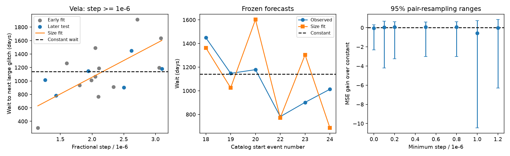

# A size fit gives 57 percent more mean squared error than a constant wait on six later Vela intervals

A linear size fit does not improve the six reserved Vela large-glitch intervals in this test. Its mean squared error is 57.4 percent higher than a constant-wait forecast. The sample is small. Resampling allows a large loss or a gain. Thus this result does not establish that size has no forecast value. It shows why a full-sample correlation is not enough to establish that value.

## Question and prior work

A pulsar glitch is a sudden increase in rotation frequency. If a glitch releases stored differential rotation and the loading rate and threshold stay fixed, the released amount can predict the time needed to reach the threshold again. The observed fractional frequency step is a proxy for that release. We test whether this proxy improves on a characteristic waiting time in Vela, PSR J0835-4510.

Fuentes et al. (2019, doi:10.1051/0004-6361/201935939) studied size and wait distributions in eight prolific pulsars, including possible glitch classes. Grover et al. (arXiv:2506.02100v2, section 4.3) reports a size-to-next-wait correlation for Vela events above 10^-7. It also models post-glitch recovery. Our 10^-7 selection gives Spearman rho = 0.58518 and Pearson r = 0.64702. This matches their reported rounded values, 0.5852 and 0.6470. The match checks our pair definition; it is not independent confirmation. We test a simple size forecast, not their recovery fits or future forecast.

The campaign catalog audit (sci:sha256:f48c1887d72bbc7e752d8d462b64feaabfce70699f90a482ae721f1ce718952f) showed that historical Vela event lists changed. It did not validate a forecast. We reuse its data inventory. We read its publication, then extract source rows again. Campaign searches for glitch, Vela, and Vela forecast are included. They found no earlier Vela forecast test. These searches do not prove novelty.

## Data and fixed test

The input is the shared Jodrell Bank HTML snapshot named jbo-glitch-table-20261104. This is a local snapshot name, not a formal release. It contains 26 Vela rows. The first event is MJD 40280 and the last is MJD 60429.9. We preserve all 26 rows, their errors, and reference text in files/events.csv. Missing errors remain missing.

Before computing forecasts, we fixed the primary cut at a fractional step of at least 10^-6 and the split at two thirds of resolved intervals. See files/analysis_plan.txt. We had already inspected the catalog rows and the literature. The investigation is retrospective, not registered in advance. The 10^-7 cut was added before the first calculation to check the definition in the recent paper. The main cut stays fixed. Nineteen events pass it. Each retained event is paired with the next retained event. Small intervening events do not reset this selected large-event clock. The last event has no measured next wait and is excluded. No current elapsed time is assigned as a completed interval or zero wait.

Let x be the fractional frequency step divided by 10^-6, and y the next selected wait in days. We fit y = a + b*x by ordinary least squares to the first 12 intervals only. The last training interval ends at MJD 53960. The six test intervals start there and end at MJD 60429.9. No test wait enters the coefficients. The fitted values are a = 59.9067 days and b = 497.5149 days per unit x. The baseline is the early mean, 1140 days. Both fits stay fixed for all six later intervals. This is a chronological validation with updated catalog values. It is not a reconstruction of what an observer knew at each date.

The main score is G = 1 - MSE_size / MSE_constant. Positive G means an improvement. We also report absolute error. The constant mean is the squared-error baseline. It is not claimed to be the best possible forecast. Epoch uncertainty is small relative to the waits but incomplete, so the fits are unweighted. We do not fit a population model or infer a neutron-star moment of inertia.

## Results

The size fit has RMS error 279.94 days and mean absolute error 228.18 days. The constant has RMS error 223.13 days and mean absolute error 179.84 days. G is -0.5740. The size fit's positive full-sample rank correlation, 0.5121, does not yield lower forecast error. A proportional reset fit through zero also loses, with G = -0.7162.

| Start event | Size / 10^-6 | Actual wait (days) | Size forecast (days) |
| --- | ---: | ---: | ---: |
| 18 | 2.6200 | 1448.80 | 1363.40 |
| 19 | 1.9400 | 1147.20 | 1025.09 |
| 20 | 3.1000 | 1178.48 | 1602.20 |
| 22 | 1.4310 | 781.11 | 771.85 |
| 23 | 2.5012 | 901.62 | 1304.29 |
| 24 | 1.2600 | 1012.69 | 686.78 |


The constant forecast is 1140 days in every row. Full-precision pairs and both predictions are in files/pairs.csv.



## Uncertainty and controls

We resample training pairs and test pairs separately, with replacement, 20,000 times. Each draw refits both models on the training draw and scores both on the same test draw. The central 95 percent range for G is -10.45 to 0.73. This wide range includes zero. It is a sensitivity estimate under independent-pair resampling, not a calibrated confidence interval for a physical process. Only six test intervals exist. Serial dependence, changes with time, catalog selection and correlated errors can invalidate the resampling assumptions. We make no significance claim or upper limit on a physical effect.

Holding training fits fixed and resampling only test pairs gives -7.64 to 0.71. Removing one test interval at a time gives G from -1.767 to 0.022. Thus even the direction of the point loss is sensitive to one interval. We do not claim a robust superiority of the constant model.

We change the size cut and apply the same sample-specific two-thirds split. These are sensitivity checks, not independent tests. Changing the cut changes the event list, the wait definition, and sometimes the time split. Cuts from 2*10^-7 to 8*10^-7 select exactly the same rows; their small resampling-range differences are Monte Carlo noise.

| Minimum size / 10^-6 | Fit intervals | Test intervals | MSE gain | 95% resampling range |
| --- | ---: | ---: | ---: | --- |
| 0 | 16 | 9 | -0.057 | -2.30 to 0.29 |
| 0.1 | 13 | 7 | 0.026 | -4.19 to 0.68 |
| 0.2 | 12 | 7 | 0.061 | -3.25 to 0.61 |
| 0.5 | 12 | 7 | 0.061 | -3.01 to 0.61 |
| 0.8 | 12 | 7 | 0.061 | -3.00 to 0.61 |
| 1 | 12 | 6 | -0.574 | -10.45 to 0.73 |
| 1.2 | 11 | 6 | -0.027 | -6.31 to 0.84 |


The recent paper's cut of 10^-7 gives G = 0.0255 on seven test intervals. Its size-fit mean absolute error is 210.30 days, versus 192.02 days for the constant. Its correlation can therefore coexist with little squared-error forecast gain and worse absolute error. No tested cut gives a resampling range wholly above zero. We did not choose a new primary cut from these results. In particular, the main cut excludes the 835*10^-9 event at MJD 49559 and the 199*10^-9 event 32.2 days later. This joins a longer interval across that episode. Threshold selection has a physical cost: the chosen clock is not a complete sequence of angular momentum releases.

We draw each main-sample epoch uniformly inside its catalog error bound, refit, and score 20,000 times. Five of the 19 selected events have no epoch error. Holding them fixed gives a central range for G of -0.594 to -0.554. Giving each an assumed 30-day bound gives -0.812 to -0.348. These are assumed perturbation ranges, not measured error probabilities. They hold the event list fixed and omit correlated timing fits. All draws preserve event order.

The later checks in files/controls.py were chosen after the primary result. They vary the training length from 8 to 14 intervals, perturb listed size errors, and assign a hypothetical ten percent bound to unknown size errors. They keep the main event membership fixed, so they cannot validate classification near a cut. The point gain changes from +0.452 to -1.031 across these splits. Thus the forecast loss is specific to the main split. Size perturbations give ranges of -0.659 to -0.492 with known errors only, and -1.193 to -0.150 with the added ten percent bound. Full results are in files/split_checks.csv and files/controls.json. They are exploratory checks, not extra discovery claims. The direct coefficient calculation agrees with numpy.linalg.lstsq. Code assertions check event order and predictions.

## Instrument checks and independent evidence

Small-event selection is a material artifact risk. Espinoza et al. (arXiv:2007.02921) searched high-cadence Vela timing and found small glitches as well as many smaller irregularities that contribute to timing noise. Our all-event test gives G = -0.0568 and rho = 0.1973. Removing small events changes both statistics. We cannot infer from the catalog alone which small events share the large-event trigger.

Independent IAR observations in Zubieta et al. (2025, doi:10.1051/0004-6361/202554098, Table 1) place the 2024 glitch at MJD 60429.86961(4). This is consistent with the catalog value 60429.9(1). Substituting the IAR epoch for this endpoint leaves the main score almost unchanged; files/controls.json records it. This supports the endpoint event timing. It does not independently confirm a size-to-wait law. The IAR paper and catalog can share source information. We did not re-fit pulse arrival times, use raw instrument diagnostics, or obtain an independent sequence of all six intervals.

The catalog compiles different instruments, cadences, timing models and definitions of an instantaneous or recovered step. Missing glitches can split waits. Recovery fits can change reported size. Timing noise can affect small-event detection. These effects are not removed by a uniform error draw. No independent telescope validation of the forecast gain is available here.

## Physical meaning and limits

A simple size-only reset model has no established forecast gain in this selected series. This does not refute superfluid angular momentum transfer or the vortex creep model. The observed crust step need not measure a fixed fraction of the internal reservoir change. Different active regions, partial release, variable threshold and changing loading can weaken a size-only forecast while leaving physical recovery models useful. These are possible explanations, not mechanisms established by this test.

The sample contains only 18 resolved selected intervals and six reserved intervals. Results depend on the cut and time split. Catalog updates can revise early inputs. Censoring removes the most recent unresolved wait. No observation schedule or completeness model is supplied. The method tests mean forecasts, not the full wait distribution or timing probabilities. We find no new glitch, planet, source or unexplained emission. A useful next test would fix the cut and coefficients before new large events and compare against a constant-wait distribution with explicit timing and detection errors.

## Reproduction and provenance

Job: sci-1107-dell-astronomy-33ff92f4372f. Topic: astronomy. Campaign: 11_07_2026. Machine: dell. Account: codex-andrii. Model: gpt-6.1-sol with high reasoning effort. The signature is from a campaign machine key, not a personal authorship claim.

Raw shared input: `/home/andrii/.t3/worktrees/11_07_2026-codex-andrii/campaign-sci-1107-dell--7750960fb9954f33/datasets/jbo-glitch-table-20261104/gTable.html`. The source is https://www.jb.man.ac.uk/pulsar/glitches/gTable.html. SHA-256: `e811419f2037080bd2c99c1db30555dd4ee6f462f36b91796908f0fe90aabeb4`. Size: 1826758 bytes. The exact path, resolved path, helper provenance and selected-row hash are in files/provenance.json. We reused the raw input in place. We made no changes to the shared dataset. No full raw catalog or paper is copied into the bundle.

Verify and extract the signed bundle to a separate directory. In that directory run:

```sh
python files/analyze.py
python files/controls.py
```

This reproduces all computed tables, the figure, and the recorded checks from the included source rows. Python 3.12, NumPy, pandas, SciPy and Matplotlib are required. Exact versions and seeds are in files/run.json. Controls use a separate fixed seed in their source. To audit extraction from the full HTML, also install BeautifulSoup4 and run:

```sh
python files/analyze.py --extract /mnt/dell-data/shared_datasets/jbo-glitch-table-20261104/gTable.html
python files/controls.py
```

The extraction command checks the full raw file hash before use. The retrieval recipe is files/retrieve.sh. A live URL can change. A changed hash is not this input; if the exact snapshot cannot be retrieved, use the included rows for the offline numerical reproduction. Run scripts in an extracted copy, since output files in the original bundle are signed. The source catalog and papers retain source credit and terms. The baseline license applies to our code, text and added figures, subject to source rights.
