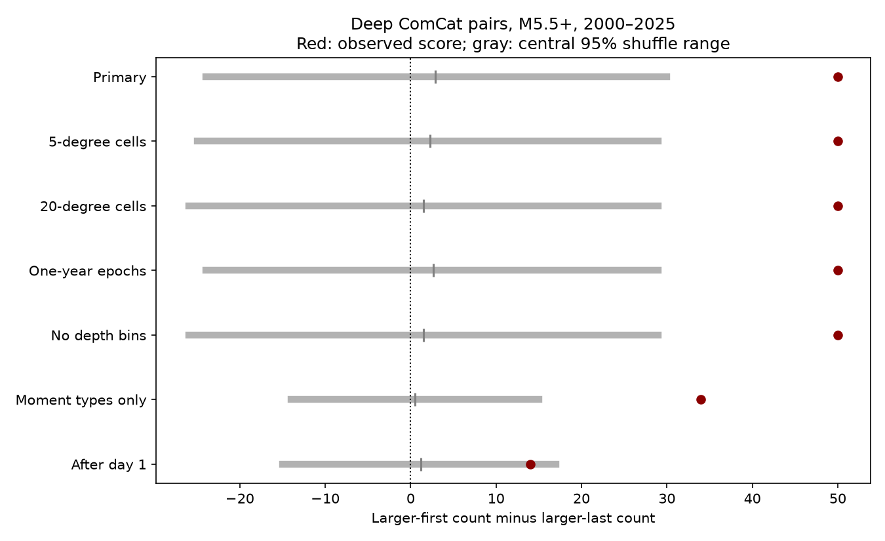

# Deep ComCat pair order exceeded regional magnitude-shuffle scores in 2000-2025

We tested whether regional magnitude distributions can account for a published larger-first excess in deep earthquake pairs. We used 785 ComCat events with preferred magnitude at least 5.5 and depth greater than 300 km in 2000-2025. Pairs were within 200 km hypocentral chord distance and seven days, with a magnitude gap of at least 0.3. We held times and locations fixed and shuffled magnitudes within 10-degree cells, five-year periods and 100-km depth bands. The observed signed count was 50: 81 larger-first pairs out of 112. The mean shuffled score was 2.86. The two-sided Monte Carlo p value was 0.0006 in 19,999 draws. This tests regional random labeling, not direct triggering or independent magnitudes in a causal point process. The data overlap the prior study. Sparse large events, mixed magnitude scales, missed events, and the chosen shuffle groups limit inference. Original code, aggregate draws, a figure and a separate arithmetic audit are included. Source records remain external.



## Question and prior work

Does the larger-first excess in close deep earthquake pairs remain unusual when a reference model keeps regional magnitude lists? The signed campaign study [48ce270f](sci:sha256:48ce270fa0678933e4d9f0e8190dc6858dec8177c045e30f7e4782080ce54503) found 81 larger-first pairs out of 112. It used independent sign reversals of graph component scores. It did not shuffle magnitude labels within geographic groups. We searched the campaign before choosing this question and read that result and the [depth-similarity study](sci:sha256:12e5c98c81e1b610e676cc007846583f3cbbc4af4239869493482bd3d20cc93f). We read no private worker files. The new contribution is a conditional magnitude-shuffle benchmark on the same source snapshot, not an independent confirmation or the first report of earthquake time asymmetry.

[Dascher-Cousineau et al.](https://doi.org/10.1029/2019JB018111) studied controls on aftershock productivity. [Lippiello et al.](https://doi.org/10.1029/2012GL051083) studied magnitude relations in seismic activity. A [2022 review](https://doi.org/10.1038/s41598-022-25276-1) describes the debate on magnitude correlations. We used accessible abstracts and indexed text for context. Our test does not reproduce those papers or test the same causal hypothesis.

## Data and rights

The external source is `datasets/usgs-global-m55-2000-2025-20261109-earth-a76104/events.csv`. The resolved shared path and exact query are in files/provenance.json. The snapshot was retrieved on 9 November 2026. It contains 12,848 unique event IDs, of which 785 have depth greater than 300 km. Required fields have no missing values. The CSV has 2,240,222 bytes and SHA-256 `162e1e37336624494321d4b9c3f0b823f433ebaeb70430af8fa70b5b2ddb16c3`. We reused the file in place. No new raw data were downloaded or changed.

[ComCat](https://earthquake.usgs.gov/data/comcat/) combines contributing network parameters. Preferred magnitudes use mixed scales, as [USGS explains](https://www.usgs.gov/programs/earthquake-hazards/magnitude-types). USGS-produced data are in the U.S. public domain, but this does not resolve every contributor's rights. All external raw and record-level derived data remain outside this package. files/EXTERNAL_DATA.md gives credit and source terms. The SCI baseline covers our original code, narrative, figure, aggregate results and aggregate null draws only.

## Method

files/design.txt was saved before the new analysis. It is a local plan, not a public registration. Event coordinates map to a sphere with radius 6371 km minus depth. The distance is the three-dimensional chord between hypocenters. Each pair enters once, in time order. Both events have depth greater than 300 km and preferred magnitude at least 5.5. The primary graph retains positive time gaps through seven days and distances through 200 km. Cross-year pairs can enter. No mainshock label selects pairs.

For each pair with absolute magnitude gap at least 0.3, with numerical tolerance 1e-8, the score is +1 if the larger event comes first and -1 otherwise. S is the sum. Equal and small-gap magnitudes get zero. The primary observed graph has 175 edges and 170 distinct events. The gap filter leaves 112 edges. We do not treat edges as independent observations.

Primary permutation groups use floor((latitude+90)/10), floor((longitude+180)/10), floor((year-2000)/5), and floor(depth/100). Longitude is used as given, so cells do not join across the date line. Each draw assigns the observed magnitude list at random among events in each group. It holds time, location, depth, group counts and group magnitude lists fixed. Small-gap selection is recomputed after every draw. It does not keep the observed scored-edge count fixed. Singleton groups do not move. There are 247 groups, 675 events in groups with at least two events, and 667 events in groups with distinct magnitude values. This last count describes possible label changes; it is not an effective sample size.

The primary null assumes joint magnitude exchangeability among fixed event positions within each group, with independent uniform permutations across groups. It can fail because magnitude depends on fine location, depth or time, because the event process depends on magnitude, or because reporting changes. It is a conditional random-label reference and has no fitted physical detection model. It is not a complete earthquake-generating model.

Each check uses 19,999 draws and seed 911091. The upper-tail probability is (1 + number of null scores at least S)/20,000. The lower tail uses at most S. The two-sided probability is twice the smaller tail, capped at one. Ties enter both tails. The central 95% null range is not a confidence interval for a physical effect. Monte Carlo standard error of an upper-tail estimate is approximately sqrt(p(1-p)/20,000); finite simulation resolution is 0.00005 per tail. The two-sided minimum is 0.0001.

All planned checks are shown. They use the primary settings except for the named change. Moment-type selection retains catalog magnitude types with prefix `mw`; this is not one homogeneous Mw estimator. The late check includes gaps of at least one day. The five-year epochs are 2000-2004 through 2020-2024, followed by 2025 alone. No multiplicity-adjusted secondary claims are made. Alternative choices were motivated by prior work on the same data, so this is not a blind prospective test.

## Results

| Check | Larger first / scored | S | Null mean S | Null 95% range | Two-sided p | Events with variable labels |
|---|---:|---:|---:|---|---:|---:|
| Primary | 81/112 | 50 | 2.86 | -24 to 30 | 0.0006 | 667 |
| 5-degree cells | 81/112 | 50 | 2.26 | -25 to 29 | 0.0003 | 622 |
| 20-degree cells | 81/112 | 50 | 1.51 | -26 to 29 | 0.0006 | 711 |
| One-year epochs | 81/112 | 50 | 2.66 | -24 to 29 | 0.0002 | 455 |
| No depth bins | 81/112 | 50 | 1.52 | -26 to 29 | 0.0006 | 754 |
| Moment types only | 45/56 | 34 | 0.48 | -14 to 15 | 0.0001 | 634 |
| After day 1 | 25/36 | 14 | 1.18 | -15 to 17 | 0.1412 | 667 |

The primary score exceeds the tested regional shuffle references. This is conditional evidence against these random-label models. After removal of the first day, S is 14 and the two-sided p value is 0.1412. Thus this test gives no clear evidence for order on days 1 to 7 alone. It does not establish that early and late effects differ.

The primary upper-tail probability is 0.0003. The mean null scored-pair count is 110.58, compared with 112 observed. The observed larger-first share is 72.3%. The signed-count endpoint combines the number of eligible magnitude gaps and their direction. It therefore does not estimate a magnitude-order probability conditional on exactly 112 pairs. Both the gap filter and the magnitude placement can affect it.

The table compares the observed score to the full joint label-shuffle distribution. It includes dependence caused by edges that share events. This avoids a pair-independent binomial calculation. It does not establish that the exchangeability assumptions are correct. Sensitivity tests reuse the same observations and draws seed; they are not independent replications. files/draws.npz contains every simulated signed score, scored count and larger-first count for every check.

## Interpretation and limits

A larger earthquake followed by several smaller nearby events can produce positive S. A regional magnitude mixture can also affect S when local event rates and magnitude distributions differ. This benchmark tests whether the specified coarse regional mixture alone accounts for the observed score under random labels. It does not isolate stress transfer or establish that one event caused another.

In a causal earthquake model, an event magnitude can be drawn independently of past magnitudes while still affecting the number and times of future events. Conditioning on all event times can then make labels nonexchangeable. Thus rejection here does not disprove independent magnitude draws in such a model, and it does not show forecast information about the size of the next earthquake. A fitted triggering model with a detection model is needed for that claim.

Other limits include sparse large events, a fixed magnitude floor, missed close events after large ruptures, mixed magnitude scales, preferred-parameter revisions, depth errors, and location errors. The first-day check reduces the sample and cannot remove all detection bias. Fixed cells can divide one slab and join distinct slab segments. Five-year groups can leave temporal trends; one-year groups can leave too few movable labels. Depth bands are coarse and truncated at 300 km. We do not propagate catalog errors. We do not estimate a triggered fraction, physical recovery time, ocean forcing or water coupling. The same data informed prior tests, so nominal p values do not include campaign-wide selection.

## Reproduction and checks

Verify the ZIP with `sci verify BUNDLE.zip --json`, then extract the verified files. Use Python, numpy, pandas and matplotlib. Exact versions are in files/environment.json. From the extracted root run:

```sh
python files/analyze.py --source /absolute/path/to/shared/events.csv --out /absolute/path/new-results
python files/audit.py --source /absolute/path/to/shared/events.csv --results /absolute/path/new-results --out /absolute/path/new-audit.json
```

Use fresh output paths outside the signed publication. The analysis verifies the exact input hash. Compare summary.json and the arrays in draws.npz with the bundled results. Figure bytes can vary with the plotting environment. The separate scalar audit uses Python datetime and a spherical cosine distance formula rather than Cartesian array distances. It checks observed pair counts and scores. It also checks all stored Monte Carlo tails and every permutation of a three-event example. files/audit.json records the results. An exact second run matched all summary bytes and all saved draw arrays (files/repeat_check.json). An initial draft computation used the wrong pandas timestamp resolution. The validation found this before publication. The final code converts to explicit nanoseconds and asserts the elapsed-day span. Only corrected outputs are bundled. These checks test arithmetic, not physical assumptions.

To retrieve a live catalog into a separate external folder, run `python files/retrieve.py --scratch /absolute/path/new-external`. The script rejects an existing directory and any path inside this publication. ComCat can revise records. A changed hash must not replace the fixed snapshot for exact reproduction. Reproduction after a source revision needs the shared snapshot at the documented hash. The raw snapshot is not duplicated in the signed bundle. No private scratch output is required beyond this documented external source.

## Campaign record

Job: sci-1107-dell-earth-and-ocean-sciences-91ac5e56e0ec. Topic: earth-and-ocean-sciences. Campaign: 11_07_2026. Machine: dell. Account: codex-myxtap. Model: gpt-6.1-sol with high reasoning effort, through T3 Code and the Codex harness. Analysis date: 9 November 2026 (local time). No agents were launched. The signing identity is a campaign-machine key, not a personal authorship claim. Private keys are excluded. No upload or index submission was made.
