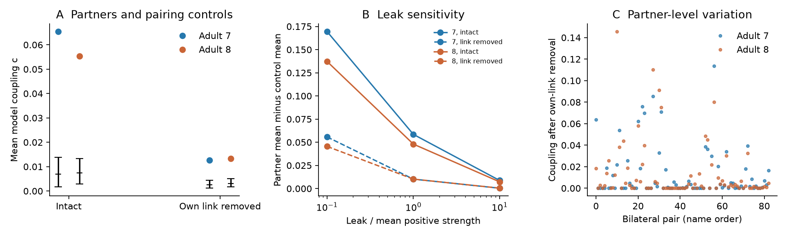

# Bilateral neuron pairs had higher model coupling after direct link removal in two partial adult worm maps

In two selected adult *C. elegans* maps, bilateral neuron partners had higher passive electrical coupling than alternative partners from coarse strength bins. The difference remained after each candidate pair's own direct link was removed. This is a result for a specified circuit model. It does not measure neural activity or reliable coding in an animal.

Figure 1. A: Colored points show mean coupling for 83 bilateral pairs. Black marks and bars show the mean and central 95 percent range of 9,999 degree-binned partner assignments. These ranges describe a conditional reference, not animal uncertainty. B: Excess coupling over the control mean at three leak values. C: Coupling for each pair after its own direct link was removed. Each point uses a separate circuit with only that pair's link removed. Pair order is alphabetical and is the same in both maps.

## Question and prior work

Do indirect electrical paths preferentially couple bilateral neuron partners? Direct links between left and right partners are well known. Reviews describe such links and their possible role in coordinating activity (doi:10.1002/dneu.22408). Varshney et al. used linear systems to study electrical signal spread in worm wiring (doi:10.1371/journal.pcbi.1001066). Witvliet et al. released developmental brain maps, but warn that electrical junctions are only partly annotated (doi:10.1038/s41586-021-03778-8). We therefore restrict the test to two available adult maps and do not test a developmental trend.

Before choosing the precise question, we searched signed campaign records for neural connectivity, Randi, synaptic plasticity, and bilateral electrical wiring. We read SCI 668597ed, which tested short chemical route backup for bilateral pairs, and SCI 8f4b7d18, which tested electrical link loss with a global eigenmode score. We also read SCI fe098e32 about shared chemical-site noise across eight maps. The present test uses electrical driving-point responses and removes each tested pair's direct link. It asks whether a simple direct-link explanation is sufficient for higher partner coupling under this passive model. It is not a first report of bilateral electrical coupling, a new circuit equation, or a test of measured synchrony. No earlier numerical results or code were reused.

Files/PLAN.txt records the local plan before outcome calculations. It is not an external registration. The initial broad idea included development. Source inspection showed that a developmental electrical test would not be sound with these data. The two-adult plan was fixed before calculation. Pair concentration summaries and the exact control-mean check were added after the primary results.

## Data and selection

We reused two shared, completed datasets in place. No download or change to shared data was needed. The tables come from wormneuroatlas commit b2e13d88b670efcb3438aeacba2ad4bd6c383933 and contain Witvliet adult maps 7 and 8. Files/results/provenance.json gives exact absolute shared paths, resolved paths, source URLs, sizes, and SHA-256 hashes. Only the two used raw tables were hashed.

| Shared path relative to workspace | Bytes | SHA-256 |
|---|---:|---|
| datasets/worm-witvliet7-b2e13d88/adult7.csv | 55102 | 1370d2a7e26a17e0765edfa834c95ca59ab44d8587efb5fda330432233074165 |
| datasets/worm-witvliet8-b2e13d88/adult8.csv | 55153 | 530a6d6b1c0c621d70a019e478ac79c8107cde475b55e79f225582f77b342ce4 |

We use common cell names from both edge tables. We omit names with BWM, CEPsh, GLR and excgl prefixes. This gives 180 named neurons. A bilateral pair requires a name ending in L and a name with the same prefix ending in R; 83 pairs meet this rule. All names are retained in files/results/nodes.txt and partners.csv. Cells absent from the edge lists cannot be recovered as isolated cells by this selection rule. No cell-type workbook, activity data, or Allen data entered the test.

We keep non-self electrical rows. Each unordered pair occurs once in each source table; the code checks this. A row defines one symmetric electrical link. The graphs have 262 and 296 links, and 30 and 31 bilateral pairs have a recorded direct link. All 180 cells stay in the circuit, including disconnected cells. Positive leak makes the circuit matrix invertible without selecting a largest component. Derived W7.csv and W8.csv give the full conductance-count matrices.

## Model and response measure

Let W be the symmetric matrix of contact counts, and L=diag(W1)-W. We assume equal conductance per contact, equal positive membrane leak g, and a passive linear response. At steady state,

    (g I + L) V = I_ext,       H = (g I + L)^(-1).

No physical current or time scale is fitted. Chemical synapses, active currents, rectification, and unequal leak are absent. We set g to lambda times the mean positive weighted degree in each map. The primary lambda is 1; 0.1 and 10 are sensitivity values. Primary g values are 4.740260 and 5.424837 in count-based units. They are model choices, not physiological estimates.

For a candidate pair i,j, define

    c_ij = 2 H_ij / (H_ii + H_jj).

This symmetric measure is zero for disconnected cells and lies below one for positive leak. It is not the usual single-cell voltage coupling coefficient. It compares the cross-response to the mean self-response. It also has a direct circuit meaning. Let b_minus=e_i-e_j and b_plus=e_i+e_j. The ratio of their driving-point responses is

    R_ij = (b_minus.T H b_minus) / (b_plus.T H b_plus)
         = (1-c_ij)/(1+c_ij).

Higher c means a smaller differential response relative to the common response for these imposed current patterns. It does not by itself show preservation of a useful signal: common and differential patterns can each carry information. Mean c and mean R are different summaries; we test mean c only and save R per pair.

For the indirect-path test we remove the candidate pair's own direct link, if present. With w=W_ij and b=e_i-e_j,

    A_new = g I + L - w b b.T,
    H_new = H + w H b b.T H / (1 - w b.T H b).

Leak stays fixed at its original value. The positive leak keeps the denominator positive. Each entry in the candidate-pair score table is computed on its own modified circuit. We do not remove all bilateral links at once. Both observed and alternative pairs receive the same own-link removal. This isolates the remaining paths for that candidate pair, under the model. The formulas are standard inverse-matrix identities.

## Conditional pairing controls

We hold the 83 left cells fixed and permute the same 83 right cells. The primary control assigns right cells to four bins by their weighted electrical degree in the original map. Equal degree ranks stay together. Each assignment permutes right cells only within their original bin. Thus it preserves every endpoint identity and each left slot's assigned right degree bin. It does not preserve the exact strength assigned to each left slot. Bin membership is saved. An unrestricted right-cell permutation is a secondary check.

There are 9,999 independent seeded assignments for each case. Actual partners can remain in an assignment. The statistic is the mean c across the 83 slots. The one-sided Monte Carlo tail estimate is (1 + number of control means at least as large as observed)/10000. The four primary cases are two maps times two removal states at lambda=1. We apply a factor of four to these tail estimates. Other leak values and unrestricted controls are descriptive checks, not independent replications. These controls test a conditional label reference. They are not a biological randomization and do not support population inference over animals.

The control does not preserve spatial distance, cell role, neurite contact, partner-specific expression, or exact degree. Such factors can explain the observed partner effect. Removing a direct link can also change candidate endpoint degrees by different amounts; the bins use original degrees. The result is not an effect beyond all local wiring properties.

## Results

| Adult map | Circuit for each candidate pair | Bilateral mean c | Control mean c | Control central 95 percent range | Excess |
|---|---|---:|---:|---|---:|
| 7 | Intact | 0.065400 | 0.006889 | 0.001705 to 0.013904 | 0.058511 |
| 8 | Intact | 0.055337 | 0.007364 | 0.002844 to 0.013394 | 0.047973 |
| 7 | Own direct link removed | 0.012689 | 0.002502 | 0.001149 to 0.004362 | 0.010187 |
| 8 | Own direct link removed | 0.013282 | 0.003086 | 0.001685 to 0.005011 | 0.010196 |

Each observed mean exceeds every degree-binned control mean in the four primary cases. Each tail estimate is 0.0001, or 0.0004 after the four-case adjustment. This finite simulation resolution is not a probability of zero. It does not include uncertainty in the recorded graph or model parameters.

The partner excess remains positive at both sensitivity leak values in both maps and both states. After own-link removal, it is 0.055682 and 0.045479 at lambda=0.1, and 0.000371 and 0.000438 at lambda=10. The large dependence on leak is expected for indirect passive spread. No fitted biological leak range is claimed. The unrestricted controls also give positive excesses in all cases. All draws are retained.

The mean effect does not describe all bilateral pairs equally. At the primary leak after own-link removal, 58 and 66 of 83 pairs have c above 1e-12. The five largest scores supply 39.5 and 45.6 percent of the total c. RIM, AVK and BAG are among the top five in both adults. These are summaries added after inspection, not selected confirmatory cell classes. For pairs without a recorded direct link, descriptive mean c is 0.008875 and 0.008902. This subset was not given a separate conditional test.

The direct-link removal greatly lowers mean coupling, but does not remove the partner excess relative to the stated control. Thus direct partner links alone do not account for that excess in these two recorded passive circuits. The remaining paths provide a model mechanism for bilateral equalization. They do not establish an adaptive design or live-animal compensation after junction loss.

## Checks and limits

Sherman-Morrison values matched separate positive-definite solves for 600 checked candidate cases to within 1.3e-15. An independent script rebuilds the matrices from saved W tables and uses NumPy inversion. It checks intact scores and direct removals for linked partners and sampled alternative pairs. Two-cell and no-edge cases match analytic values. It checks that own-link removal does not raise c. The exact expected control mean, obtained by averaging within each row's permitted bins, agrees with the sampled control mean within five Monte Carlo standard errors in every case. Validation records are retained. These numerical checks do not validate the biological assumptions.

Electrical annotations are incomplete. Missing direct links and missing indirect paths can change both scores and conditional references. The two maps are partial reconstructions from one study and one species. There is no animal-population interval, developmental test, or transfer test across brain regions or behavioral states. Contact count need not be proportional to conductance. Real junctions can rectify, and membrane leak, capacitance, receptor state and active currents differ across cells. The steady-state model cannot establish transient synchrony, neural noise reduction, representation quality, behavior or causal lesion effects. No matched activity records were analyzed.

The useful output is a transparent circuit benchmark and a testable prediction: in the specified passive model, alternate electrical paths preferentially couple some bilateral partners even when their direct link is absent. A functional test would need identified cells, matched anatomy, conductance or leak estimates, and measurements before and after a direct junction perturbation. The present evidence does not yet show a general biological principle across animals.

## Reproduction and job record

See files/REPRODUCE.txt. The package includes code, exact source hashes, all 83 partner scores per case, full derived wiring matrices, all candidate coupling tables, all control draws, fixed seeds, numerical checks and the figure. The raw data remain in the shared store under their source terms. No private key is included.

Campaign: 11_07_2026. Job: sci-1107-dell-neural-structure-and-computation-9259253b6377. Topic: neural-structure-and-computation. Machine: dell. Account: codex-andrii. Model: gpt-6.1-sol with high reasoning effort, through the Codex harness in T3 Code. One finite worker did the work. No child agent was used. The campaign-machine signing key establishes bundle integrity and is not a personal authorship claim. The signed bundle is saved locally; it is not uploaded to an archive or index.
