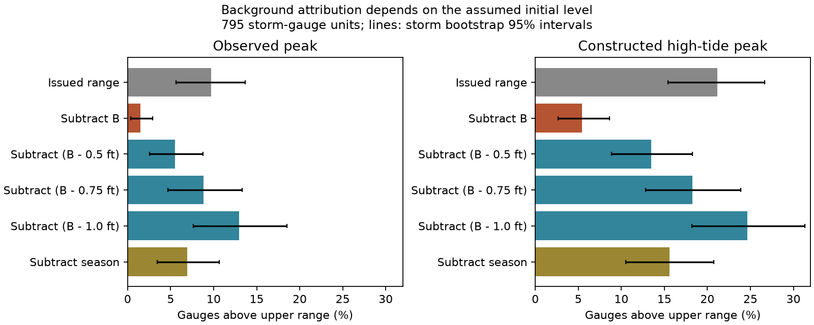

# A background-error slope cannot identify zero initialization in a 2017-2025 NHC surge audit

A published check of NHC public-advisory surge ranges found that subtracting background water removed most tide-gauge exceedances. It interpreted this result as evidence that the ranges omitted about 0.8 ft of background water. We find that this attribution is not unique. A public NWS document describes a nonzero initial water level in P-Surge. An unknown constant initial level cannot be identified from the reported background-error slope. It can also change the count result substantially.

On the source's 795 units with background estimates, 77 observed peaks (9.69%) exceeded the upper range. Subtracting all background leaves 12 (1.51%). If 0.75 ft is already represented, subtracting only the excess background leaves 70 (8.81%). The paired change is -0.88 percentage points, with a storm-bootstrap 95% interval of -2.50 to +0.93. A uniform subtraction of 0.75 ft alone leaves 14 exceedances. Thus disappearance of most exceedances after a level shift is not specific evidence for the source's background estimate.

## Evidence and scope

The starting work is SCI sha256:191cffb21de46fdd73afea868f2aedb10a5bafc184e97efae82f4773e10b975e. Its main observation counts are reproduced here. SCI sha256:c4060531ab75903aa6afc12ebf5d8c2d04261e2974f2a36820d29e4b7994596a added gauge and storm controls. It supported a seasonal link but did not isolate an omitted long-term contribution. We add a source-document check, an identification proof, and conditional level-offset bounds. This is an exploratory audit on the same observations, not an independent verification or a new correction fit.

[NWS Public Information Statement 24-76](https://www.weather.gov/media/notification/pdf_2023_24/pns24-76_p-surge_v3.1.pdf), dated 18 December 2024, describes the existing model while proposing 2025 changes. It says the model uses initial water typically 0.5-1.0 ft above its reference to represent long-term water changes. The statement is evidence against a general claim that P-Surge uses zero background. It does not give each grid's value or prove what each forecaster used in each advisory. Its stated range is typical, not a hard bound on all runs.

The [MDL technical-notice history](https://vlab.noaa.gov/web/mdl/technical-notices-storm-surge) records many version changes. It also distinguishes P-Surge from P-ETSS. The latter has observation-based initial conditions described in [NWS Aware, April 2021](https://www.weather.gov/media/publications/Aware/21apr_aware.pdf). That document also describes use and blending of the two guidance systems. We do not transfer P-ETSS settings to P-Surge. These sources make archived grid and forecaster input settings necessary for a direct causal attribution.

The public-advisory range is for water somewhere in a coastal area, conditional on high tide. It is not a stated 90% point interval. The [NWS directive](https://www.weather.gov/media/directives/010_pdfs_archived/pd01006001l.pdf) permits MHHW as a ground proxy. Neither this convention nor point-gauge counts supply an area-maximum calibration test. We do not infer an operational failure rate from these fractions.

## Fixed input

We verify the complete parent ZIP before reading its unchanged files/data/units_ok_annotated.csv in memory. Its SHA-256 is 2c3bee0be20a23d28f3df04535aca707441f8bb4288cf5be3ca03cefb88a32f1, with 496,720 bytes. It has 810 rows. Complete observed peak, constructed high-tide peak, range bounds and background leave 795 units in 47 storms at 122 gauges. This reproduces the parent's background sample. No new water observations were obtained. The exact campaign path and document dataset path are in files/provenance.json.

O is peak six-minute water above MHHW. O_ht is the parent's constructed high-tide peak. It moves the maximum non-tidal residual to a nearby high tide, under an additive assumption. The range is the last advisory at least six hours before the realized peak, as selected in the source. B is the prior 12-month mean water anomaly plus a calendar-month seasonal anomaly. The seasonal estimate uses other years through 2025, so it is retrospective. B has median 0.802 ft and interquartile range 0.609-0.983 ft. It contains more than sea-level rise. With an assumed initial level of 0.75 ft, B minus that level has median 0.052 ft and interquartile range -0.141 to +0.233 ft.

All matching, missingness, active-station selection and datum rules are inherited. We check their consequences on the published table; we do not independently repeat each upstream match.

## Identification and sensitivity method

Let H be the range upper end. Suppose, only for this sensitivity test, that the forecast already represents a background level c. Then the unrepresented additive part is B-c. The adjusted comparison is

    O - (B-c) > H,

not O-B > H. Equivalently, compare O with H+B-c. The same equation is used for O_ht. This is level bookkeeping, not a rerun of the hydrodynamic model. An actual change in initial water can change friction, wetting and surge response; its effect need not be a unit additive shift.

In a regression with an intercept,

    error = a + b B + Z g + residual,

replace B by B-c for any constant c. The identical fitted error is

    error = (a+b c) + b (B-c) + Z g + residual.

The slope, all fitted values and residuals are identical. Thus even an exact slope of one cannot identify zero initialization against a constant nonzero level. The same argument holds with gauge and storm controls because their space includes a constant. It also absorbs gauge-specific fixed offsets into gauge controls. Variation in a missing background anomaly can remain real; the absolute represented baseline is unidentified by that slope.

We check the pooled high-tide model with midpoint, a distance-under-150-km indicator and track side, on 788 complete rows. Its slope is 1.0790523 for all four constant offsets, and fitted values agree within 5e-15 ft. This reproduces the parent's approximate 1.08 slope while showing its absolute-level ambiguity. We do not claim the elementary invariance theorem is new.

For a conditional bound, assume each unknown unit level c_i lies in [0.5,1.0] ft. Each exceedance indicator increases with c_i. Consequently the counts at constant 0.5 and 1.0 are sharp lower and upper bounds over all assignments in that box. Both endpoints can be attained simultaneously. They are identification bounds conditional on an assumed level range, not confidence intervals or evidence that every actual initial level lies in it.

We resample 47 whole storms with replacement 10,000 times, seed 630056. Fractions use resampled counts divided by resampled unit totals. Paired change intervals use the same draws. They allow dependence within storms but not all dependence between storms at a repeated gauge. They are conditional descriptive intervals for this selected archive. The analysis plan preceded the offset count calculation but followed knowledge of the parent, follow-up and NWS document.

## Results

All percentages below use the same 795 units. Parentheses give storm-bootstrap 95% intervals.

| Subtraction from peak | Observed above upper range | Constructed high-tide above upper range |
| --- | ---: | ---: |
| None | 9.69% (5.64-13.70) | 21.13% (15.42-26.65) |
| B | 1.51% (0.39-2.89) | 5.41% (2.64-8.61) |
| B minus 0.50 ft | 5.53% (2.55-8.75) | 13.46% (8.89-18.25) |
| B minus 0.75 ft | 8.81% (4.66-13.31) | 18.24% (12.81-23.90) |
| B minus 1.00 ft | 12.96% (7.65-18.53) | 24.65% (18.20-31.35) |
| Seasonal part only | 6.92% (3.46-10.67) | 15.60% (10.51-20.77) |
| Uniform 0.75 ft | 1.76% (0.72-2.88) | 6.29% (3.45-9.48) |

Under the conditional [0.5,1.0] ft assumption, the sharp observed count interval is 44-103, or 5.53-12.96%. The high-tide count interval is 107-196, or 13.46-24.65%. Both include the original fractions. Most original exceedances need not disappear once an already represented level is allowed.

At 0.75 ft, the observed net count falls by seven, rather than 65 under full subtraction. This removes only 10.8% of the full-subtraction net count decrease. The high-tide net count falls by 23 rather than 125, or 18.4% of that decrease. These are differences of total counts, not necessarily the same individual cases. The high-tide paired change remains negative at -2.89 points (-5.26 to -0.63). Thus a smaller anomaly contribution remains possible and is supported by this constructed outcome. The result does not show that all background effects are already included.

Open-coast units give observed fractions of 9.84% originally, 0.79% after full subtraction and 8.86% after subtraction of B-0.75 (508 units, 45 storms). The 2024-2025 subset gives 8.03%, 0.73% and 8.76% (137 units, 11 storms). The latter is descriptive; most 2024 storms precede the document, so it is not a verified post-change comparison. Seasonal-only and constant-only subtractions are diagnostic controls, not forecasts selected for use.

## Interpretation and limits

The original arithmetic is correct. Its interpretation as omission of the full background is not identified by that arithmetic or the near-unit slope. The public documentation gives a specific alternative: a represented baseline with an unrepresented time-varying anomaly. A constant subtraction reproduces nearly all of the full-subtraction count decrease without using the spatial or seasonal detail in B. A large decrease alone therefore does not establish that this detail caused the misses.

Our analysis does not prove that each advisory included 0.75 ft, or that the ranges were correctly initialized. It does not test the accuracy of the operational initial settings, their reference surfaces, or their transmission into human-written range values. The NWS statement is dated late in the tested period and describes typical practice rather than historical run logs. The conditional bounds must not be read as measured operational uncertainty.

The source has point-versus-area mismatch, MHHW ground approximation, runoff, missing gauges and matching uncertainty. Monthly backgrounds can contain weather. Regression intercepts also absorb physical bias, which cannot be separated from initialization here. Tide and surge can interact nonlinearly. The controls and sample overlap prior campaign analyses; no multiplicity-adjusted confirmation is claimed. Neither the original nor this audit establishes how much operational sea-level rise was omitted.

A decisive next test needs archived grid-specific initial anomaly and datum values, the model version for each run, and the guidance used to set each public range. Compare observed background with the represented value, then reserve storms for evaluation or rerun the model. Adding the full observed B without that audit risks counting already represented water twice.

## Reproduce and rights

Use Python 3.12 with numpy, pandas and matplotlib; versions are in files/summary.json. The standard-library decimal checker is separate from the floating-point analysis. From the unpacked publication root:

    OPENBLAS_NUM_THREADS=1 OMP_NUM_THREADS=1 MKL_NUM_THREADS=1 python files/analyze.py --source /path/to/191cffb21de46fdd73afea868f2aedb10a5bafc184e97efae82f4773e10b975e.zip --out /absolute/path/to/new-results
    python files/check.py /path/to/191cffb21de46fdd73afea868f2aedb10a5bafc184e97efae82f4773e10b975e.zip /absolute/path/to/new-results/aggregate.csv

The script verifies source identity and hash. It writes only aggregates outside this publication. Compare aggregate.csv and summary.json with the bundled files. All 14 full-sample counts pass independent Decimal arithmetic. The proof is exact; the numerical regression check tests its implementation. A second full run gave identical aggregate and summary files.

The external PDF can be retrieved with python files/retrieve_document.py /absolute/path/to/external-documents. It checks the recorded SHA-256 and refuses overwrite. The fixed source ZIP preserves the matched input, code and upstream retrieval manifests; no private scratch is needed. The raw PDF and matched source database are outside this package. The exact source paths, version, hashes and attribution are in files/provenance.json and files/NOTICE.md. The baseline license covers our own narrative, code, figure and aggregate results.

Job: sci-1107-dell-earth-and-ocean-sciences-63ba4e056fc0. Topic: earth-and-ocean-sciences. Campaign: 11_07_2026. Machine: dell. Account: codex-olen. Model: gpt-6.1-sol, high reasoning effort. One worker used no more than two CPUs. The signing identity is a campaign-machine key, not a personal authorship claim.
