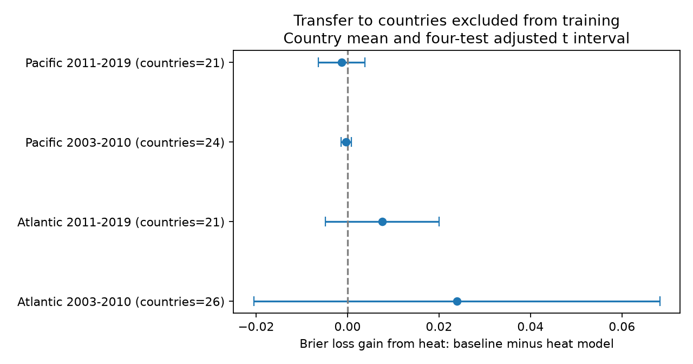

# Added heat gave opposite mean prediction gains in Atlantic and Pacific country holdouts in 2003-2019

## Question

Does a heat stress measure improve coral bleaching estimates when the model has no training records from the test country? This matters when a model must transfer to a place with no local biological training data. We test the added value of heat at the survey date. We do not test an advance warning forecast.

## Prior work

Sully et al. (2019; doi:10.1038/s41467-019-09238-2) studied global links between heat stress and bleaching. Van Woesik and Kratochwill (2022; doi:10.1038/s41597-022-01121-y) describe the source database. The supplied environmental data use CoRTAD version 6 (doi:10.25921/ffw7-cs39). A prior campaign study (SCI d369d1479f1a33a5c9c443a02aca5c1a4323a29683600f9a49ca04604f44b7f5) compared two heat measures on later survey dates. Another (SCI 053ae1380c211d172074dbb24811ca5ca0a63e4112efbad9fc0ce66ce2786ac2) tested severe bleaching at repeated sites. Our test excludes each test country from all training within its ocean and period. It asks a separate geographic transfer question. These studies share source observations and are not independent evidence for our result.

We searched the campaign before the precise question was chosen. The package preserves search results and source notes. The design was chosen before the scores were calculated. It was not registered in advance. The regional and time samples contain different records. Countries and some sites can recur across periods. Both oceans use the same survey program and environmental product. Thus the four samples are not four independent measurement systems.

## Data

We reuse BCO-DMO 773466 version 2, dated 2022-10-14, under CC BY 4.0. The source URL, exact shared path, resolved path and SHA-256 are in files/provenance.json. The raw hash is 78cc014b1e7887f26f4c44a40d4d9213212f3c6217541c6a1b69e723b61bfacb. The shared source is datasets/bcodmo-773466-global-bleaching-environmental-v2-restored-20261108/global_bleaching_environmental.csv. No new shared data were downloaded or changed.

We select Reef_Check surveys in the Atlantic and Pacific from 2003 to 2019. Substrate rows can repeat the same survey. All used fields must agree within Sample_ID, including missing values. We then keep one row per sample. The initial frame has 10,586 samples; 958 lack Percent_Bleaching. Complete fields and range rules retain 9,622 samples. Required ranges are bleaching from 0 to 100 percent, depth from 0 to 30 m, and nonnegative TSA_DHW, turbidity and shore distance. Unknown nd values are missing.

We average retained numeric values within site, country, ocean, year and month. The primary binary outcome is one when the resulting mean bleaching percentage is at least 10. This is a study rule, not a measured mortality threshold. The severe check uses 50 percent. This is a threshold on a monthly mean, not the fraction of individual surveys above a threshold. We use no colony count weights.

TSA_DHW is the supplied heat stress field. Its anomaly reference is the local maximum weekly temperature norm. It accumulates positive stress over a 12-week window subject to the product threshold. It is not interchangeable with all other products called degree heating weeks. We do not rebuild the satellite matches or the climate norms.

## Model and scoring

We split data into 2003-2010 and 2011-2019 within each ocean. For each country, we train models on all other countries in that ocean-period. We assert that no test Site_ID is present in training. Other countries can provide records after the test survey date within the same period. This is retrospective geographic transfer, not transfer to future years.

The baseline logistic model has an intercept, latitude in radians, sine and cosine of longitude, log(1+depth), log(1+shore distance), log(1+100*turbidity), sine and cosine of calendar month, and (year-2010)/10. The heat model adds log(1+TSA_DHW). Longitude terms avoid a discontinuity at the date line. No country effects are fit. Predictors are centered and scaled using weighted training data only. Each model uses sklearn LogisticRegression, L2 penalty, C=1, tolerance 1e-10 and at most 2,000 iterations. No tuning uses test outcomes.

Each site-year has total weight one before country balancing: its weight is split equally among retained months. Each training country then has equal total weight. Training weights are scaled to sum to the number of training records. This defines the penalty scale. Test loss is the squared difference between predicted probability and binary outcome, also called Brier loss. We first average this loss over site-years within each test country, then give all test countries equal weight. Thus the target is the sampled country set, with equal country weight. It is not the mean over the world's reefs.

Gain is baseline loss minus heat-model loss. Positive gain means that the heat model has lower loss. Loss can change because of calibration or ranking. It does not measure a causal heat response. Model coefficients, training sizes and scaling constants are saved for every fold.

## Results

There are 7,819 site-month records. Mean loss fell with heat in the two Atlantic samples and rose in the two Pacific samples. All four approximate adjusted intervals include zero. This gives no clear common gain from adding heat in the specified transfer task. It does not show that heat has no biological effect.

| Sample | Records | Countries | Events | Baseline loss | Heat loss | Gain | Approximate adjusted interval |
| --- | ---: | ---: | ---: | ---: | ---: | ---: | --- |
| Atlantic 2003-2010 | 1018 | 26 | 171 | 0.153095 | 0.129222 | +0.023873 | -0.020511 to +0.068257 |
| Atlantic 2011-2019 | 694 | 21 | 47 | 0.096770 | 0.089227 | +0.007542 | -0.004876 to +0.019960 |
| Pacific 2003-2010 | 2679 | 24 | 123 | 0.045432 | 0.045727 | -0.000295 | -0.001453 to +0.000863 |
| Pacific 2011-2019 | 3428 | 21 | 255 | 0.048265 | 0.049557 | -0.001293 | -0.006368 to +0.003783 |

The curved model gives the same four point-estimate signs. The severe-outcome model does not: its mean gains are negative in both Atlantic samples and early Pacific, but positive in later Pacific. Severe events are sparse, with only two in later Atlantic. All severe and curved intervals include zero.

The primary gain remains positive in both Atlantic samples when any one test country score is removed. In each Pacific sample, that omission range crosses zero. Most test countries have positive gains even where the country mean is negative: 14 of 24 in early Pacific and 14 of 21 in later Pacific. A few larger losses can outweigh many small gains. In later Pacific, the equal-country gain is -0.001293, while the pooled site-year gain is +0.001736. The equal-year summary remains negative (-0.000559). The full country evidence is in files/country_results.csv. These are weighting and influence diagnostics, not proof of a biological regional difference.




## Uncertainty and checks

The figure gives the mean of paired country gains and an approximate t interval. It uses the sample standard deviation of country gains divided by the square root of the country count. The t quantile is 1-0.05/8 with country count minus one degrees of freedom, to adjust four two-sided comparisons. This would cover four means under independent country-score assumptions. The fitted folds share training records. They can have dependent errors, and this interval does not include full model refitting uncertainty. It is a descriptive uncertainty summary, not a validated population confidence statement. It must not be used alone to claim a general benefit or lack of benefit.

Before score calculation we chose a curved heat model, which adds squared log heat dose, and a severe outcome at 50 percent. We also report the gain with site-year pooled weights, an equal-year summary of equal-country means within each year, and the range after one test country's score is omitted. Omission changes the score average; it does not refit the other folds. These summaries test dependence on the target weighting. They do not form new independent replications. Their intervals use the same four-comparison rule within each analysis family, with no joint correction across all families.

The verifier reconstructs probabilities from saved coefficients and scaling constants, then recomputes loss contrasts and intervals with separate loops. It checks panel uniqueness and prediction counts. This tests the calculation, not the source observations. files/environment.json records exact package versions.

## Limits and use

The selected sample excludes surveys with missing bleaching or model inputs. Country balancing does not correct this selection. Site placement, visits, detection, community composition and the precision of reported percentages can differ among countries. Month controls and site-year weights reduce some effort imbalance but cannot remove it. Heat and turbidity use broad matched fields, not measurements at a coral colony. Fixed environmental summaries and climate norms can contain information from later dates. A national border is not an ecological independence boundary. Small country counts and countries with no events limit uncertainty estimates. Some countries have very few sampled sites.

Only two specified logistic model forms are tested. Different variables, penalties and flexible models could give different results. No biodiversity loss, species distribution change, pollution effect or causal climate-change effect is measured. Bleaching is an assemblage stress response that is relevant to biodiversity. The contribution is a reproducible geographic transfer benchmark for heat extremes and that response. The absence of a consistent score gain would not refute thermal bleaching mechanisms.

## Reproduce and inspect

The package contains code, complete selected source rows, the site-month panel, country scores, every held-out prediction, coefficients, source hashes and the figure. The full raw source is not duplicated. To retrieve it, download the source_url in files/provenance.json and verify its SHA-256 before use. A changed source hash is a different snapshot.

Run in a copy of the extracted package, because analysis writes output files beside the script:

```sh
python files/analyze.py /exact/path/to/global_bleaching_environmental.csv
python files/verify_results.py
```

For an offline rerun from the included selected records:

```sh
python files/analyze.py
python files/verify_results.py
```

The offline path reproduces the model and score calculation. It cannot audit excluded raw rows. files/selection.json records source selection counts. files/decisions.txt records design choices. files/requirements.txt lists dependencies; files/environment.json gives versions. Both analysis and verification run locally with no remote services. The analysis limits numerical library threads to one to avoid overhead on these small fits.

## Job and license

Job: sci-1107-dell-climate-pollution-biodiversity-2f6c7ff6e10b. Topic: climate-pollution-biodiversity. Campaign: 11_07_2026. Machine: dell. Account: codex-andrii. Model: gpt-6.1-sol, high reasoning effort, through T3 Code and the Codex harness. One worker; no child agents. The campaign-machine signing key is not a personal authorship claim. No private key is included. Text, figures and derived data use the SCI baseline terms; code uses its MIT terms. Source records retain CC BY 4.0 attribution to van Woesik and Burkepile, BCO-DMO and Reef Check. The signed bundle stays in the local campaign. It is not submitted to a remote index.
