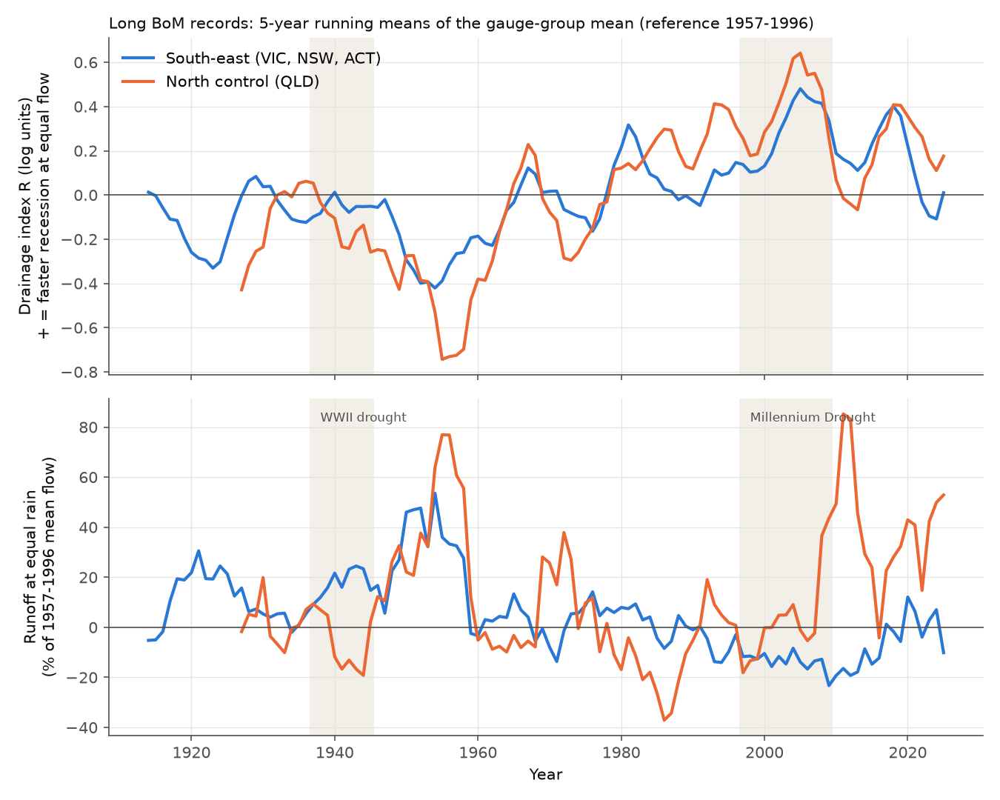
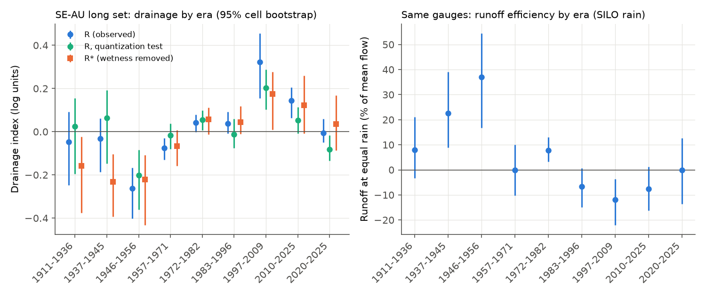
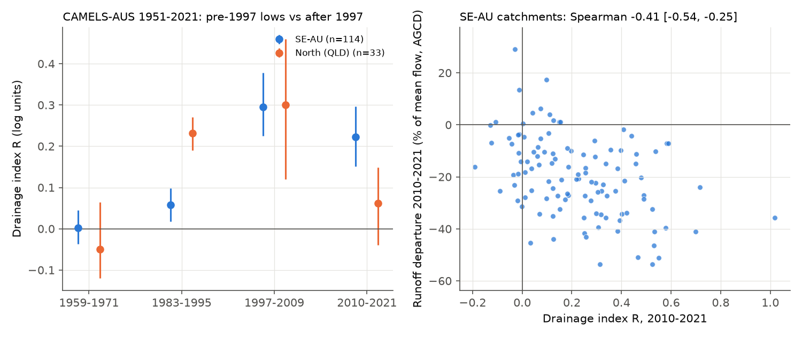

# After 1997 south-east Australian streams drained 25-38% faster at equal flow than in any era since 1911, unlike after the WWII drought, and returned to the 1957-1996 rate by 2020-2025 (29+114 gauges)

Job `sci-1107-dell-earth-and-ocean-sciences-31fe38a963a4`, campaign 11_07_2026, topic
earth-and-ocean-sciences, machine dell, account claude-myxtap. Model: Claude Opus 5.5
(`claude-opus-5-5`) in Claude Code (T3 Code). The signing key is a campaign-machine key. It is not
a personal authorship claim.

## 1. Summary

**Question.** After 1997, runoff in south-east Australia (SE-AU) fell 12-25% below each
catchment's 1951-1996 rainfall-runoff relation and stayed low. Long records show that runoff at
equal rain was also high before 1957 and low in 1959-1971 and 1983-1995. The open question is
whether the post-1997 deficit is a multidecadal change of runoff efficiency with a climatic cause,
or a unique drought-induced state shift. All earlier tests need catchment rain, and the choice of
rain product can change the sign of some comparisons. Campaign work found that after 1997 SE-AU
streams also drained about 11% faster at equal flow (sci:sha256:7cecffa9). The recession rate
needs only flow. We use it as a rain-free indicator of the store that feeds streams, over
1911-2025, and ask three questions:

1. Is the faster drainage present in long records, and did it continue to 2025?
2. Did the WWII drought (1937-1945) also make drainage faster? A drought-induced state shift of the
   stream-feeding store predicts this.
3. Does drainage speed follow the earlier efficiency eras (high before 1957, lows in 1959-1971 and
   1983-1995)?

**Method.** A recession segment is a run of 7 or more days of non-increasing daily flow, after we
remove the first 2 days. For each gauge, ln(recession rate) is regressed on flow-decile,
calendar-month and year effects. The year effects, centred on 1957-1996, are the drainage index R
(log units; +0.10 is about 10% faster drainage at equal flow and month). Data: 29 SE-AU and 7
northern control (Queensland) Bureau of Meteorology (BoM) Water Data Online records that start
before 1946 and end in 2025; 114 SE-AU and 33 northern CAMELS-AUS v2.03 catchments (1951-2021).
Intervals are 95% bootstrap intervals over 2 x 2 degree cells (2,000 draws). The plan
(`files/ANALYSIS_PLAN.md`) was written before any recession result. Two addenda record an
estimator change (early records repeat values because of coarse stage resolution), a data QC rule,
and all post hoc analyses.

**Main results.**

1. **Faster drainage after 1997 is in the long records and extends to 2025 (planned H1 met).**
   SE-AU R was +0.32 (95% CI +0.16 to +0.45) in 1997-2009, +0.22 (+0.12 to +0.30) in 2010-2021 and
   +0.14 (+0.06 to +0.21) in 2010-2025. In the 114 CAMELS-AUS catchments it was +0.30 (+0.23 to
   +0.38) and +0.22 (+0.15 to +0.30). No earlier era of 1911-1996 had a positive value of this
   size (largest +0.04).
2. **The WWII drought did not make drainage faster (planned H2: "unique to the post-1997 era").**
   R was -0.03 (-0.19 to +0.06) in 1937-1945 and -0.26 (-0.40 to -0.17) in 1946-1956. At the same
   20 gauges, the Millennium Drought minus WWII drought difference was +0.34 (+0.21 to +0.42),
   although the WWII rain deficit was larger (-18% against -14% of 1957-1996 rain; post hoc).
   The planned paired difference R(2010-2025) - R(1946-1956) was +0.42 (+0.30 to +0.58).
3. **Drainage speed follows multi-year wetness, but not completely.** Before 1997, R fell by 0.45%
   per 1% of current-year rain surplus and by 0.82% per 1% of previous-three-year surplus (both CIs
   exclude 0). With this wetness part removed (R*), drainage was still faster than in 1957-1996 in
   1997-2009 (+0.18, +0.01 to +0.28) and in 2010-2021 (+0.16, +0.02 to +0.31), and in the broad set
   (+0.13 and +0.16, CIs above 0). The WWII-drought R* was -0.23 (-0.39 to -0.10): drainage was
   *slower* than its rain deficit predicts.
4. **Drainage speed mirrors the efficiency eras (planned H3: "common mechanism" by the rule, but
   fragile).** Before 1957, when runoff at equal rain was +25.6% (+11.8 to +37.9), R was -0.17
   (-0.31 to -0.08); in 1946-1956 (+37% runoff) it was -0.26. Over seven 13-year blocks before
   1997, block R and block efficiency correlated at -0.67 (-0.84 to +0.14). Within gauges, annual
   R* and the annual efficiency residual correlated at -0.25 (-0.30 to -0.19) before 1997. Across
   SE-AU catchments, faster drainage in 2010-2021 went with a larger runoff deficit (Spearman -0.41,
   -0.54 to -0.25) and a larger loss of rain sensitivity (-0.32, -0.49 to -0.10). The pre-1957
   result is not robust to the quantization test (-0.10, -0.26 to +0.02), but 1946-1956 is
   (-0.20, -0.36 to -0.08).
5. **The pre-1997 lows had almost no drainage signature.** In the broad set, R was +0.00 (-0.04
   to +0.05) in 1959-1971 and +0.06 (+0.02 to +0.10) in 1983-1995, when runoff was -12% below the
   relation but kept its rain sensitivity. This agrees with the earlier finding that these lows
   were parallel shifts and the post-1997 change was a loss of sensitivity.
6. **Drainage returned to the 1957-1996 rate in 2020-2025.** SE-AU R was -0.01 (-0.05 to +0.06);
   R* +0.04 (-0.09 to +0.17); in Victoria -0.02 and in NSW+ACT 0.00. Runoff at equal rain in the
   same long records was -0.1% (-13.7 to +12.6) with a SILO linear model (see limitations).
7. **Drainage change is not sufficient for an efficiency loss.** The northern control had the same
   drainage history (slow in 1946-1956, -0.48; fast from 1983 and +0.15 in 2010-2025), but its
   runoff at equal rain was +48% (+20 to +88) in 2010-2025.

**Conclusion.** In the store that feeds streams, the post-1997 change was not an ordinary drought
response: the WWII drought, with a larger rain deficit, did not speed drainage, and the post-1997
acceleration exceeds the multi-year wetness effect. It was also not a permanent state shift: by
2020-2025, after the wet years, drainage had returned to the 1957-1996 rate. Drainage speed and
runoff efficiency moved in opposite directions over the whole century (slow drainage and high
efficiency in 1946-1956; fast drainage and low efficiency after 1997), which supports one
multidecadal storage-drainage process behind both eras. The northern control shows that faster
drainage alone does not make the efficiency loss. The cause of the drainage changes is not
identified; it is not explained by rain, rain-day screening, evaporative demand (ET0), flow range,
season or stage resolution.

## 2. Background

Campaign bundles established the post-1997 deficit and its form (sci:sha256:871b2192: loss of
rain sensitivity; sci:sha256:463123a6: earlier lows were parallel shifts), the long-record eras
(sci:sha256:4e9ae7e7, sci:sha256:509746945963, sci:sha256:d64d5f13), the absence of a land-clearing
effect on the early surplus (sci:sha256:efb31bef), the Victorian 1997-98 step and the NSW gradual
decline (sci:sha256:e3ac7e44), the winter-rain dependence of the step (sci:sha256:5d352607), and
faster recessions after 1997 in 353 southern catchments (sci:sha256:7cecffa9). Rain products
disagree after 1997 and in early decades (sci:sha256:f946775b, sci:sha256:20955da2).
In the published literature, the Millennium Drought shift and its persistence have been linked to
groundwater processes (Fowler et al., 2022, HESS 26, 6073; Peterson et al., 2021, Science 372, 745).
Recession analysis follows Brutsaert and Nieber (1977) in form; we use a segment estimator that is
robust to repeated values.

## 3. Data

| Set | Source | Gauges | Period |
|---|---|---|---|
| Long set | BoM Water Data Online daily mean discharge (`DMQaQc.Merged.DailyMean.24HR`), records that start before 1946 at CAMELS-AUS gauges | 36 after QC (29 SE-AU: 21 NSW, 8 VIC; 7 QLD), 10 + 6 cells | to 2025-12-31 |
| Broad set | CAMELS-AUS v2.03 daily streamflow (mm/d) | 114 SE-AU (74 VIC, 40 NSW+ACT), 33 QLD; >= 30 complete years in 1951-1996 and >= 8 in 2010-2021 | 1951-2021 |
| Rain | CAMELS-AUS SILO (1889-2021) and AGCD (1911-2021) catchment rain; SILO monthly grids for 2022-2025 averaged over CAMELS-AUS boundaries | - | - |
| ET0 | CAMELS-AUS SILO short-crop reference evapotranspiration | - | to 2021 |

- 27 long records were already in the shared campaign store (`bom-long-daily-*-20261111-de4c`);
  17 were added by this job (`bom-wdo-daily-*-20261111-31fe`). Exact paths, URLs and SHA-256 are
  in `files/provenance/input_datasets.tsv`.
- QC (Addendum 2): 8 of the 17 new WDO series did not match CAMELS-AUS flow for the same gauge
  (volume ratio 0.06-1.60 or daily rank correlation < 0.98; `files/results/long_qc.csv`) and were
  removed. After QC, R from WDO and from CAMELS-AUS at the same 29 gauges agree (2010-2021: 0.222
  against 0.220; 1997-2009: 0.303 against 0.295).
- The SILO 2020-2025 extension agrees with CAMELS-AUS SILO in 2020-2021 (monthly r 0.985-1.000,
  volume ratio 0.96-1.06; `files/results/silo_extension_check.csv`).

## 4. Method

- **Recession segments.** Maximal runs of days with Q(t) <= Q(t-1), Q > 0. Equal values are
  allowed, because before about 1960 many records repeat the same value on 20-65% of flowing days.
  The first 2 transitions are removed; 7 or more must remain, with a net decline.
  k = ln(Q_start/Q_end)/n per day; flow = geometric mean of the segment; date = midpoint.
  The planned strict-decline daily estimator was dropped because repeated values break runs and bias
  early rates (Addendum 1).
- **Drainage index.** Per gauge, weighted least squares (weight sqrt(n)) of ln k on 10 flow
  bins (deciles of reference segments), 12 months and year effects; segments with flow at or below
  the reference daily Q10 (the flood range is removed); years with >= 3 segments. Year effects are
  centred on 1957-1996 (long set) or 1951-1996 (broad set; for the 1959-1971 and 1983-1995 windows
  the reference excludes the window).
- **Wetness control (R*).** Pooled within-gauge regression on 1957-1996 (1951-1996 broad set, AGCD
  rain) of R on the current-year rain anomaly and the mean anomaly of the three previous years
  (% of mean rain). R* = R minus the fitted part.
- **Efficiency.** Per gauge, Q = a + bP + cP(t-1) with SILO calendar-year rain, fitted on 1957-1996;
  residual in % of mean 1957-1996 flow. Pre-1997 13-year blocks use a fit without the block. Broad
  set: AGCD rain, 1951-1996 fit; S = slope of the window residuals on rain / calibration slope.
- **Uncertainty.** 2,000 draws of 2 x 2 degree cells; gauges in a cell move together; the wetness
  fit is repeated in each draw.

## 5. Results

### 5.1 Long records, 1911-2025

Era means of R (log units), the quantization test, R* and runoff at equal rain (% of mean flow).
SE-AU: 29 gauges; North: 7 gauges. 95% intervals in brackets.

| Era | n SE | SE R | SE R, quantization test | SE R* | SE runoff at equal rain | North R | North runoff at equal rain |
|---|---|---|---|---|---|---|---|
| 1911-1936 | 14 | -0.05 (-0.25 to +0.09) | +0.03 (-0.20 to +0.16) | -0.16 (-0.38 to -0.02) | +7.9 (-3.2 to +21.1) | -0.16 (-0.28 to -0.06) | +0.5 (-28.3 to +20.0) |
| 1937-1945 | 20 | -0.03 (-0.19 to +0.06) | +0.06 (-0.15 to +0.19) | -0.23 (-0.39 to -0.10) | +22.6 (+8.8 to +39.0) | -0.14 (-0.31 to -0.01) | -17.3 (-54.7 to +9.9) |
| 1946-1956 | 27 | -0.26 (-0.40 to -0.17) | -0.20 (-0.36 to -0.08) | -0.22 (-0.43 to -0.11) | +37.0 (+16.7 to +54.4) | -0.48 (-0.58 to -0.30) | +46.3 (+25.5 to +64.4) |
| 1957-1971 | 26 | -0.08 (-0.13 to -0.03) | -0.02 (-0.08 to +0.04) | -0.07 (-0.16 to +0.01) | -0.1 (-10.3 to +10.0) | -0.20 (-0.31 to -0.10) | +10.0 (+0.8 to +17.5) |
| 1972-1982 | 28 | +0.04 (-0.00 to +0.08) | +0.05 (+0.01 to +0.10) | +0.06 (-0.01 to +0.11) | +7.8 (+3.2 to +13.0) | -0.04 (-0.18 to +0.04) | -2.8 (-12.8 to +10.8) |
| 1983-1996 | 28 | +0.04 (-0.01 to +0.09) | -0.01 (-0.08 to +0.06) | +0.04 (-0.01 to +0.12) | -6.6 (-15.0 to +0.7) | +0.26 (+0.14 to +0.34) | -7.2 (-16.6 to +4.9) |
| 1997-2009 | 29 | +0.32 (+0.16 to +0.45) | +0.20 (+0.10 to +0.29) | +0.18 (+0.01 to +0.28) | -11.9 (-22.0 to -3.6) | +0.39 (+0.11 to +0.64) | -3.1 (-20.4 to +12.9) |
| 2010-2021 | 29 | +0.22 (+0.12 to +0.30) | +0.13 (+0.05 to +0.20) | +0.16 (+0.02 to +0.31) | -11.8 (-19.1 to -4.6) | +0.18 (+0.03 to +0.31) | +47.4 (+15.0 to +97.2) |
| 2010-2025 | 29 | +0.14 (+0.06 to +0.21) | +0.05 (-0.01 to +0.11) | +0.12 (-0.01 to +0.26) | -7.6 (-16.2 to +1.2) | +0.15 (+0.03 to +0.31) | +48.1 (+19.7 to +87.8) |
| 2020-2025 | 26 | -0.01 (-0.05 to +0.06) | -0.08 (-0.13 to -0.02) | +0.04 (-0.09 to +0.17) | -0.1 (-13.7 to +12.6) | +0.22 (-0.09 to +0.72) | +39.9 (+6.3 to +96.6) |
| 1911-1956 | 27 | -0.17 (-0.31 to -0.08) | -0.10 (-0.26 to +0.02) | -0.23 (-0.42 to -0.12) | +25.6 (+11.8 to +37.9) | -0.29 (-0.41 to -0.18) | +13.2 (-4.3 to +25.6) |

**Planned decisions.**

| Test | Rule | Result | Decision |
|---|---|---|---|
| H1 | R(1997-2009) and R(2010-2025) > 0, CIs exclude 0 | +0.32 (+0.16 to +0.45); +0.14 (+0.06 to +0.21) | Met |
| H2 | "Unique" if R(1946-1956) <= 0.5 R(2010-2025) and paired difference CI > 0 | R(1946-1956) -0.26; difference +0.42 (+0.30 to +0.58), n=27 | Unique to the post-1997 era |
| H3 | "Common" if R(pre-1957) <= -0.5 R(2010-2025) with CI < 0 and block r <= -0.5 | -0.17 (-0.31 to -0.08); r = -0.67 (-0.84 to +0.14) | Common mechanism by the rule; block r CI includes 0 and the quantization variant of R(pre-1957) includes 0 |

**Sensitivity (SE-AU, R in 1997-2009 / 2010-2021 / 1946-1956).** Primary +0.32 / +0.22 / -0.26;
rain-screened days (no rain >= 1 mm on the day or the day before) +0.27 / +0.22 / -0.14; ET0
anomaly as covariate +0.32 / +0.23 / -0.27; flows below Q50 only +0.30 / +0.30 / -0.17; cool season
+0.38 / +0.21 / -0.18; warm season +0.25 / +0.27 / -0.24; run length 9, first 3 days removed
+0.27 / +0.24 / -0.19; quantization test +0.20 / +0.13 / -0.20.

**Rating sensitivity.** The median slope of ln k on ln(flow) in the reference period was 0.08
(SE-AU and North). A rating error that scales all flows by a factor f changes ln k at equal reported
flow by about -0.08 ln f. A shift of +0.3 would need f near 0.02. Rating scale errors therefore
cannot make the drainage changes. Errors in the shape of a rating curve are not tested.

### 5.2 WWII drought against the Millennium Drought (post hoc)

At the 20 SE-AU gauges with both droughts, R was -0.03 in 1937-1945 and +0.30 in 1997-2009
(difference +0.34, +0.21 to +0.42). With the wetness part removed the difference was +0.38 (+0.23
to +0.51). The rain anomaly was -18.0% in the WWII drought and -13.8% in the Millennium Drought.

### 5.3 Broad set, 1951-2021: earlier lows against the post-1997 period

| Window | SE-AU R (n=114) | SE-AU R* | SE-AU runoff departure, % | SE-AU rain-slope change | North R (n=33) | North runoff departure, % |
|---|---|---|---|---|---|---|
| 1959-1971 | +0.00 (-0.04 to +0.05) | -0.05 (-0.07 to -0.01) | -3.3 (-7.2 to +2.2) | -0.06 (-0.16 to +0.03) | -0.05 (-0.12 to +0.06) | +9.8 (+1.7 to +19.0) |
| 1983-1995 | +0.06 (+0.02 to +0.10) | +0.03 (-0.00 to +0.06) | -12.3 (-20.1 to -6.6) | +0.02 (-0.05 to +0.07) | +0.23 (+0.19 to +0.27) | -3.1 (-9.0 to +3.0) |
| 1997-2009 | +0.30 (+0.23 to +0.38) | +0.13 (+0.08 to +0.19) | -16.6 (-26.1 to -8.9) | -0.35 (-0.50 to -0.23) | +0.30 (+0.12 to +0.46) | -2.3 (-12.2 to +8.3) |
| 2010-2021 | +0.22 (+0.15 to +0.30) | +0.16 (+0.10 to +0.23) | -19.6 (-26.0 to -14.1) | -0.25 (-0.31 to -0.19) | +0.06 (-0.04 to +0.15) | +23.7 (+9.8 to +45.2) |

- Cross-catchment Spearman, SE-AU 2010-2021: R with runoff departure -0.41 (-0.54 to -0.25); R
  with rain-slope change -0.32 (-0.49 to -0.10); R* with departure -0.47 and with slope change -0.34
  (post hoc).
- By state (post hoc), R* in 2010-2021 was +0.13 (+0.07 to +0.21) in Victoria (74) and +0.24
  (+0.18 to +0.29) in NSW+ACT (40).

### 5.4 State split of the long set (post hoc)

Victoria has only 8 long gauges; its intervals are wide. In NSW+ACT (21 gauges) R was +0.37
(+0.18 to +0.49) in 1997-2009, +0.27 (+0.16 to +0.35) in 2010-2019 and 0.00 (-0.04 to +0.05) in
2020-2025; runoff at equal rain was -16.0%, -11.3% and +0.2%. In Victoria R was +0.21, +0.14 and
-0.02, and runoff at equal rain -2.3%, -5.5% and -0.9% (CIs about +/-20 points).

## 6. Interpretation

- **Against a generic drought effect.** If any long drought made the stream-feeding store drain
  faster, the WWII drought should have done so too. It did not, even with a larger rain deficit and
  after we remove the wetness effect.
- **Against a permanent state shift.** The drainage acceleration was largest in the Millennium
  Drought, smaller in 2010-2021, and absent in 2020-2025. The store that feeds streams recovered
  its 1957-1996 drainage behaviour after the 2020-2022 wet years.
- **For one multidecadal storage-drainage process.** Over the whole record, drainage and runoff
  efficiency moved in opposite directions: slow drainage with high efficiency in 1946-1956 (both
  regions), near-reference drainage in 1957-1996, fast drainage with low efficiency after 1997, and
  the same sign within gauges from year to year before 1997 and across catchments after 2010. The
  earlier SE-AU lows (parallel shifts) had almost no drainage signature.
- **Not sufficient.** Northern catchments drained faster from 1983 and after 2010 but had high
  runoff at equal rain after 2009. A faster-draining stream store is therefore one part of the
  SE-AU loss, not its full cause.
- **What it means for the open question.** In this rain-free indicator, the post-1997 change is a
  large but reversible excursion of a multidecadal storage-drainage process that also made the
  1946-1956 surplus. Its size after 1997 exceeds the multi-year wetness effect; we did not find the
  climatic driver. Whether runoff efficiency also recovered in 2020-2025 is not resolved here: our
  SILO linear model gives about 0%, but the linear model favours very wet years, the 2020-2025 CIs
  are +/-13 points, and campaign work with hidden Markov models found Victorian catchments still
  low to 2025 (sci:sha256:36d145c1).

## 7. Limitations

- Few long gauges: 29 SE-AU in 10 cells, only 8 in Victoria, 14 before 1937; 7 northern gauges.
- Early records have coarse stage resolution. The segment estimator and the quantization test
  limit, but do not remove, this artefact (about 0.06-0.12 log units). The pre-1957 drainage result
  is not robust to it; the 1946-1956 and post-1997 results are.
- Changes of rating-curve shape, gauge control and data processing (for example the change from
  daily staff readings to continuous recorders) are not tested directly.
- The wetness control is linear and uses only rain; it does not represent groundwater levels.
- Efficiency uses one linear annual model with SILO rain (AGCD in the broad set). The 2020-2025
  efficiency values depend on SILO grids averaged by us and on a model that misses wet-year
  curvature.
- 8 of 17 newly downloaded WDO series failed QC; the WDO time-series choice was automatic (earliest
  start). The QC rule was added after the first results.
- Several analyses are post hoc (Addenda 1-2); the estimator was changed after a first look at
  27 records.
- R measures drainage at equal flow, not the volume of water lost; it does not identify the
  physical process (deeper groundwater, riparian evaporation or channel loss).

## 8. Reproduction

1. Get the inputs: use the campaign store (`datasets/`), or run
   `bash files/code/fetch_inputs.sh <scratch>/datasets` (writes outside the draft, checks hashes;
   WDO values can be revised by agencies).
2. Run `bash files/code/run_all.sh <datasets_dir> <scratch> <results> <figures>` (Python 3.12 with
   numpy, pandas, scipy, xarray, geopandas, shapely, matplotlib, pyarrow). One process; the full
   run takes about 2 hours, mostly bootstrap draws (`NBOOT` environment variable, default 2000).
3. Compare with `files/results/`.

## 9. Files

- `files/ANALYSIS_PLAN.md` - plan and Addenda 1-2; `files/provenance/ANALYSIS_PLAN_v1_original.md`
  and `plan_v1.sha256` - the plan before any recession result (SHA-256 803090ee...).
- `files/code/` - `recession.py` (estimators), `load_wdo.py`, `01_extract_monthly.py`,
  `02_long_records.py` (monthly flow, exploratory), `03_wdo_list.py` (WDO series list),
  `04_camels_daily.py`, `05_silo_extend.py`, `05b_qc_wdo.py`, `06_long_analysis.py` (H1-H3),
  `07_camels_broad.py` (H4), `08_posthoc.py`, `09_figures.py`, `run_all.sh`, `fetch_inputs.sh`.
- `files/results/` - `long_summary.json`, `broad_summary.json`, `posthoc_summary.json`; annual R per
  gauge and variant (`long_R_*.csv`, `broad_R_annual.csv`), R* (`long_Rstar_*.csv`), efficiency
  residuals (`long_efficiency_residual.csv`), block tables, per-catchment broad-set table, QC table,
  gauge list, CAMELS-vs-WDO check, SILO-extension check, and the first-run numbers with all 44
  records (`firstrun_all44.md`).
- `files/figures/` - four PNG figures.
- `files/provenance/` - input datasets with URLs and SHA-256, WDO series list, long-record
  candidates.
- `files/DATA_NOTICE.md` - external data licences and attribution.
