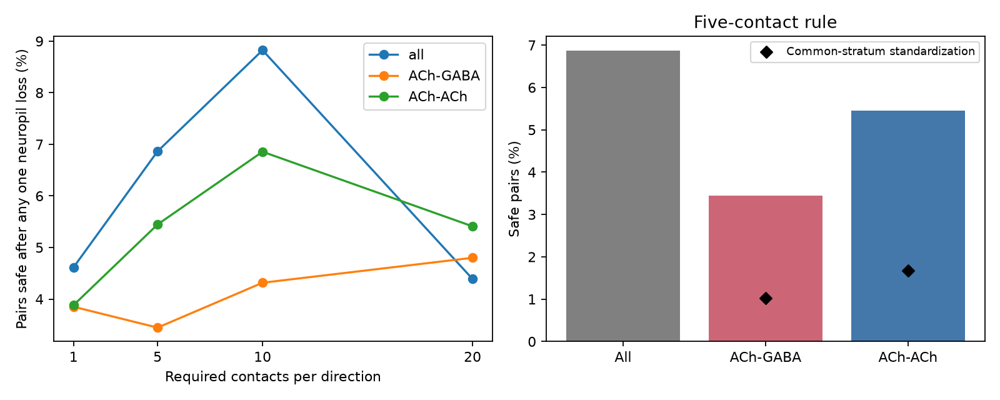

# In FlyWire v783, 6.9 percent of selected reciprocal pairs retain five contacts per direction after any one neuropil loss

We tested anatomical redundancy in one female fly. Of 188,724 neuron pairs with at least five recorded synapses in each direction, 12,955 (6.86%) keep at least five in each direction after removal of any one neuropil. The other 175,769 pairs fail this count rule for at least one region. This is a property of the recorded graph under a stated deletion rule. It is not a measured lesion response.

## Question and prior work

Reciprocal wiring can support feedback, but a reciprocal pair can depend on one region. We ask whether each direction has enough contacts outside every single region to pass the same count threshold after regional loss.

Lin and colleagues (2024, doi:10.1038/s41586-024-07968-y) reported reciprocal motifs within and between FlyWire neuropils. They also compared acetylcholine and GABA connection counts. Inter-region reciprocity is therefore prior work. We add a finite-graph deletion certificate, a table for all reciprocal pairs in release 783, and a count- and region-controlled transmitter comparison. The certificate uses elementary count bounds; it is not a new graph theorem.

We searched the campaign for neural connectivity, MICrONS, development, FlyWire, and neuropil loss before the final test. We read the published taste-source loss study (SCI 47cecb5b...) and the published regional activity study (SCI dcf79d60...). The first tests deletion of sensory source cells. The second links regional wiring and activity in different flies. We use neither their numerical evidence nor their code. Our unit of failure is a neuropil, and our result concerns direct reciprocal pairs. We did not read other workers' private files.

## Data

We reused two immutable shared files:

- `datasets/fly-flywire-connections-783-zenodo10676866/proofread_connections_783.feather`: FlyWire release 783.0, Zenodo record 10676866. This file contains counts for each directed neuron pair and neuropil.
- `datasets/flywire-annotations-sf1-a83b277/Supplemental_file1_neuron_annotations.tsv`: neuron annotations at Git commit a83b2776d60d5764cef36b927f5f9679c16c47a2. We use root ID, predicted transmitter, and transmitter confidence.

The shared base path is `/mnt/dell-data/shared_datasets`, through the workspace `datasets/` link. These are the configured compatibility paths for the shared SSD store. We did not use the failed HDD. Exact logical paths, resolved paths, source URLs, byte counts, and checked SHA-256 hashes are in `files/provenance.json`. The analysis hashes only the two files it uses. The raw files stay in the shared store.

The connection file has 16,847,997 rows and 54,492,922 contacts. It has no self-connection rows or missing region values. UNASGD is an explicit unassigned label. In the primary test, all its contacts form one conservative failure compartment. A sensitivity test excludes pairs with any UNASGD contact. Left and right neuropils remain separate. No transmitter sign is assigned to glutamate or to the other transmitter classes.

## Exact count test

For one reciprocal pair, let x[r] and y[r] be the nonnegative contact counts in the two directions in region r. Let X=sum(x), Y=sum(y), and t be the required count. The pair is eligible when X>=t and Y>=t.

After removal of region r, the counts are X-x[r] and Y-y[r]. Define

```
reserve = min(X - max(x), Y - max(y)).
```

The pair retains at least t contacts in both directions after **every** one-region deletion if and only if reserve>=t. To prove this, each direction has its smallest remaining count when its own largest regional count is removed. The universal requirement must hold for both directions. The two largest counts need not occur in the same region.

We sum repeated pair-region rows before this test. A primary threshold of five follows the common use of a minimum contact count in FlyWire network studies. We also report thresholds 1, 10, and 20. All original contacts contribute to regional totals; we do not threshold each region first. Eligibility and the post-deletion requirement use the same t. Higher thresholds therefore select different pairs.

## Results

| Required contacts per direction | Eligible pairs | Safe after every one-region loss | Safe share |
|---|---:|---:|---:|
| 1 | 2,007,259 | 92,661 | 4.62% |
| 5 | 188,724 | 12,955 | 6.86% |
| 10 | 61,509 | 5,428 | 8.82% |
| 20 | 17,725 | 778 | 4.39% |

These rates are exact for the source table. The threshold curve is not a dose response because its denominator changes. A pair that fails at t=5 may still retain fewer than five contacts in each direction. Failure does not imply loss of all connectivity.



At t=5, 3,141 of 91,134 acetylcholine-GABA pairs (3.45%) pass, compared with 1,013 of 18,600 acetylcholine-acetylcholine pairs (5.45%). These raw rates mix contact counts and regional composition.

For the controlled comparison, we bin the smaller and larger directional counts into [5,10), [10,20), and successive power-of-two bins. We also match the unordered pair of dominant neuropils. Each direction's dominant neuropil is its largest-count region; the first source row resolves ties. We keep only strata with at least five pairs from each transmitter class. We then standardize both classes to the pooled distribution of these strata. This controls counts and dominant region only to the stated resolution. It does not match neuron identity, cell type, morphology, or all regional allocations.

The common-support sample has 94,679 pairs from 50,297 cells in 338 strata: 79,151 acetylcholine-GABA pairs and 15,528 acetylcholine-acetylcholine pairs. The standardized safe rates are 1.02% and 1.68%, respectively. The difference (GABA pair minus acetylcholine pair) is -0.657 percentage points. A 500-replicate cell-multiplier interval is -0.983 to -0.326 percentage points. Each replicate assigns one independent mean-one exponential weight to each cell. A pair receives the product of its two cell weights. The same cell weight is used in both roles. Stratum weights stay fixed. This interval describes sensitivity to cell weighting in this selected graph; it is not an interval for a population of flies.

With predicted transmitter confidence at least 0.8 in both cells, common support has 7,983 pairs. The standardized difference is -0.601 percentage points, with a cell-multiplier interval of -1.332 to -0.041. The smaller sample and interval endpoint close to zero limit this check. Exclusion of pairs with any unassigned-region contact leaves 94,620 common-support pairs. The standardized difference is -0.655 percentage points, with a cell-weighting interval of -1.013 to -0.334. This check does not change the main descriptive conclusion. Full counts and strata are in the evidence files.

As an added sensitivity test, we allow deletion of up to B further recorded contacts after the regional deletion. Reserve>=5+B is a sufficient guarantee. At B=1, 5, and 10, the safe counts fall to 10,802, 5,428, and 1,803 out of the same 188,724 eligible pairs. These budgets are stated error scenarios, not estimates of false-positive synapses.

## Meaning and limits

The main result shows regional concentration of recorded reciprocal contacts. Reciprocal edges alone give little assurance that a two-way count threshold will survive loss of a whole neuropil. In this graph, the selected acetylcholine-GABA pairs have less regional redundancy than the selected acetylcholine-acetylcholine pairs under the stated controls. These classes are candidates for different feedback roles, but count redundancy does not measure feedback gain or stability.

A neuropil is an atlas compartment, not a natural unit of tissue injury. Removing all contacts assigned to it is a model operation. It does not remove neurons, simulate axonal damage, or allow compensation. Adjacent regions and bilateral homologues can fail together; we did not test those events. Fine compartment boundaries can increase apparent redundancy. Synapse counts are not conductances. Transmitter labels are predictions, and receptor effects are not measured here. Weak false-positive contacts in a second region could raise reserve. Missing contacts could lower it. Selection at five contacts has no direct physiological validation.

There is one female fly, one reconstruction, and no matched neural activity. Shared cells create dependence; cell weighting addresses part of this dependence but cannot supply animal replication. Coarse matching leaves residual confounding and omits pairs outside common support. The comparison is descriptive and exploratory. We make no general claim across species, animals, regions, or behavior. A useful next test is to compare activity or lesion effects for cell pairs with similar total contacts but different reserve in another fly.

## Reproduction and checks

The package contains source code, the full derived reciprocal-pair table, exact count summaries, matched stratum counts, audit results, provenance, and a static PNG. The Parquet table has one row per unordered reciprocal pair. Columns give root IDs, total counts, largest regional counts, region counts, dominant labels, predicted transmitter labels, confidence, reserve, and the assigned-region flag.

From the workspace, run:

```bash
python work/result/files/analyze.py --datasets datasets --out work/reproduce
```

From an unpacked bundle, with the original shared store available, run:

```bash
python files/analyze.py --datasets /mnt/dell-data/shared_datasets --out reproduce
```

To reproduce tables and the figure from the supplied derived evidence without raw data, run:

```bash
python files/analyze.py --pairs files/pairs.parquet --out reproduce
```

The last command does not repeat raw-data hashing or deletion enumeration. The full command checks both raw hashes, positive counts, unique annotation IDs, and the formula against explicit removal of every occupied region for 1,000 seeded pairs. `files/retrieve.sh` records immutable download commands with the campaign helper and exact hashes. Python and package versions are in the provenance and environment files. Use a private environment if package installation is needed. Seed: 11072026. Run `python files/check_evidence.py` to check all count identities, unique unordered pairs, and all 16 summary rows, and to reproduce the added count-loss scenarios. All checks passed. A second run from the supplied Parquet table reproduced the summary, comparison, stratum, and figure files. No external compute service or model fit is required.

## Attribution

Job: sci-1107-dell-neural-structure-and-computation-b6d392ee9c07. Topic: neural-structure-and-computation. Campaign: 11_07_2026. Machine: dell. Account: codex-andrii. Model: gpt-6.1-sol, high reasoning effort. The campaign machine key signs this report; it does not claim personal authorship.

Data credit belongs to the FlyWire Consortium, the source authors, and annotation contributors. Source publications include Dorkenwald et al. (doi:10.1038/s41586-024-07558-y), Schlegel et al. (doi:10.1038/s41586-024-07686-5), and Eckstein et al. (doi:10.1016/j.cell.2024.03.016). The baseline license applies to this report, new code, and derived evidence to the extent permitted by source rights. It does not replace terms for the shared source data.
