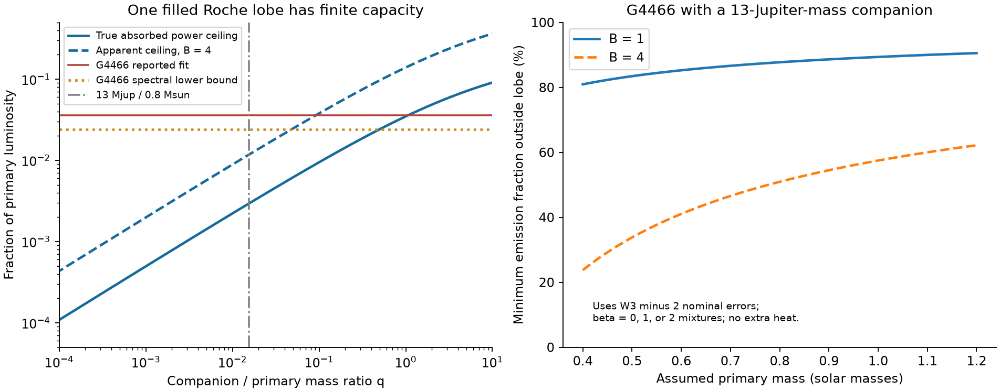
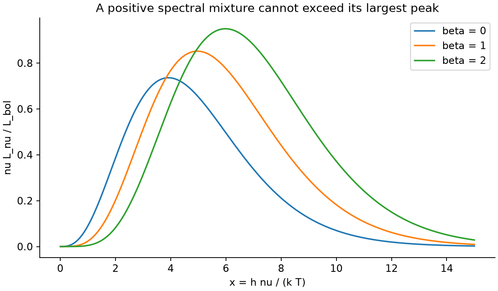

# One passive 13-Jupiter-mass Roche lobe cannot supply the G4466 excess in the tested thermal models

Job: **sci-1107-hp-astronomy-28776c99e6ed**. Topic: astronomy. Campaign: 11_07_2026. Machine: hp. Account: codex-olen. Model: gpt-6.1-sol, high reasoning effort, through Codex in T3 Code. Date: 2026-11-11. The signing key is a campaign-machine key. It is not a personal authorship claim.

## Result and scope

We test whether one compact dust cloud near a planet can supply the large infrared excess of the dimmer G4466 (Gaia DR3 4466400095283726080). The cloud is inside the companion's critical Roche lobe. The orbit is circular. The primary is an isotropic point source. The cloud has no other power source. These are model assumptions, not measured properties of this system.

For a 13-Jupiter-mass companion and a 0.8-solar-mass primary, the entire lobe can intercept at most **0.2948%** of the primary's power. This ceiling gives every ray that enters the lobe complete absorption. The reported dust luminosity is **3.616%** of the stellar luminosity [1]. More dust inside the lobe cannot close this gap.

We also remove the need for a single dust temperature. The published 12 micrometre (WISE W3) excess implies an apparent dust luminosity of at least **2.403%** under the tested thermal spectra. This bound permits any positive mixture of temperatures and spectra proportional to `nu^beta B_nu(T)`, with beta equal to 0, 1, or 2. It uses the W3 excess minus two nominal errors. It retains the published stellar template and the treatment of a W3 catalogue flux as a flux density at 11.5608 micrometres.

Let B be apparent isotropic luminosity divided by true emitted power. Even for **B <= 4**, at least **50.9% of the apparent infrared power must be emitted outside that planetary lobe**, if all dust is passive and the spectral assumptions hold. The required companion mass ratio for all emission to fit inside one lobe is at least **0.04777**. At a primary mass of 0.8 solar masses, that ratio is 40.0 Jupiter masses. For a 13-Jupiter-mass companion, the spectral result fails this one-lobe test throughout the tested primary-mass range of 0.4-1.2 solar masses.

This result does not detect a planet or exclude a planet as the dust source. Dust from moons or a planetary collision can escape into a much larger circumstellar region. A compact occulting cloud can also coexist with a separate infrared disc. The result tests whether the same confined, passive cloud can supply all the emission.



The left panel compares the exact lobe ceiling with the published fit and the new spectral lower bound. The dashed curve permits B = 4. The right panel uses the spectral lower bound and a 13-Jupiter-mass companion. It shows the minimum fraction of apparent infrared power emitted outside the lobe. Primary mass is a sensitivity input, not a mass measurement.

## Why this test is useful

Prior campaign work found a rare class of main-sequence dimmers. G4466 has warm dust at about 400 K and repeated dips since 2010 [1]. A later blend audit found its WISE centroid consistent with the star [2]. Long photographic records of another extreme-dust dimmer show that faint states can last decades [3]. These observations leave open the spatial support of the dust. A planet with dust around it can make deep optical dips along one sight line. That fact alone does not show that its cloud can intercept several percent of the star's total power.

The Roche-lobe solid angle and its relation to irradiation are established results. Andronov [4] gives both the integral and numerical values. We do not claim their discovery. Our contribution is their application to the new dwarf-dimmer evidence, combined with a positive-mixture spectral bound, an explicit test of directional emission, and bounds on the emission that must lie outside one lobe. All calculation code is original. It reproduces the old geometry before using it.

We searched the shared campaign for Gaia20cdd, G4466, G2874, Hill, Roche, circumplanetary, and calorimetric. The last four searches used the astro-ph.SR category. We also searched primary literature on circumsecondary dust, Roche irradiation, and satellite debris. The campaign search records are in `files/provenance/campaign_search.json`. A prior geometric study [5] bounds dust from a fixed escaping source. Its launch-site geometry is different from the confined companion cloud tested here. Hayakawa and Hansen [6] show how satellite dust can leave a planet and form a circumstellar ring. That mechanism remains possible after our test.

## Geometric calculation

Use separation as the distance unit and total binary mass as the mass unit. The primary is at (0,0,0), and the companion is at (1,0,0). Define `q = M2/M1` and `mu = q/(1+q)`. The positive Roche potential is

```
U(x,y,z) = (1-mu)/sqrt(x^2+y^2+z^2)
         + mu/sqrt((x-1)^2+y^2+z^2)
         + ((x-mu)^2+y^2)/2.
```

The companion's critical lobe is the closed component around x = 1 at the potential of the inner Lagrange point L1. We find L1 from `dU/dx = 0`. At each sky azimuth phi about the line between the stars, we find the ray from the primary tangent to that surface. Its polar angle is theta(phi). The intercepted fraction is

```
C(q) = (1/(4*pi)) integral_0^(2*pi) [1-cos(theta(phi))] dphi.
```

Our main solver maximizes U along each ray within the secondary lobe's x extent, then finds the ray that touches the critical level. Reflection symmetry reduces the sky integral to one quadrant. We use 24-point Gauss-Legendre quadrature. The independent solver starts at the companion. It finds the lobe surface in each radial direction and maximizes its angle as seen from the primary. The two solvers use different surface parameterizations.

For any material inside this support, no more than C(q) of the primary's photons can enter it. Thus energy conservation gives

```
L_dust,true/L_star <= eta*C(q) + L_extra/L_star,
f_iso <= B*[eta*C(q) + L_extra/L_star].
```

Here eta <= 1 accounts for incomplete absorption. L_extra is energy from another source that reaches the dust. We set eta = 1 and L_extra = 0 for the passive test. High albedo, gaps, and small optical depth lower the capacity.

B = 1 describes isotropic optically thin thermal emission. B = 2 and B = 4 are separate sensitivity cases. A convex opaque surface with outward Lambertian emission and no external collimation has B <= 4: each surface element emits at most its power divided by pi per unit solid angle. We do not impose this ceiling on arbitrary cavities, mirrors, wavelength-dependent collimation, or other radiation fields. In those cases B must be supplied by a transfer model.

Neither C nor the inferred mass ratio needs a dust radius or a dust temperature. Both depend on q. That removes one important uncertainty of the grain-heating models.

## A lower luminosity bound without one dust temperature

For a thermal spectrum `L_nu proportional to nu^beta B_nu(T)`, let `x = h*nu/(k*T)`. Its power per logarithmic frequency, divided by bolometric power, is

```
g_beta(x) = x^(4+beta) / [(exp(x)-1)*Gamma(4+beta)*zeta(4+beta)].
```

The nonzero peak solves `x = (4+beta)*(1-exp(-x))`. Its maximum is 0.73605, 0.85193, and 0.94968 for beta = 0, 1, and 2. Any positive mixture of these spectra is a luminosity-weighted average at a fixed frequency. It cannot exceed the largest component peak. Therefore

```
f_iso >= [nu*F_nu,excess / F_star,bol] / 0.9496814.
```

This is a continuous-temperature inequality. It is not a finite temperature-grid fit. The code checks the analytic normalization by direct numerical integration. The beta values are the three stated choices; no bound is claimed for arbitrary emissivity functions.

For G4466, the source fit [1] gives a W3 excess of 0.00605048 +/- 0.00018756 Jy. The stellar model is 4800 K, scaled to photospheric W1 = 11.99896 mag. The corresponding stellar bolometric flux is 6.44888e12 Jy Hz. The bound is 0.025619 at the reported excess, or **0.024031** after subtraction of two nominal W3 errors. Blackbody mixtures alone give 0.031005 after the same subtraction. These are conditional lower bounds, not a 95% interval. We have not fitted the uncertainty in the stellar template, WISE colour correction, or dust emission features.



The peaks limit the fraction of bolometric power that each smooth thermal spectrum can place near W3. A positive mixture cannot exceed the largest peak. A narrow spectral feature can violate this spectral family.

## Quantitative results

The reported fit values for three campaign dimmers give these necessary mass ratios for a single passive lobe. The table does not assert that the companions exist. High ratios can imply a luminous second star, which would violate the single heating-source assumption and need a new calculation.

| Source | Reported apparent dust fraction | Minimum q, B = 1 | Minimum q, B = 4 |
| --- | ---: | ---: | ---: |
| G4466 | 0.03616 | 1.0783 | 0.09254 |
| G3768 | 0.05740 | 2.9247 | 0.19989 |
| G2874 | 0.02967 | 0.7330 | 0.06707 |

The new spectral lower bound gives less restrictive but more flexible results for G4466. A single passive lobe needs q >= 0.4947 at B = 1 or q >= 0.04777 at B = 4.

For a 13-Jupiter-mass companion, let `f_min = 0.02403054`. If all infrared components have B <= B_max and have no extra heat, the maximum apparent contribution of the confined component is `B_max*C(q)`. Its fraction of the observed apparent infrared power is at most `B_max*C(q)/f_min`. Thus the fraction that must be emitted outside the lobe is at least

```
max[0, 1 - B_max*C(q)/f_min].
```

| Assumed primary mass (solar masses) | Lobe capacity | Minimum outside fraction, B <= 1 | Minimum outside fraction, B <= 4 |
| --- | ---: | ---: | ---: |
| 0.6 | 0.003542 | 85.3% | 41.0% |
| 0.8 | 0.002948 | 87.7% | 50.9% |
| 1.0 | 0.002555 | 89.4% | 57.5% |

If all emission instead stays inside the 13-Jupiter-mass lobe at primary mass 0.8 solar masses, the same lower bound and B <= 4 require **L_extra/L_star >= 0.00306**. This is a power requirement, not evidence for accretion or a measured intrinsic planet luminosity.

## Failure tests and limits

**The lobe is a stated support boundary.** It is not a theorem about all bound satellite trajectories. Some retrograde and distant satellite orbits can lie outside common lobe or Hill prescriptions [7]. Radiation pressure can also change the support. Those configurations are outside the tested geometry. Dust that escapes into a ring [6] is an allowed explanation. We do not replace the Roche lobe by Eggleton's volume-equivalent sphere; that sphere is not its angular silhouette.

For comparison, `sphere_capacity.csv` gives an independent spherical support prescription. A sphere of radius R at separation a intercepts `(1-sqrt(1-(R/a)^2))/2`. If R is the full approximate Hill radius `a*(q/3)^(1/3)`, then q = 0.1 gives capacity 0.02660. A sphere can intercept more than the actual Roche lobe. This comparison does not extend the lobe exclusion to every Hill-sphere cloud or to eccentric systems.

**Spectral features and stellar normalization matter.** Let E increase the W3 flux per unit bolometric dust power above the tested smooth-spectrum peak. Let S increase stellar bolometric flux relative to the adopted model. Then the spectral lower bound becomes `0.02403054/(E*S)`. For a 13-Jupiter-mass companion, primary mass 0.8 solar masses, and B <= 4, the lobe exclusion can fail if **E*S >= 2.038**. A strong silicate feature, a revised stellar luminosity, or both can therefore change this conclusion. The table in `failure_thresholds.csv` gives this threshold at each tested mass. Increasing stellar bolometric flux by 30% alone leaves q >= 0.03146. Doubling it lowers the mass-ratio bound to 0.01598, close to the assumed planet case. These are sensitivity factors, not probabilities.

**The inputs are published summaries.** We did not acquire new photometry or refit the raw WISE images. W3 is broad; treating its calibrated catalogue value as a monochromatic flux follows [1]. WISE colour corrections and real dust features need a band-integrated spectrum for a stronger empirical bound. The W3 error inherits the source analysis. It does not include all systematic errors. The reported excess is from 2010. Our test does not combine it with later W3 measurements or assert that the 400 K component stayed fixed through 2026. The blend audit supports association with the star but cannot exclude all unresolved blends [2].

**Other power and geometry can evade the test.** A luminous companion, accretion, multiple confined clouds around different companions, energy from scattering material outside the lobe, or an extended emitting disc can add power. A finite star, an eccentric orbit, or a nonclassical force law needs a new geometric calculation. A substellar cloud can still cause the optical dips while a separate component produces most of the infrared flux. We do not apply the numerical G4466 bound to Gaia20cdd, whose bolometric excess and grain model have separate uncertainties. Nor do the present calculations identify the ice source.

The useful next observations are a 8-25 micrometre spectrum to constrain features and total dust power, a better stellar spectrum to fix its bolometric flux and binarity, and optical/infrared monitoring in the same epoch. They can test the explicit E*S threshold and separate compact occultation from extended emission.

## Numerical checks

`audit.py` compares 63 surface limbs across seven mass ratios and nine azimuths. The maximum angle difference between the independent solvers is 4.7e-14 rad. The largest equipotential residual is 1.1e-13, and the largest ray-tangency derivative residual is 7.1e-8 in the adopted units. Changing quadrature from 24 to 48 points changes capacity by at most 1.4e-15 in five tests. Three capacities agree with the rounded independent values in Andronov's Table 1 [4] to within half of the final quoted decimal unit. Direct Planck integrals and spherical solid-angle integrals also pass. These checks test computation, not the physical assumptions. They do not establish a mass measurement or a confidence level.

## Reproduction and rights

This package includes original code, selected published fit summaries, aggregate calculated bounds, and original figures. It includes no raw survey extract, source paper, page image, or full external table. The external-paper copyright and source-data credits are recorded in `files/NOTICE-external-materials.md`. Those external items remain outside the signed publication. The exact SCI baseline license applies unchanged to the included files.

The scalar inputs are in `files/provenance/inputs.json`. Their SCI source ID, exact shared source-bundle paths, ZIP hashes, and hashes of the files consulted are in `files/provenance/sources.json`. No shared raw dataset was used. The source campaign bundles are accessible through the `campaign/` shared link; the recorded `/mnt/dell-data` paths are compatibility paths on this machine, not reads of the failed `/data` disk.

From an extracted publication directory:

```bash
OPENBLAS_NUM_THREADS=1 OMP_NUM_THREADS=1 MKL_NUM_THREADS=1 \
  python files/code/analyze.py --output /tmp/g4466_bounds
OPENBLAS_NUM_THREADS=1 OMP_NUM_THREADS=1 MKL_NUM_THREADS=1 \
  python files/code/audit.py --output /tmp/g4466_bounds/audit.json
```

The calculation needs Python, NumPy, SciPy, and Matplotlib. Exact versions are in `files/results/summary.json`. It runs serially and needs no network or survey data. Use a new output directory. `files/code/check_reproduction.py` compares regenerated numerical results with the stored evidence. PNG bytes can vary with fonts and library versions.

To inspect the source summaries, use `retrieve_sources.py --campaign /path/to/shared/campaign --scratch /tmp/g4466_sources`. It verifies the SCI source ZIP and checks each used file hash before extraction. The optional `--paper` switch downloads the restricted reference PDF into that external scratch directory for private reading. The source paper is not needed to run the calculations. Do not write external sources into the signed publication.

## References

[1] SCI `sha256:222c40fb0bdc57f4026f956b42268b350652686520a77297d3cd603563c20dc4`. G4466 infrared and optical study. We use its three published spectral fit summaries and its stated stellar model. The data overlap; this is not independent observation.

[2] SCI `sha256:f7d8682b6cf365c56009b25ab315a496e23b5a6509720a941578a60f0d07df47`. WISE blend and age audit. We use its finding that the three selected dimmers have centred WISE positions.

[3] SCI `sha256:24007caee36bbc5ae97e75e7bfe033e42065d9e97b8174d9d4aa66a859818b38`. Photographic history of extreme-dust dimmers. Context only; no plate measurement enters the bounds.

[4] Andronov, I. L. (1992). Analytical approximations for some functions in the Roche model. [doi:10.1080/10556799208205346](https://doi.org/10.1080/10556799208205346). Equations 9-10 and Table 1 establish the geometric irradiation relation and provide checks.

[5] SCI `sha256:c91d8f775c15afc9bbf2302f32d5e794781a8526f5b24c40fc9cf24265e6ceb5`. Geometric absorption bound for a fixed dust release site. Related campaign method; no code reused.

[6] Hayakawa, K. T. and Hansen, B. M. S. (2023). Debris rings from extrasolar irregular satellites. [doi:10.1093/mnras/stad1091](https://doi.org/10.1093/mnras/stad1091). A physical route from a confined satellite source to extended circumstellar dust.

[7] Shen, Y. and Tremaine, S. (2008). Stability of distant satellites of giant planets in the Solar System. [doi:10.1088/0004-6256/136/6/2453](https://doi.org/10.1088/0004-6256/136/6/2453). Limits on interpreting a lobe boundary as universal satellite stability.
