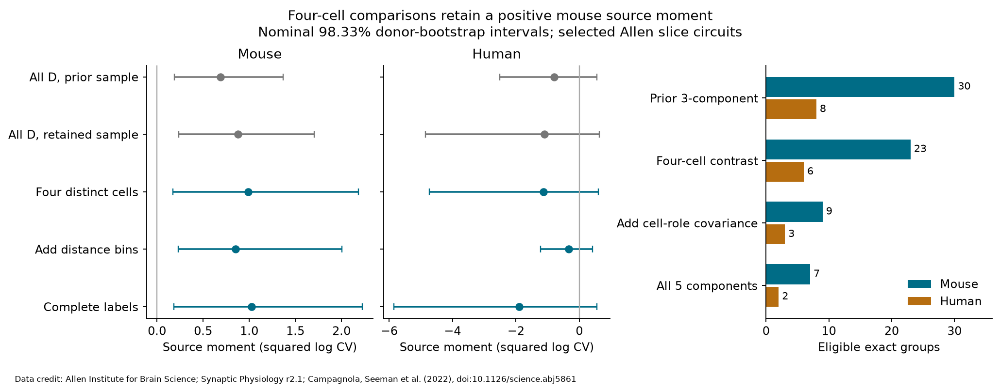

# Four-cell contrasts retained a positive source moment in 23 Allen mouse slice groups under an additive model

## Result

A source-cell contribution to resting synaptic variability remained positive when we used comparison pairs with four distinct cells. These pairs permit a contrast that does not require independence between the source and target effects of the same neuron. They also permit covariance between the errors of reciprocal connections. Under the stated additive model, the mean mouse source moment was 0.989 [0.170, 2.183] squared log-CV units. Brackets give a nominal 98.33 percent donor bootstrap interval. The sample had 100 connections in 23 exact groups, 22 recordings and 22 inferred mice. The human estimate was -1.124 [-4.729, 0.598], from 27 connections in six groups and six inferred donors.

This is a stronger assumption check of an earlier result on the same data. It is not an independent replication. It does not show a source-cell release mechanism, trial-by-trial shared noise, or reliable population coding.

Figure 1. Left and center: source moments and nominal 98.33 percent marginal intervals. The panels use different scales. Gray rows use all pairs with neither same-role endpoint; the first row uses the prior sample and the second uses only the retained sample. Blue rows use four-distinct-cell comparisons. Right: exact groups available for increasingly rich local decompositions. All results use original aggregate analysis of Allen Institute for Brain Science Synaptic Physiology r2.1 data, described by Campagnola, Seeman and colleagues (2022), doi:10.1126/science.abj5861.

## Question and prior work

A circuit model can assign a common variability term to the outgoing connections of one neuron. Such a term can affect a model of signal reliability. Before assigning it, one must check whether apparent source sharing can instead arise from the same cell acting as a target, or from reciprocal connection effects.

Campagnola, Seeman and colleagues measured local chemical connectivity and synaptic dynamics in mouse and human cortical slices ([source paper](https://doi.org/10.1126/science.abj5861)). We link connectivity and physiology through pair and cell IDs within each recording. We do not join separate animals or infer a connection from activity correlation.

SCI sha256:8e75b82a74240a247aab381c8b615f9ac0a92244d2c80fa83f25e670f2d7e6df found a positive mouse source moment under independent source and target effects. We read its report and verified analysis code. We retain its extraction, exact groups, inferred donor rules, and recording weights. We add two covariance terms, split the old disjoint-role pair class into three cell-overlap classes, and use the four-cell class to estimate source, target, and edge moments. We reproduce its point estimates exactly. Its original bootstrap seed and draw count differ from ours.

SCI sha256:026ed84db52f6913644f68a0a99a59b010077c3de5a2dbea14295f566c02eab7 found no clear class-controlled serial-path variability matching in the same source data. That permutation test does not estimate the covariance components tested here. Neither campaign result is independent source data.

The model with sender, receiver, and reciprocal-edge covariance is established in the social relations literature ([Koster, Leckie and Aven, 2020](https://doi.org/10.1177/1525822X19889011)). Identification through independent component matrices is also established ([Hunter and colleagues, 2021](https://doi.org/10.1007/s10519-021-10055-x)). We claim a new model check and data-support audit for these selected neural circuits, not a new general random-effects model.

Campaign searches covered connectome structure and function, Allen dynamics, shared presynaptic dynamics, synaptic variability, serial paths, cross-role effects, and variance components. Search outputs were inspected before the precise question was fixed. We used public reports and shared source data. No private worker workspace was used.

## Data and selection

Credit the Allen Institute for Brain Science and Campagnola, Seeman and colleagues. The source is the [Synaptic Physiology r2.1 small database](https://allen-synphys.s3-us-west-2.amazonaws.com/synphys_r2.1_small.sqlite), object date 2023-01-26. Its metadata gives db_version 22 and creation date 2021-12-21. We read this exact shared file in place:

`/mnt/dell-data/shared_datasets/allen-synphys-r2.1-small-20230126/synphys_r2.1_small.sqlite`

Size: 176771072 bytes. Measured SHA-256:

`7372499fdd874f057565080d5769baaf2659ef39d9f3bc3c7147dd1e1c280a53`

The resolved immutable path is in files/evidence/provenance.json. The analysis checks this hash and opens SQLite read-only. No source database was downloaded or changed.

We require a detected chemical connection, a joined synapse record, dynamics QC, mouse or human tissue, and distinct endpoint cells. This selects 2,112 edges. Of these, 1,594 have a finite stored variability value: 1,353 mouse and 241 human. Missing values are not zero and are not absent edges. Exact groups fix recording, synapse sign, both nonsynaptic cell classes, both Cre labels, and both cell target-layer labels. Missing labels form explicit categories.

The measured value is the stored natural log of a noise-corrected coefficient of variation. The pinned [Allen definition](https://github.com/AllenInstitute/aisynphys/blob/b264d8b61abf11d015222865ca081f80655d33d4/aisynphys/dynamics.py) uses the standard deviation of resting response amplitudes after subtraction of noise variance, divided by the absolute resting median amplitude. Resting responses follow a prior pulse by more than 8 seconds. We do not log this value again. The code definition uses the median despite a nearby comment about a percentile. Its exact relation to the database build is unknown. We use no stored pulse arrays or paired-event correlations.

## Model and contrast

Within each exact group, let

`y_ij = mu + a_i + b_j + e_ij`.

Here a is a source-cell effect, b is a target-cell effect, and e is an edge effect plus error in its summary. Their variances are A, B and E. We allow `Cov(a_i,b_i)=C` for one physical cell and `Cov(e_ij,e_ji)=R` for a reciprocal edge pair. Other cell effects are independent across different cells. Cell and edge effects are independent. Edge effects are independent except for the reciprocal term. Moments are constant within a group, but can differ between groups. These are model assumptions after selection on the observed graph. The data do not establish them.

Let q be one half of the mean squared difference of two edge values. The expected values are:

| Pair type | Example | Distinct cells | Expected q |
|---|---|---:|---|
| S | i to j; i to k | 3 | B + E |
| T | i to j; k to j | 3 | A + E |
| D0 | i to j; k to l | 4 | A + B + E |
| D1 | i to j; j to k | 3 | A + B + E - C |
| D2 | i to j; j to i | 2 | A + B + E - 2C - R |

For example, each edge variance is A+B+E. Two serial edges have covariance C, which subtracts C from their half squared difference. Reciprocal edges have covariance 2C+R. This gives every row in the table.

Thus `A0=qD0-qS`, `B0=qD0-qT`, and `E0=qS+qT-qD0` do not depend on C or R. Our primary sample requires S, T and D0 so it can estimate all three components and compare them with the prior three-component method. Estimating A alone does not require T. At least four distinct cells are needed for D0, but four cells alone do not ensure the required edge pairs exist.

If all five pair types are present, `C=qD0-qD1` and `R=2*qD1-qD0-qD2`. The five-by-five design matrix in files/check.py has determinant one and rank five. Every row subset is independent. Without D0, the vector `(1,1,-1,1,-1)` lies in the null space for parameters `(A,B,E,C,R)`. Therefore the available difference moments then cannot separate the three variances when both covariance terms are free. This is a statement about local group-specific pair-difference moments. A global model can gain information by assuming common parameters across groups.

The prior method pools D0, D1 and D2 as D. If their proportions within a group are w0, w1 and w2, its source moment has expectation `A - w1*C - w2*(2*C+R)`. The same bias enters its target moment. The edge moment has the opposite bias. This equation explains the sensitivity check; it does not measure the actual bias without additional assumptions and observations.

## Estimation and uncertainty

files/PLAN.txt was fixed before outcome calculation. It is an exploratory plan, not an external registration. We calculate each q from all unordered pairs of the given type, average groups equally within each recording, then average recordings equally within each species. Pair counts are not independent sample sizes. We do not truncate negative component estimates.

We resample inferred donors 9,999 times with seed 110711, retaining all recordings of each selected donor. Bootstrap donor counts follow a multinomial distribution. Mouse labels use the six-digit specimen number; human labels use the Hxx.xx.xxx prefix. Slice ID is a fallback when parsing fails. One retained mouse group needs that fallback, which can split a real animal across clusters. These labels are not a verified donor register.

Primary intervals have nominal 98.33 percent marginal coverage. Bonferroni gives nominal 95 percent joint coverage for three moments within one species if the bootstrap coverage assumptions hold. The species are separate exploratory families. We also report a descriptive 95 percent interval for the paired source-moment change on the retained sample. All intervals condition on the selected graph and fixed summary values. They omit response-fit uncertainty, selection uncertainty and donor-label error. Six human donors give poor support for interval coverage. There is no equivalence test or external confirmatory test.

## Data support

| Species and stage | Exact groups | Edges | Prior S,T,D groups | S,T,D0 groups | Add D1 | All five types |
|---|---:|---:|---:|---:|---:|---:|
| Mouse, QC | 1387 | 1828 | 44 | 33 | 14 | 10 |
| Mouse, finite | 1069 | 1353 | 30 | 23 | 9 | 7 |
| Human, QC | 188 | 284 | 12 | 9 | 6 | 2 |
| Human, finite | 169 | 241 | 8 | 6 | 3 | 2 |

The stronger primary support rule removes seven of the 30 finite mouse groups and two of the eight human groups. The retained sample contains 7.4 percent of finite mouse edges and 11.2 percent of finite human edges. The mouse sample has 16 inhibitory and seven excitatory groups; 22 groups are VisP and one lacks a region label. The human sample has five excitatory and one inhibitory group, all TCx. Species, region and group mixtures are confounded.

## Component results

Units are squared natural log CV. Brackets give nominal 98.33 percent marginal intervals.

| Species | Source A0 | Target B0 | Edge plus error E0 |
|---|---|---|---|
| Mouse | 0.989 [0.170, 2.183] | 0.511 [-0.507, 1.779] | -0.027 [-1.201, 1.057] |
| Human | -1.124 [-4.729, 0.598] | -0.089 [-0.815, 0.552] | 2.421 [-0.306, 7.836] |

The mouse primary comparisons have 39 S pairs, 43 T pairs and 58 D0 pairs. Human counts are 11, 11 and 21. The target and edge intervals include zero in both species. Negative moments are sampling estimates, not negative biological variances. The mouse edge point estimate is slightly negative. We have not fitted a valid joint covariance matrix with nonnegative variances and covariance bounds. This result therefore does not validate the complete model.

The prior all-D source estimate is 0.687 in all 30 mouse groups. It is 0.876 in the 23 retained groups. Replacing D with D0 in this same retained sample raises it to 0.989. The paired change is 0.112, with a descriptive 95 percent interval of -0.206 to 0.556. Thus the positive corrected moment does not establish that the correction itself raises the population mean. In human, the corresponding retained-sample values are -1.101 and -1.124; the paired change is -0.023 [-0.152, 0.110]. Sample loss and contrast change must be kept separate.

## Sensitivity checks

| Check | Mouse groups / donors | Mouse A0 [98.33 percent interval] | Human groups / donors | Human A0 [98.33 percent interval] |
|---|---:|---|---:|---|
| Primary | 23 / 22 | 0.989 [0.170, 2.183] | 6 / 6 | -1.124 [-4.729, 0.598] |
| Add distance bins | 11 / 11 | 0.852 [0.232, 2.005] | 3 / 3 | -0.334 [-1.217, 0.416] |
| Complete labels | 22 / 21 | 1.027 [0.184, 2.228] | 4 / 4 | -1.899 [-5.849, 0.554] |

The distance check keeps positive distances at most 500 micrometres and adds exact 100 micrometre bins to the group. Complete labels requires nonblank values in all six cell-label fields. Both checks change selection. They are descriptive checks rather than extra confirmatory families. All mouse source intervals remain positive. All human intervals include zero. Leaving out one inferred mouse donor at a time gives source means from 0.638 to 1.071. Human means range from -1.504 to 0.130.

Only nine mouse and three human primary groups support the cell-role covariance contrast C with the full variance contrast. Their C means are 0.305 and -0.704. Their 95 percent intervals include zero. Only seven mouse and two human groups support all five components. Their R means are 0.160 and 3.577. With only two human donors, an ordinary donor bootstrap cannot give a reliable population interval; its nominal positive interval in the saved descriptive output is not evidence of human reciprocity covariance. The distance C and R checks also have only two donors in some cases. These sparse results are not a biological finding.

## Checks and limits

A separate extractor reads each source table and matches all 2,112 selected rows and every extracted field. An independent checker uses external edge values to rebuild all 30 pooled point estimates and their counts without importing the analysis code. It checks all 120 interval arrays against saved draws. It also checks 4,752 covariance-pair calculations, all 4,096 loop-free directed graphs on four labeled cells, and all 32 row subsets of the design. All checks passed. The prior point values and support counts agree exactly. A complete rerun was also compared numerically with the saved output; see files/evidence/rerun_validation.json.

The main result removes two independence assumptions from one positive source moment. It leaves substantial assumptions in place. Coarse labels, unmeasured synapse position, cell health, common electrodes, amplitude-dependent summary errors, and response detection can create shared-cell patterns. The source moment includes source-associated measurement error. It cannot isolate biology from recording quality. Missing values and dense-circuit selection can change the result. Different cell effects can be correlated across distinct neurons, contrary to the model. Random effects can also depend on the sampled graph.

Only selected chemical connections in slices are observed. These are not complete connectomes or simultaneous population noise measurements. The human analysis is small and does not replicate the mouse sign. No activity under behavior is included. These data do not establish transfer across brain regions, species or behavioral conditions. A next study should collect several complete four-cell branching and converging motifs per verified donor, repeat each response summary on independent trials, and estimate cell-level and edge-level measurement error. The method can guide that design.

## Reproduce and reuse

See files/REPRODUCE.md for exact commands. The package contains original code, SQL, plan, pooled estimates, pooled bootstrap draws, graph audits, checks, figure, source hashes and environment versions. Externally licensed records and per-group tables remain outside the signed package. The retrieval script writes only into a new external directory. The analysis can recreate these external tables from the hash-checked public database. It does not require private scratch from this run.

The baseline LICENSE applies to original bundled materials. External Allen data retain their source terms. Attribution, URLs, rights separation, and the stopped optional definition-file download are recorded in files/EXTERNAL_NOTICE.txt. No Allen source data or implementation is included. Early runs exposed two NumPy-integer JSON encoding errors; the code was fixed and the complete analysis was rerun. The source data were not changed.

## Job record

Campaign: 11_07_2026. Job: sci-1107-hp-neural-structure-and-computation-e81dd1f51c32. Topic: neural-structure-and-computation. Machine: hp. Account: codex-olen. Model: gpt-6.1-sol with high reasoning effort through the Codex harness in T3 Code. No agents were launched. The analysis used one numerical-library thread within the two-CPU budget. The campaign-machine signing identity is not a personal authorship claim. This worker saved the publication locally and made no remote archive upload or index submission.
