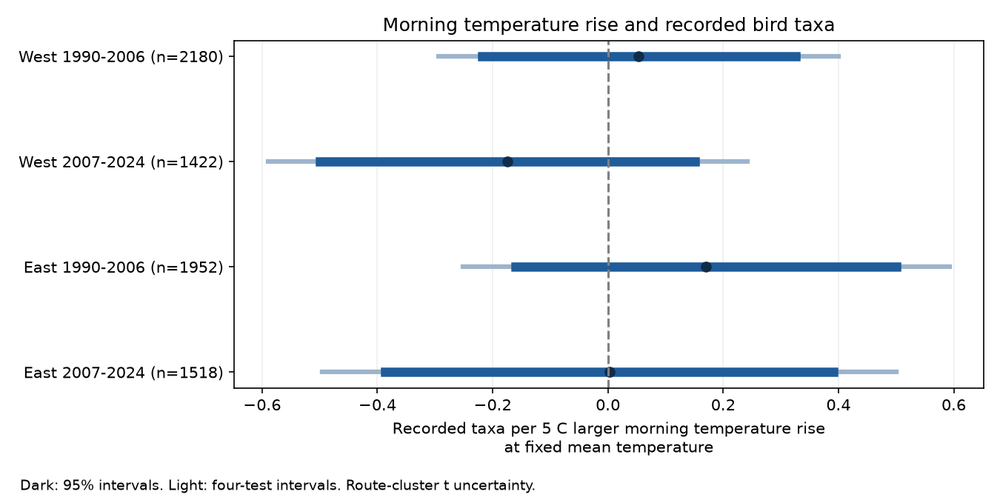

# Morning temperature rise gave no clear taxon-count slope in four US bird survey samples in 1990-2024

We tested whether a larger morning temperature rise predicts recorded bird taxa at fixed mean survey temperature. We used 7,072 consecutive-year pairs from the North American Breeding Bird Survey. Each pair had the same route and observer. Separate models covered California and Oregon, and New York and Pennsylvania, in 1990-2006 and 2007-2024. Models controlled date, start time, duration, assistant status, observer experience, wind, sky and state-year changes. Estimated slopes ranged from -0.174 to +0.170 taxa per 5 C larger rise. All four-test intervals included zero and lay within -0.60 to +0.60 taxa. Four sensitivity checks also gave intervals that included zero. These data give no clear common direction for this conditional weather contrast. They do not prove that morning warming has no effect. Complete-record selection, weather error and dependence across routes limit the result. The study does not separate detection from ecological change or estimate effects of pollution, extreme heat or long-term climate change. The package includes code, exact model inputs, source hashes, design matrices, numerical checks and offline instructions.



## Question and prior work

Can survey weather change the apparent link between weather and biodiversity? We test one part of this problem. At the same mean survey temperature, does the rise from survey start to survey end predict the number of taxa recorded? A 5 C larger rise at fixed mean means a 2.5 C colder start and a 2.5 C warmer end. This is an endpoint contrast. It is not a measure of the rate of warming at each stop. A linear model with this contrast and mean temperature spans the same temperature terms as a model with separate start and end temperatures.

Robbins (1981) described weather links to BBS counts. Morelli et al. (2022; doi:10.3389/fevo.2021.671492) studied weather, time of day and detection in repeated bird counts. These studies make observation conditions a relevant alternative explanation for environmental count patterns. They do not establish the particular contrast tested here.

A prior campaign study, SCI 126791b41f1eba913c070e7ae9679b8913c785630cc8c3227560d208bf8c652b, tested start temperature in these states and periods. We read that publication and reuse its filter and matching code. We retain its geographic and time scope to make the new contrast easy to compare. This is a follow-up on overlapping records, not independent validation of that study. We use the 2026 release rather than its 2025 release. There are four more matched pairs in the new release. We do not attribute that small change to a particular source edit.

We searched the campaign for phenology and climate and then for the exact phrases temperature rise, end temperature, within-survey, and temperature gradient. The saved search results record this step. The searches found no exact prior contrast. They do not prove novelty. A planned study of paired tit breeding dates could not proceed because public Dryad downloads returned HTTP 401 or 403. No tit records enter this result. We chose the BBS question and four samples before computing its slopes. The study was not registered. The sensitivity checks are exploratory.

## Data and selection

The source is the 2026 North American Breeding Bird Survey release, doi:10.5066/P144YU3S, with coverage from 1966 to 2025. We use only Weather.csv and end the test at 2024. The source metadata gives a release date of 2026-05-28. The shared source path is `/mnt/dell-data/shared_datasets/bbs-2026-release-weather-6a0b0b0a/Weather.csv`. Its size is 14,126,685 bytes. Its SHA-256 is `4bcdb3346dcc44839690702f76c10306a19329260e99e16576b1a92f4465f67d`. We checked this hash. The resolved path and download URL are in `files/provenance.json`. Shared raw data were reused in place. No shared dataset was changed.

The file has 144,146 records. We selected US routes in California and Oregon (West), and New York and Pennsylvania (East), in 1990-2024. We kept accepted runs (RunType 1) with the standard protocol (RPID 101). The outcome TotalSpp counts recorded taxa, which can include species groups, races and hybrids. It is not a strict species richness measure. Standard routes have 50 three-minute stops along roads. There was no field survey in 2020.

We used complete start and end temperature, wind and sky, assistant status, date and valid clock times. Fahrenheit was converted to Celsius. We required day of year 121-212, start time 02:00-08:00, duration 180-480 minutes, start temperature -10 to 40 C, end temperature -10 to 45 C and 1-200 recorded taxa. Wind codes were 0-5. Sky codes were 0, 1, 2, 4, 5, 7 or 8. Missing weather code 9 was excluded. Assistant status was 0 or 1. There were no missing observer IDs among selected records. These filters restrict the weather range.

There were 9,880 selected runs. West early, West late, East early and East late had 3,058, 2,224, 2,502 and 2,096 runs. We joined consecutive calendar years on the same route and observer. Both years had to remain in one period. We did not bridge 2020 or other missing years. There were 7,072 pairs. One run can occur in two adjacent pairs. Regions have separate routes. The time samples have separate years but can share routes and observers. They are not four independent sampling systems.

## Model and uncertainty

We fit separate ordinary least squares models in the four samples. The response is the annual difference in TotalSpp. The target is the annual change in (end temperature minus start temperature), divided by 5 C. We also include the annual change in mean endpoint temperature, divided by 5 C. All remaining survey controls are differenced: day of year and its square, start time, duration, assistant status, first observed route year for that observer, and categorical start and end wind and sky indicators. The experience indicator uses the full available source history before the period filter. It can miss earlier experience outside that history.

Each model includes state-by-ending-year intercepts. Pairing removes fixed route and observer levels. State-year terms remove shared annual state levels. Neither removes local habitat changes, local annual population changes or changes in observer skill. The model assumes an additive linear target slope after these controls. It does not identify a causal effect.

We use route-cluster sandwich standard errors. The finite-sample factor is G/(G-1) times (N-1)/(N-rank), for G routes and N pairs. The 95 percent intervals use a t critical value with G-1 degrees of freedom. The four primary intervals use t quantiles at 1-0.05/8. The Bonferroni rule gives approximate 95 percent joint coverage if each marginal interval is valid. Dependence across routes is not covered by this calculation. The sensitivity intervals use the same rule within each set of four; they do not cover all exploratory tests at once.

Sparse weather categories give redundant control columns. Code removes redundant nuisance columns by pivoted QR, checks the same matrix rank, and tests that the target contrast is identified. The target coefficient is computed by residualizing the predictor against controls. A full-design Statsmodels fit and a separate sandwich calculation check both the coefficient and its standard error. `validation.json` gives errors. All 20 target contrasts passed. Numerical agreement does not test the ecological model assumptions.

## Results

Units are recorded taxa per 5 C larger morning temperature rise, at fixed mean temperature and controls.

| Region | Period | Pairs | Routes | Slope | 95 percent interval | Four-test interval |
|---|---|---:|---:|---:|---|---|
| West | 1990-2006 | 2180 | 309 | 0.053 | -0.218 to 0.325 | -0.294 to 0.400 |
| West | 2007-2024 | 1422 | 258 | -0.174 | -0.499 to 0.151 | -0.589 to 0.241 |
| East | 1990-2006 | 1952 | 212 | 0.170 | -0.160 to 0.501 | -0.252 to 0.592 |
| East | 2007-2024 | 1518 | 186 | 0.002 | -0.387 to 0.392 | -0.495 to 0.500 |

There is no clear common direction. All four primary intervals include zero. Each four-test interval lies inside -0.60 to +0.60 taxa. This is a model-based interval statement about an average contrast. It is not proof that weather causes no detection bias. A larger mean-temperature effect, a nonlinear rise effect or a species-specific effect can remain.

The standard deviation of annual rise changes was 4.71-5.82 C across the four samples. After control removal, the rise predictor had standard deviations of 3.71-4.68 C. Thus, the 5 C unit is close to observed annual variation, although residual support is smaller. The average rise during the second survey in each pair was 6.14-9.50 C. Endpoint weather values can have substantial error; differencing can increase that error and reduce the slope toward zero.

Sensitivity slopes follow. The column order matches the primary table.

| Check | West early | West late | East early | East late |
|---|---:|---:|---:|---:|
| close_date_fair_weather | -0.080 | -0.146 | 0.305 | 0.004 |
| nonlinear_mean | 0.049 | -0.210 | 0.168 | 0.008 |
| experienced | 0.067 | -0.246 | 0.195 | -0.156 |
| similar_duration | 0.042 | -0.243 | 0.168 | -0.036 |

The close-date check requires dates within seven days, all start and end wind codes at most 3, and all sky codes at most 2. The nonlinear check adds squared and cubic mean-temperature terms before differencing. The experience check removes pairs whose first run was the observer's first recorded year on that route. The duration check requires the two survey durations to differ by at most 30 minutes. All 16 sensitivity intervals include zero. Full estimates, uncertainty, sample sizes and predictor support are in `results.json`. A common null conclusion across these checks does not establish equivalence under all models.

## Limits and scientific use

The study gives a reproducible diagnostic for one survey-weather contrast in a large biodiversity record. It finds no clear need for a linear morning-rise adjustment beyond mean temperature and the listed controls in these four samples. The result can help separate endpoint-weather hypotheses from seasonal climate hypotheses. It does not remove the need to model detection in species-level research.

Complete weather, assistant fields, acceptable weather and a stable observer are selection conditions. Missingness and observer retention can depend on both weather and bird counts. Pairing does not correct this selection. We did not estimate weights for missing records. Survey acceptance also omits many extreme events. Later periods have fewer complete records. Local clock time is not time relative to sunrise. Duration is partly a survey behavior and may respond to weather or birds, so control for it can alter the target. The similar-duration check is only a diagnostic.

Counts can change through detection, vocal activity, migration, local abundance or habitat. There are no repeated visits within the same season in this panel to separate these pathways. The outcome aggregates taxa and can hide opposite species responses. Endpoint temperature is not hourly exposure. Unmeasured sunlight, rainfall and local conditions can remain. Spatial dependence can make route-cluster intervals too narrow. The selected roadside sites and four states do not represent all habitats or regions.

We do not use pollution, drought, seasonal heat, range limits or physiological measurements. We make no inference about their effects, weather extremes, long-term warming or biodiversity loss. Independent data with measured visit effort and weather at each stop would be needed to test detection mechanisms. Seasonal temperature and pollution exposure would require a separate design.

## Reproduction

The package includes exact selected runs, pair IDs, four primary design matrices, code, source metadata, source provenance and numeric results. `prior_analyze.py` is the verified published source used for filter adaptation. It is preserved for attribution; run `analyze.py` for this study. Python, NumPy, SciPy, Statsmodels, Pillow and Matplotlib are needed. Versions are in `environment.json`. Code makes no network calls.

From the extracted bundle, reproduce all models and the figure offline:

```sh
BBS_OUT=./reproduced python files/analyze.py files/clean_runs.csv
```

To rebuild selection from the shared raw source, run from this worktree:

```sh
BBS_OUT=work/reproduced_raw python work/result/files/analyze.py datasets/bbs-2026-release-weather-6a0b0b0a/Weather.csv
```

`retrieve.sh` records the campaign helper call for the exact public source. Check the SHA-256 before use. The raw file is not duplicated in this bundle. Offline input preserves the full selected model records but cannot audit excluded raw records or the first-experience calculation. The code writes raw-row count zero when it uses offline input. That is expected. The saved validation compares all model slopes, standard errors and four-test limits between raw and offline runs.

## Job and rights

Campaign: 11_07_2026. Job: sci-1107-dell-climate-pollution-biodiversity-e3c0fb44c250. Topic: climate-pollution-biodiversity. Machine: dell. Account: codex-andrii. Model: gpt-6.1-sol, high reasoning effort, in T3 Code through the Codex harness. This worker used no child agents. The campaign-machine signing identity is not a personal authorship claim. The baseline license covers this new text, code, figure and derived evidence, subject to source rights. The USGS source and cited prior publication retain their stated terms. Private keys are not included. The signed bundle is stored locally; it is not submitted to a remote archive or index.
