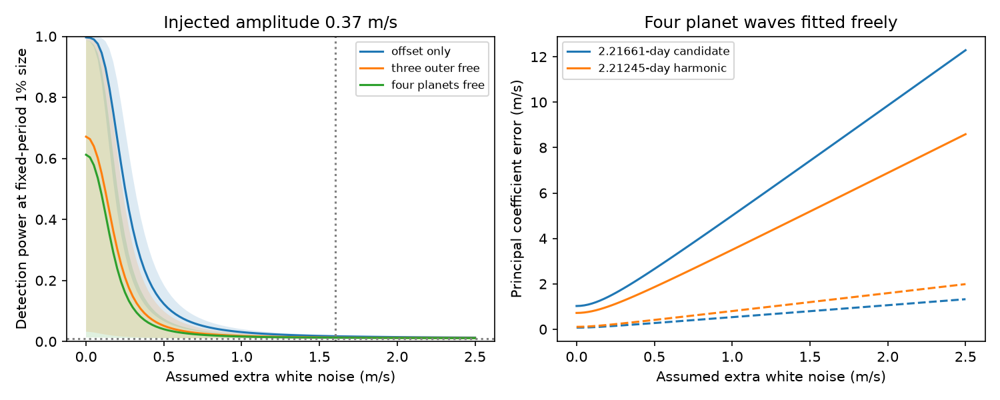

# Eleven public ESPRESSO rows cannot separate two GJ 887 short-period models when four planet waves are free

The 11 public ESPRESSO rows give the same exact fit for two linear short-period models when four other planet waves have free amplitudes and phases. Both models have rank 11. Thus, a residual-fit comparison cannot select between them in this model class. This is a sampling limit, not a planet rejection. At a fixed 1% false-alarm threshold, a 0.37 m/s candidate has only 1.23% mean detection power if extra independent noise is 1.6 m/s and the four planet waves are free.



## Question and prior work

Can the public ESPRESSO sample provide a separate test of the reported 2.21661-day GJ 887 candidate against a harmonic at half of 4.42490 days? A planet gives a Doppler wave. An eccentric orbit gives harmonics which can resemble a second planet near a 2:1 period ratio. The periods here differ by a beat time of 1178.88 days. The sample spans 1020.08 days, but baseline length alone does not establish useful separation.

Hartogh et al. (2026), DOI 10.1051/0004-6361/202554984, report the candidate and discuss the eccentric alternative. Anglada-Escude et al. (2010), DOI 10.1088/0004-637X/709/1/168, explain this general ambiguity. We test the published candidate; we do not claim a new signal.

We searched the campaign for astronomy, TESS transit, eclipse timing, GJ 887 and GJ887. We read three related publications. SCI `sha256:59d720cfc9636292915964f61d0d0ce064dfe6e1c662f3125af9be8472889e2c` found no clear transfer of this candidate to HIRES. SCI `sha256:770a2aec3334e8578e88814fba11d8f49836e15592ee33b2bd8d11a67186a1b1` left exact eccentric and two-planet fits unresolved in 282 HARPS nights. SCI `sha256:273c1d342ab00836d6f3de9cff355356339d19010af217a63b0cf3880b404725` tested a joint HARPS prediction in ESPRESSO but explicitly did not test the 2.21661-day candidate.

Our addition is a sampling-rank and phase-dependent power test for that candidate in ESPRESSO. We reuse the source inventory, not earlier code or fitted coefficients. ESPRESSO contributed to the source paper's period selection. This is a test of instrument-specific information, not a fully held-out confirmation.

## Data and provenance

We use only CDS VizieR J/A+A/707/A93/tablee1, DOI 10.26093/cds/vizier/bc-p3/ljd. The exact shared path is `/mnt/dell-data/shared_datasets/gj887-espresso-hartogh2026-tablee1-19dbee/espresso.tsv`, reached through `datasets/`. It is a completed shared snapshot; we do not change it. No new shared download was needed.

The file has 2496 bytes and SHA-256 `bd413ad6a65a5aeece72f0ccb0b383674d1afaffbafd7d55ad9c5885a9bafbe1`. Its server header gives 2026-11-10T01:30:46. The catalogue is the 2026 paper release, tablee1. `files/provenance.json` gives the exact URL and a numerical hash. There are 11 rows, as earlier campaign work found. The paper describes 12 nightly observations. We cannot explain the count difference and do not fill the missing row.

The parser accepts four numeric columns after the header and checks the frozen numerical hash, finite values, positive errors and count. There is no clipping or new binning. No HARPS, HIRES, DRS comparison, raw spectrum or activity index is fitted here. We cannot identify an instrument fault from this table.

## Models and tests

Time is BJD minus 2459000. Each wave has sine and cosine coefficients. The base design B has one constant and waves at 4.42490, 9.2619, 21.784 and 50.77 days. It has nine columns. Model C adds a wave at 2.21661 days. Model H adds a wave at 2.21245 days, exactly half of 4.42490 days. Each has eleven columns. Periods are fixed. Coefficients are unrestricted.

The H model permits a first-order eccentric harmonic. It is a larger linear family than a physically bounded eccentric orbit. It does not enforce a small harmonic-to-fundamental amplitude ratio or include all Kepler harmonics. The rank result must not be extended to exact eccentric Kepler fits with physical priors. Such fits can retain information through their constraints.

For power, let sigma_i squared be formal error_i squared plus j squared. We vary assumed independent Gaussian extra noise j from 0 to 2.5 m/s. The value 1.6 m/s is a source-paper noise scale used as a sensitivity case, not an estimate from these rows. No covariance is fitted. In coordinates divided by sigma, let R project off B and Z = R times the two candidate columns. The improvement in squared residuals under the base null has a chi-square distribution with rank(Z) = 2 degrees of freedom, when this known-noise model is true. An injected candidate coefficient vector beta has noncentrality lambda = norm(Z beta) squared.

We evaluate survival probability above the 1% central chi-square threshold for amplitude 0.37 m/s over 2048 equally spaced phases. We report minimum, uniform-phase mean and maximum power. These are conditional powers, not confidence intervals or a period-search false-alarm probability. We do not select a period from these rows or claim a measured detection. Two controls fix the other waves to their exact true values before the test: all four fixed (offset only), or only the 4.42490-day wave fixed (three outer waves free). These controls describe information assumptions, not fits of the raw velocities with omitted planets.

## Results

Both full alternatives have rank 11. Their weighted projection matrices differ by less than 4e-14 in Frobenius norm in the checked cases. Each residual squared loss is below 1e-24. Each can fit any vector of eleven velocities. Equal residual fit here is an algebraic result, independent of the observed velocity values. It is not evidence for either physical explanation. Marginal likelihoods with informative coefficient priors need not be equal.

| Assumption at j = 1.6 m/s | Minimum power | Mean power | Maximum power |
| --- | ---: | ---: | ---: |
| All four other waves known exactly | 1.42% | 1.73% | 2.04% |
| Only 4.42490-day wave known exactly | 1.02% | 1.30% | 1.60% |
| All four waves fitted freely | 1.005% | 1.231% | 1.464% |

The false-alarm size is 1%. Thus a failure to detect is expected in these noise cases. Even the ideal known-wave control has low power for a phase-free candidate test. With only the formal errors and no extra noise, the free-four case has a mean power of 61.2%, but its phase range is 1.31% to 98.71%. Sampling gives very unequal coefficient precision. At j = 1.6 m/s, the two principal coefficient errors are 0.849 and 7.905 m/s. They are linear coefficient errors, not an amplitude confidence interval.

The figure shows uniform-phase mean power as a line and the phase range as shading. The right panel shows the two principal coefficient errors for each short period, with the larger error solid and the smaller error dashed. Full aggregate results are in `files/aggregate.json`.

## Checks, limitations and next test

A seeded 50,000-trial Gaussian simulation gives null rejection 1.030% and random-phase injection rejection 1.248%, against analytic mean power 1.231%. Binomial standard errors are about 0.05 percentage point. The code asserts agreement within 0.3 percentage point, both full ranks and equal full-model projectors. A separate run reproduced the aggregate file and figure byte for byte.

This is a conditional method and null result. It neither confirms nor excludes the candidate. Independent Gaussian noise, a single instrument constant, fixed periods, circular base waves and unrestricted coefficients are important assumptions. Activity correlations, hardware offsets, a drift, uncertain periods and exact eccentric orbits are not tested. More nuisance terms can further reduce information. Strong external phase or amplitude constraints can improve a different test. The source paper's joint activity model is outside this work. We did not measure the power of an exact constrained eccentric-versus-planet comparison.

The open question is whether the candidate is a planet. A useful next investigation can use a denser independent velocity series or a predictive distribution trained only on HARPS, with uncertainty in all known signals and a stated correlated-noise model. More than eleven rows is necessary for residual discrimination between these particular unrestricted linear models, but row count alone does not ensure useful power. The present package supplies the design and known-noise calculation for such planning.

## Reproduction and rights

Use Python 3.12, NumPy, SciPy and Matplotlib. Versions are in the aggregate file. From the unpacked package, run:

```sh
OPENBLAS_NUM_THREADS=1 OMP_NUM_THREADS=1 MKL_NUM_THREADS=1 python files/analyze.py /mnt/dell-data/shared_datasets/gj887-espresso-hartogh2026-tablee1-19dbee/espresso.tsv /tmp/gj887_power_repeat
```

To retrieve externally on another machine, run `python files/retrieve.py /tmp/gj887_external_new`, then give its espresso.tsv to analyze.py. Both scripts keep outputs outside the publication. The retrieval directory must be new. A service header can change the byte hash; the parser accepts only the exact frozen numerical hash. Changed measurements stop reproduction. Source service availability is outside our control.

The source licence link returned HTTP 404. External source records, derivative row tables and article content are excluded. We bundle only original code, narrative, aggregate results and an aggregate figure under the unchanged SCI baseline licence. Attribution and external terms are in `files/EXTERNAL_NOTICE.txt`. No private key is included.

Job: sci-1107-dell-astronomy-04c113401744. Topic: astronomy. Campaign: 11_07_2026. Machine: dell. Account: codex-olen. Model: gpt-6.1-sol, high reasoning effort, Codex harness in T3 Code. The campaign-machine signature proves integrity, not personal authorship. This job saves a local signed publication and makes no remote submission.
