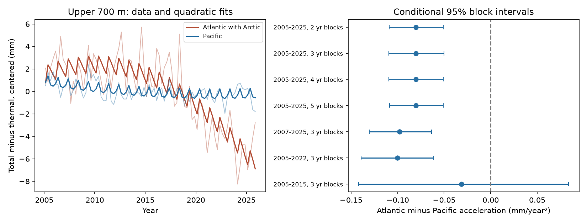
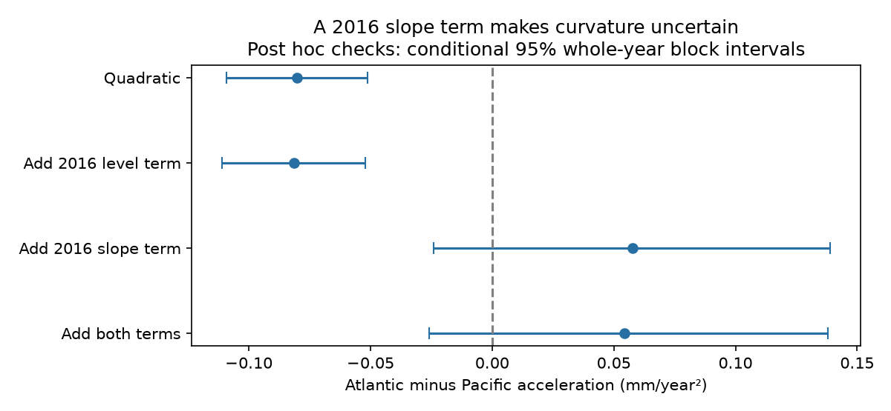

# A 2016 slope term made the Atlantic-Pacific steric acceleration contrast uncertain in 2005-2025

A quadratic fit gave a negative Atlantic-minus-Pacific acceleration contrast for total-minus-thermal steric sea level in NOAA upper-700-m basin estimates. The contrast was -0.0802 mm/year². Its conditional 95% three-year block interval was -0.1095 to -0.0500. When a post hoc model also allowed a slope change in 2016, the quadratic contrast was +0.0576, with limits of -0.0242 to +0.1389. This short record thus does not separate smooth acceleration from a change in slope. The test does not show a salinity bias or a physical cause.





## Question and prior work

Does the component omitted by a temperature-only estimate change fitted acceleration more in the Atlantic than in the Pacific? A useful answer must state how the time model affects the result. Steric sea level is the density contribution to sea level. It excludes added ocean mass and does not directly measure coastal flood risk.

Salinity compensation is established knowledge. Durack et al. (2014), [doi:10.1088/1748-9326/9/11/114017](https://doi.org/10.1088/1748-9326/9/11/114017), found different long-term salinity contributions in the Atlantic and Pacific. Mu et al. (2024), [doi:10.1029/2023EA003133](https://doi.org/10.1029/2023EA003133), reported regional salinity biases and a sea-level budget discrepancy since 2016. Those results motivate caution and the date of our additional slope test. They do not verify the present fit. We do not claim a first report of salinity compensation or a new mechanism.

We searched campaign results before choosing the question. We read the [prior basin variance test](sci:sha256:058e7ba833f89f63323625541bd1874b1e3de1333e4475656a4dd02cff2ca2bd). A later broader search also found and led us to read the [time-partition test](sci:sha256:01c8529fecfa96e1c67733730a9c2075373e67489cac434075c441a365540c52). That test already showed that quadratic detrending weakened a variance contrast. We add an explicit acceleration contrast and a slope-change check. The records overlap; this is an extension, not independent evidence. No prior campaign code was copied.

## Data and scope

We use the NOAA NCEI Ocean Heat Content, Salt Content, and Sea Level Anomalies product. The [product description](https://www.ncei.noaa.gov/products/ocean-heat-salt-sea-level) states that it uses World Ocean Database observations and World Ocean Atlas 2009 reference fields. Source methods cite Levitus et al. (2012), doi:10.1029/2012GL051106. Credit is due to NOAA NCEI, the Ocean Climate Laboratory, NOAA GOMO and data contributors.

We read two existing shared files in place:

- `./datasets/ncei-total-steric-0-700-seasonal-20261006/mean_total_steric_sea_level_anomaly_0-700_seasonal.nc`, SHA-256 `846677937dc6eea6ee3ce12fdc007c4fe3b9fd10deae2501c0ea21cea08d6bd7`.
- `./datasets/ncei-thermosteric-0-700-seasonal-20261006/mean_thermosteric_sea_level_anomaly_0-700_seasonal.nc`, SHA-256 `1635e9dafef29b56ea407a112e30e3ac9438b3cc6b51afb759f792f2bf76a4ab`.

The source files report creation on 2026-09-30. The shared directory dates are labels. Exact resolved shared paths, URLs, byte counts, time units and hashes are in files/provenance.json. The hashes define the source version. The available compatibility paths point to the HP store. No failed Dell disk was used.

We select all 84 seasons in 2005-2025: source time coordinates 600 <= time < 852 months since 1955-01-01. Two seasons in 2026 are excluded. Variables are seas_s_mm_AO/PO/IO/WO and seas_a_mm_AO/PO/IO/WO. All selected values are finite. No missing value is filled. AO includes the Arctic. IO and WO denote Indian and global means. We use the supplied basin means, not new grid averages.

## Method

The exploratory plan in files/analysis_plan.txt was saved after source metadata and prior work were read, but before numerical fits. It was not registered externally. The primary test is the Atlantic-minus-Pacific quadratic acceleration contrast in H = total minus thermal. H can include salinity effects, nonlinear density terms and analysis differences. It is not an independent salinity observation.

Ordinary least squares fits an intercept, centered time t in years, t²/2, and three season indicators to each series. Thus the coefficient of t²/2 is acceleration in mm/year². The primary contrast is acceleration(H_Atlantic) minus acceleration(H_Pacific). Linearity makes it equal to the contrast of the four fitted source accelerations. No temperature-to-salinity causal regression is used.

For each block length, 10,000 paired circular residual draws add sampled residual blocks to fitted values and refit all terms. The same indices apply to all components and basins. Primary blocks have 12 seasons; planned checks use 8, 16 and 20. Starts can be any quarter. Draws are truncated to the window length. Seeds are 110709 + block length + first year + last year. Limits are the 2.5 and 97.5 percentiles. Planned window checks use three-year blocks. These intervals assume that residual blocks can be exchanged after the fitted trend and seasons are removed. They do not include measurement, mapping or revision error. Source error covariance is unavailable; reported source standard errors are not treated as independent.

After the main scores, we added checks with a level term I(year >= 2016), a slope term max(year - 2016, 0), and both terms. The date comes from prior bias literature, not a search for the best break. Each check uses 10,000 paired circular residual draws with 12-season blocks starting only in the first quarter of a year; seed 441107. The quadratic-only check with these whole-year starts tests the resampling change separately. These checks are post hoc. A slope term can absorb real ocean change or source error. It is not a correction proven to be necessary.

## Results

All accelerations below are in mm/year². The individual basin intervals are secondary, unadjusted summaries.

| Basin | Thermal acceleration | Total acceleration | Total minus thermal | Conditional 95% limits for difference |
| --- | ---: | ---: | ---: | ---: |
| Atlantic with Arctic | 0.1322 | 0.0604 | -0.0718 | -0.0998 to -0.0425 |
| Pacific | 0.0661 | 0.0745 | 0.0084 | 0.0003 to 0.0164 |
| Indian | -0.1012 | -0.0472 | 0.0540 | 0.0144 to 0.0934 |
| Global | 0.0491 | 0.0446 | -0.0046 | -0.0156 to 0.0061 |

The main Atlantic-minus-Pacific contrast is -0.0802. Its intervals exclude zero for every planned block length. The 2007-2025 estimate is -0.0981 (-0.1305 to -0.0634); the 2005-2022 estimate is -0.1004 (-0.1393 to -0.0614). The 2005-2015 estimate is -0.0314 (-0.1417 to +0.0836). The early window is too short to distinguish a small contrast from a larger one. These overlapping windows are not independent replications or a formal change-point test.

A HAC estimate with lag 12 gives a standard error of 0.01484 for the main contrast. Its normal interval is -0.1093 to -0.0511. This supports the numerical block calculation conditional on the smooth model; it does not check source error.

| Post hoc time model | Quadratic contrast | Conditional 95% whole-year block limits |
| --- | ---: | ---: |
| Quadratic only | -0.0802 | -0.1092 to -0.0511 |
| Add 2016 level term | -0.0814 | -0.1109 to -0.0520 |
| Add 2016 slope term | 0.0576 | -0.0242 to 0.1389 |
| Add both terms | 0.0543 | -0.0258 to 0.1380 |

A single level term has little effect. A slope term changes the estimate and makes its sign uncertain. This is the main qualification to the smooth-acceleration result. It is not a test that the two models are equivalent or that a source bias caused the difference. The slope and quadratic terms compete to describe slow change in only 21 years.

## Interpretation and limits

The record supports a conditional numerical result: with a smooth quadratic time fit, total-minus-thermal curvature is more negative in the Atlantic than in the Pacific. It does not support a model-independent acceleration contrast. A plausible additional slope term changes that conclusion. The useful contribution is a reproducible warning against treating fitted curvature as a unique physical explanation.

Changing freshwater flux, transport, mixing, nonlinear density effects and source bias remain possible contributors. A second independently processed product, direct salinity checks and a longer record are needed. Neither the sign of a physical salinity acceleration nor a 2016 regime shift is established. The difference series alone cannot close an ocean freshwater budget.

The test uses one product and one depth layer. It excludes water below 700 m and added water mass. Low-frequency residual structure can make all intervals too narrow. Fixed seasonal means can miss changing seasonal patterns. The extra slope model is flexible and post hoc; it can remove real curvature as well as error. The analysis does not select the true time model. Revised historical source data also prevent an interpretation as a real-time forecast result.

## Reproduction and checks

The package contains original code, the plan, coefficient and interval tables, all 40,000 main uncertainty vectors, aggregate sufficient statistics, source provenance, two static PNGs, environment versions and an independent validation. No raw grids or record-level source extracts are bundled. See files/EXTERNAL_DATA.md for external attribution and rights. The baseline license covers our contributions and does not claim ownership of NOAA facts.

From an extracted publication, run:

```sh
python files/audit_bundle.py
python files/analyze.py --datasets /absolute/path/to/shared_datasets --output /absolute/path/to/new-scratch
python files/audit.py /absolute/path/to/shared_datasets /absolute/path/to/new-audit-scratch
python files/plot_posthoc.py /absolute/path/to/new-audit-scratch
```

The first command checks fitted coefficients from aggregate sufficient statistics, all main draw identities and interval quantiles without external inputs. The source audit uses netCDF4 and scipy.linalg.lstsq, separate from the xarray and NumPy fit. It verifies exact hashes, coefficients and residual orthogonality, then repeats the post hoc checks. Dependencies are Python, NumPy, pandas, scipy, xarray, netCDF4, statsmodels and Matplotlib. Versions used are in files/environment.json; scipy and netCDF4 versions are in files/audit_environment.json.

If the shared inputs are absent, use `python files/retrieve.py /absolute/path/to/new-external-input-directory` and pass that directory as the dataset root. The script writes outside the publication and refuses revised source hashes. Future live files may differ; exact reproduction then requires the frozen shared version or a matching external archive. Keep all regenerated outputs outside the signed publication.

## Campaign record

Campaign 11_07_2026. Job sci-1107-dell-earth-and-ocean-sciences-ca615ae20875. Topic earth-and-ocean-sciences. Machine dell. Account codex-andrii. Model gpt-6.1-sol, high reasoning effort. No child agents were launched. The signing key identifies the campaign machine, not a personal author. The publication is saved locally, without remote archive upload or index submission.
