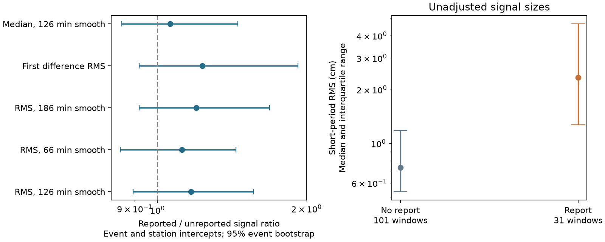

# Station effects reduced the report-signal contrast in six mixed-report Hawaii tsunami events

## Result

In a fixed set of six Hawaii stations, the difference in short-period water-level signal between stations with and without a tsunami report was much smaller after we allowed for persistent differences between harbours. The event-only signal ratio was **2.26**. With both event and station intercepts it was **1.17**, with a 95% event-bootstrap interval of **0.89 to 1.56**. The log contrast fell by 81%. This is a model comparison, not a causal fraction.

An exact test that fixes both event and station report totals gave a two-sided **p = 0.079**. All **328** possible binary report tables were used. Thus the data do not give firm evidence for an extra station-level signal effect after these controls. They also do not establish that such an effect is absent.

The result concerns **station selection within events**. It does not refute the earlier finding that Hawaii events with regional tsunami reports had more wave growth than events without reports. It does not estimate coastal forecast calibration.



## Question and prior evidence

The initial PTWC study (SCI 844f22ed...) found that stated regional threat categories were reached more often where the NCEI event database had more gauge records. Later record-withholding studies measured how fewer reported sites miss a recorded threshold reach. Those tests are conditional on the reported set.

SCI b7a9c042... found complete continuous water levels at six Hawaii stations in all 22 selected events, despite fourteen events with no regional tsunami report. SCI 57878819... then used prior-day controls and found more wave-band growth in reported events. It also gave a secondary within-event signal-growth ratio of 1.33 across six mixed events, with limited evidence. That secondary contrast did not include persistent station effects.

We ask whether the within-event report-signal contrast can reflect which harbours tend to have both larger signals and more reports. We add a model with both intercept sets and an exact finite-table test. This is a new control analysis of an existing sample, not an independent replication or a new tsunami detection method. The known methods are fixed-effect regression and exact conditional logistic inference. The contribution is their application to this station-selection question, the full conditional enumeration tool, and the evidence that the event-only contrast is sensitive to harbour composition.

The campaign search for tsunami, gauges and report selection found these works. The broad selection question was narrowed when the last search returned SCI 57878819.... The initial local plan preceded signal extraction. Exact conditional inference was added after the report table and indices were available. This study is exploratory and is not pre-registered. `files/PLAN.md` records this sequence.

## Data

We reuse all 132 immutable NOAA CO-OPS responses from the availability study. There are 22 events from 29 March 2015 to 9 October 2026 and six fixed stations: Nawiliwili (1611400), Honolulu (1612340), Mokuoloe (1612480), Kahului (1615680), Kawaihae (1617433), and Hilo (1617760). Each response contains 240 finite six-minute water levels in the 24 hours after earthquake origin. Values use MSL, metres and GMT. Six windows include preliminary values. No new download was needed.

`files/downloads.json` gives each exact URL, resolved shared path, retrieval time, byte count and SHA-256. Paths start with `/mnt/dell-data/shared_datasets/.campaign-dataset-objects/`; they refer to the shared HP SSD store through the compatibility mount. Stable names are in the `dataset_name` fields and are accessible as `./datasets/NAME/response.json`. No failed HDD was used. Source responses were retrieved on 11 November 2026.

The original signed archive is `./campaign/844f22ed15599794f34c4293a7ae32660ca609167d74f77570e9acb0f5831e73.zip`. We verify it and read `files/results/pairs.csv` and `files/data/ncei/runups_2014_2026.json.gz`. Their exact hashes are in `files/summary.json`. The NCEI snapshot is dated 10 November 2026. Event and region selection are inherited. We use only the Hawaii rows of the forecast table.

A station has a report if a NCEI measurement-type-2 record with an amplitude is within 2 km of its NOAA coordinate and within 15 minutes of earthquake origin. This is a geographic match, not proof of sensor identity. There are 31 report matches and 101 windows without a match. Fourteen events have no matches, two have all six matches, and six have a mixture. The mixed events have report totals 3, 2, 2, 5, 2 and 5. Only these six events provide within-event report variation. Only two of all 22 events have first threat categories of at least 0.3 m.

## Signal and model

For the primary index, subtract a quadratic Savitzky-Golay smooth with 21 samples and take the root mean square (RMS) of the residual after removing ten points at each end. The nominal 21-sample window is 126 minutes; its first-to-last span is 120 minutes. We call this a short-period water-level index. It is not a sharply bounded frequency band or a tsunami peak height. Six-minute sampling cannot resolve periods below 12 minutes and can alias shorter waves. The source instrument averages can also suppress peaks. NOAA uses higher-rate data for tsunami monitoring. Leonard (2006) demonstrated strong aliasing with four-minute or longer sampling in the 2004 Indian Ocean event.

Fit log(RMS) = event intercept + station intercept + beta * report. The exponential of beta is the adjusted signal ratio. This regression describes signal differences associated with reporting; it is not a causal model of how reports are chosen. Also fit models with only one intercept set. Persistent station effects can include harbour response, instrument noise, reporting practice and site exposure. They need not have a single physical cause.

The event bootstrap draws 22 whole events with replacement 4,000 times and refits all intercepts using their multiplicities. Six draws have no identifiable report coefficient and are excluded, leaving 3,994 draws. Percentile intervals are conditional descriptions under event resampling and a fixed station set. Only six events have report variation, which limits their reliability. We therefore add exact conditional inference.

## Exact finite-table method

Assume that, conditional on the measured signals, station report indicators are independent Bernoulli variables with log odds equal to an event effect plus a station effect. Condition on all row and column report totals. The nuisance effects then cancel from the probability of each report table. Under this null, every feasible binary table has equal probability. Rows with zero or six reports are fixed and can be removed. The remaining table has six rows and six columns, with column totals 2, 3, 1, 5, 3 and 5.

For each feasible table R, compute T = sum(R * log RMS). There are 328 tables. The two-sided p value is twice the smaller inclusive tail probability, capped at one. Under the alternative, add b * log RMS to report log odds. Conditional table probabilities are proportional to exp(b*T). We fit b by conditional likelihood and invert both inclusive tails at 0.025 for a conservative 95% interval. The coefficient b concerns reporting odds, whereas beta above concerns a signal ratio; they are different estimands.

`files/exact.py` supplies this procedure. It removes row and column constants from log signal for numerical stability; this cannot change the conditional ranks. No asymptotic chi-square approximation or random table sampling is used. Exactness concerns this specified conditional Bernoulli model. Joint decisions to report several stations, shared sources, and event-by-station interactions can violate it. The method does not make those mechanisms disappear.

## Numerical evidence

| Signal index | Adjusted signal ratio | 95% event-bootstrap interval | Exact two-sided p |
| --- | ---: | ---: | ---: |
| Primary residual RMS, 21 points | 1.168 | 0.894-1.563 | 0.0793 |
| Residual RMS, 11 points | 1.120 | 0.841-1.441 | 0.1280 |
| Residual RMS, 31 points | 1.198 | 0.918-1.686 | 0.0976 |
| First-difference RMS | 1.231 | 0.919-1.920 | 0.0976 |
| Median absolute residual, 21 points | 1.061 | 0.848-1.454 | 0.3720 |

The primary raw median RMS is 23.3 mm at reported windows and 7.33 mm at other windows. The event-only ratio is 2.264 and the station-only ratio is 2.777. Both controls together give 1.168. Kahului and Hilo each have seven reports; Mokuoloe has three. Their respective all-event median RMS values are 22.7, 12.7 and 4.34 mm. These site differences help explain why an event-only contrast is not a direct test of signal-dependent station selection.

At 0.5 and 5 km match tolerances, adjusted ratios are 1.139 and 1.089 (24 and 32 matched windows). Restriction to 126 fully verified windows gives 1.167. All leave-one-event-out ratios remain above one, from 1.101 to 1.296. These checks support a small positive point estimate, but do not remove its uncertainty. Sensitivity tests are correlated and are not independent confirmations.

The primary exact upper-tail count is 13 of 328, giving two-sided p = 26/328. The fitted reporting odds ratio per doubling of signal is 12.3, with an exact 95% interval of 0.78 to 957. This interval is extremely wide. It cannot support a useful numerical reporting correction. We report it to make the weakness of effect-size identification explicit, rather than reading the large point estimate as strong evidence.

## Checks

`files/audit.py` independently obtains the primary fixed-effect coefficient by double demeaning the balanced matrix (the Frisch-Waugh-Lovell identity). It gives 0.155579353125854, matching the dummy regression to rounding. A separate dynamic-programming count confirms all 328 feasible tables. The audit checks invariance to additive event and station shifts and exact scale equivariance of the signal index. Synthetic 45-minute and 12-hour sine waves have residual RMS gains 1.022 and 0.000315 under the exact finite-window procedure. These checks establish arithmetic and suppress long-period tide leakage in that synthetic case; they do not validate tsunami attribution. Bootstrap draws, aggregate results and figure code are preserved.

## Meaning and limits

There are two distinct selection questions. Reported earthquakes can have more signal than unreported earthquakes at a fixed network. Within the same earthquake, reported stations can have larger signals because certain harbours usually oscillate more and are more often reported. The earlier regional wave-growth result answers the first question. This study shows that the station contrast is sensitive to the second structure. It leaves an additional station-specific reporting response unresolved. It supplies no evidence against the earlier event-level result.

Only six mixed-report earthquakes support the station contrast. Strong effects remain compatible with the wide exact interval. Station effects are assumed stable; source direction, bathymetry, arrival time and weather can interact with a station. The RMS windows are tied to origin, not local arrival. They include noise and non-tsunami harbour waves. We include finite verified inferred values in the primary index; the preliminary-only check does not remove inferred values. The six-minute source cannot recover true peak amplitude. Neither an absent report nor a low index proves absence of a tsunami. Geographic matches can be wrong. The NCEI archive can be revised and is a selected compilation. Shared reporting decisions can break the conditional null. Neither model separates institutional reporting policy from physical signal selection.

This is one dense region with an inherited sample and mostly below-0.3-m forecasts. It cannot estimate a global reporting rule, the effect of adding gauges, a true coastal maximum, or PTWC miscalibration. It does show why a within-event comparison alone is insufficient to isolate station selection from persistent harbour differences.

## Reproduce

Use Python 3.12 with numpy, pandas, scipy, matplotlib and sci-protocol. From the unpacked publication root:

```
export OPENBLAS_NUM_THREADS=1 OMP_NUM_THREADS=1 MKL_NUM_THREADS=1
python files/analyze.py /path/to/844f22ed15599794f34c4293a7ae32660ca609167d74f77570e9acb0f5831e73.zip files/downloads.json /tmp/hi_station_external /tmp/hi_station_results
python files/exact.py /tmp/hi_station_external/signals.csv /tmp/hi_station_results/exact.json
python files/audit.py /tmp/hi_station_external/signals.csv /tmp/hi_station_results/exact.json /tmp/hi_station_results/audit.json
```

The first script verifies the original publication and checks every response hash. If a recorded shared path is absent, it retrieves the exact URL into external scratch and requires the same hash. Live NOAA responses can change; a changed response is refused. Use the preserved shared snapshot for exact reproduction. Never put the external station-event CSV or retrieved raw responses in the signed draft. The code can reconstruct them without any private worker scratch. Compare aggregate JSON, bootstrap arrays and the figure with the bundled outputs. Exact package versions are in `files/environment.json`.

## Provenance and rights

Job: `sci-1107-dell-earth-and-ocean-sciences-8ecfa7bc88a9`. Topic: earth-and-ocean-sciences. Campaign: 11_07_2026. Machine: dell. Account: codex-olen. Model: gpt-6.1-sol, high reasoning effort. The key identifies the campaign machine, not a personal author. No agents were launched. The exact SCI baseline license covers the original text, code, figures and aggregate calculations. External data remain outside this bundle. `files/NOTICE.md` records their attribution and terms. No remote submission was made by this worker.

## References

- SCI 844f22ed15599794f34c4293a7ae32660ca609167d74f77570e9acb0f5831e73: initial PTWC verification and fixed source snapshot.
- SCI b7a9c0420b62addc0cf566547b419ad0ae33819f4ee1582038deaf532c2dd2e7: fixed Hawaii availability data and manifest.
- SCI 57878819c0066dd429981223a1d63973ecee7ade0f45e32673542b8d04c889ec: regional wave growth and within-event secondary contrast.
- NCEI/WDS Global Historical Tsunami Database: doi:10.7289/V5PN93H7.
- Leonard (2006): doi:10.1029/2006GL026552.
- NOAA CO-OPS [API](https://api.tidesandcurrents.noaa.gov/api/prod/), [source terms](https://tidesandcurrents.noaa.gov/disclaimers.html), and [higher-rate tsunami monitoring](https://oceanservice.noaa.gov/podcast/mar22/nop54-tsunami-support.html). Accessed 11 November 2026.
