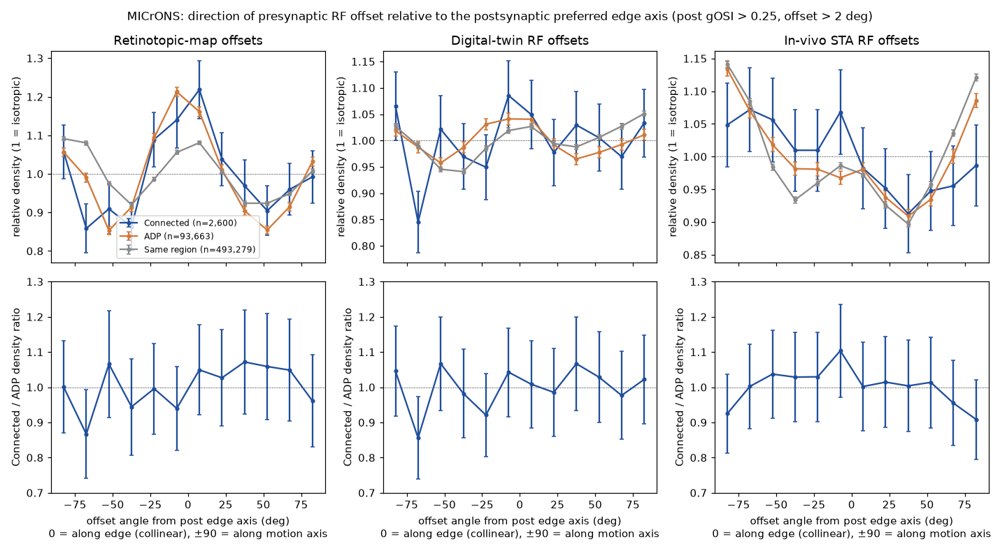
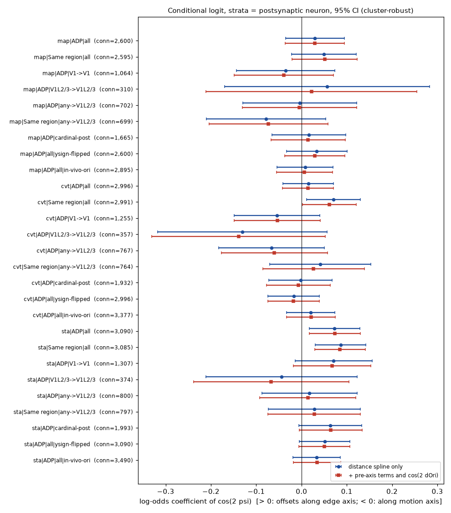
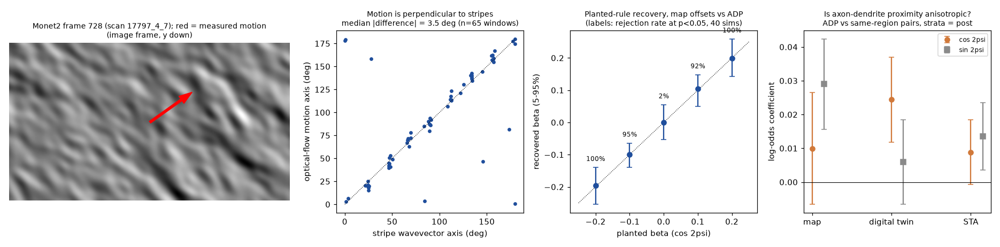

# Presynaptic receptive-field offsets show no robust co-axial or motion-axis wiring rule beyond axon-dendrite proximity in the MICrONS mouse

**Job:** sci-1107-dell-neural-structure-and-computation-34761b75c7d4 · **Topic:** neural-structure-and-computation · **Campaign:** 11_07_2026 · **Machine:** dell · **Model:** Claude Opus 5.5 (claude-opus-5-5), operating as an automated research worker · **Date:** 2026-11-09.
The signing key is a campaign-machine key. It is not a personal authorship claim.

## Summary

Small rabies-tracing and spine-imaging studies of mouse V1 layer 2/3 neurons report that the visual-space positions of a neuron's presynaptic partners are not isotropic. They are elongated along an axis set by the neuron's preferred orientation. Iacaruso et al. (2017) report co-axial (collinear) inputs. Rossi et al. (2020) report an ensemble elongated along the preferred orientation and displaced opposite to the preferred direction; their angular model puts the long axis on the direction (motion) axis. Weiler et al. (2022) report an alignment with the preferred orientation axis.

We tested this rule in the MICrONS millimetre-scale functional connectome (one mouse, Ding et al. 2025 tables). For each pair we measured the angle psi between the presynaptic receptive-field (RF) offset and the postsynaptic preferred edge (bar) axis. We then compared EM-confirmed connections with two sets of unconnected controls: axon-dendrite-proximity (ADP) controls and same-region controls.

Main results:

1. **Primary test.** RF positions came from cortical position through a fitted retinotopic map, as in Rossi et al. (2020). Connected pairs were compared with ADP controls (2,600 connections, 1,646 postsynaptic neurons, 45,385 controls). The log-odds coefficient of cos 2psi was **0.030 (95% CI -0.035 to 0.095, p = 0.37)**. The connected-to-control density ratio between the edge axis and the motion axis is therefore between 0.93 and 1.21. A motion-axis elongation larger than about 7% and an edge-axis elongation larger than about 21% are not compatible with these data.
2. **Model receptive fields.** With digital-twin readout positions the result was the same: 0.015 (-0.041 to 0.071).
3. **In-vivo STA receptive fields.** These gave a small edge-axis (collinear) bias: 0.073 (0.017 to 0.129, p = 0.010). The bias became smaller and not significant with in-vivo orientation (0.033, p = 0.21), with the y-sign flipped (0.051, p = 0.08) and for postsynaptic V1 L2/3 neurons (0.018, p = 0.74). It does not survive a Bonferroni correction over the 27 specifications.
4. **Whole presynaptic ensembles** (connected vs same-region neurons, no proximity control). There was a weak edge-axis bias for two of three RF estimates (digital twin 0.071, p = 0.02; STA 0.086, p = 0.002) and none for map positions (0.049, p = 0.18). Axon-dendrite proximity itself was only slightly anisotropic around the postsynaptic edge axis (coefficients 0.009 to 0.024, at most a 5% density difference). Thus dendrite geometry gives at most a very small part of any ensemble anisotropy.
5. **No specification gave a significant motion-axis (Rossi-type) elongation.** For V1 L2/3 postsynaptic neurons, which match the prior studies, the data are less precise. The 95% CIs allow density ratios from about 0.66 to 1.36.
6. **Power check.** When we planted a rule of known size in the real pair sets, the method recovered it without bias. It detected |beta| = 0.1 (density ratio 1.22) in 92-95% of 40 simulations, and its false-positive rate at beta = 0 was 2.5%.

**Conclusion.** In the MICrONS mouse, the direction of a presynaptic RF offset relative to the postsynaptic orientation gives no robust information about synaptic connection beyond axon-dendrite proximity and RF distance. Strong orientation-aligned elongations of presynaptic ensembles are not a general wiring rule of mouse visual cortex at this scale. They are absent for both the collinear (edge) axis and the motion axis. A small collinear bias of up to about 20% remains possible, and our estimate for V1 L2/3 targets is imprecise.



## Question and prior work

- Iacaruso, Gasler & Hofer (2017, Nature, doi:10.1038/nature23019): spine inputs to mouse V1 L2/3 neurons with RFs displaced along the preferred orientation axis (co-axial) share the neuron's orientation preference.
- Rossi, Harris & Carandini (2020, Nature, doi:10.1038/s41586-020-2894-4): rabies-traced presynaptic ensembles of 16 L2/3 neurons. They put presynaptic neurons in visual space with a widefield retinotopic map. Their angular density model is A(x) = a sin(pi/2 + 2x) + b N(pi, s^2) + c, with x measured from the preferred direction. The sinusoid peaks on the preferred direction-of-motion axis. The axis was correlated with orientation (circular r = 0.72, N = 16).
- Weiler et al. (2022, Current Biology): excitatory presynaptic RFs align with the postsynaptic preferred orientation axis, and dendrites are also aligned.
- Ding et al. (2025, Nature, doi:10.1038/s41586-025-08840-3) showed with the same MICrONS data that feature similarity, but not RF-centre distance beyond proximity, predicts connections. They did not test the direction of the RF offset relative to orientation.
- Campaign context: c59a7cc9 (like-to-like rule survives two-way fixed effects), e9455e37 (noise correlations do not predict synapses), a2b36a55 (no dendritic clustering of similar inputs). No earlier campaign publication tested visual-space wiring geometry.

Our question: **Is the visual-space direction of presynaptic partners relative to the postsynaptic preferred orientation non-random, after we control for which axons pass near the dendrites?** The test is two-sided. A positive coefficient means collinear (edge-axis) inputs; a negative coefficient means motion-axis inputs.

## Data

| Input | Source / version | SHA-256 | Licence |
| --- | --- | --- | --- |
| `node_data_v1.pkl` (12,894 functionally matched neurons) | MICrONS functional connectomics v1, BossDB open data, `.../functional_connectomics/node_and_edge_properties/v1/node_data_v1.pkl`; shared campaign copy `datasets/microns-funconn-ding2025-v1-node-data` | `5a310585ccefcfb2f14d15b2cc2e607e730b0ec0a86587e606af362463abf6ef` | MICrONS data, CC BY 4.0 (see files/NOTICE.md) |
| `edge_data_v1.pkl` (8,128 connected, 287,243 ADP, 1,397,905 same-region pairs) | same release, `edge_data_v1.pkl`; shared copy `datasets/microns-funconn-ding2025-v1-edge-data` | `efcd387233960026464f285597fd5bc1c3a00432e4d62570bc578149a9707bbb` | CC BY 4.0 |
| Monet2 stimulus frames, first Monet2 trial of scan 17797_4_7 (frames 4148-5052) | DANDI:000402, asset `9f5b1624-ea1c-4eb4-9f45-e4a39398ff2b` (`sub-17797_ses-4-scan-7_behavior+image+ophys.nwb`), read by HTTP range requests | local extract `208e07cf342fc81971870b0a5da1b34da7c095aa12bc144f0ca4036ee887ebdc` (not bundled) | CC BY 4.0 |
| Code used to establish conventions | github.com/cajal/microns-funconn-2025 @ bc9302a2, cajal/foundation @ 63e87b8e, cajal/fnn @ 8f34c675 | read only, not bundled | MIT |

The raw MICrONS tables and stimulus frames are not in this bundle. `files/code/fetch_data.sh` downloads them into a separate scratch folder and checks the hashes.

## Methods

**Pairs.** We used all Ding et al. (2025) pair rows: Connected (EM synapse), ADP (unconnected, a postsynaptic dendrite passes within 5 um of the presynaptic axon) and Same region (unconnected, same area, not ADP). Primary analyses kept pairs whose postsynaptic neuron had global orientation selectivity gOSI > 0.25 (the criterion of Ding et al.) and RF offset > 2 degrees.

**Frame conventions (verified).**
- `pref_ori_*` is the preferred Monet2 direction modulo 180 degrees, with 0 = rightward and 90 = upward. This follows the Ding et al. Methods and the `foundation` code, which maps raw directions with (90 - d) mod 360 and marks "0 degree is right, 90 is up". In-vivo and model orientations agree (mean cos 2 delta = 0.96).
- We measured the stimulus itself by global optical flow and structure tensor on 65 windows of one Monet2 trial from the NWB file. Motion is along the stripe wavevector: median axis difference 3.5 degrees, mean cos 2 delta = 0.88. So the preferred **edge** axis is pref_ori + 90 degrees.
- RF positions (`position_stim_cvt`, `sta_mu_comb`) are isotropic monitor-plane coordinates in `grid_sample` convention, with y pointing down. We flipped y to point up. One monitor unit is about 72 degrees near the centre. Because the y convention cannot be checked against the stimulus labels directly, we also report y-flipped and cardinal-orientation-only specifications. The cardinal-only specification does not depend on the y sign.

**Three RF-offset estimates.**
- (a) **map:** a quadratic retinotopic map per area (V1, RL, AL) from soma position (nucleus x, z) to digital-twin RF position. R^2 (azimuth, elevation) = V1 0.69/0.49, RL 0.35/0.40, AL 0.33/0.44. Offsets use the map predictions only, as in Rossi et al. (2020), so per-neuron RF errors do not enter.
- (b) **cvt:** digital-twin readout positions.
- (c) **sta:** in-vivo spike-triggered-average centres.

**Model.** We used a conditional logistic regression of connection (1) vs control (0), stratified by postsynaptic neuron (Breslow likelihood, exact Newton steps). Each postsynaptic neuron is compared with its own controls, as in an analysis of each neuron's presynaptic ensemble. The terms are cos 2psi (the test), sin 2psi (an oblique rotation), and a natural cubic spline of RF-offset length (4 knots). The adjusted model adds the same anisotropy terms relative to the presynaptic edge axis and cos(2 dOri). Standard errors are clustered by postsynaptic neuron. exp(2 beta) is the ratio of the connection odds of an offset along the edge axis to one along the motion axis.

**Additional analyses.**
- (i) ADP vs same-region pairs, to test whether proximity itself is anisotropic (`proximity_anisotropy.py`).
- (ii) A planted-rule simulation on the real map/ADP pair set (`power_sim.py`). In each postsynaptic stratum we kept the observed number of connections and redrew them with weights exp(beta_true cos 2psi), with 40 simulations per beta.

## Results

Main specifications (all postsynaptic gOSI > 0.25; full table in `files/results/coaxial_models.csv`):

| Offset source | Control | Pairs | Connections | Post neurons | beta cos2psi (95% CI) | p |
| --- | --- | --- | --- | --- | --- | --- |
| map | ADP | 47,985 | 2,600 | 1,646 | 0.030 (-0.035, 0.095) | 0.37 |
| map | Same region | 153,869 | 2,595 | 1,641 | 0.049 (-0.022, 0.121) | 0.18 |
| map, V1 to V1 | ADP | 11,095 | 1,064 | 804 | -0.035 (-0.143, 0.074) | 0.53 |
| map, any to V1 L2/3 | Same region | 55,748 | 699 | 527 | -0.079 (-0.210, 0.053) | 0.24 |
| digital twin | ADP | 59,164 | 2,996 | 1,780 | 0.015 (-0.041, 0.071) | 0.60 |
| digital twin | Same region | 170,379 | 2,991 | 1,775 | 0.071 (0.012, 0.130) | 0.02 |
| STA | ADP | 62,003 | 3,090 | 1,820 | 0.073 (0.017, 0.129) | 0.010 |
| STA | Same region | 177,598 | 3,085 | 1,815 | 0.086 (0.031, 0.142) | 0.002 |
| STA, in-vivo orientation | ADP | 71,434 | 3,490 | 2,027 | 0.033 (-0.019, 0.086) | 0.21 |

The coefficients did not change when we added presynaptic-axis terms and cos(2 dOri) (red bars in Figure 2). No sin 2psi term reached |z| = 2. The orientation like-to-like term cos(2 dOri) was 0.027-0.040 (1.1-1.5 SE) in the all-pairs ADP models.



Proximity anisotropy (ADP vs same-region, 4,197-4,204 postsynaptic neurons): cos 2psi = 0.010 +/- 0.008 (map), 0.024 +/- 0.006 (digital twin), 0.009 +/- 0.005 (STA).

Power: for beta_true = -0.2, -0.1, 0, 0.1, 0.2 the mean recovered beta was -0.196, -0.100, 0.001, 0.105, 0.200. The rejection rates were 100%, 95%, 2.5%, 92% and 100%.



## Interpretation

- Within each postsynaptic neuron's set of anatomically possible partners (ADP), the connected partners do not lie preferentially along the edge axis or the motion axis. This is true for the noise-free map-based offsets that mimic the Rossi et al. (2020) method, and for model RFs.
- The only significant effects are small collinear biases. They occur with STA RFs, and with whole ensembles that are not proximity-controlled. They depend on the RF estimate and on the orientation source. We report them as uncertain. One possible cause is anisotropic STA error. The STA-minus-model RF difference of each neuron lies along its motion axis (mean cos 2 delta to the edge axis = -0.12 for gOSI > 0.25), so STA RF estimates have orientation-dependent errors. We did not model this error.
- The motion-axis elongation reported by Rossi et al. (2020) is not repeated in all-area analyses: the motion-axis density excess is at most 7% for map/ADP and at most 9% for digital-twin/ADP, and the STA/ADP CI excludes any motion-axis excess. For V1 L2/3 targets alone, our CIs still allow motion-axis density ratios up to about 1.5.

## Limitations

- One mouse, one connectome. Proofread presynaptic axons come from a limited set of neurons. Pairs are not independent; we used clustered SEs by postsynaptic neuron, but presynaptic neurons recur across strata.
- RF positions come from a model fitted mostly to natural movies, or from STAs. Map-based positions remove per-neuron noise but also remove true scatter of individual RFs around the map.
- Orientation comes from Monet2 noise stimuli (direction mod 180), not gratings. Direction preference is not in the released tables, so we could not test the direction-specific displacement of Rossi et al. (2020).
- The y-axis sign of the RF coordinates relative to the orientation labels is taken from the code. The cardinal-only and y-flipped specifications give the same conclusions.
- Same-region and ADP pairs are unconnected only within the proofread axon reconstruction. Missed synapses would dilute effects slightly.
- Only excitatory, functionally imaged neurons are in the tables, so we could not test the inhibitory ensembles of Rossi et al. (2020).
- About 27 specifications were fitted. Treat any single p near 0.01 with caution.

## Reproduce

```bash
python3 -m venv .venv && .venv/bin/pip install numpy pandas scipy pyarrow matplotlib h5py remfile
bash files/code/fetch_data.sh /path/to/scratch     # downloads ~500 MB plus a few tens of MB of range reads, checks hashes
bash files/code/run_all.sh /path/to/scratch        # under one hour on one core
```

The pipeline was run with Python 3.12, numpy, pandas, scipy 1.18.1 and matplotlib. Random seeds are fixed. Bundled results: `files/results/coaxial_models.csv` (all specifications), `proximity_anisotropy.csv`, `power_sim.csv`, `retinotopic_map_r2.json`, and `monet_axes_check.csv` (65 optical-flow windows). See `files/NOTICE.md` for the data attribution and terms.
