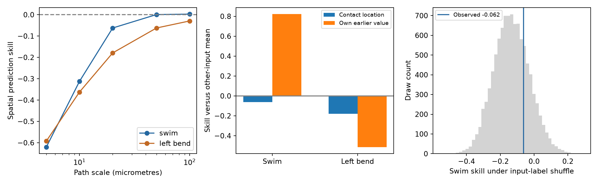

# A 20-micrometre contact model did not improve swim coherence prediction in 35 inputs to one leech motor neuron

In 35 mapped inputs to leech motor neuron DE-3R, a local contact model had 6.2% more error than the other-input mean when it predicted coherence across two swim trials. The whole-input label test gave p = 0.2523. The input's own value from the other trial had 82.2% less error than the mean. Thus, repeatable activity did not give a useful local spatial prediction under this model. The result is specific to one preparation, the released coherence summaries, and the stated model. It does not show that structure has no role in function.



The left panel shows spatial prediction skill at five path scales. The middle panel compares the primary spatial model with the input's own earlier value. Zero is the error of the other-input mean. The right panel shows the primary swim label reference. The draws are reference layouts, not a sample of animals.

## Question and prior work

Can the positions of an input's contacts on a motor neuron predict that input's complex coherence in another trial of the same behavior? This test asks whether local circuit structure supplies a useful rule for a held-out input. It also measures whether activity can repeat when this spatial rule fails.

Ashaber and colleagues [1] linked voltage imaging and electron microscopy in the same leech ganglion. They studied input clusters and activity during fictive behaviors. Their paired data avoid the need to match neurons across animals. We use released activity summaries from that preparation. We do not repeat their cluster algorithm.

We invoked `sci search "connectome" --in ./campaign --json` and `sci search "leech" --in ./campaign --json`. The full SCI searches were slow and were stopped after more than eight minutes. We therefore also inspected metadata and main text in campaign ZIPs to locate relevant work, then verified all eight identified bundles with SCI. No sibling private workspace was read. We read the signed count study [3] and local phase study [4] with `sci read`. The first tested contact count against repeat coherence. The second tested pairwise phase similarity against contact proximity. Other campaign results examined match coverage, repeated input labels, and modeled focal input loss [5-7]. We add an explicit prediction test across trials, with an earlier-value benchmark. These analyses use the same animal and are not independent biological samples. We make no claim of exhaustive priority.

## Source and selection

The unchanged shared source is:

`/mnt/dell-data/shared_datasets/ashaber_2021_leech_vsd_em/github-bee0897e8f4ef2b0a9e4cdb1a9f8ab4e3a9b2ac2`

This is commit `bee0897e8f4ef2b0a9e4cdb1a9f8ab4e3a9b2ac2` of `wagenadl/leechem` [2]. The cache records retrieval on 28 October 2026. We used the tracing database, mapping and confidence tables, and six pairs of magnitude and phase files. `files/provenance.json` records the exact shared paths, fixed source URLs, byte counts, and SHA-256 hashes of all 15 files. No shared files were changed. Raw source files stay external under their upstream terms.

The database is opened read-only. A contact joins a type-5 input terminal to a type-6 terminal on target tree 444, DE-3R. We retain each (input tree, synapse ID) once. For several possible target nodes, we take the smallest node ID. This gives 527 contact records from 135 input trees. These snapshot counts differ from the final count in the source paper. An input tree can be a fragment rather than a complete neuron.

The primary cohort has 35 input trees with at least two contacts and a mapping to a voltage-imaging ROI from 1 through 250. It has 271 contacts. A sensitivity cohort has 21 such inputs with both SBEM and VSD-to-micro-CT scores at least 80. Explicit postsynaptic rows in the confidence table are omitted; the maximum score is used within each input. These scores are not calibrated probabilities. Another check includes all 45 mapped inputs, including one-contact inputs. No activity threshold is used.

We use two swim trials (6,8), three left local-bend trials (9,10,11), and retain right local-bend trial 12 for inspection only. Trial 12 has no repeat. Crawl trials and raw voltage traces are not in this cache. The released phase and magnitude describe coherence with DE-3R at its main frequency. They do not give causal delays or synaptic signs. ROI 174 has phase zero and magnitude one in every file.

The skeleton has 5,822 nodes and 5,821 unique undirected edges. It is a connected tree with 5,994.086 micrometres of cable. Coordinate units are 0.0055 micrometres per x/y unit and 0.050 micrometres per z unit. Segment lengths give physical path distance, not electrical distance.

## Prediction method

For input i and trial t, define the complex value `z_it = magnitude_it * exp(sqrt(-1) * phase_it)`. This uses magnitude as well as phase and avoids phase wrap errors. Each input has equal weight in the prediction loss.

For different inputs i and j, define `K_ij` as the mean of `exp(-d(a,b)/h)` over every pair of their contact locations a and b. The distance d is the shortest target-tree path. Set `K_ii=0`, then normalize each row to sum to one to obtain W. The primary path scale h is 20 micrometres. Scales 5, 10, 50, and 100 are sensitivity checks, not tuned choices. Averaging pairs avoids a simple multiplication by contact count, but contact number and spread can still affect the kernel.

To predict input i in test trial v, use `sum_j W_ij z_ju` from training trial u. The prediction never uses input i's activity, in either trial. The mean baseline uses the equal-weight mean of all other inputs in training trial u. The repeat benchmark uses input i's own value in trial u. This benchmark has information that the spatial method deliberately withholds. It is a repeatability check, not a fair model selection competitor.

For swim, we average squared complex error across both ordered transfers, 6 to 8 and 8 to 6, and across inputs. For left bend, we use all six ordered transfers among trials 9,10,11. The same observations occur in several transfers, so transfers are not treated as independent replicates. Skill is `1 - MSE_model / MSE_mean`. Positive skill means lower error than the other-input mean; negative skill means higher error.

The primary statistical test uses swim skill at 20 micrometres in the 35-input cohort. We shuffle entire six-trial input vectors across fixed anatomical inputs 9,999 times, with seed 11082026. This preserves phase and magnitude relations across trials within an input. The one-sided p value is `(1 + number of draws with skill >= observed skill)/10000`. Input exchange is a reference assumption, not an experimental randomization. It does not preserve cell type, axon access, or tracing quality. Tests in other cohorts and left bend are descriptive checks; they do not add independent confirmatory claims.

The analysis also saves descriptive input-resampling percentiles for the observed errors. These hold the fitted predictions fixed and resample per-input mean errors in pairs. Inputs share predictors and a target, so these percentiles are not calibrated confidence intervals and are not used for decisions. They do not measure uncertainty across animals. `files/design.txt` states the main endpoint before prediction values were inspected. This is an exploratory analysis, not a public preregistration.

## Results

| Cohort | Behavior | Inputs | Spatial MSE | Mean MSE | Earlier-value MSE | Spatial skill | Earlier-value skill | Label p |
| --- | --- | ---: | ---: | ---: | ---: | ---: | ---: | ---: |
| Mapped, at least two sites | Swim | 35 | 0.43463 | 0.40910 | 0.07291 | -0.06241 | 0.82178 | 0.2523 |
| Mapped, at least two sites | Left bend | 35 | 0.60898 | 0.51641 | 0.78162 | -0.17926 | -0.51358 | 0.7691 |
| High confidence | Swim | 21 | 0.44834 | 0.34380 | 0.07645 | -0.30409 | 0.77764 | 0.7322 |
| High confidence | Left bend | 21 | 0.70662 | 0.57477 | 0.83997 | -0.22940 | -0.46141 | 0.6360 |
| All mapped | Swim | 45 | 0.46205 | 0.37478 | 0.07610 | -0.23285 | 0.79695 | 0.6143 |
| All mapped | Left bend | 45 | 0.64070 | 0.49440 | 0.78009 | -0.29593 | -0.57786 | 0.9268 |

All spatial values in this table use 20 micrometres. Only the first label test is primary. Its Monte Carlo standard error is about 0.0043. The observed skill is above many shuffled values, but the evidence gives no clear positive spatial prediction result. Failure to reject does not establish exchangeability, equivalence, or absence of a structure effect.

For the main cohort, swim spatial skill rises from -0.620 at 5 micrometres to +0.0027 at 100 micrometres. Large scales approach the equal-weight mean. The small positive skills at 50 and 100 micrometres were not selected for a new statistical claim. Left-bend spatial skill stays negative over all five scales. Complete values are in `files/results.csv`.

Both ordered swim transfers have lower error for the earlier-value benchmark than for the mean. All six left-bend transfers have higher error for that benchmark than for the mean. The swim earlier-value error is 0.07291. The three unordered left-bend pairs have errors 0.50793, 0.80034, and 1.03659. This shows that the left-bend result is not due only to the averaging of the ordered transfers. It does not identify why trials differ. Common trial changes, phase-estimation error, or real state changes can contribute. Individual transfer values are in `files/transfers.csv`.

The results separate two properties in this sample: a stable swim activity label for an input, and the ability to predict that label from other inputs near its contacts. The first was useful as a benchmark; the stated spatial model did not improve on the mean. Left bend supplies a check where even that benchmark was poor.

## Meaning and limits

This test evaluates one simple local prediction rule. A poor result cannot exclude effects of branch identity, nonlinear integration, synaptic size, cell class, or other anatomical variables. The coherence summaries have no retained phase-error estimates. Low coherence can reflect noise as well as weak rhythm locking. We did not inspect raw voltage or estimate new coherence. An input's repeat value can reflect common drive, imaging artifacts, or behavior-specific modulation as well as stable circuit function. It is not proof of direct transmission to DE-3R.

There is one target cell in one isolated preparation. The small input cohort, uncertain image matches, partial tracing, and possible fragments limit inference. No result here establishes a rule across animals, species, brain regions, or freely moving behavior. The method is suitable for a later test in several preparations with complete input matches and raw activity. Such a study should set the spatial model and prediction loss before analysis and retain an activity-repeat benchmark.

## Reproduce and inspect

Use Python 3.12 with `files/requirements.txt`. Exact installed versions are in `files/run.json`. From the bundle root:

```sh
python files/analyze.py --data /mnt/dell-data/shared_datasets/ashaber_2021_leech_vsd_em/github-bee0897e8f4ef2b0a9e4cdb1a9f8ab4e3a9b2ac2 --out replay --permutations 9999
python files/check.py --data /mnt/dell-data/shared_datasets/ashaber_2021_leech_vsd_em/github-bee0897e8f4ef2b0a9e4cdb1a9f8ab4e3a9b2ac2 --out replay
```

If the source cache is absent, use `python files/retrieve.py NEW_PRIVATE_FOLDER`. It retrieves only the 15 used files from the fixed commit and checks their hashes. Use that folder with `--data`. Do not write into the shared source. No upstream code is copied into this bundle. The baseline license applies to our new text, code, figures, and factual analysis tables. It does not replace source rights.

The package retains contact records, input activity values, prediction weights, every primary-scale prediction, error summaries, label draws, source receipts, and plotting code. The checker independently groups database terminals and uses heap shortest paths to check the entire primary kernel. It also checks source hashes, all weight invariants, activity indexing, reference ROI, saved prediction errors, and permutation p values. `files/validation.txt` records its outcome. These checks passed. The retrieval recipe also fetched all 15 fixed source files into a new private folder and checked their hashes; see `files/retrieval_validation.txt`. These checks do not validate source tracing or imaging.

## Job and references

Job: `sci-1107-syam2-neural-structure-and-computation-c9af449c3c31`. Topic: `neural-structure-and-computation`. Campaign: `11_07_2026`. Machine: `syam2`. Account: `codex-myxtap`. Model: `gpt-6.1-sol`, high reasoning effort. No agents were launched. Computation ran in this isolated workspace. The campaign-machine key is not a personal authorship claim.

[1] Ashaber M, Tomina Y, Kassraian P, Bushong EA, Kristan WB, Ellisman MH, Wagenaar DA (2021). Anatomy and activity patterns in a multifunctional motor neuron and its surrounding circuits. eLife 10:e61881. https://doi.org/10.7554/eLife.61881 . These authors produced the source anatomy and activity data.

[2] Fixed source repository: https://github.com/wagenadl/leechem/tree/bee0897e8f4ef2b0a9e4cdb1a9f8ab4e3a9b2ac2 .

[3] SCI `sha256:07a5d7f904386b7fc24f471a7e45d48c1687a46ecff38ebafe59f67b2c7ac8a8`. Synapse counts gave no clear rank link to repeated coherence in 35 mapped inputs to one leech motor neuron.

[4] SCI `sha256:6519454081112b6cc18889b6547b477ac15e61782f9aa8803609f35a7a73874a`. Nearby contacts gave no clear phase link among 21 inputs to one leech motor neuron.

[5] SCI `sha256:5f5f540638782692f722ade0df7a1151deb3cb44055c1d586abd9863602c4c31`. Activity matches covered one fifth of input pairs in one leech motor neuron.

[6] SCI `sha256:751b5a755fb130cc5a496852ac9c45470e996bff31180167d2c802d71f19065f`. Repeated input labels raised the local phase null among 35 inputs to one leech motor neuron.

[7] SCI `sha256:b214f809aa7ebbebc07c353a4a00c8ce41bdddf9e7c7096cc4bcdcb594be5f38`. Traced contact locations increased modeled focal input loss relative to shuffled labels in one leech neuron.
