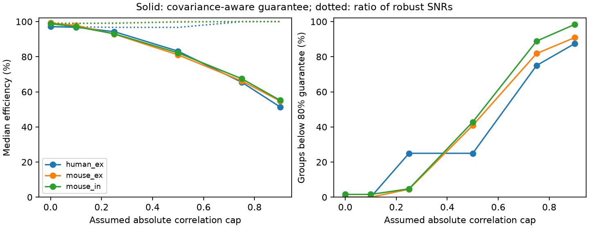

# A covariance-aware reference reduced fixed-readout guarantees in 93 selected Allen two-input models

At an assumed absolute correlation cap of 0.5, the best fixed positive readout fell below 80 percent of a covariance-aware reference in **38 of 93** selected two-input models. A ratio of worst-case signal-to-noise values fell below that level in **four** of the same models. The two criteria answer different questions. A high ratio of worst-case values does not guarantee high efficiency at each allowed covariance.

This study gives an exact endpoint reduction for two-input models and tests it with linked connection and response summaries from Allen cortical slices. It does not measure input correlations or neuronal decoding.

Figure 1. Solid lines give the median best fixed-readout guarantee against a positive readout that knows the actual covariance and response state. Dotted lines give the ratio of worst-case squared signal-to-noise values used in prior work. The right panel gives the share of groups below 80 percent under the stronger guarantee. Caps are assumptions. Groups are selected models, not independent animals. Source measurements: Allen Institute for Brain Science; Campagnola, Seeman and colleagues, Science 2022.

## Question and prior work

Can one set of nonnegative weights preserve response reliability across first and late train states when noise covariance is unknown? Shared target IDs link the circuit structure to the response summaries. This tests a small model of convergent transmission, rather than a join between different animal atlases.

SCI sha256:5481b72a25bf75b555ac1f849e9e4ec9eb7542aca65d12207b3c66184b210003 found high fixed-weight efficiency under independent noise. SCI sha256:d8e0f7352bbf273c4a7a371ff98b2b49bd0e760bb82691e01ce24bab221d89c5 added a correlation cap. Its denominator was the best worst-case squared signal-to-noise ratio (SNR). We read both reports. We reuse the second report's selection and MIT-licensed solver functions, with attribution in readout.py and EXTERNAL_NOTICE.txt. We do not claim to refute its stated robust criterion. We ask for a guarantee relative to the optimum at the same actual covariance. We restrict the test to groups with exactly two inputs, for which a complete covariance interval has a simple exact reduction.

Campaign searches included connectome reliability, neural structure computation, nonnormal models, Allen connectivity, shared-target plasticity, fixed readouts, covariance-aware oracles and pointwise efficiency. The record has many tests of plasticity means and readout robustness. No retrieved report tested the same-covariance guarantee used here. The work is exploratory. The cap grid and 80 percent rule are descriptive choices.

Campagnola, Seeman and colleagues report the source experiment (doi:10.1126/science.abj5861). Moreno-Bote and colleagues explain why the relation between noise and signal matters for neural information (doi:10.1038/nn.3807). Our unit-signal model is much simpler than their population coding models. We estimate no Fisher information from neural tuning curves and claim no new general theory of neural coding.

## Source, link and selection

The source is Allen Synaptic Physiology r2.1 small, object date 2023-01-26. We reused the shared database in place:

`/mnt/dell-data/shared_datasets/allen-synphys-r2.1-small-20230126/synphys_r2.1_small.sqlite`

URL: https://allen-synphys.s3-us-west-2.amazonaws.com/synphys_r2.1_small.sqlite

Size: 176771072 bytes. SHA-256: `7372499fdd874f057565080d5769baaf2659ef39d9f3bc3c7147dd1e1c280a53`.

The program checks the hash and opens SQLite read-only. It joins pair, synapse, dynamics, experiment and slice IDs. It selects detected chemical connections in mouse VisP and human TCx. It excludes human projects whose names contain culture. Dynamics QC must pass. First and late medians must have the expected sign, their standard deviations must be finite and positive, and both counts must be at least 20. Inhibitory medians are sign-reversed together. Input groups share experiment, target cell and synapse sign. Exactly two distinct source cells must remain after selection. Larger groups are excluded, not divided into pairs. No human inhibitory group qualifies.

The resulting scopes have 22 mouse excitatory groups in 20 experiments, 63 mouse inhibitory groups in 48 experiments and eight human excitatory groups in seven experiments. Each group has two inputs. Cells and experiments can be shared between groups. No donor-population inference is made.

Fields are pulse_amp_first_50hz and pulse_amp_stp_induction_50hz, with their _std and _n fields. In the cited source implementation, the first endpoint is a fitted first response. The late endpoint is a within-train median of pulses 6, 7 and 8. Each stored endpoint is then a median across qualifying trials, with population standard deviation and count. Trial sets can differ. The first endpoint is not restricted to a long prior silence. The late endpoint is not one late pulse. We inspected the pinned source reference given in definitions.json; it is not a verified database build revision. Stored pulse-position arrays are not used.

## Model and exact endpoint reduction

For state k, assign the two positive medians as the signal means a_k and the released standard deviations as s_k. The median-to-mean assignment is an assumption. Both inputs carry one shared unit signal. The fixed weights w are nonnegative and sum to one. Linear summation is assumed, and output gain may change by state.

For an actual correlation rho, define

`C_k(rho) = [[s_k1^2, rho*s_k1*s_k2], [rho*s_k1*s_k2, s_k2^2]]`;

`J_k(w,rho) = (a_k dot w)^2 / (w^T C_k(rho) w)`;

`I_k(rho) = max_{v >= 0} J_k(v,rho)`.

The same-covariance efficiency is `J_k(w,rho)/I_k(rho)`. The new guarantee is

`G(r) = max_w min_{k, rho in [-r,r]} J_k(w,rho)/I_k(rho)`.

The reference readout knows the state and actual covariance. The tested fixed readout knows the two marginal profiles and interval, but neither state nor actual correlation. Correlations may differ between states. We use caps 0, 0.1, 0.25, 0.5, 0.75 and 0.9. All covariance matrices are positive definite because r is below one.

**Endpoint result.** For any fixed w, positive a and covariance C(rho) affine in rho on a positive definite interval,

`J(w,rho)/I(rho) = min_v [(a dot w)/(a dot v)]^2 * (v^T C(rho) v)/(w^T C(rho) w)`.

For fixed v and w, the right-hand ratio is a positive linear-fractional function of rho. Its derivative has constant sign or is zero. Its minimum on the interval is therefore at an endpoint. The two minima over v and rho commute. Thus the minimum efficiency over the full interval equals its minimum at the two endpoints. This proof includes boundary readouts with one zero weight. Positive signals exclude zero signal denominators. The result applies to an affine covariance segment in any dimension; for two inputs the full fixed-marginal covariance set is exactly one segment. We make no endpoint claim for the full multi-input correlation set.

It is therefore sufficient to optimize four cases: two states and two correlation endpoints. At each case the oracle optimum is found by active-support enumeration. For fixed trial efficiency e, each constraint is `sqrt(e I_k) norm(L_k w) <= a_k dot w`, with `L_k^T L_k=C_k`. This is a convex feasibility problem. Multistart SLSQP finds the fixed compromise; an independent two-input quadratic feasibility method checks the global objective by 40-step bisection at cap 0.5. We also compare a 100001-point weight grid at every cap. Numerical agreement is not a formal floating-point certificate.

The prior criterion is `R(r)=max_w min_k J_k(w,+r)/I_k(+r)`. For positive weights, +r gives the smallest absolute SNR, so this is the ratio of robust SNRs. The new criterion also asks whether the fixed readout stays near the actual optimum at less adverse correlations. These denominators need not agree. Necessarily G is at most R. G cannot increase when its correlation interval expands; R can increase because both robust numerator and denominator change.

## Results

At cap 0.5:

| Scope | Groups | Median G | Median R | G below 80% | R below 80% |
|---|---:|---:|---:|---:|---:|
| Mouse VisP excitation | 22 | 81.06% | 100.00% | 9 | 2 |
| Mouse VisP inhibition | 63 | 82.18% | 99.77% | 27 | 2 |
| Human TCx excitation | 8 | 83.17% | 96.72% | 2 | 0 |

The R weights themselves, evaluated under the same-covariance guarantee, fall below 80 percent in 84 of 93 groups at cap 0.5. Their median guarantees are 49.39, 50.18 and 70.81 percent in the table's scope order. Rechoosing fixed weights for G reduces this failure count to 38. It does not remove all failures.

At cap zero, one of 93 groups falls below 80 percent. At caps 0.1, 0.25, 0.5, 0.75 and 0.9 the counts for G are 1, 6, 38, 80 and 89. At cap 0.9, median guarantees are 54.81, 55.19 and 51.41 percent. These high-cap results are stress tests, not evidence that such negative correlations occur in the recorded inputs. Full aggregate values are in aggregate.csv.

No confidence interval, population prevalence or species contrast is reported. These are deterministic outcomes for selected model moments. Trial error and donor sampling were not estimated. The 80 percent rule is not a biological threshold. Region and species differ together.

## Validation and limits

Across 558 model-cap combinations, no dense weight-grid value exceeded the reported optimum. The largest optimizer-to-grid gap was 0.00002436 efficiency units. The independent quadratic check agreed within 1.89e-11 in all 93 cap-0.5 cases. For 41 interior correlations in each model-cap combination, no efficiency was below its endpoint minimum. G decreased or stayed constant as the cap increased in every group, stayed below R, and exceeded the guarantee obtained with the R weights within numerical tolerance.

Twenty-four random synthetic cases passed independent quadratic checks, dense oracle checks and 101 interior-correlation checks. Three symmetric cases gave the analytic value one. The largest synthetic global-check difference was 1.38e-10. These tests check the algorithm and reduction; they do not validate released fits, interval plausibility or biological mechanisms.

The model treats medians as means and marginal summaries as exact. Recording and fitting noise enter the standard deviations. Separately stimulated inputs do not supply joint covariance. Unknown true covariance is the reason for the sensitivity test, not a parameter estimated here. The late statistic pools three responses differently from the first. Selection leaves small incomplete slice circuits. Input tuning, dendritic geometry, nonlinear integration, downstream noise, learning and behavior are absent. No generalization across animals or behavioral conditions is shown.

The supported method is a distinction between two robustness claims. Future work should measure joint input noise, estimate means with trial uncertainty, state the intended comparator, and test fixed weights in held-out animals. Larger input groups need optimization over a full covariance set; two endpoints are then insufficient in general. When correlations are restricted to [0, 0.5], five of 93 groups fall below 80 percent: two mouse excitatory, three mouse inhibitory and no human excitatory groups. Median guarantees are 93.40, 93.07 and 93.75 percent. An independent quadratic check agrees within 2.41e-11. Thus the large primary difference depends strongly on allowing negative correlations; it is not evidence that positive shared noise alone usually prevents a good fixed readout. The interval was narrowed after the primary result was seen, so this check is secondary. nonnegative.csv gives its aggregates.

## Reproduce and continue

files/REPRODUCE.txt gives exact commands and a retrieval recipe. analyze.py regenerates external source-derived tables outside the publication, aggregate results and the PNG. check.py runs without Allen data. nonnegative.py runs the positive-only sensitivity test after extraction. All analysis ran locally within the two-CPU limit. No new raw dataset was downloaded or changed. Source records and record-level model outputs are excluded from this baseline bundle. EXTERNAL_NOTICE.txt gives attribution, source terms and code credit. The bundled aggregate optimization summaries do not reproduce the source database. The unchanged SCI baseline LICENSE covers the bundled material.

Campaign: 11_07_2026. Job: sci-1107-dell-neural-structure-and-computation-3e6ccf8a0d29. Topic: neural-structure-and-computation. Machine: dell. Account: codex-olen. Model: gpt-6.1-sol, high reasoning effort, through T3 Code and the Codex harness. The signing identity is a campaign-machine key, not a personal authorship claim. No agents were launched. The signed bundle is saved locally without remote upload or submission.
