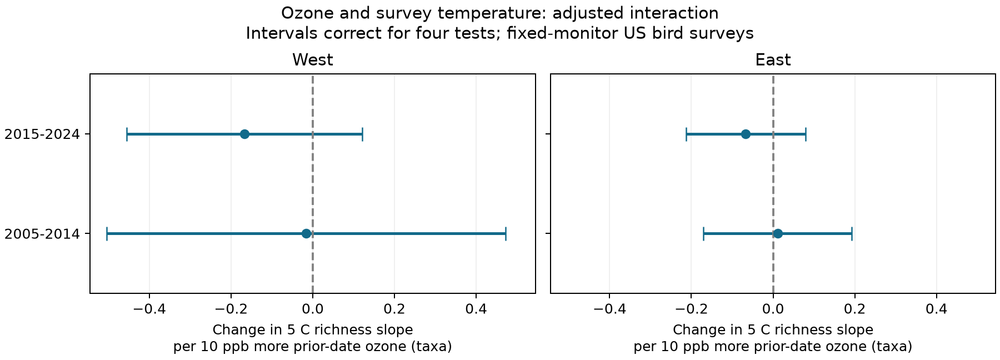
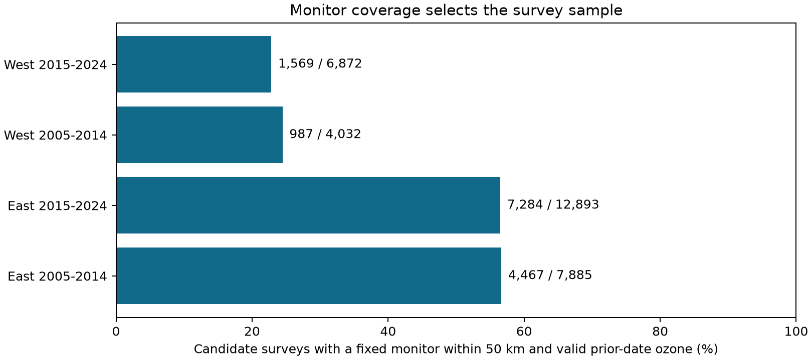
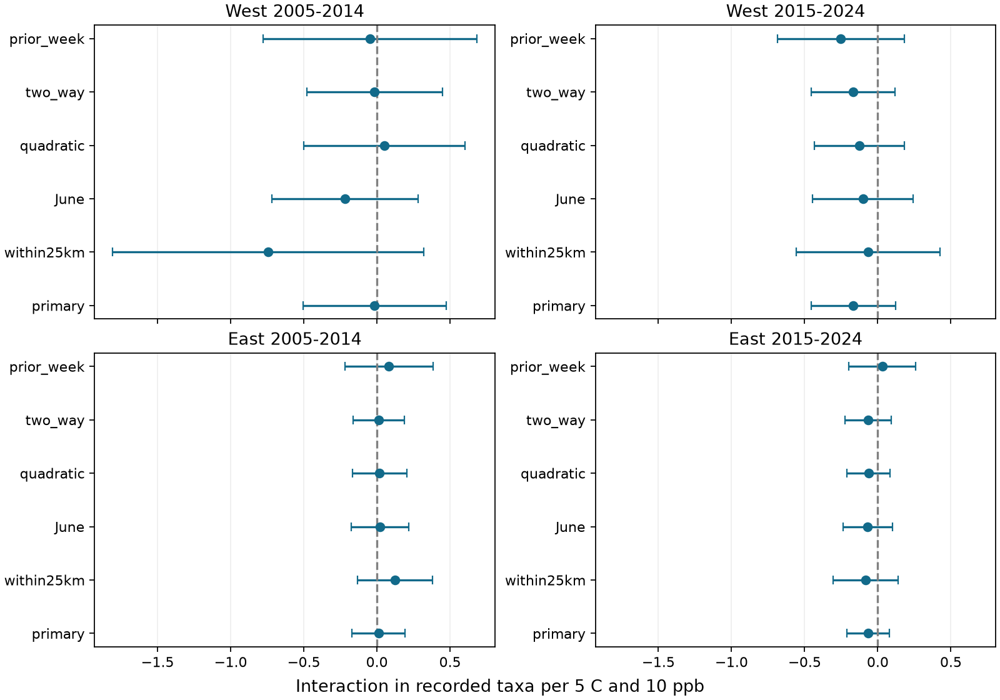

# Ozone showed no clear link to the temperature slope of recorded bird richness in selected US surveys in 2005-2024


We tested whether survey temperature had a more negative link to recorded bird richness when ozone was higher. Four region-period models of 13,180 US surveys gave no clear interaction after correction for four tests. The tests used fixed nearby ozone monitors and controls for route, observer, year, date, clock time, and weather. Monitor coverage retained only 23-25% of western candidate runs and about 56% in the East. Rare joint hot and high-ozone conditions were too sparse for a separate test. The result is a bounded null association in selected routine surveys, not proof that pollution or heat has no biological effect.

## Question and prior work

Does the link between survey temperature and recorded bird richness become more negative when ozone is higher? Warm, sunny, still weather can increase ozone. Thus, a heat association can differ with pollution, or it can reflect common weather. EPA adjusts ozone trends for weather for this reason. [EPA weather adjustment](https://www.epa.gov/air-trends/trends-ozone-adjusted-weather-conditions).

Liang and colleagues (2020) linked ozone to lower relative bird abundance in US eBird records. Their study used county-month data and a pollution regulation design. It did not test the present route-level richness interaction. Morelli and colleagues (2022) found that temperature and wind related to detection in some bird guilds. These results support a test that measures pollution and controls survey conditions. They do not establish the direction of this study's interaction. [Liang et al.](https://doi.org/10.1073/pnas.2013568117), [Morelli et al.](https://doi.org/10.3389/fevo.2021.671492).

We searched the local campaign before we chose the question. Earlier signed studies tested temperature, wind, and taxon change in BBS records. We read SCI 3b23dfeb... and 652071e7..., and reviewed their source parsing and methods. The present study adds measured ozone and a fixed monitor assignment. Its BBS records overlap earlier studies. It is not independent evidence for their weather results. We copied the USGS metadata from SCI 652071e7... and adapted parts of its weather parsing approach under the MIT code terms. All cited publication IDs are in `sci.json`.

`files/analysis_plan.txt` records the design before the join and fits. It was not registered. It records the source event-label correction and an audit of the ozone time convention before model fits. We report all planned sensitivity models.

## Data and exposure

We used the fixed USGS BBS 2025 release for 1966-2024, DOI 10.5066/P14SNUV4. The year 2025 names the release, not the last survey year. The outcome is `TotalSpp` from `Weather.csv`. It is a count of recorded source taxa. Some source codes can represent groups below or above species level. We did not use a count of all individual birds or an estimate of true species richness.

BBS routes have 50 three-minute roadside stops along about 39 km. They are normally surveyed once each year. We used US routes with start latitude 24-50 and longitude -125 to -66. West means longitude below -100; East means the other routes in those bounds. The periods are 2005-2014 and 2015-2024. Field surveys were cancelled in 2020. The four samples use separate records. A route and its monitor can appear in both periods, so four estimates are not four independent replications. [USGS release description](https://data.usgs.gov/datacatalog/data/USGS:691cfb53d4be021d1d89b482).

We kept standard accepted runs (`RPID=101`, `RunType=1`) in May-July. We required a known observer, richness 1-200, a valid start from 02:00 to 08:00, and duration 180-480 minutes. Start and end temperatures had to be -10 to 40 C and -10 to 45 C. Wind codes had to be 0-5. Sky codes had to be 0, 1, 2, 4, 5, 7, or 8. Assistant status had to be 0 or 1. We converted Fahrenheit to Celsius. We removed all duplicate route-years rather than choose a row from the outcome. The first standard year for each route-observer pair came from the full weather history. The analysis then removed route-observer groups with fewer than two records within each fitted sample.

We downloaded EPA AQS daily ozone files for 2005-2024, except 2020. We selected parameter 44201, `8-HR RUN AVG BEGIN HOUR`, standard `Ozone 8-hour 2015`, observation percent at least 75, and measured values with exceptional events included. We kept site-day concentrations from 0 to 200 ppb. The daily maximum is `1st Max Value`, not the daily arithmetic mean. We converted ppm to ppb and averaged devices within a site-day. We fixed one standard to avoid repeated records for different regulatory summaries. We required unique device-date keys after this filter. [EPA file definitions](https://aqs.epa.gov/aqsweb/airdata/FileFormats.html).

An eligible site had valid May-July data in at least eight years in each period. A year can meet this rule with one valid day; it is not a whole-season completeness rule. We used median site coordinates across the retained dates. For each route, we selected the one nearest eligible site by great-circle distance. The main limit is 50 km from the route start. A monitor is never replaced on a missing day. The 25 km check keeps the same assignments. This avoids changes in exposure due only to switching monitors. It selects long-lived monitoring sites and nearby routes.

The main exposure is the monitor's maximum 8-hour ozone for the date before the bird survey. The seven-day check uses the mean of the seven prior-date maxima and requires at least six valid days. The daily ozone date is local standard time, and the 8-hour timestamp marks its start. A maximum with a late start can extend into the bird survey morning. Thus, the label is *prior-date ozone*, not a guarantee that the full exposure preceded every count. The retained maximum start hour permits an audit. The outcome has no claim of strict temporal or causal ordering.

Exact raw paths, source URLs, byte counts, download dates, and SHA-256 hashes are in `files/provenance.json`. We reused the existing weather file in place. We added the route file and each ozone year through the locked campaign dataset helper. All raw source objects stay in `/mnt/dell-data/shared_datasets`. No existing dataset was changed. The BBS weather hash is `bd8ceccc2045089762aacf32c4e160cdf75feb9bb387621949fb349b97b8d8b7`. Raw ozone files are mutable upstream; the recorded hashes identify the versions used here.

## Model and uncertainty

The outcome is recorded taxa. Let T=(start temperature in C minus 15)/5 and O=(ozone in ppb minus 50)/10. The model has T, O, and T times O. The interaction coefficient is the change in the 5 C temperature-richness slope for 10 ppb more ozone. A negative coefficient is consistent with a more negative temperature slope at higher ozone. It does not alone mean that either marginal slope is negative.

We fit one ordinary least-squares model for each region and period. Each fit includes route-observer and BBS state-year fixed effects. Controls are end-minus-start temperature, day of year and its square, start clock time, duration, mean start/end wind, assistant status, first route-observer year, and categorical start and end sky. Clock time is not time since sunrise. A fixed route-observer effect removes stable differences in route, habitat, and observer identity. It does not remove annual habitat change or changes in observer hearing and skill. A state-year effect removes a shared state-year mean. It does not remove every common weather event.

We remove the two sets of fixed effects by repeated subtraction of group means, to an absolute change below 1e-11. We fit the remaining columns by least squares. We check rank and the residual variation in the target interaction after all other columns. The full rank includes the fixed-effect rank from the connected components of the two grouping sets.

The main covariance clusters by assigned monitor. Since a route has one fixed monitor, this allows dependence within routes and between routes with the same monitor. The finite-sample multiplier is G/(G-1) times (N-1)/(N-rank). Intervals use t critical values with G-1 degrees of freedom. We give nominal 95% intervals and Bonferroni intervals with approximate 95% family coverage for the four primary tests. The planned two-way check adds state-year cluster variance and subtracts monitor-by-state-year variance; its degrees of freedom are the smaller cluster count minus one. Spatial dependence across monitors can still remain.

The planned checks use at most 25 km, June only, added temperature and ozone squares, two-way clusters, and preceding-week ozone. Each mode has four-test intervals. Those intervals do not correct for selection across all sensitivity modes. Only the primary mode defines the primary test. The square terms test whether simple curvature explains an apparent product association. The lag-window check changes the exposure and can change the sample.

## Results and coverage

The four primary models used 13,180 surveys. The interaction estimates were small, with mixed signs. Every primary interval corrected for four tests included zero. Thus, these selected data gave no clear evidence that the temperature slope of recorded bird richness changed with prior-date ozone. The result does not establish equivalence or absence of a pollution effect.



All estimates below are changes in the 5 C temperature-richness slope for 10 ppb more ozone. Units are recorded taxa. Intervals correct for the four primary tests.

| Region | Period | Surveys | Routes | Monitors | Interaction | Four-test interval |
|---|---|---:|---:|---:|---:|---|
| West | 2005-2014 | 845 | 192 | 115 | -0.016 | -0.505 to +0.472 |
| West | 2015-2024 | 1,456 | 252 | 136 | -0.167 | -0.455 to +0.121 |
| East | 2005-2014 | 3,965 | 848 | 414 | +0.011 | -0.170 to +0.192 |
| East | 2015-2024 | 6,914 | 1075 | 460 | -0.067 | -0.213 to +0.079 |

The West 2005-2014 interval was the widest: -0.505 to +0.472 taxa per 5 C and 10 ppb. The later East interval was -0.213 to +0.079. These bounds depend on the fitted linear model and covariance assumptions. We did not set an equivalence margin or test equality across regions or periods. In the primary samples, the 10th to 90th percentiles of start temperature were about 5-19 C in the West and 10-23 C in the East. Ozone was about 30-67 ppb across the four cells. These are mostly routine survey conditions.

The data filters retained 31,682 candidate surveys from 47,981 raw geographic records. The early-period filters retained 11,917 of 25,697 records (46.4%). The later filters retained 19,765 of 22,284 (88.7%). This large difference in retention limits a comparison between periods. It does not show that the underlying bird response changed.

A total of 883 ozone sites met the two-period year-support rule. Of the candidates, 14,307 had a fixed site within 50 km and valid prior-date ozone. The primary models removed another 1,127 records in route-observer groups with fewer than two observations within the model cell. All selected sites had unchanged recorded coordinates in the retained daily records. This check cannot exclude unreported site or instrument changes.



| Region | Period | Candidate surveys | With exposure | Coverage | Median distance (km) |
|---|---|---:|---:|---:|---:|
| East | 2005-2014 | 7,885 | 4,467 | 56.7% | 27.4 |
| East | 2015-2024 | 12,893 | 7,284 | 56.5% | 27.6 |
| West | 2005-2014 | 4,032 | 987 | 24.5% | 30.4 |
| West | 2015-2024 | 6,872 | 1,569 | 22.8% | 31.2 |

The coverage loss was much larger in the West. Western selected runs also had about 2.6-2.9 more recorded taxa on average than western nonselected candidates. In the East the difference was about 1.1-1.5 taxa. These are unadjusted comparisons, not effects of monitor coverage. They show that the selected sample differs from the other filtered surveys. `files/coverage.csv` gives the means and sample sizes.

Only 18 of the 14,307 exposure-matched candidate runs had both a start temperature of at least 25 C and prior-date ozone of at least 70 ppb. This descriptive threshold was used only for a support audit. It is not a biological or regulatory damage threshold and had no fitted test role. The data do not support a separate test of rare joint hot and high-ozone conditions. Between 3.2% and 4.0% of matched runs had a reported prior-date maximum whose latest device start hour was after 16:00. Such windows can extend past midnight. We did not assert that they overlapped a bird survey, since clock conventions and exact timing would also be needed.

## Planned sensitivity results

All 20 sensitivity intervals corrected across four tests within each mode included zero. The point estimates are below. The full sample sizes and intervals are in `files/results.csv`. A change in sign does not prove a difference between models.

| Mode | West 2005-2014 | West 2015-2024 | East 2005-2014 | East 2015-2024 |
|---|---:|---:|---:|---:|
| Primary | -0.016 | -0.167 | +0.011 | -0.067 |
| At most 25 km | -0.742 | -0.064 | +0.123 | -0.082 |
| June only | -0.219 | -0.102 | +0.020 | -0.068 |
| Temperature and ozone squares | +0.051 | -0.126 | +0.018 | -0.064 |
| Two-way cluster covariance | -0.016 | -0.167 | +0.011 | -0.067 |
| Prior seven-date mean ozone | -0.047 | -0.252 | +0.083 | +0.031 |

The 25 km West early estimate was more negative (-0.742), but its corrected interval was -1.806 to +0.322 and used only 319 surveys. The prior-week check also had wider intervals. These checks do not supply clear evidence for a common negative interaction. They do not rule out modest or large associations in the smaller selected samples.



## Numerical and exposure checks

The full sparse fits with explicit fixed-effect columns agreed with the group-mean-removal fits. The largest primary coefficient difference was 1.06e-10 taxa. The largest model residual difference was 7.03e-8 taxa. The independent scalar interaction covariance differed by at most 1.05e-16. A synthetic test recovered known coefficients with maximum error 4.44e-16 and the correct fixed-effect rank. These checks test code, not the ecological assumptions.

A second analysis from the retained panel completed all 24 fits. The ten deterministic result, coefficient, partial-value, and numerical-check files were byte-identical. The report is `files/reproduction_check.json`. This repeat did not repeat raw extraction. A separate audit reconstructed exposures from the 86,265 retained ozone site-days. The maximum difference was zero for prior-date ozone and 1.43e-10 ppb for prior-week ozone. Valid-day counts and all fixed route-monitor assignments matched. `files/panel_checks.json` records those checks.

The primary figure was then given the same horizontal scale in both regions. This changed plots only. `files/plot_results.py` renders the figures directly from the fitted results; `analyze.py` also calls it. No fit or inference changed.

## Limits

This is a test of selected annual records. It is not an experiment or a population-loss estimate. A count can change because of birds present, vocal activity, detection, observer behavior, taxonomy, or annual habitat conditions. One annual route survey cannot separate these pathways. Stable observer effects and survey controls address some observation bias, but they do not estimate detection probability. Accepted weather and complete fields select the sample. Surveys can be timed to avoid poor weather or pollution. Missing exposures need not be random.

The ozone monitor can be 50 km from the route start, while the route itself is about 39 km long. Neither its average nor its maximum measures every bird's exposure. Ozone can vary with terrain, vegetation, elevation, and local emissions. The route coordinates describe one released location, not annual stop locations. Long-lived monitors and routes near them may not represent remote habitats. Stable monitor assignment prevents one source of artificial change but does not solve measurement error. Device changes and revisions remain possible.

Survey-start temperature is not a daily maximum or a heat-wave measure. We do not use prior-day temperature, humidity, rain history, land cover, other pollutants, or species traits. Prior-date ozone can be a proxy for preceding weather. A linear interaction can miss thresholds and species-specific responses. The curvature check covers only squared terms. The models test short-term conditional associations within the selected data, not long-term climate causation, damaging weather extremes, range shifts, or species extinction. A null interaction cannot rule out main pollution effects or longer exposure effects. The four samples do not establish transfer to new regions.

## Reproduction and files

The package retains the candidate survey panel, needed ozone site-days, fixed monitor choices, eligible site coordinates, filter audit, all fitted results, numerical checks, figures, source code, and raw source hashes. `files/data_dictionary.md` defines fields and units. The raw sources need not be copied into this package.

To repeat the fits offline from an extracted publication, make a new environment and use a new output directory:

```sh
python3 -m venv /tmp/bbs_ozone_env
/tmp/bbs_ozone_env/bin/pip install -r files/requirements.txt
OPENBLAS_NUM_THREADS=1 OMP_NUM_THREADS=1 MKL_NUM_THREADS=1 NUMEXPR_NUM_THREADS=1 PYTHONDONTWRITEBYTECODE=1 campaign-compute -- /tmp/bbs_ozone_env/bin/python files/analyze.py --panel files/candidate_panel.csv --out /tmp/bbs_ozone_repeat
```

The independent full-design numerical checks run with each primary fit. They use sparse LSQR with explicit fixed-effect columns. A separate scalar residual-regression formula checks the monitor-cluster interaction variance.

For a complete raw-source repeat in the campaign, check or retrieve only the recorded source files, then run:

```sh
/tmp/bbs_ozone_env/bin/python files/retrieve.py --datasets /mnt/dell-data/shared_datasets
sh files/run_all.sh /tmp/bbs_ozone_env/bin/python /mnt/dell-data/shared_datasets /tmp/bbs_ozone_raw_repeat
```

Outside the campaign, use the source URLs and hashes in `provenance.json` to retrieve files under the recorded dataset names. The retrieval checker accepts another dataset root when all files are already present. Use an equivalent CPU and memory limit in place of `campaign-compute`. Do not write outputs inside a shared raw dataset. The source version hashes are required because upstream daily files can change.

## Job and rights

Campaign: `11_07_2026`. Job: `sci-1107-hp-climate-pollution-biodiversity-d94f36be280c`. Topic: `climate-pollution-biodiversity`. Machine: `hp`. Account: `codex-andrii`. Model: `gpt-6.1-sol`, high reasoning effort, through the Codex harness in T3 Code. One finite worker did the work. No child agent was used. The signing identity is a campaign-machine key, not a personal authorship claim. The bundle is stored only in the local campaign archive.

The SCI baseline license applies to this text, figures, derived evidence, and code. The copied USGS metadata and source records retain their public source terms. Parsing methods were informed by SCI 652071e7..., whose code is under MIT terms. Private keys and credentials are not in this package.
