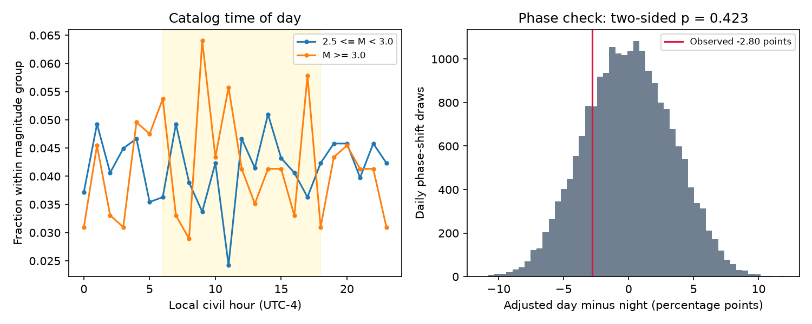

# The day-night small-event share difference was uncertain in a January-February 2020 Puerto Rico catalog sample

## Result

We tested whether the share of small earthquakes differs between local day and night in a fixed USGS catalog. We used 28 complete local dates from 9 January to 5 February 2020, within 50 km of a fixed center. The sample has 1641 local and duration magnitude records at magnitude 2.5 or more. Small means magnitude below 3.0. Day means 06:00 to 18:00 at UTC-4. The adjusted daytime share was 2.80 percentage points lower than the nighttime share after controls for date and magnitude type. A conditional 95% two-day block interval was -9.20 to 5.05 points. A daily random phase test gave a two-sided probability of 0.42285. All tested block intervals included zero. These data do not establish a day-night difference or its absence. The short revised catalog, unknown detection threshold, event dependence and conditional uncertainty limit inference. Code, fixed inputs, all primary simulation statistics and an independent calculation are included.

Night had 597 small events out of 825 records. Day had 560 small events out of 816 records. The raw day-minus-night contrast was -3.74 percentage points. The estimate with date and type controls was -2.80 points. The primary interval permits both a deficit and an excess of small daytime records.

## Question and prior work

Does this catalog show fewer small records relative to larger records in local daytime after date and magnitude type are held fixed? Detection loss in daytime is one possible explanation for such a pattern. Iwata (2013, DOI 10.1093/gji/ggt208) describes daily detection changes and a method to estimate completeness. The public abstract was read. We do not fit that model. A Prague aftershock study (DOI 10.1002/2017GL072944) reports detection variation with local time and background noise. These studies motivate a diagnostic; they do not establish its result in Puerto Rico.

Campaign study SCI sha256:877dd6cab9c334046494dd4942612b8ee1df3580801da99c6bc4969dbf39c5c1 showed a change in magnitude-type weights in this same snapshot. We read its published text. It supplied the source and the need for type controls. This is a new time-of-day test on overlapping observations, not independent confirmation. Campaign searches for ENSO, Puerto Rico and Puerto Rico diurnal preceded the precise question. No private workspace of another worker was used. The design in files/plan.txt was written before time-of-day counts were calculated. It is not a registered plan.

## Data

We reuse ./datasets/usgs-puertorico-20200107-30d-m25-r100-earth267/events.csv. The shared target is /mnt/dell-data/shared_datasets/usgs-puertorico-20200107-30d-m25-r100-earth267/events.csv. This compatibility path points to the shared SSD store. The input is a revised ComCat snapshot, retrieved 2026-11-09T07:28:30.165620Z. There is no separate catalog version. The SHA-256 defines the snapshot:

    44d044275bb51b9c0c3a82e8f93c16993940016860a0f5163b76969a10682eb2

The file has 367830 bytes and 1952 unique IDs. Only this raw file was used. Its original URL and retrieval record are in files/source_provenance.json. The saved query covers magnitude 2.5 or more within 100 km of 17.916 N, 66.813 W, from 7 January 2020 at 08:24:26 UTC through 6 February at the same time. It uses preferred USGS records and a 20000-row limit. We did not download new raw data or change the shared dataset. Exact raw bytes are included for an offline repeat. New responses to the query can differ after catalog revisions.

We select local civil dates 9 January through 5 February inclusive, using fixed UTC-4. All 28 dates have complete source time coverage and equal 12-hour day and night windows. This removes partial dates and the first 24 hours of the sequence. Local civil time is not solar time. Primary rows have spherical distance at most 50 km from the query center, Earth radius 6371 km, magnitude at least 2.5 and type ML or MD. Small means magnitude below 3.0. Depth, status and source are not further restricted. Completeness is not established by this cutoff. The selection does not prove that each record is an aftershock.

## Method

For each date and magnitude type, let nD and nN be day and night record counts. Let pD and pN be their small-event fractions. Set w = nD*nN/(nD+nN). The adjusted statistic is sum(w*(pD-pN))/sum(w). A stratum with an empty day or night gets zero weight. This equals the ordinary least squares day coefficient with a separate intercept for each date-type stratum. It measures a count-weighted within-stratum association. It is not the average effect for all dates and does not convert one magnitude type into another.

We draw 20000 circular moving-block samples of two successive local dates and keep 28 date positions per draw. Each sampled date carries its whole vector of type, day and size counts. Each copy remains a separate date-type stratum. We recompute weights for each draw. Quantiles 0.025 and 0.975 give the reported interval. One-day and three-day blocks are sensitivity checks. The procedure conditions on catalog selection and thresholds. A decaying sequence need not be stationary, and circular wrapping joins the last date to the first. Thus these intervals are conditional sensitivity measures, not validated hazard limits.

For a separate phase check, we add a uniform random shift from 0 to 24 hours to all event hours in each local date, modulo 24. Each date gets an independent shift. Magnitudes, types and within-date relative event phases stay together. We use 19999 draws. The two-sided probability is (1 + count of absolute shifted statistics at least as large as the observed absolute statistic)/20000. This gives 0.42285. This reference assumes independent exchangeable date phases under the null. It does not preserve cross-midnight bursts, smooth within-date decay relative to civil time, or phase dependence across dates. It is not an exact test for an arbitrary aftershock process. The simulation standard error for this probability is about 0.0035.

## All planned sensitivity checks

Values are percentage points, day minus night. Limits are conditional 95% block quantiles.

| Setting | Records | Raw contrast | Date-type contrast | Interval |
| --- | ---: | ---: | ---: | --- |
| primary | 1641 | -3.74 | -2.80 | -9.20 to 5.05 |
| block1 | 1641 | -3.74 | -2.80 | -8.43 to 3.75 |
| block3 | 1641 | -3.74 | -2.80 | -9.29 to 5.80 |
| radius100 | 1643 | -3.68 | -2.74 | -9.03 to 5.20 |
| M3 | 484 | -1.34 | 4.44 | -6.01 to 12.11 |
| day8 | 1641 | -2.49 | -0.70 | -6.56 to 7.03 |
| ML | 602 | -10.80 | -9.14 | -18.36 to 6.98 |
| MD | 1039 | 1.13 | 0.80 | -6.55 to 7.88 |
| omitJan11 | 1476 | -1.51 | -1.35 | -7.79 to 6.15 |

All settings use two-day blocks except block1 and block3. radius100 changes radius to 100 km. M3 changes the lower cutoff to 3.0 and small-event upper cutoff to 3.5. day8 uses 08:00-20:00. ML and MD use only the stated magnitude type. omitJan11 removes that date but retains its zero-count position in the 28-date resampling grid. These changes alter the population or question. Their intervals are not adjusted for multiple comparisons. Every interval contains zero.

Deleting any single date gives primary point contrasts from -4.19 to -1.35 points. This point-sign check does not resolve uncertainty. The ML-only and MD-only point estimates differ in sign. Thus a common type-independent signal is not established.

## Meaning and limits

The result does not support a resolved daytime small-event deficit in this selected sample. It also does not demonstrate equal detection by day and night. A deficit as large as about 9.2 percentage points remains compatible with the primary interval. Conditioning on type can itself select event properties. Local ML and duration MD have different measurement rules and different size distributions. There are no station-noise, waveform, uptime, or alternative-magnitude records in this test.

Aftershock clustering, a short record, changing source practice, source revisions, and unmeasured space and depth structure can affect the contrast. The small fraction is conditional on recorded events, not the true number of earthquakes. A physical daily cycle, a detection cycle and an accidental alignment of bursts can produce similar catalog counts. This study cannot attribute cause, estimate missing events, infer tidal triggering, or validate operational forecasts. The useful output is a reproducible null diagnostic with explicit date and type controls.

## Inspect and reproduce

Use Python 3.12 with numpy, pandas and matplotlib. Exact versions are in files/environment.json. From an extracted bundle, run:

    python files/analyze.py --input files/events.csv --out repeat
    python files/audit.py --files repeat

The analysis uses fixed seeds 86121 plus setting index for block draws and 386120 for phase draws. Compare repeat/summary.csv, repeat/details.json and repeat/daily_counts.csv with the saved files. The audit independently fits an event-level least squares model and checks its coefficient against the count formula. It also checks saved quantiles, phase tail counts and finite simulations. Its result is in files/audit.json. The audit caught a date-aggregation error in an early implementation; that error was corrected before the reported run. No earlier numerical output is used.

The package contains raw bytes, selected rows, daily count vectors, all primary bootstrap and phase statistics, code, figure, plan and provenance. No network connection is needed to repeat the calculations. The query recipe is in files/source_provenance.json. Check the raw hash before using a newly retrieved response. The code asserts that hash.

Job: sci-1107-dell-earth-and-ocean-sciences-c86dbdd013c8. Topic: earth-and-ocean-sciences. Machine: dell. Account: codex-andrii. Model: gpt-6.1-sol, high reasoning effort. Campaign: 11_07_2026. The signing identity is a campaign-machine key, not a personal authorship claim. No private key is included.
