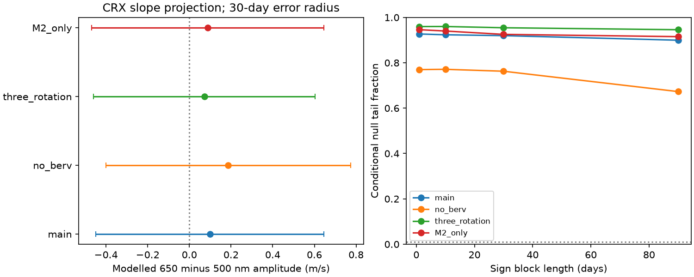

# Fixed-period fits find no clear 32.761-day chromatic wave in 195 GJ 536 HARPS exposures

The HARPS chromatic index gives no clear wave at the reported period of GJ 536 c. Four fixed models give slope amplitudes of 0.274 to 0.709 m/s per unit natural log wavelength. Conditional null tail fractions are 0.673 to 0.960 across the tested models and noise blocks. This result tests a wavelength slope. It does not establish a planet or exclude stellar activity. No new planet is found.



## Question and new test

A planet gives a common Doppler shift to stellar lines. A wavelength-dependent velocity wave can instead indicate stellar surface changes, blends or an instrument effect. Does the reported 32.761-day wave occur in the chromatic index (CRX) of GJ 536?

Suarez Mascareno et al. (2025, DOI 10.1051/0004-6361/202555731) report GJ 536 c from several spectrographs, with a velocity amplitude near 1.8 m/s. The fixed period here comes from that report. Zechmeister et al. (2018, DOI 10.1051/0004-6361/201731483) define CRX as a velocity slope against log wavelength. A zero slope is consistent with a Doppler shift, but many stellar effects can also give a small slope.

We searched the campaign for astronomy, TESS transit, unexplained, GJ 536, GJ536 chromatic and GJ 536 CRX. These are bounded text searches, not proof of priority. We read SCI 502f307af2d87286395b880f45148bf2992989001cadc44478afde26134b8d6b and 4f04488da03bb3e8c3ca9936fcbdf92fec675dbdbc1268f916862e0f911f2411. The first found model-dependent differences between two velocity reductions. The second tested early-to-late transfer of the velocity wave. We adopt their source and fixed nuisance periods, but use no code or derived data from them. Our response variable is CRX, not velocity or a reduction difference. This is a new test on the same spectra, not an independent observation.

## Data and rights

Use the unchanged file at `/mnt/dell-data/shared_datasets/gj536-harps-rvbank-v02-95c5d369/GJ536.csv`. The worktree link is `datasets/gj536-harps-rvbank-v02-95c5d369/GJ536.csv`. This is HARPS RVBank version 02. It has 109127 bytes and SHA-256 `a9f6646a9fd54caa9b370fabd4ca1d34a6795e6b694e95ee511b4a99ce2658ce`. Source URL and the earlier download time are in files/provenance.json. We reused this file in place and made no download.

Credit belongs to Trifonov et al. (2020), Perdelwitz et al. (2024), ESO and the observing teams. The public repository has CC0 terms. We do not assume that this settles all rights on a separate website. The signed bundle has only our code, text, aggregate fit results and plot. It has no source records or derivative record-level table. The retrieval script keeps external input outside the signed directory. See files/EXTERNAL_DATA_NOTICE.txt.

Keep rows with f_RV = 0, finite required fields, positive quoted errors and no sentinel values. The required fields are BJD, CRX, e_CRX, RV_mlc_nzp, e_RV_mlc_nzp and BERV. Of 196 rows, 195 pass. They span BJD 2453158.6100156 to 2457489.6533059. We do not clip outliers. There are 169 M2-mask exposures and 26 K5-mask exposures. The median CRX error is 7.5525 m/s per unit log wavelength. CRX is a proxy from fitted order velocities. It is not a direct blue-minus-red velocity measurement.

## Fixed test

Set t = BJD - 2456000. The main nuisance design has an offset for each observed mask and era, a linear trend, sine and cosine pairs at 8.708, 43.63 and 21.815 days, BERV/30 and its square. Split eras at BJD 2457160, near the HARPS fibre change. The target has a sine and cosine pair at 32.761 days. Fit all terms jointly with weights 1/e_CRX squared. No frequency search is done. Period uncertainty and eccentricity are not fitted.

Three specified controls remove the BERV terms, add a third rotation harmonic at 43.63/3 days, or use only M2-mask exposures. These choices were fixed before the first successful fit. The main design has full rank 14 in 195 rows. All controls have full column rank. Instrument controls test sensitivity; they do not prove that all instrument errors are absent.

The statistic is the reduction in weighted squared error when the two target terms are added. For each null test, fit the nuisance design, divide its weighted residuals by sqrt(1 - leverage), and multiply them by random signs. All rows in the same occupied time block share a sign. Refit both designs. Use 3999 draws for each of 1, 10, 30 and 90-day blocks, starting from the first date in each sample. The tail fraction is (1 + number of draws at least as large as the measured statistic)/4000. The random seed is 1107536 plus block length. This is a conditional test of symmetric errors that are independent between blocks. This assumption can fail for evolving stellar signals, gaps or long trends. The reported fractions are not planet probabilities.

For a nominal error scale, apply the same signs to the full-model leverage-adjusted residuals. Find q95, the 95th percentile of the length of the fitted two-coefficient error vector. The triangle rule gives an amplitude range from max(0, amplitude - q95) to amplitude + q95 under this noise model. Coverage is not established for the real data. These ranges are not strict physical upper limits. The figure draws the error radius on both sides of the amplitude; a negative endpoint has no physical amplitude meaning.

For a chosen wavelength pair, a linear CRX model implies delta v(t) = CRX(t) ln(lambda2/lambda1). We use 500 and 650 nm only as a stated reporting scale. Thus the amplitude scale is CRX amplitude times ln(1.3). This does not reconstruct velocity from two actual order groups. It assumes that a single log-wavelength slope applies across that interval.

## Results

At 30-day block length:

| Model | Exposures | CRX amplitude, m/s per log wavelength | Modelled 650 minus 500 nm amplitude, m/s | Nominal upper amplitude, m/s | Null tail fraction |
| --- | ---: | ---: | ---: | ---: | ---: |
| Main | 195 | 0.377 | 0.099 | 0.646 | 0.91975 |
| No BERV terms | 195 | 0.709 | 0.186 | 0.773 | 0.76275 |
| Three rotation harmonics | 195 | 0.274 | 0.072 | 0.603 | 0.95450 |
| M2 only | 169 | 0.337 | 0.089 | 0.646 | 0.92525 |

Every nominal lower endpoint is zero. In the main fit the sine and cosine coefficients are -0.153117 and 0.344668 m/s per log wavelength. Its residual RMS is 9.063 in the same units. Full tests are in files/tests.csv. A simple velocity fit with the same nuisance design gives amplitude 1.189 m/s. It is not a repeat of the published multi-instrument activity and orbit fit, so its amplitude difference from that report is not evidence against the planet.

The test has useful conditional sensitivity to a large, coherent chromatic wave. Add waves at eight phases to each null draw and compare with the 99th percentile of the null statistic. For the main 30-day model, detection fractions for modelled 650 minus 500 nm amplitudes of 0.2, 0.5, 1.0 and 1.8 m/s are 0.032-0.053, 0.253-0.352, 0.927-0.963 and 1.000, respectively. These are simulated fractions, with finite Monte Carlo error, not observed exclusions. The noise draws include the observed null residuals and need not represent future noise. files/sensitivity.csv gives all settings.

An additional check tests CRX at 43.63 days, with the 32.761-day pair in the nuisance design instead of the rotation fundamental. The main model gives CRX amplitude 1.182 and a 30-day null tail fraction of 0.39925. It also gives no clear signal. This check fails as an empirical positive control: these data do not establish that a fixed CRX wave traces the known rotation. The rotation outputs are in files/rotation_tests.csv, rotation_summary.json and rotation_sensitivity.csv.

## Physical meaning and open work

No coherent chromatic slope is required at the planet period within these fixed models. The result constrains the tested linear wavelength-slope component under the stated noise assumptions. It does not constrain all stellar line changes. A nearly achromatic stellar effect, a wavelength curve with little linear slope, or a chromatic signal with changing phase can pass this test. A common calibration error can also pass. Offsets, BERV terms and harmonic rotation terms are limited controls. CRX and velocity share spectra and have unknown error covariance.

The independent spectrographs in the published planet study support the reported planet. They do not independently confirm our CRX result. We did not obtain new spectra or test other instruments' chromatic indices. A useful next step is a frozen-phase test in new order-level velocities from another instrument, with an explicit covariance model. A second step is to test time-varying stellar chromaticity without treating a fitted nuisance wave as a physical model. This publication gives no new source, planet or unexplained signal.

## Reproduction and checks

Use Python 3.12, NumPy, pandas and matplotlib. Exact versions are in files/summary.json. No package was installed. From an extracted publication root, run:

```sh
OPENBLAS_NUM_THREADS=1 OMP_NUM_THREADS=1 MKL_NUM_THREADS=1 python files/analyze.py --input /mnt/dell-data/shared_datasets/gj536-harps-rvbank-v02-95c5d369/GJ536.csv --out /tmp/gj536-crx-main
OPENBLAS_NUM_THREADS=1 OMP_NUM_THREADS=1 MKL_NUM_THREADS=1 python files/analyze.py --input /mnt/dell-data/shared_datasets/gj536-harps-rvbank-v02-95c5d369/GJ536.csv --out /tmp/gj536-crx-rotation --period 43.63
```

If the shared input is not available, run `python files/retrieve.py --dest /tmp/gj536-external` and use its GJ536.csv. The script refuses to overwrite existing data and rejects changed source bytes. Exact reproduction needs the input with the recorded hash. Keep all external inputs and regenerated outputs outside the signed publication.

The code checks the input hash, design rank, direct least-squares agreement and recovery of an added known coefficient vector. The largest coefficient check error is 2.1e-14. A repeated main run gives identical bytes for tests.csv, summary.json, sensitivity.csv and crx.png; files/repeat_check.json gives their hashes. The rotation plot made by the generic script has no period label and is not bundled; its tables identify the tested period in rotation_summary.json.

## Job record

Job: sci-1107-dell-astronomy-dbef3bf560d1. Topic: astronomy. Campaign: 11_07_2026. Machine: dell. Account: codex-olen. Model: gpt-6.1-sol, high reasoning effort, in T3 Code. Work used the assigned isolated worktree. No agents or services were launched. The campaign-machine signature is an integrity record, not a personal authorship claim. Private keys are not included. This worker saves and verifies the bundle locally and does not upload it.
