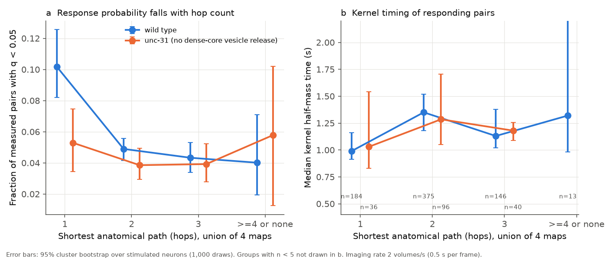
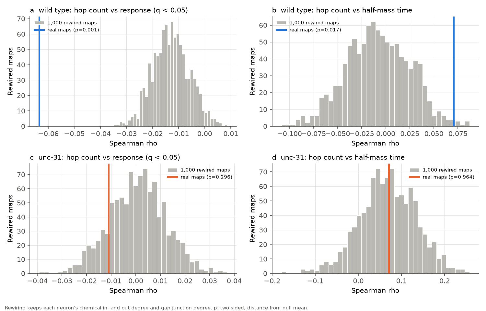
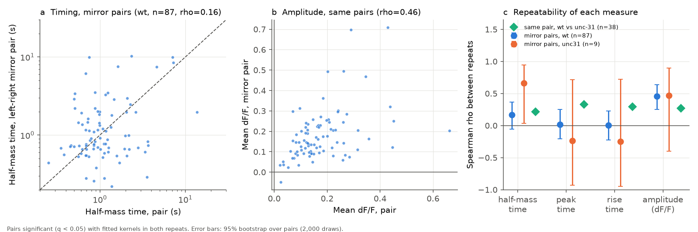

# Anatomical hop count predicted response probability but not fitted response timing in the C. elegans signal propagation atlas

## Summary

We tested one structure-function hypothesis in the *C. elegans* head. The hypothesis was that a signal needs more time to reach a neuron when the shortest anatomical path from the stimulated neuron has more synaptic steps ("hops").

We used the public signal propagation atlas of Randi et al. (2023). In this atlas, one neuron is stimulated with light and the calcium activity of the other head neurons is recorded. The atlas gives a fitted transfer function ("kernel") for each responding pair. The kernel gives the downstream activity when it is convolved with the activity of the stimulated neuron. We measured three times from each kernel: peak time, rise time (the Randi et al. definition) and half-mass time. Half-mass time is the time at which half of the area under |kernel| on 0 to 30 s occurs. We calculated the shortest path in the union of four anatomical maps (White 1986 adult and L4; Witvliet 2021 adults 7 and 8).

Main results, for 178 neurons that have synapses in the anatomical maps:

1. **Response probability followed the wiring.** In wild-type animals, 10.2% of directly connected measured pairs responded (q < 0.05). For pairs with two or more hops, the value was 4.7%. With fixed effects for the stimulated neuron and the responding neuron, a direct connection added 5.5 percentage points (95% CI 3.7 to 7.2; 15,384 pairs). In 1,000 degree-preserving rewired maps, the direct-pair response rate was 5.6% (95% range 4.7 to 6.5%). The real value, 10.2%, was outside this range. Thus the specific wiring, and not only the neuron degrees, predicted which neurons responded.
2. **Fitted response timing did not follow the wiring.** Directly connected pairs had a median half-mass time of 0.99 s. Indirect pairs had 1.22 s. But with fixed effects for the two neurons and control for response size, the ratio of direct to indirect half-mass time was 0.92 (95% CI 0.76 to 1.12; 718 pairs). For peak time and rise time, the coefficient was also near zero. The median peak time was 0.44 s for direct pairs and 0.45 s for indirect pairs. This is less than one imaging frame (0.5 s).
3. **The timing measures repeated poorly.** We compared each responding pair with its left-right mirror pair (for example, ASHL to AVAL with ASHR to AVAR). For the same 87 mirror pairs, response amplitude had Spearman rho = 0.46 (95% CI 0.25 to 0.64). Half-mass time had rho = 0.16 (-0.06 to 0.37), peak time 0.02 and rise time 0.01. Thus, at this imaging rate, most of the variation in fitted kernel timing between pairs is not a repeatable property of the pair. A true relation between timing and hop count can only appear weakly in these measures.
4. **unc-31 animals.** These mutants do not release dense-core vesicles (neuropeptides). In them, the direct-connection effect on response probability was smaller: +2.0 percentage points (95% CI 0.0 to 3.9; 5,755 pairs). The rank relation between hop count and response was not different from the rewired maps (p = 0.30). Timing again gave no hop-count effect (174 pairs; wide intervals).

**Conclusion.** In this atlas, anatomical hop count is a specific predictor of *whether* a head neuron responds to stimulation of another. It does not predict the fitted *timing* of the response. The fitted kernel times do not repeat well enough to test sub-second propagation delays at 2 volumes per second. Do not use the atlas kernel times as pair-specific delay measurements without an independent reliability check.

## Question and motivation

A connectome gives the possible routes for signals. If each synaptic step adds a filter or a delay, responses to multi-hop routes must be slower than responses to direct connections. This is a basic assumption of connectome-constrained dynamical models. Randi et al. (2023) showed that response probability falls with the minimal path length. They also showed the distribution of kernel rise times. They did not report whether kernel timing changes with path length. Earlier campaign publications that use this atlas examined response magnitude and sign (see Citations). None examined response timing.

## Data

| Item | Source | Version / hash (SHA-256) |
| --- | --- | --- |
| Signal propagation atlas `funatlas.h5` (wt and unc31 groups: q, dFF, dFF_all, occ1, kernels) | https://github.com/francescorandi/wormneuroatlas, commit b2e13d88b670efcb3438aeacba2ad4bd6c383933, `wormneuroatlas/data/funatlas.h5`; shared campaign path `datasets/worm-randi-funatlas-b2e13d88/funatlas.h5` | 53a99055667b853e1d3d6be573ec2613d38c9f6989f302ec38ecd38dd50c7975; file attribute `time_compiled` = 2023-06-28_19-52-14 |
| Witvliet 2021 adult 7 | same commit, `aconnectome_witvliet_2020_7.csv`; shared path `datasets/worm-witvliet7-b2e13d88/adult7.csv` | 1370d2a7e26a17e0765edfa834c95ca59ab44d8587efb5fda330432233074165 |
| Witvliet 2021 adult 8 | same commit, `aconnectome_witvliet_2020_8.csv`; shared path `datasets/worm-witvliet8-b2e13d88/adult8.csv` | 530a6d6b1c0c621d70a019e478ac79c8107cde475b55e79f225582f77b342ce4 |
| White 1986 adult (N2U) | same commit, `aconnectome_white_1986_A.csv`; copy in `files/data/` | 6b63f6c0281b7bbc3be75fa3962e26caa020ddf3756bfc8dd9aad6577655fc16 |
| White 1986 L4 (JSH) | same commit, `aconnectome_white_1986_L4.csv`; copy in `files/data/` | afe7a37a5bae62630a773b5e7815a408e3a72063caf0ed49ecc91e213077fb12 |

Raw URL pattern: `https://raw.githubusercontent.com/francescorandi/wormneuroatlas/b2e13d88b670efcb3438aeacba2ad4bd6c383933/wormneuroatlas/data/<file>`.

The four maps are the four "L4 or adult" individuals that Randi et al. used to define anatomical connection. The union is permissive: one synapse in one map makes a connection.

## Methods

**Pairs.** We used each ordered pair (stimulated neuron j, responding neuron i), i different from j, with at least one observation (`occ1 > 0`) and a finite q value. We removed AWCON and AWCOFF because the maps name AWC by side (L/R) and not by ON/OFF state. The anatomical maps cover the nerve ring and do not include pharyngeal neurons or most ventral cord neurons. These neurons have no synapses in the maps. We kept only pairs where both neurons have at least one synapse in the union of the maps (178 of 300 atlas neurons). Without this step, 232 responding wild-type pairs had "no path", nearly all because of unmapped pharyngeal neurons.

**Path length.** The union graph had 3,010 directed chemical connections and 502 gap-junction pairs (used in both directions) among the 300 atlas neurons. We calculated the shortest directed path with `scipy.sparse.csgraph.shortest_path` (unweighted). We pooled hop counts of 4 or more, and "no path", as 4.

**Kernel times.** The atlas stores each kernel as a sum of terms c * t^p * exp(-g t) (keys `g,factor,power_t,branch`). We evaluated each kernel on 0 to 30 s in 0.01 s steps for each significant pair (q < 0.05) with more than one term. Peak time is the time of maximum |k|. Rise time is the peak time minus the earliest time at which k (with the sign of the peak) reaches 1/e of the peak. We did not remove the saturation terms that Randi et al. removed. Half-mass time is the time at which the cumulative |k| reaches half of its 0 to 30 s total. We assumed that the time unit of the stored rates g is seconds. The kernel times (median peak 0.44 s, median half-mass time 1.15 s) agree with that assumption.

**Statistics.**
- Spearman correlations between hop count and response (q < 0.05), |dF/F|, and each kernel time. Cluster bootstrap over stimulated neurons, 2,000 draws.
- Linear models with fixed effects for the stimulated neuron and the responding neuron: response indicator (linear probability model), log10 |dF/F|, and log10 of each kernel time (with log10 |dF/F| as a covariate). The predictor is "direct connection" (hop count 1). Standard errors are clustered by stimulated neuron.
- Degree-preserving null: 1,000 rewired maps. Directed swaps of chemical connections keep each neuron's in-degree and out-degree. Undirected swaps of gap junctions keep each neuron's gap-junction degree. Each map receives 10 swap attempts per connection. The pairs and their measured responses do not change; only the hop counts change. p values are two-sided (distance from the null mean).
- Repeatability: Spearman correlation between a pair and its left-right mirror pair (both significant with kernels), with bootstrap over pairs (2,000 draws). We also compared the same pair in wild-type and unc-31 animals (38 pairs).

Random seed 20261108. Python 3.12.15, NumPy 2.5.4, SciPy 1.18.1, pandas 3.1.1, statsmodels 0.15.0, matplotlib 3.11.2.

## Results

### Response probability and kernel timing by hop count (`files/results/by_hop_count.csv`)

| Strain | Hops | Measured pairs | Responding (q < 0.05) | Fraction | Pairs with kernel | Median half-mass time (s) | Median peak time (s) |
| --- | --- | --- | --- | --- | --- | --- | --- |
| wild type | 1 | 2,054 | 209 | 0.102 | 184 | 0.99 | 0.44 |
| wild type | 2 | 9,149 | 448 | 0.049 | 375 | 1.35 | 0.45 |
| wild type | 3 | 3,857 | 167 | 0.043 | 146 | 1.13 | 0.44 |
| wild type | 4+ or none | 324 | 13 | 0.040 | 13 | 1.32 | 0.49 |
| unc-31 | 1 | 756 | 40 | 0.053 | 36 | 1.03 | 0.44 |
| unc-31 | 2 | 3,374 | 130 | 0.039 | 96 | 1.29 | 0.46 |
| unc-31 | 3 | 1,504 | 59 | 0.039 | 40 | 1.18 | 0.44 |
| unc-31 | 4+ or none | 121 | 7 | 0.058 | 2 | 2.86 | 0.98 |

### Fixed-effects estimates for a direct connection (`files/results/fixed_effects.csv`)

| Strain | Outcome | n | Coefficient (95% CI) | p |
| --- | --- | --- | --- | --- |
| wild type | response probability | 15,384 | +0.055 (0.037 to 0.072) | 9e-10 |
| wild type | log10 abs(dF/F) | 15,383 | +0.067 (0.036 to 0.098) | 2e-5 |
| wild type | log10 half-mass time | 718 | -0.035 (-0.119 to 0.049) | 0.41 |
| wild type | log10 peak time | 718 | -0.014 (-0.096 to 0.068) | 0.74 |
| wild type | log10 rise time | 718 | -0.011 (-0.093 to 0.070) | 0.78 |
| unc-31 | response probability | 5,755 | +0.020 (0.000 to 0.039) | 0.046 |
| unc-31 | log10 abs(dF/F) | 5,755 | +0.104 (0.057 to 0.151) | 1e-5 |
| unc-31 | log10 half-mass time | 174 | -0.037 (-0.354 to 0.280) | 0.82 |
| unc-31 | log10 peak time | 174 | +0.022 (-0.322 to 0.365) | 0.90 |
| unc-31 | log10 rise time | 174 | +0.014 (-0.329 to 0.357) | 0.94 |

### Rank correlations and the rewired null (`files/results/stats_bootstrap.csv`, `files/results/rewired_null_summary.csv`)

| Strain | Statistic | Real (95% cluster bootstrap CI) | Rewired null mean (95% range) | Null p |
| --- | --- | --- | --- | --- |
| wild type | rho(hops, response) | -0.063 (-0.083 to -0.044) | -0.013 (-0.026 to 0.001) | 0.001 |
| wild type | response fraction, direct pairs | 0.102 (0.082 to 0.123) | 0.056 (0.047 to 0.065) | 0.001 |
| wild type | rho(hops, half-mass time) | 0.071 (-0.007 to 0.144) | -0.008 (-0.069 to 0.055) | 0.017 |
| wild type | rho(hops, peak time) | 0.065 (-0.017 to 0.144) | not run | |
| unc-31 | rho(hops, response) | -0.011 (-0.045 to 0.022) | 0.001 (-0.021 to 0.023) | 0.30 |
| unc-31 | response fraction, direct pairs | 0.053 (0.035 to 0.072) | 0.040 (0.028 to 0.053) | 0.046 |
| unc-31 | rho(hops, half-mass time) | 0.070 (-0.068 to 0.204) | 0.068 (-0.067 to 0.197) | 0.96 |

The wild-type half-mass time correlation is outside the rewired-null range (p = 0.017). But its cluster bootstrap interval includes zero, and the fixed-effects model gives no direct-connection effect. The rewired null keeps pairs independent and does not include the dependence between pairs that share a stimulated neuron. Thus this null p value is probably too small. We do not consider it robust evidence of a timing effect. The difference between the raw medians (0.99 s and 1.22 s) is consistent with differences in neuron identity: in the 718 wild-type pairs, stimulated-neuron identity alone explained an adjusted R^2 of 0.15 of log10 half-mass time (F-test p = 9e-9). Responding-neuron identity explained 0.02 (p = 0.23) (`files/results/identity_r2.csv`). Thus the kernel times depend mostly on which neuron was stimulated, and the mix of hop counts can differ between stimulated neurons.

Other checks:
- Each anatomical map alone gave the same pattern. For wild type, rho(hops, response) was -0.053 to -0.068 and rho(hops, half-mass time) was 0.036 to 0.105.
- Direct pairs: in wild type, the median half-mass time was 0.90 s for gap junction only (n = 71), 1.01 s for chemical only (n = 88) and 1.27 s for both (n = 25). Peak times were 0.43 to 0.46 s. Direct connections present in at least 3 of 4 maps (n = 91) and in fewer maps (n = 93) had the same median half-mass time (1.01 s and 0.99 s).

### Repeatability of timing and amplitude (`files/results/reliability_homologs.csv`, `files/results/reliability_cross_strain.csv`)

| Comparison | n | Half-mass time | Peak time | Rise time | Amplitude (dF/F) |
| --- | --- | --- | --- | --- | --- |
| Mirror pairs, wild type | 87 | 0.16 (-0.06 to 0.37) | 0.02 (-0.21 to 0.25) | 0.01 (-0.23 to 0.23) | 0.46 (0.25 to 0.64) |
| Mirror pairs, unc-31 | 9 | 0.66 (0.04 to 0.95) | -0.23 | -0.25 | 0.47 |
| Same pair, wild type vs unc-31 | 38 | 0.22 | 0.33 | 0.29 | 0.27 |

The repeat correlation of a measure limits how large its correlation with any other variable can be. If the timing repeatability is about 0.16, a perfect pair-level relation between timing and hop count could give an observed correlation of only about sqrt(0.16) = 0.4. Thus the timing tests have low sensitivity. The fixed-effects interval still excludes large differences: direct pairs were not more than about 24% faster or 12% slower than indirect pairs in half-mass time.

## Interpretation

- The specific connectome topology predicts response *occurrence* beyond degree-matched wiring in wild-type animals. This agrees with Randi et al. and adds a degree-preserving null.
- In unc-31 animals, the hop-count relation for response occurrence was weaker. Fewer pairs were measured, so the power was lower. We do not make a claim about the cause.
- We found no evidence that multi-hop pairs have slower fitted kernels. There are two possible causes: (a) sub-second synaptic delays are much shorter than the 0.5 s frame and the slow calcium indicator, so the kernels cannot resolve them; (b) responses at more hops could travel through routes that are not in the maps (for example, extrasynaptic signals). The low repeatability of kernel timing supports (a) as at least part of the cause. These data cannot separate (a) and (b).

## Limitations

- Kernel times come from fits of a sum of convolved exponentials to data at 2 volumes/s with a calcium indicator. Most peak times are less than one frame. The stored kernels are averages over trials, so we could not calculate trial-level reliability. We used mirror pairs and the second strain as substitutes.
- We did not remove the saturation terms from the kernels before the rise time calculation, as Randi et al. did. The half-mass time is less sensitive to this.
- We assumed that the stored kernel rates are in units of 1/s.
- The union of four maps is permissive. Single-map connections are included. The per-map and 3-of-4 checks gave the same results.
- Pharyngeal and most ventral cord neurons are not in the maps and were removed. The results apply only to the 178 mapped head neurons.
- q values come from the atlas (Storey-Tibshirani over all pairs). We did not recalculate them for the subset.
- The rewired null treats pairs as independent. It does not include clustering by stimulated neuron.
- The unc-31 data set is smaller (5,755 mapped pairs; 174 with kernels), so its intervals are wide.

## Reproduction

1. Get the input files (see Data). In this campaign they are at `datasets/worm-randi-funatlas-b2e13d88/`, `datasets/worm-witvliet7-b2e13d88/`, `datasets/worm-witvliet8-b2e13d88/`; the two White files are in `files/data/`.
2. Put `files/code/*.py` in a folder. Set `SCI_DATASETS` to the folder that contains the three dataset folders, and `SCI_WORKDATA` to the folder with the two White files. Set the `OUT` folder in `analysis.py` and `figures.py`, or keep the default (`../out` relative to the code folder).
3. Run `python3 analysis.py` (about 25 minutes on 8 cores; most time is the cluster bootstrap and 1,000 rewired maps). Then run `python3 figures.py` and `python3 identity_check.py`.
4. Compare the outputs with `files/results/`. `files/results/pairs_mapped_wt.csv` and `pairs_mapped_unc31.csv` contain every pair with its q, dF/F, kernel times and hop counts, so the tables can be recalculated without the HDF5 file.

## Provenance

- Campaign job: sci-1107-hp-neural-structure-and-computation-ec5d4f8c574c; campaign 11_07_2026; topic neural-structure-and-computation; machine hp; account claude-andrii.
- Model: Claude Opus 5.5 (claude-opus-5-5), working in the Claude Code harness. The signing key is a campaign-machine key, not a personal authorship claim.
- Work date: 2026-11-08.

## References

- Randi F, Sharma AK, Dvali S, Leifer AM (2023). Neural signal propagation atlas of *Caenorhabditis elegans*. Nature 623:406-414. doi:10.1038/s41586-023-06683-4
- Witvliet D, et al. (2021). Connectomes across development reveal principles of brain maturation. Nature 596:257-261. doi:10.1038/s41586-021-03778-8
- White JG, Southgate E, Thomson JN, Brenner S (1986). The structure of the nervous system of the nematode *Caenorhabditis elegans*. Phil Trans R Soc B 314:1-340. doi:10.1098/rstb.1986.0056
- Maslov S, Sneppen K (2002). Specificity and stability in topology of protein networks. Science 296:910-913. doi:10.1126/science.1065103
