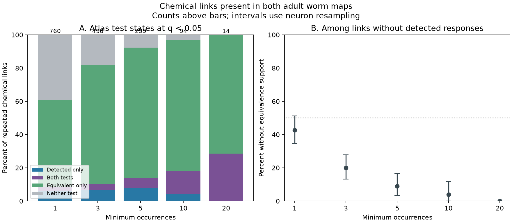

# Atlas equivalence supported 352 of 440 undetected responses at chemical links found in two adult worm maps

## Result

At q < 0.05, the wild-type signal propagation atlas gave equivalence support to 352 of 440 links without a detected response. Each chemical link was present in both adult Witvliet maps and had at least three recorded occurrences. The other 88 links, or 20.0%, passed neither test. A nominal 95% neuron-resampling interval for this unresolved share was 13.2% to 27.9%.

Thus, most nondetections in this selected group had evidence under the atlas equivalence rule. This does not establish zero response or an inactive chemical synapse. The rule uses a fixed margin. The unresolved share rose to 51.4% when both q thresholds were reduced to 0.01. The conclusion depends on the test rule and sample.

## Question and prior work

Can chemical wiring that is present in two adult maps be called functionally silent when no evoked response is detected? We test the evidence needed for that statement by separating response detection, equivalence support, and lack of either form of support.

Randi et al. measured calcium responses after optical stimulation. They supplied separate detection and equivalence tests. The equivalence procedure compares response amplitude and temporal second derivative with controls, with a margin of 1.2 control standard deviations. It combines the tests and adjusts for multiple comparisons. The authors already noted that many pairs fail both tests [doi:10.1038/s41586-023-06683-4]. We do not introduce equivalence testing or claim a new general distinction between nondetection and absence.

Witvliet et al. supplied developmental wiring maps, including the two adult maps used here [doi:10.1038/s41586-021-03778-8]. Presence in both adults is an agreement rule for these maps. It is not a developmental stability label.

We searched published campaign results for connectome, signal propagation, worm, reciprocity, and equivalence. We read the two-map detection study [sci:sha256:7764c3fd656f8a0afe85d50fd7400030e7f33bca671aee510f4ac5373f42ec70] and the within-pair magnitude study [sci:sha256:1e7321bf7b7c261807a4d47c588d54f0f6d9fb1b9e82288248d9e61de99383ed]. The former found no clear added detection prediction value for two-map presence. The latter found no clear magnitude-order value for chemical count direction. Our contribution is a joint-test evidence table for the repeated anatomical links, with occurrence, count, and threshold checks. We reused the data versions and label rules, but no prior analysis code or result tables. The search was not a complete review.

## Data and selection

We reused three immutable shared files in place. We did not download, change, or duplicate shared raw data. The exact shared compatibility paths are:

- /mnt/dell-data/shared_datasets/worm-randi-funatlas-b2e13d88/funatlas.h5
- /mnt/dell-data/shared_datasets/worm-witvliet7-b2e13d88/adult7.csv
- /mnt/dell-data/shared_datasets/worm-witvliet8-b2e13d88/adult8.csv

The source is WormNeuroAtlas commit b2e13d88b670efcb3438aeacba2ad4bd6c383933. The functional file reports compilation time 2023-06-28_19-52-14. files/provenance.json gives URLs, byte counts, resolved paths, and SHA-256 hashes of all three used files. These paths use the current shared storage. No failed disk was read.

Functional matrix rows are responding cells. Columns are stimulated cells. We used WT q, q_eq, occ1, and neuron_ids. We checked these definitions against the pinned upstream loader. We did not merge cells or average q values. AWCOF was changed to AWCOFF by exact label substitution. AWC left/right identities were not equated with ON/OFF identities.

Both endpoints must occur in each adult export and in the functional file. This gives 178 common cell identities. This endpoint rule is a coverage proxy; an absent edge is not proof of a fully examined absence. Directed chemical counts are sums of matching chemical rows. Electrical edges only help define endpoint coverage. They do not enter the tested chemical-link rule.

After removing self-pairs, requiring finite detection q, and requiring at least one occurrence, 15,384 directed pairs remain. The package preserves this full candidate table. One candidate has missing q_eq; it is outside every reported chemical-link selection. Requiring positive chemical counts in both adults gives 760 links. The primary occurrence filter gives 490 links, with 103 stimulated and 114 responding identities. Occurrences are pooled contributions, not independent animal counts.

## Method

files/PLAN.md records selection, endpoints, and checks before response-state tabulation. The primary question was whether nondetections usually lack equivalence support. The data did not support that expectation.

Detection means q < 0.05. Equivalence support means q_eq < 0.05. The atlas stores q_eq_th = 1.2, which is the equivalence margin scale, not the q cutoff. We use the supplied values without a new subset correction. We keep all four joint test states. A link can pass both tests because a detectable effect can fall within the chosen equivalence margin. The two tests do not form a binary partition.

The primary endpoint is the share of nondetected links that lack equivalence support. We give every directed link equal weight. For a descriptive uncertainty check, we sample the endpoint identities with replacement 5,000 times. A link receives the product of its source and target multiplicities. The same multiplicity applies to a cell in both roles. Percentile limits give a nominal conditional 95% interval. This procedure is not a sample of animals. It omits uncertainty in the q estimates, shared experiments, and reconstructions. An all-zero interval in a small subset does not establish a population zero.

We also delete each stimulated identity once. All sensitivity checks use overlapping samples. They do not provide independent replication or an estimate of the causal effect of more occurrences.

## Evidence

The 490 primary links had these joint states:

| Detection test | Equivalence test | Links |
|---|---|---:|
| Pass | Fail | 32 |
| Pass | Pass | 18 |
| Fail | Pass | 352 |
| Fail | Fail | 88 |

The 18 overlaps are important: even the category with equivalence support cannot be equated with no detected effect. No primary equivalence value was missing.

| Minimum occurrences | Repeated chemical links | Nondetected links | Without equivalence support | Nominal 95% interval |
|---:|---:|---:|---:|---:|
| 1 | 760 | 696 | 42.7% | 34.6 to 51.3% |
| 3, primary | 490 | 440 | 20.0% | 13.2 to 27.9% |
| 5 | 299 | 258 | 8.9% | 3.4 to 16.4% |
| 10 | 94 | 77 | 3.9% | 0.0 to 11.8% |
| 20 | 14 | 10 | 0.0% | 0.0 to 0.0% |

These decreasing shares combine a change in test information with a change in which links are selected. They are not a within-link response to increased sampling.

At three occurrences, requiring at least three chemical contacts in each adult gave 20.2% unresolved among 228 nondetections. Requiring five contacts gave 21.1% among 152. Allowing a chemical edge in either adult gave 22.1% among 800. Deleting one stimulated identity at a time put the primary unresolved share between 19.5% and 20.5%. Thus, the primary value was not due to one stimulated identity.

Changing both q cutoffs to 0.01 left 238 of 463 nondetections unresolved, or 51.4%, with a nominal interval of 42.9% to 60.5%. At 0.10, the share was 38 of 426, or 8.9%, with an interval of 4.5% to 14.7%. The cutoff changes both the conditioning set and the equivalence call. It does not change the underlying responses or the equivalence margin. These checks do not re-estimate a false discovery rate in the selected subset.

## Meaning and limits

A useful structure-function benchmark must preserve both test results. Using all nondetections as negative functional labels would combine 352 equivalence-supported links with 88 unresolved links in this primary sample. Conversely, using every equivalence-supported link as a nondetection would mislabel the 18 test overlaps. The linked table makes these choices reviewable.

The result supports equivalence under one released atlas rule for many selected repeated anatomical links. It does not show that these synapses transmit no current, that a response is exactly zero, or that wiring fails to support computation. A margin of 1.2 control standard deviations can include nonzero effects. We cannot test a smaller biological margin from the saved q summaries. Calcium activity need not measure all electrical or chemical signals. Stimulus strength, network state, indirect paths, inhibition, and extrasynaptic signals can change the measured response.

Anatomy and activity come from different animals. Only two adult wiring maps enter this test. Selection depends on endpoint coverage and pooled occurrence counts. No animal, brain-region, species, or behavior transfer is tested. The data therefore do not establish a general rule of silent or reliable wiring. The useful result is a scoped evidence audit and a reproducible joint-test benchmark.

## Reproduction and validation

See files/REPRODUCE.md. Code, all linked candidate records, summary counts, bootstrap draws, source hashes, and environment versions are included. The independent validator checks raw response orientation, every candidate value, directed chemical counts, unique pairs, primary joint states, and all state totals. A check initially rejected the one missing q_eq in the full candidate table. The validator was corrected to allow missing values and still check finite values against [0,1]. No analysis rule or primary result changed. All final checks passed.

## Campaign record and license

Job: sci-1107-dell-neural-structure-and-computation-28113930080a. Topic: neural-structure-and-computation. Campaign: 11_07_2026. Machine: dell. Account: codex-andrii. Model: gpt-6.1-sol, high reasoning effort, through the Codex harness in T3 Code. No child agents were used. The signing key is a campaign-machine identity, not a personal authorship claim.

The SCI baseline license applies to new text, figures, derived evidence, and original code. Raw inputs keep their upstream terms and are not included. No upstream software was copied into the package. This is a local signed publication; no remote archive or index submission was made.
