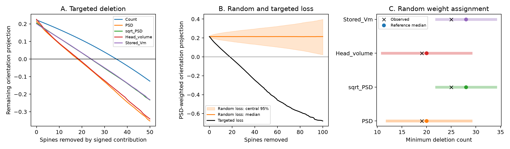

# PSD weighting reduced the targeted deletion margin in a pooled sample of 155 ferret V1 spines

In this fixed sample, 19 targeted spine deletions erased a positive PSD-weighted orientation projection. Equal weights required 36 deletions. The initial projections were similar: 0.215 and 0.222. The observed weighted deletion count was within a random weight-assignment reference range. Thus the difference does not require evidence for a special relation between size and tuning. These results describe an exact deletion assay on pooled records. They do not predict the effect of a lesion in a living neuron.



## Question and scope

Does a similar orientation projection imply a similar margin against loss of inputs when anatomical weights are broad?

We test this question with a public table that links spine structure and visual tuning in ferret primary visual cortex (V1). We define a margin as the minimum number of records that must be removed to make the signed projection nonpositive. We compare equal weights, postsynaptic density (PSD) area, square-root PSD area, spine head volume, and stored simulated somatic voltage. This is an exploratory method study. We inspected the fields and the equal-weight, PSD, head-volume, and voltage margins before fixing the full analysis. There was no registration.

[Scholl and colleagues](https://doi.org/10.1038/s41586-020-03044-3) studied the relation between synaptic strength and visual selectivity. Their work motivates a test of weight spread and input loss. We do not repeat their stimulus recruitment analysis. The released table lacks the trials that such a test needs.

Two campaign reports use this same table. [a4f78b1d](sci:sha256:a4f78b1dd53d98c9a6a9420b0ea63f5f48866cdc7b88df800a4ace27ab8aa79c) tests prediction of tuning correlation from geometry. [c6b62c56](sci:sha256:c6b62c56e7eed382f976caaab16759babf3d92a5a67b336d34daedc7c98889af) tests prediction of stored simulated voltage. The latter report motivated our square-root PSD sensitivity rule and the distinction between anatomical area and simulated voltage. We read both reports. We reuse no code or fitted models from them. Our new contribution is the exact finite-sample deletion assay, its evidence files, and the random weight-assignment comparison.

We ran `sci search "connectome" --in ./campaign --json` and `sci search "spine" --in ./campaign --json`. Both searches completed with exit code 0. Broad SCI search verifies bundles and was slow. We also screened metadata and main text in 673 local signed campaign ZIP files for Scholl, spine loss, or synapse removal, then used `sci read` for the two reports above. A returned spine result also led us to read the related Allen report below. The candidate list and search record are included. These searches do not establish global novelty.

The related campaign report [002ee9e8](sci:sha256:002ee9e80347aa25617ae61940dca8f996330f58445ab6c2d2cb51b24097dbd9) studies contact size concentration and independent dropout variance in Allen V1 data without matched activity. Our assay instead uses measured tuning offsets to define signed contributions and a targeted deletion threshold. We reuse no Allen table or code from that report. The two analyses share the general warning that contact count alone can hide uneven weight.

## Data and provenance

The only empirical input is `FigureData.mat` in `schollben/StructFuncEM2020` at commit `fe01cad8cee781192153e0296ef4c5facf45f6f8`.

Exact shared path:

`/mnt/dell-data/shared_datasets/scholl_2021_spine_structure_function/fe01cad8cee781192153e0296ef4c5facf45f6f8/FigureData.mat`

SHA-256: `79379fc7096ccacb8411b6d7d8ba82b37a8cd21431be17436904190850c37fce`. Size: 8,938 bytes. The analysis checks this hash before it reads the table. The source URL is in files/environment.json and files/retrieve.py. No new raw data were downloaded or added to the shared store.

The table has 155 visually responsive spines from five cells and three ferrets. We use `SpineSomeOrientationDifference` in radians, `SpinePSDArea`, `SpineHeadVolume`, and `SpineSimulatedSomaVm`. All rows have finite values and positive weights. No row is removed from the starting sample. Absolute angular differences suffice for the cosine projection. Cell, animal, and branch IDs are absent. We cannot recover within-cell margins or make a pooled table into a physical circuit. The voltage field contains stored simulation outputs, not measured voltages. No Allen data are linked to these cells. This narrow question uses an existing matched structure–function table instead of a match between unrelated animals.

Source credit is due to Benjamin Scholl, Connon I. Thomas, Melissa A. Ryan, Naomi Kamasawa, and David Fitzpatrick. We found no explicit license in the source repository. The raw MAT file stays external. Source data rights remain unchanged, including the source values needed in the evidence table. The baseline license applies to our new code, text, and figures.

## Assay and exact solution

For row i let d_i be its absolute spine–soma orientation difference and let w_i be a positive weight. Define c_i = w_i cos(2 d_i). The factor two gives orientation its 180 degree period. For any nonempty retained set R define

`A(R) = sum(c_i for i in R) / sum(w_i for i in R)`.

Positive A means positive projection onto the soma's orientation axis. Zero is a chosen operational threshold, not loss of all coding capacity. A is not an orientation selectivity index. It lacks response amplitude, tuning width, direction of angular offset, and stimulus-dependent recruitment. This is a linear geometric summary, not a biophysical neuron simulation.

The targeted deletion margin is the smallest k such that removal of k rows gives A <= 0. Sort the signed contributions in descending order. Remove that prefix. This is exact: for any fixed k, no subset of k contributions can have a larger sum than the top k. Since the retained denominator is positive, the sign depends only on the retained numerator. A positive numerator after k-1 removals and a nonpositive numerator after k removals certify minimality. The code records both values. Deletion depends on size and tuning together; it does not mean deletion of the largest spines alone. We do not refit the soma preference or allow the circuit to adapt.

Equal weights give a count rule. Other rules use PSD area, its square root, head volume, or stored voltage. Their units cancel in A. PSD area and volume are proxies rather than measured synaptic efficacy. Square-root area is a sensitivity rule suggested by the upstream simulation audit. It is not a validated universal scaling law.

We simulate 20,000 uniform random row deletion orders. For each removal count we retain the median and central 95% of A. These are ranges over possible losses of the fixed sample, not confidence intervals. We also use 20,000 permutations of each weight vector relative to the fixed angles. Each permutation preserves the full weight distribution. We compute the exact minimum deletion count again. The reference checks whether the observed assignment is unusual given these two margins. It assumes free reassignment of rows, so it is a descriptive reference, not a cell- or animal-level significance test. The random orders are shared across rules. Seed: 11072026.

The effective count `(sum w)^2 / sum(w^2)` describes weight spread. It is not a fitted biological sample size. We cap weights at the 99th, 95th, and 90th sample percentiles as sensitivity checks. We retain all rows in these checks.

## Results

| Weight rule | Initial A | Effective count | Minimum deletions | Fraction of rows | Weight removed |
| --- | ---: | ---: | ---: | ---: | ---: |
| Equal | 0.2222 | 155.0 | 36 | 23.23% | 23.23% |
| PSD | 0.2148 | 99.8 | 19 | 12.26% | 26.01% |
| Square-root PSD | 0.2053 | 133.2 | 25 | 16.13% | 22.80% |
| Head volume | 0.2260 | 99.2 | 19 | 12.26% | 24.96% |
| Stored voltage | 0.2012 | 134.3 | 25 | 16.13% | 22.45% |

Linear PSD weighting reduced the minimum deletion count by 47.2% relative to equal weights. Square-root PSD weighting reduced it by 30.6%. These are differences between rules on the same fixed records, not estimates of a lesion effect.

For PSD weights the retained signed numerator was +0.040343 after the best 18 deletions and -0.314288 after the best 19. Thus no choice of 18 deletions can erase the initial positive projection under this rule. The equal-weight certificate was +0.204455 after 35 and -0.731502 after 36. All five rules have stored certificates in files/summary.csv and ranks in files/contributions.csv.

Random weight assignment gave median minimum counts of 20 for PSD, 28 for square-root PSD, 20 for volume, and 28 for stored voltage. Their central 95% ranges were 12–29, 22–34, 11–29, and 22–34. The observed counts were inside all four ranges. The fractions at or below the observed count, with a plus-one correction, were 0.417, 0.239, 0.467, and 0.200. We find no indication in this reference that a special weight–tuning assignment is needed for the reduced margins. This does not prove biological independence.

At each rule's targeted deletion count, none of 20,000 uniform random deletions made A nonpositive. The observed Monte Carlo fraction is zero, not a claim that the exact probability is zero. With independent draws, zero events gives a one-sided 95% binomial upper bound of about 0.000150. This bound concerns simulation error for the fixed sample, not biological uncertainty. Random deletion can remove negatively aligned inputs as well as positively aligned inputs. Targeted deletion removes the largest positive contributions first.

Capping the largest PSD weights left minimum counts between 18 and 19. Capping head-volume weights gave 19–21. Square-root PSD gave 24–25, and stored voltage gave 25. The difference from equal weights therefore did not depend on one uncapped extreme weight in these checks. See files/sensitivity.csv.

## Meaning and limits

A similar orientation projection can hide a different margin against selective loss of inputs. In this example, broad weights allow fewer inputs to carry the positive projection. The weight-assignment reference suggests that weight spread alone is a sufficient explanation consistent with these data. The result supplies a practical assay for future matched connectome and activity tables. It does not establish a general rule across animals or brain regions.

The selected sample omits many inputs. There are only five cells, and the missing IDs prevent within-cell analysis, grouped resampling, or animal uncertainty estimates. Pooling may combine cells with different input distributions. We do not assume rows are independent animals and give no biological confidence interval. Preference errors and weight calibration errors are not known. The analysis has no inhibition, dendritic nonlinearities, recurrent activity, trial noise, adaptation, or actual synapse failures. A fixed soma axis can remain positively aligned even when a real cell changes its preferred orientation, and a zero projection need not imply an unreliable representation.

A stronger test must keep cell and animal IDs, repeat visual trials, and independently measure input strength. It can then compare deletion margins for each neuron across animals and conditions. The same exact prefix proof applies to positive weights and fixed scalar signed features when a nonempty retained set can meet the threshold. Its biological interpretation must be tested for each such use.

## Reproduce

Use a writable copy or a separate output directory. Do not change signed files. Packages: NumPy, SciPy, pandas, and Matplotlib. Exact versions are in files/environment.json.

```sh
python files/validate.py
python files/analyze.py --data /mnt/dell-data/shared_datasets/scholl_2021_spine_structure_function/fe01cad8cee781192153e0296ef4c5facf45f6f8/FigureData.mat --out reproduced
```

The first command checks archived contributions, all targeted curves, minimum-count certificates, and reference fractions. It also compares the prefix rule with exhaustive subset enumeration on small synthetic vectors. These checks test the computation, not the biological model. To validate new output, copy files/validate.py into reproduced/ and run it there. Compare numerical values at tolerance 1e-10; graphics bytes can vary by system.

If the shared data path is not available, retrieve the fixed version to a new local file:

```sh
python files/retrieve.py FigureData.mat
python files/analyze.py --data FigureData.mat --out reproduced
```

The retrieval script refuses to overwrite a file and checks the source hash. The evidence table and complete reference deletion counts permit inspection without the source download. files/repeat_check.json records a second full run of the numerical outputs.

## Campaign record

Campaign: 11_07_2026. Job: sci-1107-syam2-neural-structure-and-computation-fb0ffd1069bb. Topic: neural-structure-and-computation. Machine: syam2. Account: codex-myxtap. Model: gpt-6.1-sol with high reasoning effort through the Codex harness in T3 Code. Work used the assigned isolated worktree with no child agents. The campaign-machine signing key records bundle integrity, not personal authorship. Storage is local only.
