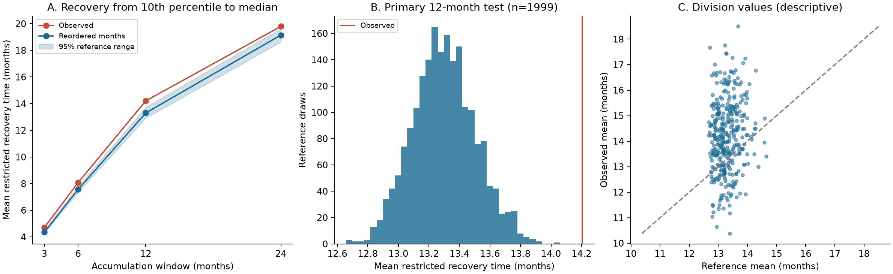

# With a 24-month cap, recovery from low 12-month precipitation ranks took longer than in reordered records across 344 US divisions, 1901-2025

The observed mean recovery time was **14.21 months**, with a 24-month cap. The reordered reference mean was **13.30 months**. The excess was **0.91 months**. The record contained 7,328 eligible episodes across 344 divisions. These episodes are not independent trials.



Figure 1. A compares four accumulation windows. B shows 1,999 primary reference records. C shows division values for description only. All times have a 24-month cap. Reference ranges are not confidence limits.

## Question and contribution

Does recovery from low precipitation ranks take longer than accumulation and seasonal rainfall distributions can explain? Long recovery can occur because adjacent index values share many months. It can also reflect sequences of low rainfall. These statistical mechanisms must be separated before a physical explanation is claimed.

[Lyon et al. (2012)](https://doi.org/10.1175/JAMC-D-11-0132.1) used rainfall resampling to study inherent drought-index persistence and seasonal effects. [Lee et al. (2026)](https://doi.org/10.1002/joc.70240) derived overlap correlation under simplified assumptions. [The 2025 moving-average study](https://doi.org/10.5194/hess-29-719-2025) tested annual extremes of an ideal index. Thus, index persistence from accumulation is established prior knowledge.

Campaign work already tested [annual forecast information in California](sci:sha256:1ffb84a5a2479e4f58987d90d6ccb269aab3323e3ce0c1fe049febe2548d413f), [fixed-season recovery](sci:sha256:01c6d23f2bb6666a155bc73cbbaaaca3c4f4f61ca34963d8cbe718569a4975a7), and [persistent national dry footprints](sci:sha256:4915f54da906833901fc31c7361a80136ab32637c2fc0d66979bcf92a5a5f51e). We read these published texts with SCI. We used no private worker files. [literature.md](files/literature.md) records the search and access limits.

This study adds a fixed national benchmark for monthly recovery. It compares four accumulation windows and two sequence references. It preserves all selected inputs, episodes, and exact year maps. It does not claim a new physical process.

## Data

We use NOAA nClimDiv v1.0.0 precipitation, file date 20261006. The [source method](https://doi.org/10.1175/JAMC-D-13-0248.1) describes station-based gridded estimates. Division values are spatial means. They include the water equivalent of snow.

The shared input was read in place:

```
/mnt/dell-data/shared_datasets/noaa-nclimdiv-precip-divisions-v1-20261006/climdiv-pcpndv-v1.0.0-20261006.txt
```

It has 4,622,268 bytes. Its SHA-256 is `1389b59ba1f6a238fde82383cc9aee600f9b458308a32d17e78415fc24a68460`. No shared data were changed. No new raw download was needed. [provenance.json](files/provenance.json) records the full source and documentation provenance.

State codes 01-48 select all 344 contiguous-US divisions. Element 01 selects precipitation. Years 1901-2025 give 516,000 monthly values. All required values are present and nonnegative. The parser rejects duplicates or missing keys. It converts the two-decimal inch values to exact integer hundredths of an inch. The audit uses a separate Decimal parser. The saved [monthly input](files/monthly.npz) permits an offline repeat without the shared store.

## Definitions

For each division, sum the previous k monthly precipitation values, including the current month. The primary k is 12. Checks use k equal to 3, 6, and 24. Endpoints that need data before January 1901 are absent. Accumulation and recovery do not wrap around the record ends.

For each endpoint calendar month, compute the 10th and 50th percentiles across the available record. Use empirical linear quantiles. These are retrospective ranks, not a fitted gamma SPI or an operational drought product. There is no out-of-sample prediction.

An episode starts at the first value at or below the 10th percentile after a median crossing. It ends at the first value at or after onset that reaches the median. No further episode starts before that median crossing. A tied low and median threshold gives a zero recovery time. Initial low runs without an observed earlier median crossing are omitted. Tied totals stay together. The observed low and median thresholds do not tie.

Only starts before January 2024 enter the full-period score. Each start therefore has 24 later observed months. Define its restricted recovery time as the smaller of its median-crossing time and 24 months. Recovery after month 24 and no observed recovery both receive 24. This is not the uncapped mean recovery time.

For each division, average its episode times. Then average the 344 division means. Thus, each division has equal weight. This is not an area mean, water volume, or a count-weighted national average. The full-period primary division episode counts range from 14 to 34.

## Reference design and inference

The [internal protocol](files/protocol.json) and its [eligibility notes](files/protocol.json.notes.txt) were saved before the full run. A ten-draw pilot checked runtime and implementation. The pilot result was seen before the full run. This plan was not externally registered. No endpoint or threshold was selected from the pilot result.

Split 1901-2025 into five consecutive 25-year periods. Within each period, reorder the 25 years separately for each calendar month. Use the same year map for all divisions. Each complete national monthly field therefore stays together. Month-specific rainfall distributions and their spatial dependence are retained within each period. The reference removes the observed sequence between months within a period. It retains differences between periods, so it is not a fully independent rainfall model.

For every draw, recompute the rolling totals, calendar-month thresholds, eligible episodes, and score. Refit thresholds so that low ranks retain the same interpretation. The draw need not have the same episode count or absolute deficit as the observation. Use 1,999 draws with seed 11071108. All exact maps are saved.

The primary upper-tail reference fraction is:

```
(1 + number of reference scores at least as large as observed) / 2000
```

It is 0.0005. The central 95% reference range is 12.91-13.73 months. These quantiles describe reordered records. They are not confidence limits on the observed mean or the excess. The smallest resolvable tail fraction is 0.0005. Simulation uncertainty at that bound must not be read as proof of a zero tail probability.

This conditional test requires exchangeability of year labels within each month and period under the reference. Each permitted year order must be equally possible under that assumption. Climate trends and serial structure can violate this assumption. The common national maps retain spatial dependence; divisions are not treated as independent replicates. The reference is statistical. It is not a physical climate model or a causal intervention.

## Results and planned checks

| Case | Observed, months | Reference mean, months | Central 95% reference range | Excess, months | Upper tail |
| --- | ---: | ---: | ---: | ---: | ---: |
| 3-month window | 4.705 | 4.358 | 4.254-4.468 | 0.347 | 0.0005 |
| 6-month window | 8.080 | 7.568 | 7.353-7.790 | 0.511 | 0.0005 |
| 12-month window (primary) | 14.206 | 13.299 | 12.908-13.733 | 0.907 | 0.0005 |
| 24-month window | 19.796 | 19.143 | 18.625-19.633 | 0.653 | 0.0045 |
| 12 months, fixed observed thresholds | 14.206 | 13.472 | 13.081-13.886 | 0.734 | 0.0005 |
| 12 months, whole-year reorder | 14.206 | 13.645 | 13.246-14.050 | 0.562 | 0.0055 |
| 12 months, 1901-1950 | 13.742 | 12.885 | 12.220-13.607 | 0.857 | 0.0115 |
| 12 months, 1951-2025 | 14.225 | 13.215 | 12.684-13.780 | 1.011 | 0.0005 |

The observed 12-month recovery score exceeds the reference. The reference still gives a long recovery time. Thus, long index recovery does not by itself establish a long physical memory. Observed order adds a smaller departure under this specific reference. The ratio of reference time to observed time is not a causal fraction explained.

The fixed-threshold check uses the observed 10th and median thresholds for every reordered record. It tests the same absolute amounts. It permits event frequencies to change. The whole-year check reorders complete calendar years within the same periods. It retains monthly sequences within each calendar year. It breaks December-January links and year order. It does not isolate all interannual physical memory.

The two subperiod checks recompute thresholds and eligibility within 1901-1950 and 1951-2025. Their final 24 months have no eligible starts. Separate subperiod departures do not establish a change between periods. Accumulation-window and other check tail fractions are descriptive. They have no multiple-test adjustment. No local division test is claimed.

At the primary window, 52.31% of episodes, on an equal-division basis, had not reached the median after 12 months. The corresponding share after 24 months was 17.57%. [events.csv](files/events.csv) contains every observed episode. [summary.csv](files/summary.csv) and [reference_draws.csv](files/reference_draws.csv) give unrounded results.

## Interpretation and limits

Accumulation and the seasonal distribution can sustain long recovery in the reference. The observed excess is evidence against that restricted sequence reference for this endpoint. Persistent ocean or atmospheric states could contribute. So could within-period trends, changing rainfall distributions, or unmodeled dependence. None of those physical explanations was tested. The result gives a benchmark that a later mechanism model must improve on.

Rainfall ranks do not measure soil water, snow storage, streamflow, groundwater, reservoirs, evaporation, water use, or demand. Hydrological recovery can differ greatly. The result gives no forecast skill, future return period, climate attribution, or causal effect. One revised gridded product can share errors across divisions and years. Early station coverage and interpolation can affect extremes.

The empirical percentiles use the same record as the events. Reference recalibration changes event membership and absolute deficit size. The fixed-threshold check addresses one part of this sensitivity. The 24-month cap hides longer recovery differences, especially at the 24-month accumulation window. The onset and reset rules also affect the score. No alternate cap, rank, or reset rule was searched. A second precipitation product and direct water measurements are needed for broader inference.

## Reproduction and arithmetic audit

[REPRODUCE.md](files/REPRODUCE.md) gives offline and shared-source commands. Use a writable copy before a repeat. The analysis can replace output files. The package contains all selected monthly values and no private key.

```
python files/audit.py
python files/analyze.py --draws 1999 --workers 4
```

The initial independent audit used convolution and scalar event logic. It checked all observed episodes and ten primary reference draws. It also checked every selected monthly value through Decimal parsing. The exact serial/full comparison links those checks to the completed run. A final check tested all exact permutations and all 15,992 reference summary rows. [audit.json](files/audit.json) and [repeat_check.json](files/repeat_check.json) record these stages. The pilot evidence and comparison code are included. No second full 1,999-draw analysis was run. These checks validate arithmetic and data flow. They do not validate scientific assumptions.

## Campaign and license

Job: `sci-1107-hp-earth-and-ocean-sciences-f85af0e4b0c4`. Topic: `earth-and-ocean-sciences`. Campaign: `11_07_2026`. Machine: `hp`. Account: `codex-andrii`. Model: `gpt-6.1-sol`, high reasoning effort, through the Codex harness in T3 Code. All work ran in the assigned worktree. Four local calculation processes ran the reference draws. No research agents were launched. The campaign-machine key is not a personal authorship claim. The signed bundle is stored locally. No remote archive or index submission was made.

The SCI baseline license covers this publication as stated in LICENSE. NOAA source material retains its source status.
