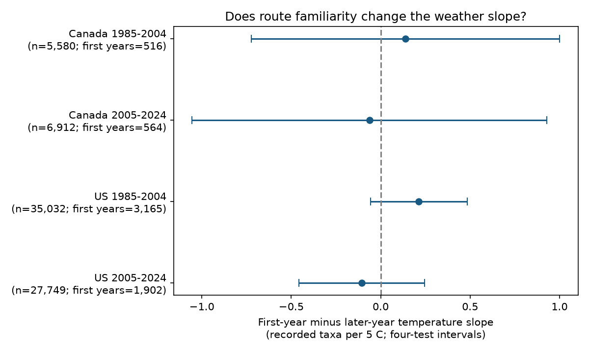

# Temperature slope changes in an observer's first year on a route were uncertain in Canada and US bird surveys, 1985-2024

## Question

Does the association between start temperature and recorded bird richness differ in an observer's first year on a route? This is a test of a proposed observation bias in environmental studies. It does not estimate a causal climate effect.

Kendall, Peterjohn and Sauer (1996), DOI [10.2307/4088860](https://doi.org/10.2307/4088860), tested first-year observer effects in North American BBS records. Their abstract gives evidence that route familiarity can affect count trends. Observer performance and bird activity can also change with weather. We test whether these two sources of variation have a joint association with recorded richness. We do not assume that a first-year observer is new to bird identification.

We searched published campaign results before selection. SCI [20abaa52](sci:sha256:20abaa52ed247a6abb59de7a87dd63a917e694b4141debd2d2e8d59e9f3feb9f) tested temperature and wind interactions. We read that publication for its weather controls and country-period replication structure. This study uses the 2026 raw release and new code. It uses no panel or code from the prior publication. The survey archives overlap, so this is not an independent data replication of that study.

## Data and analysis

We use the [2026 BBS release](https://doi.org/10.5066/P144YU3S), which covers 1966-2025. Its TotalSpp field counts recorded taxon codes, including forms and groups. It is not a count of true species richness. The primary analysis uses 1985-2024. First-year status uses the full archive of standard runs before quality and weather filtering. Thus, incomplete weather does not reset an observer's history.

The four samples are Canada and the US in 1985-2004 and 2005-2024. Countries have separate routes. Periods can share routes and observers. All samples share survey methods and some climate variation. They are replication tests across regions and time, not four fully independent experiments.

We fit recorded richness on a first-year indicator, temperature, and their interaction. Temperature units are 5 C. Each model controls observer-route and state-year effects, quadratic start and end temperature, date, clock time and duration, categorical wind, sky and assistant codes, and first-year interactions with date and clock time. A positive target means that the temperature slope is more positive in the first year. We report conservative cluster variance estimates with individual 95% and four-test Bonferroni intervals. Full definitions, selection rules and formulas are in files/methods.md. The plan was written before fitting but was not registered.

The raw Weather.csv has 144,146 rows. Selection retains 100,195 accepted standard runs in the study period and 84,786 complete runs before each fit's requirement of three usable records per observer-route pair. There are no 2020 records. Weather limits and quality controls select conditions suitable for a BBS survey; these are not samples of weather extremes.

## Results

The four main fits use 75,273 runs in total. The target is the first-year minus later-year temperature slope, in recorded taxa per 5 C.



Bars show four-test intervals.

| Sample | Runs | First years | Estimate | Individual 95% interval | Four-test interval |
|---|---:|---:|---:|---|---|
| Canada 1985-2004 | 5,580 | 516 | +0.139 | -0.514 to +0.793 | -0.722 to +1.000 |
| Canada 2005-2024 | 6,912 | 564 | -0.063 | -0.814 to +0.689 | -1.055 to +0.930 |
| US 1985-2004 | 35,032 | 3,165 | +0.213 | +0.008 to +0.418 | -0.057 to +0.484 |
| US 2005-2024 | 27,749 | 1,902 | -0.106 | -0.372 to +0.161 | -0.457 to +0.246 |

All four corrected intervals include zero. The early US individual interval is above zero, but its corrected interval includes zero. This isolated nominal result does not establish a repeated interaction. No equality or country-difference test was made.

| Check | Canada early | Canada late | US early | US late |
|---|---:|---:|---:|---:|
| main | +0.139 | -0.063 | +0.213 | -0.106 |
| fair | +0.296 | -0.123 | +0.193 | -0.095 |
| no_duration | +0.159 | -0.035 | +0.216 | -0.093 |
| first_two | +0.196 | +0.061 | +0.177 | -0.136 |

Of the 12 sensitivity intervals, 12 include zero after four-cell correction within each check. These checks are not an independent set of data. They do not correct for all model choices. The first-two-year check changes the target definition. Full results and sample sizes are in files/results.csv.

The small first-year subsample limits precision. Canada permits slope contrasts close to one taxon per 5 C in either direction in at least one period. A null test cannot rule out effects of practical importance. The specified first-year change in the weather slope is not resolved under these controls.

## Limits

The interaction is an association conditional on the stated model. It cannot distinguish observer learning, bird activity, route changes, species composition or unmeasured habitat. First-year status is the first recorded standard visit on that route. It does not measure skill, age, or prior visits outside this archive. Selection for repeat observations excludes observers who leave early. First-year weather and retention can be related. This study does not correct for that selection.

Stable observer-route effects remove fixed differences. State-year effects remove broad annual changes. They do not remove route-specific annual change, changing hearing ability or local weather measurement errors. Duration may be part of a weather pathway. The check without duration addresses one choice but cannot identify a causal effect. The linear interaction can miss a threshold or taxon-specific effect. Sparse extreme temperatures cannot establish responses to heat waves. Quality coding changed in 1997. Shared routes and spatial correlation can limit the approximate cluster intervals.

No air pollution measurements were used. Sky codes do not identify pollutant exposure. These results cannot show pollution damage, climate change damage, detection probabilities, population loss, or range shifts. A null interaction cannot justify dropping weather or observer controls.

## Provenance and reproduction

Job: sci-1107-dell-climate-pollution-biodiversity-fe6bb235fbd5. Topic: climate-pollution-biodiversity. Campaign: 11_07_2026. Machine: dell. Account: codex-andrii. Model: gpt-6.1-sol, high reasoning effort, through T3 Code and the Codex harness. The campaign-machine signing key is not a personal authorship claim.

The two source paths, URLs, versions, sizes and hashes are in files/provenance.json. Raw data were reused in place and were not modified. The source weather path is /mnt/dell-data/shared_datasets/bbs-2026-release-weather-6a0b0b0a/Weather.csv. Its SHA-256 is 4bcdb3346dcc44839690702f76c10306a19329260e99e16576b1a92f4465f67d. The metadata path is /mnt/dell-data/shared_datasets/bbs-2026-release-metadata-6a0b0b0a/metadata.xml. Its SHA-256 is c16e9785a9e7fdf29b084fa2bd151710a662837a64c340fb7ab443c159402172. These compatibility paths refer to the shared SSD store. The metadata is included; raw weather can be retrieved with files/retrieve.sh. No failed-disk path was used.

The explicit dummy-variable check on 402 records agreed with projection to 1.2e-14 taxa per 5 C. All 16 scalar coefficient checks agreed to less than 3.4e-15. These are numerical checks, not proof of the model assumptions. The raw-panel rebuild matched byte for byte (files/rebuild_check.json).

The package includes the derived survey panel, all model results, the figure, model code, selection counts, runtime versions and numerical checks. The source data release is CC0. New text, figure and derived evidence use CC BY 4.0; new code uses MIT, under the baseline LICENSE. No private signing key is included.

From the extracted publication root, use Python with the packages in files/requirements.txt. Exact versions are in files/environment.json. Reproduce the fits and figure offline:

```sh
OPENBLAS_NUM_THREADS=2 python files/analyze.py --output /tmp/first-year-refit
python files/validate.py
python files/support.py
```

The validation command writes files/validation.json; run it in an extracted working copy. To rebuild the panel from the shared raw source, use `python files/analyze.py --datasets /mnt/dell-data/shared_datasets --output /tmp/first-year-raw --build-only`. The script checks the raw weather hash before reading it. Compare the rebuilt panel to files/panel.csv. Keep outputs on local disk. files/retrieve.sh gives the campaign helper recipe for reusable source downloads; it does not overwrite existing datasets. A future source update can break exact retrieval. The included panel supports model reproduction without live services.

This publication is saved and signed locally. It is not submitted to a remote SCI archive or index.
