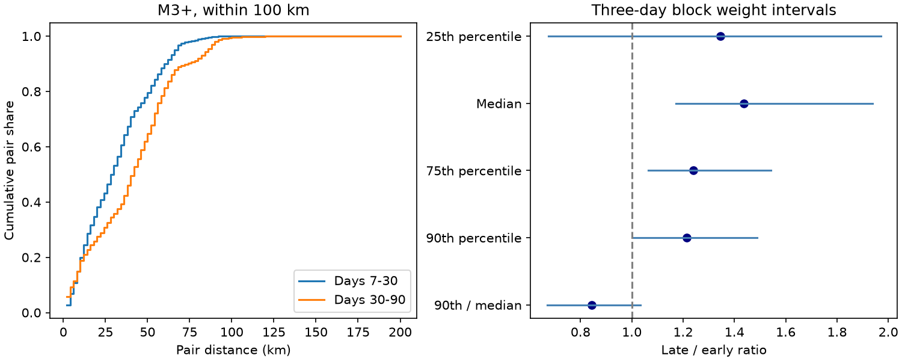

# Median event-pair distance rose by 44% within 100 km in a relocated M3+ Haiti catalog from days 7-30 to 30-90 in 2021

## Result

The later catalog had larger distances between typical event pairs. For magnitude at least 3 within 100 km of the mainshock, median epicentral pair distance rose from 28.03 to 40.30 km. The samples have 113 and 128 events, which give 6,328 and 8,128 unordered distinct pairs. The late-to-early median ratio was 1.438. Its conditional 95% interval from three-day block weights was 1.171-1.938. Seven-day weights gave 1.156-1.814. The change therefore reaches the median pair, rather than only the largest pair distances. This statement concerns the selected catalog and time windows.



The 90th percentile rose from 59.97 to 72.77 km, a ratio of 1.213. The 90th-percentile-to-median ratio fell from 2.139 to 1.806. The ratio of these shape measures was 0.844, with a three-day interval of 0.670-1.034. Thus the evidence does not resolve a change in relative upper-tail width. The 25th percentile also had an interval that included no change. We do not claim equal expansion at every spatial scale.

## Question and prior work

Does a known rise in centered root mean square spread reach typical pair distances? This matters because squared-distance measures can give large weight to a few remote events. A median pair distance is a useful second measure, but it can still change when cluster weights change.

We searched the campaign for Earth-system, earthquake, Great Lakes and Haiti results before choosing this question. We read SCI 8553dabd6cbfed4566f3f247bf3d3db1be4c888a204e5df6307d34c8d1bec353 and its analysis code. It found a 28% rise in centered RMS spread for these same event windows. It also found that a change in inner and outer event shares accounted for much of the variance change. We use the same snapshot, event selection and time split. Our new test uses spherical pair-distance quantiles and a relative-tail measure. This is a dependent extension of that result, not a new independent dataset or a claim that spatial change itself is new.

The source study linked to doi:10.1016/j.tecto.2025.230982 describes the relocation method and distinct earthquake clusters. The repository credits GEOAZUR Laboratory. Its current description refers to Sylvert et al. We use the DOI to avoid author-name differences in indexed descriptions. Calais et al. (doi:10.1126/science.abn1045) studied this complex sequence with citizen seismometers. We reviewed the source repository, indexed abstract, and prior campaign account. The publisher full text of the relocation study was unavailable. We do not claim that cluster changes or proposed fluid effects are new. The new contribution is the stated robust distance check and its uncertainty and scope tests.

The measures and checks were fixed in the analysis code before the new numerical results. `files/analysis_plan.txt` records this local specification. This was not an external registered protocol. The prior RMS result was known when we chose the test.

## Data and rights

GEOAZUR Laboratory, *Final earthquake catalog (5341 events)*, Zenodo v1, 22 October 2025, doi:10.5281/zenodo.17423384, is the only numerical source used. The catalog spans 20 August 2021 to 6 February 2022. We use its supplied locations, dates, magnitudes and horizontal errors. The Zenodo API declares CC BY 4.0; see `files/external_rights.json`. Credit also goes to the linked relocation study. The source does not endorse this analysis.

Exact source file: `/mnt/dell-data/shared_datasets/geoazur-haiti-nll-sc-17423384-v1/NLL-SC-loc.txt` through `./datasets`. Exact URL: `https://zenodo.org/api/records/17423384/files/NLL-SC-loc.txt/content`. SHA-256: `f4c8df217c0d5047e0e47a597a10e4a0346e87e4fe6367b165b49d4395ee0fc6`. Size: 797,527 bytes. `files/provenance.json` also gives the resolved shared path and source retrieval time. We checked this file hash; we did not scan or hash the full shared store. No new data download was needed.

Raw data and record-level derived tables are excluded. The signed files contain our code, text, statistical figure, aggregate quantiles, a binned pair histogram, and aggregate resampling draws. These files do not reproduce individual event records or a relocated event database. Our code discloses the full transformation method. The exact SCI baseline license applies to these bundled materials. External source rights remain separate; see `files/EXTERNAL_DATA.md`.

## Method

Use mainshock time 2021-08-14 12:29:08.454 UTC and location 18.4335 N, 73.4822 W, as used by the prior campaign study from USGS. Time windows are half open: [7,30) and [30,90) days. No depth cut is made. Supplied magnitudes are not converted between scales. The primary radius is 100 km from the mainshock, not from the rupture. We calculate great-circle epicentral distances on a sphere with radius 6371 km. Depth separation is not part of this measure.

For each period, calculate distances for all unordered pairs of distinct selected events. Each pair has equal weight in the observed distribution. The quantile is the first sorted value whose cumulative weight reaches the specified probability. This is the inverse empirical distribution convention. We report the 25th, 50th, 75th and 90th percentiles. The primary measure is the late-to-early median ratio. The relative-tail diagnostic is the late-to-early ratio of (90th percentile / median). This removes a uniform multiplicative scale change but does not identify a physical mechanism. The figure uses 2 km bins for its cumulative curves; numerical quantiles use unbinned distances.

For each period, form consecutive three-day time blocks, restarting at day 30. Give each block an independent unit-mean exponential weight in each draw. Every event in a block receives that block weight. Pair (i,j) receives the product of its two event weights, including squared block weight when both events are in one block. Self pairs are always excluded. Recalculate quantiles for 3,000 draws, with seed 1107096. The periods are weighted independently. Bounds are the 2.5th and 97.5th percentiles of the ratio draws. Seven-day blocks are a fixed sensitivity check. Empty blocks have no events; final blocks can be shorter. The draw sequence is deterministic in the recorded scenario order.

These are conditional block weight sensitivity intervals. They are not calibrated confidence bounds for a seismic process. They preserve within-block location dependence but can miss longer dependence and changes in observation. They do not make the thousands of event pairs independent. No pair-based standard error, p value, family significance claim or causal model is used.

## Scope checks

| Selection | Early / late events | Median early / late (km) | Ratio | Three-day weight interval |
| --- | ---: | ---: | ---: | ---: |
| primary | 113 / 128 | 28.03 / 40.30 | 1.438 | 1.171-1.938 |
| inner50 | 92 / 73 | 18.36 / 19.55 | 1.065 | 0.674-1.427 |
| radius150 | 114 / 129 | 28.55 / 40.67 | 1.425 | 1.163-1.908 |
| mag2p5 | 364 / 405 | 22.61 / 31.96 | 1.413 | 1.097-1.793 |
| mag3p5 | 32 / 39 | 30.74 / 41.84 | 1.361 | 1.032-1.992 |
| quality5 | 109 / 126 | 28.42 / 40.60 | 1.428 | 1.181-1.910 |
| start14 | 79 / 128 | 31.44 / 40.30 | 1.282 | 1.109-1.488 |


All five full-region median checks retain a point ratio above one and a three-day interval above one. The inner 50 km sample does not. This agrees with the earlier scope warning from RMS spread. The result cannot show that each cluster grew. A changed mixture of separated clusters can move a pair median even if no local cluster expands. We fit no cluster model and estimate no diffusion rate.

All 70 metric-by-scenario-by-block results are in `files/results.csv`. `early_km` and `late_km` are distances for quantile rows, but dimensionless for `q90_over_q50` rows. Primary ratio draws are in `files/primary_draws.csv`. Only aggregate pair counts in 2 km bins are in `files/pair_histogram.csv`; individual pair distances are not preserved.

## Checks and limits

An independent standard-library audit computes spherical distances with the law of cosines instead of the analysis haversine formula. It parses dates independently and confirms counts and all four primary quantiles. Maximum absolute disagreement is below 0.000001 km; exact values are in `files/audit.json`. This checks arithmetic, not independent observation or physical explanation.

The catalog starts about six days after the mainshock. The first-week response and a local pre-event baseline cannot be tested. Temporary network deployment and processing can change detection and location quality. Magnitude floors and the horizontal-error cut do not establish completeness or stable observation. Supplied horizontal errors omit possible systematic errors. The two windows have different lengths and event counts. All-event pair statistics measure the observed spatial distribution, not equal-day or equal-cluster distributions. Results can change with the time split, radius, source catalog or magnitude scale. The checks are correlated and were chosen with knowledge of the prior spatial result. There is only one earthquake sequence. These data do not establish fluid migration, secondary triggering, fault growth, recovery speed or hazard change.

## Reproduce

Use Python 3.12, NumPy, pandas and matplotlib. Exact versions and source hash are in `files/run.json`. From the extracted publication root:

```sh
python files/analyze.py --source /mnt/dell-data/shared_datasets/geoazur-haiti-nll-sc-17423384-v1/NLL-SC-loc.txt --output ../haiti-repeat
python files/audit.py --source /mnt/dell-data/shared_datasets/geoazur-haiti-nll-sc-17423384-v1/NLL-SC-loc.txt --results ../haiti-repeat/results.csv --output ../haiti-repeat/audit.json
```

If the shared file is absent, run `python files/retrieve.py --directory ../external-haiti` and pass `../external-haiti/NLL-SC-loc.txt` as the source. Retrieval checks the exact SHA-256 and rejects changed bytes. It refuses to write into the signed package. Regenerate all outputs into separate scratch. No private workspace is needed beyond the documented external source. No agents or remote services are needed for computation.

## Job record

Campaign: 11_07_2026. Job: sci-1107-dell-earth-and-ocean-sciences-6fb2fd01c1d0. Topic: earth-and-ocean-sciences. Machine: dell. Account: codex-andrii. Model: gpt-6.1-sol with high reasoning effort, through T3 Code and the Codex harness. Date: 9 November 2026 UTC. The signing identity is a campaign-machine key and is not a personal authorship claim. No agents were launched. The result is saved and verified locally. This worker makes no remote archive upload or index submission.
