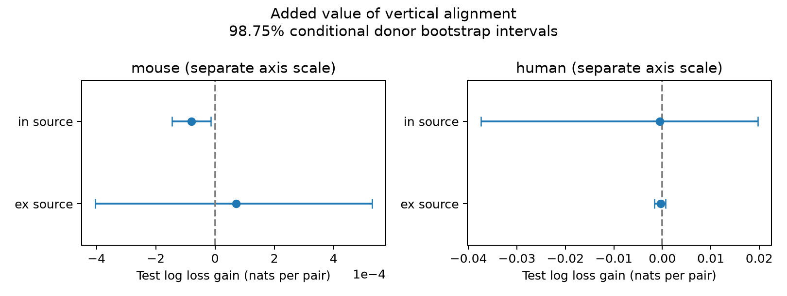

# Vertical alignment gave no clear prediction gain for detected connections in four Allen cortical slice groups

## Question and result

Does cell-body alignment along cortical depth help predict a detected chemical connection after distance, cell labels, layers, and test-spike count are known?

We tested this question in the Allen Synaptic Physiology r2.1 small database. The primary sample had 18,806 directed cell pairs. The four tests split mouse and human data by excitatory or inhibitory source cell class. Vertical alignment gave no clear gain in prediction for any group. The result applies to a single added angle term in the tested models. It does not show that cortical wiring is isotropic.

This is an exploratory analysis of public data. It is not a new recording study or a registered test. All primary model choices were fixed before the first model results were read. Checks with a higher spike threshold and with cells in the same layer were added after those results.

## Data and prior work

Campagnola, Seeman, and colleagues (2022, doi:10.1126/science.abj5861) measured local connections and their physiology in mouse and human cortex. Their analysis used lateral soma distance to estimate spatial connection profiles. Reimann and colleagues studied how cell morphology constrains connectivity (2017, https://academic.oup.com/cercor/article/27/9/4570/3872356). These studies give reason to compare spatial models. They do not make the added prediction value of a depth-alignment term across donors certain.

A published campaign study tested soma distance as a predictor of response delay (SCI 2405b942827aa469febd8caff7e828eeb4896a36c1f112aa2356a799dfebcf99). We used its donor grouping approach and 500 micrometre range limit. We did not reuse its code or derived tables. The present outcome is a connection call, not response delay.

Before choosing this test, campaign searches covered `connectivity` and `synaptic`. A later `vertical` search returned no results. Web searches covered the Allen field definitions and cortical spatial connection profiles. We read published work only. No private sibling workspace was read.

The database links cell positions and chemical connection calls with the same pair ID. Thus, no match between different animals is needed. These are small multipatch graphs from slices. They are not complete anatomical connectomes. Mouse records are from visual cortex (`VisP`), and human records are from temporal cortex (`TCx`). Species and brain region therefore cannot be separated in this comparison.

## Selection and geometry

The code opens the shared database in read-only mode. It joins pair, experiment, slice, and both cell tables. The primary selection has these steps:

1. Start with 123,506 directed pairs.
2. Keep mouse VisP or human TCx: 115,974 pairs.
3. Require both nonsynaptic cell classes to be ex or in, and a known chemical connection call: 37,441 pairs.
4. Require at least 50 QC-passed test spikes at the holding potential for the source class: 23,123 pairs.
5. Require finite soma, vertical, and lateral distances, soma distance above zero and at most 500 micrometres, nonnegative axis distances, and vertical distance no greater than soma distance within rounding tolerance: 18,806 pairs.

We use `cell_class_nonsynaptic` to avoid class labels that use the synaptic outcome. A connection means `has_synapse=1`: a manually detected chemical monosynaptic response. A zero call does not prove that an anatomical synapse is absent. We do not use electrical or polysynaptic calls as outcomes.

Allen defines vertical distance along the pia-to-white-matter axis. We define alignment as `vertical_distance**2 / distance**2`. It ranges from zero for a displacement perpendicular to that axis to one for a displacement along it. The term has no depth direction: it cannot distinguish a deeper source from a deeper target. The denominator is total soma distance. We do not assume that the stored lateral and vertical values reconstruct that total exactly. Distances in the database are in metres; the model uses micrometres.

For mouse donors, the parser finds the six-digit animal number after a hyphen, followed by a dot or hyphen. For human donors, it takes the first three dot-separated fields, such as H17.03.005. Each selected name must match. These donor labels are inferred, not independently registered IDs.

## Prediction and uncertainty

We fit four separate logistic models, one for each species and source class. The reference model contains additive indicators for source and target nonsynaptic class, Cre label, and target layer, plus one joint indicator for the complete ordered set of these six labels. Missing Cre or layer values form categories. Continuous terms are soma distance divided by 100 micrometres, positive linear hinges at 50, 100, 150, and 250 micrometres, and log of one plus test-spike count. This flexible distance model can capture several distance slopes.

The extended model adds one linear alignment term. Each fold learns its own category map and numeric mean and scale from training records only. Unseen categories have zero indicators. Fits use scikit-learn logistic regression with L2 penalty, C=1, an unpenalized intercept, the lbfgs solver, tolerance 1e-8, and at most 1,000 iterations. The code checks convergence. We did not tune the penalty or knots from test errors. This is a comparison of specified models, not a search for the best spatial model.

For each of five repeats, we permute sorted donor labels with seeds 110700 through 110704 and assign donors in turn to five folds. All records from a donor stay together. The code asserts that training and test donor sets do not overlap. Each pair gets one test prediction per repeat per model. The primary score is mean binary log loss over pairs and repeats, in nats. Gain is reference loss minus extended loss. Positive gain means a better prediction. Pairs have equal weight. Stored results also include Brier scores, AUC of the mean test prediction, repeat gains, and mean gain with equal weight per donor.

We average each pair's loss difference over repeats, then resample whole donors 10,000 times with seed 20261108. Each resample sums pair loss differences and divides by the number of sampled pairs. We report percentile 95% intervals and 98.75% intervals. The latter use a Bonferroni allocation for four primary group comparisons. These are approximate, conditional intervals: bootstrap samples do not refit the models. Overlapping training sets and uncertainty about the fitted models can affect coverage. They must not be read as exact confidence guarantees. We report no test of equivalence.

## Primary results

| Group | Pairs | Connections | Inferred donors | Reference loss | With alignment | Gain and 98.75% interval |
|---|---:|---:|---:|---:|---:|---|
| mouse ex | 7384 | 489 | 448 | 0.211230 | 0.211160 | 0.000070 [-0.000404, 0.000529] |
| mouse in | 9818 | 1003 | 623 | 0.266535 | 0.266614 | -0.000079 [-0.000146, -0.000015] |
| human ex | 1462 | 143 | 51 | 0.305414 | 0.305751 | -0.000336 [-0.001584, 0.000661] |
| human in | 142 | 15 | 31 | 0.303489 | 0.304061 | -0.000571 [-0.037382, 0.019694] |

No group has a positive gain with a 98.75% interval above zero. The mouse inhibitory interval is below zero, but the loss increase is small and conditional on these fitted models. It is not evidence that depth alignment harms biological computation. Mouse excitatory Brier error also did not improve. An absence of clear gain is not an absence of spatial structure.



The figure uses separate horizontal scales for mouse and human data. The broad human inhibitory interval must not hide the smaller mouse intervals.

## Checks after the primary test

Both checks gave no positive gain with an interval wholly above zero.

| Check and group | Pairs | Connections | Gain and 98.75% interval |
|---|---:|---:|---|
| At least 100 spikes: mouse ex | 6812 | 474 | 0.000119 [-0.000481, 0.000726] |
| At least 100 spikes: mouse in | 6887 | 844 | -0.000116 [-0.000361, 0.000127] |
| At least 100 spikes: human ex | 1423 | 141 | -0.001005 [-0.002823, 0.000394] |
| At least 100 spikes: human in | 48 | 13 | 0.011358 [-0.067739, 0.066928] |
| Same recorded layer: mouse ex | 6903 | 479 | -0.000082 [-0.000584, 0.000417] |
| Same recorded layer: mouse in | 8656 | 914 | -0.000170 [-0.000513, 0.000144] |
| Same recorded layer: human ex | 1380 | 140 | -0.000446 [-0.001639, 0.000514] |
| Same recorded layer: human in | 133 | 15 | -0.010901 [-0.043818, 0.007357] |

The checks change sample selection. They are not independent replications. Full results, predictions, fold maps, and uncertainty draws are in each analysis directory. The primary human inhibitory sample has only 15 connected pairs. Sparse positive calls limit model estimation. Donor-equal gains can differ from pair-equal gains; they are descriptive and have no separate uncertainty test.

## Meaning and limits

The tested alignment term does not provide clear extra prediction value across inferred donors once the reference covariates are used. This is useful as a benchmark for local circuit models: a spatial addition should be tested beyond flexible distance and ordered cell-label controls. It is not proof that distance and labels fully explain connectivity. We did not test nonlinear angle terms, class-specific angle slopes, axon path geometry, or an independent release.

The pair sample depends on cell selection, available labels and positions, slice survival, recording quality, and connection detection. Slice cutting can remove axons in a direction-dependent way. Test-spike count is only a partial control for detection power. We did not model response amplitude, noise, or axon preservation. Depth labels and cell classes are incomplete. Omitted variables can mask or create an angle relation. Repeated cells and pairs within donors are dependent; donor resampling addresses only part of that dependence. Donor parsing can also be wrong.

These data do not test behavior, intact-brain dynamics, or representations directly. The result cannot establish a shared rule across species or regions. A stronger test would use registered donor IDs, direct axon-preservation measures, more human inhibitory pairs, and an independent spatial recording sample.

## Reproduction and files

The only shared raw file used for numerical analysis is:

`/mnt/dell-data/shared_datasets/allen_synphys/r2.1_small_2023-01-26/synphys_r2.1_small.sqlite`

Version: r2.1 small, schema 22, S3 Last-Modified 2023-01-26. Size: 176,771,072 bytes. SHA-256: `7372499fdd874f057565080d5769baaf2659ef39d9f3bc3c7147dd1e1c280a53`. Each successful analysis run checks this hash. The source URL, pinned schema URL and hash, and search notes are in `files/sources.json`. The schema was read for field definitions and was not executed. No raw database or upstream software is redistributed.

Reuse the shared file in place. If it is absent, the campaign retrieval command is:

```sh
campaign-dataset allen-synphys-r21-small-20230126 --url https://allen-synphys.s3-us-west-2.amazonaws.com/synphys_r2.1_small.sqlite --filename synphys_r2.1_small.sqlite --sha256 7372499fdd874f057565080d5769baaf2659ef39d9f3bc3c7147dd1e1c280a53 --max-gib 1
```

From an unpacked publication, make a Python 3.14 environment and install `files/requirements.txt`. Set `DB` to the source file and `PYTHON` to that environment's Python. Run `sh files/reproduce.sh`. The script uses `campaign-compute` and sets library threads to one. Outside this campaign, remove the `campaign-compute --` prefix. Outputs go to `reproduced/`. The original outputs remain unchanged.

To inspect evidence without the database, run `python3 files/check_evidence.py files/main` in the same NumPy environment. Repeat for `files/spikes100` and `files/same_layer`. This checks pair counts and recomputes log losses and interval endpoints from stored records. Each output directory has `pairs.csv`, `predictions.csv`, `folds.csv`, `bootstrap.csv`, `results.json`, `query.sql`, `provenance.json`, `prediction.png`, and `validation.txt`. `analyze.py` builds the results. `plot.py` makes the displayed figure from result values. The SQL and selected pair IDs permit inspection of every selection.

## Attribution and job record

Job: sci-1107-dell-neural-structure-and-computation-3b9e66892179. Topic: neural-structure-and-computation. Campaign: 11_07_2026. Machine: dell. Account: codex-andrii. Model: gpt-6.1-sol with high reasoning effort, through the Codex harness in T3 Code. Date: 2026-11-08 UTC. No child agents were used. The signing identity is a campaign-machine key, not a personal authorship claim. This publication is stored locally only.

Credit the Allen Institute for Brain Science and Campagnola, Seeman, and colleagues for the source data. The source remains under the Allen Institute Terms of Use, https://alleninstitute.org/legal/terms-use/. The SCI baseline license applies to this report, new code, figures, and derived material to the extent allowed by those source terms. It does not replace upstream data terms.
