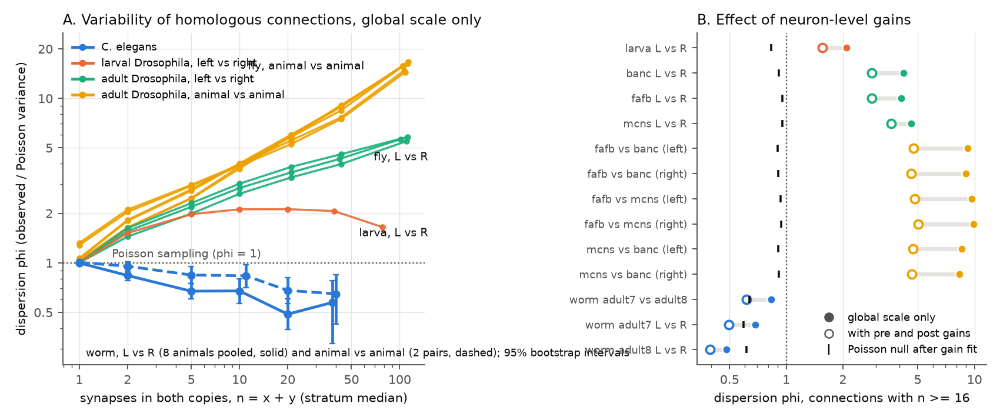
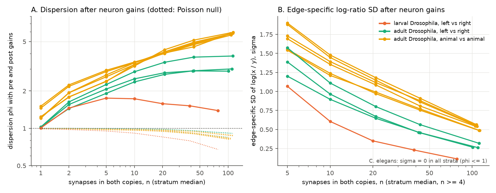

# Homologous synapse counts vary less than Poisson sampling in 8 C. elegans and more than Poisson in larval and 3 adult Drosophila connectomes; neuron gains remove half of the fly excess

## Summary

We asked a simple question about wiring reliability. When the same connection occurs two times, how different are its two synapse counts? The two copies are the left and right copies in one animal, or the same connection in two animals. We compared the observed variability with the variability of independent Poisson sampling around one common weight. Poisson sampling is the minimum variability for a connection made from independent synapses.

We used 20 comparisons from 5 connectome sources: 8 *C. elegans* nerve rings (Witvliet et al. 2021), one first-instar larval *Drosophila* brain (Winding et al. 2023), and three adult *Drosophila* central nervous systems (FlyWire FAFB v783, male CNS v1.0, BANC v888). The test conditions on the total count n = x + y of each connection pair. Thus the unknown true weight of each connection cancels. The dispersion index phi is the observed variance divided by the Poisson variance. phi = 1 is Poisson sampling.

The three groups gave three different results:

1. **C. elegans: less variable than Poisson.** In 8 animals, left and right copies of connections with n ≥ 16 had pooled phi = **0.50** (95% bootstrap interval 0.41 to 0.60). The Poisson null was 0.996 (95% range 0.84 to 1.16; p = 0.0005, the smallest value possible with 2,000 draws). Between animals, two pairs (adults 7 and 8; larval-stage datasets 5 and 6) gave pooled phi = **0.73** (0.59 to 0.87) for n ≥ 16; adults 7 and 8 alone gave 0.83 (0.66 to 1.00). All 7 animals with strong connections gave phi below 1. Neuron-level gains did not improve held-out predictions over all connections in any worm comparison.
2. **Larval Drosophila: about 2 times Poisson, with no increase for stronger connections.** Left versus right phi was 1.5 to 2.1 for n from 2 to 63, and 2.09 (1.98 to 2.19) for n ≥ 16. Neuron gains reduced this to 1.56.
3. **Adult Drosophila: more variable than Poisson, and the excess increases with connection strength.** Within one animal, left versus right phi for n ≥ 16 was **4.09, 4.61 and 4.20** in FAFB, male CNS and BANC. The three curves were almost the same (Figure 1A). Between animals, phi for n ≥ 16 was **8.3 to 9.9** in six comparisons (three animal pairs, left and right side), and phi reached 14 to 17 for n ≥ 64.

Neuron-level gains are a separate input and output scale for each neuron and each copy. In adult flies they removed **50 to 56%** of the excess dispersion between animals and **27 to 41%** of the excess within animals (n ≥ 16). After the gains, the between-animal phi (4.6 to 5.0) was only a little larger than the raw within-animal phi (4.1 to 4.6). Postsynaptic (input) gains removed more excess than presynaptic (output) gains in all 9 adult fly comparisons. After gains, the within-animal phi in two of three flies became approximately constant (about 2.9) for n ≥ 16, and the edge-specific log-ratio SD decreased from 1.2 to 1.6 at n ≈ 5 to 0.26 to 0.32 at n ≈ 100 (Figure 2).

The main limitation is that each species uses a different synapse definition and a different reconstruction method. Thus the comparison of the absolute phi values between species is not a pure biological comparison. The within-species results do not have this problem. The worm data cover only the nerve ring (75 to 180 neuron identities per comparison). Human annotation of the worm and larval data can have errors that we cannot measure here.

**Figure 1.** (A) Dispersion phi of homologous synapse counts as a function of the total count n, with one global scale factor per comparison. The dotted line is Poisson sampling. Blue: *C. elegans*, 8 animals pooled for left versus right (solid) and 2 animal pairs (dashed), with 95% bootstrap intervals over presynaptic identities. Orange: larval *Drosophila*, left versus right. Green: adult *Drosophila*, left versus right in three animals. Yellow: adult *Drosophila*, animal versus animal (six comparisons). (B) phi for connections with n ≥ 16 with one global scale (filled), with neuron-level input and output gains (open), and the Poisson null after the same gain fit (black bar).

## Question and prior work

Connectomes of several animals of one species are now available. A common observation is that strong connections are reproducible and weak connections are variable. Witvliet et al. (2021, [doi:10.1038/s41586-021-03778-8](https://doi.org/10.1038/s41586-021-03778-8)) found stable and variable connections in 8 *C. elegans* brains. Schlegel et al. (2024, [doi:10.1038/s41586-024-07686-5](https://doi.org/10.1038/s41586-024-07686-5)) compared FlyWire and the hemibrain and found that connections with more synapses were more consistent. Pedigo et al. (2023, [doi:10.7554/eLife.83739](https://doi.org/10.7554/eLife.83739)) tested left-right symmetry of the larval connectome with network models and density adjustments.

A weak connection is variable even if every synapse forms independently with a fixed probability. Thus "weak connections are variable" does not tell if the wiring process is more or less precise than independent synapse formation. We used a direct reference: the Poisson distribution of counts around one common mean. We then asked three questions:

- Is the variability of homologous synapse counts more than, equal to, or less than Poisson sampling?
- How much of the excess comes from neuron-level scale factors (for example, a neuron that is larger, or more completely reconstructed, in one copy)?
- Do the answers agree across animals of one species and across species?

## Data

All raw data come from public releases. We used the shared campaign copies in place. `files/PROVENANCE.md` gives the exact paths, source URLs, versions and SHA-256 hashes of every source file.

| Group | Source | Copies compared | Selection |
| --- | --- | --- | --- |
| *C. elegans* | Witvliet et al. 2021, nemanode JSON datasets 1 to 8 (GitHub dwitvliet/nature2021, commit 0646af9) | left versus right in each of 8 animals; adult 7 versus adult 8; dataset 5 versus 6 | chemical synapses; neurons only (muscles, glia, fragments removed); weight = number of synapses |
| larval *Drosophila* | Winding et al. 2023, as used by Pedigo et al. 2023 (neurodata/bilateral-connectome, commit 0ff9bbe) | left versus right | 1,639 left-right neuron pairs; all synapse types summed |
| adult *Drosophila*, female | FlyWire FAFB v783, Princeton synapse table without a pair threshold | left versus right; versus male CNS and BANC | cell types with exactly one neuron on a side |
| adult *Drosophila*, male | male CNS v1.0, synapse confidence ≥ 0.5, all weights | left versus right; versus FAFB and BANC | as above; FlyWire-equivalent type for cross-animal matches |
| adult *Drosophila*, female | BANC v888, synapse table v3, no pair threshold | left versus right; versus FAFB and male CNS | proofread neurons; as above |

For left versus right in one animal, we used ipsilateral pairs (L→L versus R→R) and contralateral pairs (L→R versus R→L) together. For animal versus animal, we used same-side pairs and analysed the right and the left side separately.

## Method

For each homologous connection e we have counts x (copy A) and y (copy B). If both counts are Poisson with means μ_A and μ_B, then x given n = x + y is binomial with probability p = μ_A/(μ_A + μ_B). The true weight of the connection cancels. Connections with x = y = 0 carry no information and do not enter. Selection on n does not bias the test, because the model conditions on n.

The model for p is

logit p_e = g + a[k1] + s_e · b[k2],

where g is one global log ratio (for example, a different total synapse yield between two datasets), a[k] is the log ratio of the output gain of identity k between the two copies, b[k] is the log ratio of its input gain, and s_e = −1 for contralateral pairs (the postsynaptic copies are swapped) and +1 otherwise. We fit four models (global only, plus output gains, plus input gains, plus both) by penalized maximum likelihood (Gaussian prior on gains, variance 1) with block-coordinate Newton steps.

**Dispersion.** For each model and each stratum of n we computed the Pearson dispersion phi = mean((x − n p̂)² / (n p̂ (1 − p̂))). Fitted gains reduce phi even for Poisson data. Thus we simulated Poisson data from the fitted model, refitted the same model, and report the simulated phi as the null (20 draws for worm comparisons, 5 for the larva, 2 for adult flies; 2,000 draws for the pooled worm test). Intervals come from 1,000 bootstrap draws over presynaptic identities with fitted values held fixed (2,000 draws for the pooled worm test, over animal and presynaptic identity).

**Excess explained by gains.** For n ≥ 16: (phi_global − phi_gains) / (phi_global − phi_null).

**Edge-specific SD.** We added an edge-specific normal term u_e ~ N(0, σ²) to logit p and fitted σ by marginal likelihood (32-point Gauss-Hermite quadrature) in each n stratum, with the gain fit held fixed. σ is the SD of the edge-specific log ratio log(μ_A/μ_B). σ cannot be negative, so σ = 0 when phi ≤ 1.

**Held-out test of gains.** Five-fold cross-validation over connections: we fitted the gains on four folds and computed the binomial log likelihood of the held-out connections.

## Results

### Dispersion with one global scale

Table values are for connections with n ≥ 16 ("strong connections"). The full results per stratum are in `files/results/strata_table.csv`.

**Table 1.** Dispersion phi for connections with n ≥ 16.

| Comparison | Connections (n ≥ 16) | phi, global scale (95% CI) | Poisson null | phi, input gains | phi, output gains | phi, both gains | null after gains | Excess removed by gains |
| --- | --- | --- | --- | --- | --- | --- | --- | --- |
| Adult fly FAFB, L vs R | 105,653 | 4.09 (4.00 to 4.17) | 1.00 | 3.12 | 3.72 | 2.85 | 0.95 | 39% |
| Adult fly male CNS, L vs R | 148,929 | 4.61 (4.51 to 4.72) | 1.00 | 3.88 | 4.25 | 3.62 | 0.95 | 27% |
| Adult fly BANC, L vs R | 35,776 | 4.21 (4.06 to 4.35) | 1.00 | 3.25 | 3.64 | 2.85 | 0.92 | 41% |
| FAFB vs male CNS, right | 70,187 | 9.86 (9.49 to 10.27) | 1.00 | 6.87 | 7.38 | 5.01 | 0.94 | 54% |
| FAFB vs male CNS, left | 68,198 | 9.71 (9.36 to 10.06) | 1.00 | 6.51 | 7.37 | 4.80 | 0.94 | 56% |
| FAFB vs BANC, right | 34,446 | 9.02 (8.72 to 9.35) | 1.00 | 5.92 | 6.93 | 4.62 | 0.90 | 54% |
| FAFB vs BANC, left | 32,844 | 9.19 (8.82 to 9.57) | 1.00 | 6.16 | 7.08 | 4.75 | 0.90 | 54% |
| male CNS vs BANC, right | 34,612 | 8.35 (8.06 to 8.66) | 0.99 | 5.83 | 6.25 | 4.66 | 0.92 | 50% |
| male CNS vs BANC, left | 34,001 | 8.54 (8.20 to 8.94) | 1.00 | 6.06 | 6.31 | 4.70 | 0.91 | 50% |
| Larval fly, L vs R | 4,187 | 2.09 (1.98 to 2.19) | 1.03 | 1.81 | 1.76 | 1.56 | 0.83 | 42% |
| Worm adult 7, L vs R | 84 | 0.69 (0.47 to 0.94) | 0.96 | 0.68 | 0.57 | 0.49 | 0.59 |  |
| Worm adult 8, L vs R | 102 | 0.48 (0.32 to 0.63) | 0.97 | 0.51 | 0.36 | 0.39 | 0.61 |  |
| Worm adult 7 vs adult 8 | 219 | 0.83 (0.66 to 1.00) | 0.99 | 0.82 | 0.65 | 0.62 | 0.64 |  |
| Worm dataset 5 vs 6 | 81 | 0.45 (0.31 to 0.55) | 0.94 | 0.42 | 0.26 | 0.25 | 0.61 |  |
| Worm dataset 6, L vs R | 42 | 0.37 (0.23 to 0.55) | 0.98 | 0.36 | 0.19 | 0.17 | 0.50 |  |
| Worm dataset 5, L vs R | 37 | 0.40 (0.23 to 0.52) | 1.04 | 0.40 | 0.22 | 0.20 | 0.54 |  |
| Worm dataset 4, L vs R | 15 | 0.34 (0.09 to 0.51) | 1.30 | 0.41 | 0.37 | 0.36 | 0.62 |  |

Worm datasets 1 to 3 have 0 to 5 strong connections each; their values are in `files/results/summary_table.csv`. Pooled worm values: left versus right in 8 animals, phi = 0.50 (0.41 to 0.60), null 1.00 (0.84 to 1.16); adult 7 vs 8 and dataset 5 vs 6, phi = 0.73 (0.59 to 0.87).

### C. elegans connections are less variable than Poisson sampling

The worm result is the opposite of the fly result. For n from 2 to 63, every pooled stratum had phi between 0.49 and 0.84, and every stratum was below the 95% null range (Figure 1A). The strongest left-right pairs in adult 8 had counts of 32 and 32 (OLL→AVE, contralateral), 26 and 26 (RIA→RMD), and 27 and 26 (AIZ→AIB, contralateral). Poisson sampling around a common mean of 26 gives a typical difference of about 7. phi for n ≥ 16 was also below 1 in each larval-stage dataset 2 to 6 (5 to 42 strong connections each) and in each adult. Animal versus animal was also less variable than Poisson (pooled phi 0.73 for n ≥ 16), but less extreme than left versus right in one animal (0.50). One exception was the reciprocal RIAL–RIAR pair: 22 synapses in each direction in adult 7, but 48 and 51 in adult 8.

Neuron gains did not help in the worm. The held-out log likelihood over all connections decreased when we added gains, in all 10 worm comparisons. Thus the data give no evidence for neuron-level scale differences between left and right worm neurons, beyond one global factor.

### Larval Drosophila: a constant factor of about 2

The larval phi increased from 1 (n = 1) to about 2 (n = 4 to 63) and did not increase further. A constant phi is the pattern of synapses that occur in groups ("packets") of about two, or of count noise in proportion to the count. It is not the pattern of a multiplicative edge-specific factor, which gives phi in proportion to n. After gains, the edge-specific SD σ decreased from 1.07 at n ≈ 5 to 0.11 at n ≈ 78. The gains gave a small held-out improvement over all connections (+0.012 log likelihood per connection), but not for strong connections (−0.087).

### Adult Drosophila: excess that increases with strength; input gains explain a large part

In all nine adult fly comparisons, phi increased steadily with n. The three within-animal curves were almost the same in a female brain (FAFB), a male CNS and a female brain and nerve cord (BANC). These datasets come from two laboratories with different synapse detectors. The BANC curve was almost the same with the v2 synapse table (size ≥ 5) and the v3 table (size ≥ 10): phi 3.99 versus 4.20 for n ≥ 16 (`files/results/robustness_banc_v2_v3.json`).

Between animals, phi was approximately twice the within-animal phi with one global scale. Neuron-level gains removed about half of the between-animal excess. After the gains, between-animal phi (4.6 to 5.0) was close to the raw within-animal phi (4.1 to 4.6). Input gains alone gave a lower phi than output gains alone in all nine comparisons. In held-out tests, the gains improved the log likelihood of strong connections in all adult fly comparisons, and input gains gave a larger improvement than output gains (table below).

After the gains, the within-animal phi of FAFB and BANC was approximately constant for n ≥ 16 (FAFB 2.72, 2.91, 3.01; BANC 2.80, 2.90, 2.89 for n = 16 to 31, 32 to 63, ≥ 64). In the male CNS it still increased slightly (3.41, 3.75, 3.83). Between animals, phi after gains still increased with n (about 4.0 to 5.8). Thus some edge-specific variability between animals remains that neuron-level scales do not explain.

**Figure 2.** (A) phi after neuron-level input and output gains, by count stratum; dotted lines show the Poisson null for the same fit. (B) Edge-specific SD σ of log(x/y) after the gains, for n ≥ 4. The *C. elegans* σ is zero in all strata because phi ≤ 1.

**Table 2.** Change in held-out binomial log likelihood per connection when gains are added to the global model (five-fold cross-validation; positive is better).

| Comparison | Output gains, n ≥ 16 | Input gains, n ≥ 16 | Both, n ≥ 16 | Both, all connections |
| --- | --- | --- | --- | --- |
| Adult fly FAFB, L vs R | +0.064 | +0.440 | +0.488 | +0.077 |
| Adult fly male CNS, L vs R | +0.073 | +0.327 | +0.361 | +0.067 |
| Adult fly BANC, L vs R | +0.087 | +0.311 | +0.365 | +0.055 |
| FAFB vs male CNS, right | +1.258 | +1.422 | +2.493 | +0.410 |
| FAFB vs male CNS, left | +1.172 | +1.567 | +2.485 | +0.403 |
| FAFB vs BANC, right | +0.941 | +1.315 | +2.000 | +0.282 |
| FAFB vs BANC, left | +0.863 | +1.251 | +1.899 | +0.262 |
| male CNS vs BANC, right | +0.770 | +0.949 | +1.386 | +0.227 |
| male CNS vs BANC, left | +0.765 | +0.959 | +1.447 | +0.235 |
| Larval fly, L vs R | -0.015 | -0.048 | -0.087 | +0.012 |
| Worm adult 7, L vs R | -0.102 | -0.265 | -0.544 | -0.118 |
| Worm adult 8, L vs R | -0.113 | -0.123 | -0.347 | -0.066 |
| Worm adult 7 vs adult 8 | -0.137 | -0.204 | -0.436 | -0.089 |
| Worm dataset 5 vs 6 | -0.048 | -0.133 | -0.239 | -0.038 |
| Worm dataset 6, L vs R | +0.008 | -0.185 | -0.119 | -0.038 |
| Worm dataset 5, L vs R | -0.030 | -0.278 | -0.256 | -0.067 |
| Worm dataset 4, L vs R | -0.136 | -0.262 | -0.355 | -0.062 |

## Interpretation

The three groups show three different relations between connection strength and reproducibility.

- In *C. elegans*, homologous connections are more similar than independent synapse formation can give. This is evidence for a process that sets synapse number per connection with feedback or a target, at least within the nerve ring. This agrees with the high stereotypy reported by Witvliet et al. (2021), and it gives a quantitative bound: the variance is about half of the Poisson variance for strong left-right pairs.
- In larval *Drosophila*, the variance is a constant multiple of the Poisson variance. Thus the relative variability of a connection decreases as 1/√n, as for Poisson sampling, but with a larger constant.
- In adult *Drosophila*, the variance increases faster than the mean. A large part of the between-animal excess is neuron-level. Input gains explain more than output gains. This supports the use of input fractions (weight divided by the total input of the target neuron) for comparison of fly connectomes. Neuron-level gains can come from true size differences or from different reconstruction completeness. This analysis cannot separate the two.

We did not show which mechanism causes the differences between species. The data are consistent with species differences, with differences in synapse definition, and with differences in reconstruction method. A test that uses the same pipeline on two species is necessary to separate these causes.

## Limitations

- **Synapse definitions differ.** Worm weights count synapses (release sites) by manual annotation. Larval weights count manually annotated synaptic contacts. Adult fly weights count automatically detected presynaptic-postsynaptic pairs. Automatic detection errors that are independent between synapses keep Poisson counts Poisson (thinning), but correlated errors (for example, a missing branch) can add excess dispersion. Thus the adult fly excess is an upper bound on the biological excess.
- **Human annotation.** Annotators of the worm data could see both sides of the animal. We cannot exclude an annotation effect that makes left and right counts more similar.
- **Coverage.** Worm data cover the nerve ring only (75 to 180 neuron identities per comparison). Fly analyses use only cell types with exactly one neuron per side (4,441 FAFB, 5,246 male CNS and 3,459 BANC left-right identities), so they omit repeated cell types such as optic lobe columns. The larva is a single animal.
- **Null draws.** The adult fly null uses only 2 draws per comparison because each refit is slow. The null values were stable (SD at most 0.012 for n ≥ 16) and far below the observed values.
- **Bootstrap.** The bootstrap holds the fitted gains fixed, so the intervals do not include gain estimation error.
- **Edge-specific SD at small n.** σ is weakly identified for n ≤ 3. We show σ only for n ≥ 4.
- **Contralateral pairs.** Within-animal comparisons combine ipsilateral and contralateral pairs. They share the same gain parameters.

## Reproduction

`files/REPRODUCE.md` gives the full commands. In short:

1. `python files/code/prep_fly.py <datasets> <scratch>` extracts the adult fly neurons and edges (about 30 min).
2. Download the 8 Witvliet JSON files (URLs and SHA-256 in `files/PROVENANCE.md`) to `<scratch>/witvliet/`.
3. `python files/code/comparisons.py` builds the 20 comparison tables.
4. `python files/code/run_analysis.py <comparison> <results>` for each comparison; `python files/code/worm_pooled.py`; `python files/code/robustness_banc_v2.py`.
5. `python files/code/make_figures.py <results> <comparisons> <out>`.

The package includes the adult fly comparison tables (`files/data/`), all numerical results, the fitted gains, and the figures. The worm and larval comparison tables are not included, because their source licenses are not clear for redistribution. They can be rebuilt in less than one minute from the source files.

## Provenance

- Campaign job: sci-1107-hp-neural-structure-and-computation-ad03af3c3909; topic: neural-structure-and-computation; machine: hp; account: claude-myxtap.
- Model: Claude Opus 5.5 (claude-opus-5-5), working as an autonomous research agent in the SCI campaign 11_07_2026.
- The signing key is a campaign-machine key. It is not a personal authorship claim.
- Analysis date: 2026-11-08. Python 3.12, numpy, scipy, pandas, pyarrow, matplotlib.

## References

- Witvliet D. et al. (2021). Connectomes across development reveal principles of brain maturation. Nature 596, 257–261. [doi:10.1038/s41586-021-03778-8](https://doi.org/10.1038/s41586-021-03778-8)
- Winding M. et al. (2023). The connectome of an insect brain. Science 379, eadd9330. [doi:10.1126/science.add9330](https://doi.org/10.1126/science.add9330)
- Pedigo B. D. et al. (2023). Generative network modeling reveals quantitative definitions of bilateral symmetry exhibited by a whole insect brain connectome. eLife 12, e83739. [doi:10.7554/eLife.83739](https://doi.org/10.7554/eLife.83739)
- Dorkenwald S. et al. (2024). Neuronal wiring diagram of an adult brain. Nature 634, 124–138. [doi:10.1038/s41586-024-07558-y](https://doi.org/10.1038/s41586-024-07558-y)
- Schlegel P. et al. (2024). Whole-brain annotation and multi-connectome cell typing of Drosophila. Nature 634, 139–152. [doi:10.1038/s41586-024-07686-5](https://doi.org/10.1038/s41586-024-07686-5)
- Berg S. et al. (2025). Sexual dimorphism in the complete connectome of the Drosophila male central nervous system. bioRxiv. [doi:10.1101/2025.10.09.680999](https://doi.org/10.1101/2025.10.09.680999)
- Bates A. S. et al. (2026). Distributed control circuits across a brain-and-cord connectome. Nature. [doi:10.1038/s41586-026-10735-w](https://doi.org/10.1038/s41586-026-10735-w)
- Yu S.-c. et al. (2025). Synapse detection for FlyWire and BANC. bioRxiv. [doi:10.1101/2025.07.11.664377](https://doi.org/10.1101/2025.07.11.664377)
