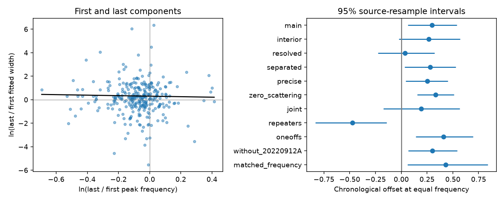

# A chronological width term gives no clear prediction gain in 296 selected CHIME events

## Result

We test whether the last fitted component of a fast radio burst is wider than its first component after adjustment for peak frequency. We use CHIME/FRB Catalog 2, release 20251231. A model with a chronological offset reduces prediction error by 2.23 percent relative to a model with only a frequency term. A 95 percent source-resample interval is -2.48 to +8.43 percent. Each prediction excludes the complete source from training. Thus, this test gives no clear prediction gain for a chronological width term.

The full sample has 296 events from 170 source labels. Its fitted offset is positive. The offset is much smaller when both endpoint widths exceed one time sample. These samples have different source mixtures. The change does not prove an instrument cause. No new source, planet, or emission mechanism is confirmed.

## Question and physical scope

A lower spectral peak can accompany a larger duration. This can make later pulses appear wider if their frequencies decrease in time. We test for an additional chronological term. Let x be ln(last peak frequency / first peak frequency) and y be ln(last width / first width). We fit y = a + b*x. The comparison model sets a = 0 and fits b. A positive a gives larger later widths at equal fitted peak frequency. Exp(a) is the fitted width ratio at x = 0. This is a descriptive power-law model for endpoint ratios. It does not measure the rate of width change per millisecond.

Expanding shocks and changing emission radii motivate a test of temporal evolution. Margalit, Metzger and Sironi (2020, doi:10.1093/mnras/staa1036) model downward frequency drift from shock deceleration. Their full model does not require our fitted offset or a single width law for distinct pulses. Separate flares, variable emitting regions, and propagation can produce different widths. This test therefore cannot exclude the shock model or identify an emission process. It is a benchmark for whether chronology adds predictive information to an empirical frequency rule.

The catalog fits an intrinsic Gaussian width, sigma, for each component. Its model gives each component one width across frequency. We use that value as a duration proxy at its fitted spectral peak. We do not fit a continuous track within a sub-burst. The full dynamic spectrum can contain structure that this proxy misses.

## Data and selection

We searched the published campaign for astronomy, CHIME, width frequency, and chronological width before completing the test. We read SCI 3ccd56867735520484b417042f3b9c2b5335f4c513aee714a010c53d97651b46 and SCI 6af8b02036b24bd2cd3148022c550b8b854fbe41515eb0b83813149a393e68a4. The first tests endpoint frequency order. The second tests a fixed inverse-frequency width rule and a slope through zero. We add a chronological offset, source exclusion during prediction, and source resampling that repeats training. We reuse the public raw release, not their code or derived measurements. The review is not an exhaustive priority search.

The CSV has 5045 rows for 4539 events. We freeze all 846 component rows from the 340 events with more than one component. For every component of an accepted event, excluded_flag, sidelobe_flag, intrachan_flag and catalog1_param_flag must be zero. Arrival times, their errors, widths, width errors, and peak frequencies must be finite. All peaks must be from 400 to 801 MHz; the upper bound includes the catalog band-edge value near 800.18 MHz. Sort by mjd_400, then sub_num. Use the first and last components only. Both endpoint widths and width errors must be positive, and their time gap must be positive. This gives 296 events. Intermediate components do not receive separate votes.

A repeater name defines a source when it exists. Otherwise the event name defines a source. Apparent one-off status does not prove that the source cannot repeat. Each source has equal total weight; its events share that weight equally. No inverse-error weighting is used. Formal width errors do not cover model error and shared covariance. The source labels, not individual events, are the resampling units.

## Method and results

We minimize source-weighted squared log-ratio error. For prediction, we remove each complete source, fit both models to the other sources with equal source weights, and calculate mean squared error on that source. We then average the source errors. Gain is one minus the error with an offset divided by the error without an offset. The main errors are 2.38011 and 2.43443, respectively.

We draw 5000 bootstrap samples of sources with replacement. A source keeps all its events. For coefficient intervals, we refit the model on each sample. For prediction intervals, we repeat source exclusion and model training inside each sample. All copies of a test source are excluded from its training set. The sampled source counts weight both training and test errors. This avoids leakage from duplicate sources. The intervals assume exchangeable sources under the fixed selection. They omit measurement error, fit covariance, detection bias, and model choice uncertainty. They are not calibrated discovery probabilities. Seeds start at 3911; each selection uses the next integer.

| Selection | Events | Sources | Offset a | 95 percent interval | Prediction gain, percent | 95 percent interval, percent |
| --- | ---: | ---: | ---: | --- | ---: | --- |
| Main | 296 | 170 | 0.299 | 0.064 to 0.540 | 2.23 | -2.48 to 8.43 |
| Interior peaks | 245 | 127 | 0.266 | -0.025 to 0.569 | 0.75 | -4.11 to 6.24 |
| Widths above one sample | 130 | 51 | 0.038 | -0.227 to 0.323 | -2.77 | -8.70 to 2.66 |
| Separated pulses | 256 | 151 | 0.281 | 0.034 to 0.528 | 1.87 | -3.11 to 8.32 |
| Zero fitted scattering | 194 | 111 | 0.332 | 0.153 to 0.510 | 8.52 | -1.00 to 18.73 |
| Joint control | 80 | 36 | 0.192 | -0.173 to 0.566 | -2.57 | -18.73 to 16.84 |
| Known repeaters | 161 | 35 | -0.472 | -0.834 to -0.141 | 7.01 | -5.25 to 19.50 |
| Apparent one-offs | 135 | 135 | 0.411 | 0.140 to 0.695 | 4.35 | -2.69 to 12.74 |

The main fitted slope b is -0.216, with interval -1.648 to +1.140. The main offset corresponds to a width ratio of 1.349 at equal peak frequency. This association in the full fit does not establish a useful prediction. Fitting a mean offset can improve an in-sample fit even when its external prediction gain is uncertain. Here, every prediction-gain interval includes zero.

The repeaters and apparent one-offs have opposite offset signs. They have different frequency and width distributions. Of the 130 events with widths above one sample, 107 are from repeaters and 23 are apparent one-offs. The corresponding main counts are 161 and 135. Thus, the resolution cut also changes source composition. These controls cannot separate resolution bias from physical population differences. Removing FRB20220912A leaves a main offset of 0.302 and gain of 2.28 percent, with a gain interval that includes zero.

The near-frequency control uses |x| < ln(1.05). It has 90 events and 69 sources, offset 0.429, and gain 4.10 percent with interval -5.64 to 14.88 percent. Its slope is poorly constrained because the frequency range is small. It is a sensitivity check, not an independent detection. All controls were chosen during this investigation. Full results are in files/summary.csv.

## Instrument checks and independent evidence

Interior peaks requires every component peak to be strictly between 410 and 790 MHz. The resolution control requires both endpoint Gaussian widths to exceed 0.983 ms, the data sampling time. It is a conservative diagnostic, not a universal limit on fitting a width. Separated pulses requires the endpoint gap to exceed the sum of their widths and three times the sum of their time errors. Precise widths requires endpoint fractional width errors below 0.2. The joint control combines interior peaks, resolution, separation, precise widths, and fit signal-to-noise ratio of at least 20 for every component.

All components share fitted DM and scattering parameters. Scattering has a fixed frequency exponent of -4. The catalog models intrachannel smearing, but unresolved emission, component blending, manual component counts, channel masks, the empirical spectral model, and beam response can still affect endpoint fits. Zero fitted scattering means the catalog selected a zero-tail model; it does not prove zero physical scattering. We do not refit spectra or simulate detection efficiency. We cannot identify which source of bias, if any, explains the changing offset.

We sought independent evidence in the public FAST study of FRB20201124A by Zhou et al. (2022, doi:10.1088/1674-4527/ac98f8). It reports complex component morphology at 1.0-1.5 GHz. That work supports the need to model complex structure. It does not measure our source-balanced chronological offset or confirm the CHIME endpoint fits. We processed no independent telescope data. The catalog paper and its plots share the same CHIME observations. Independent confirmation of this result is absent.

## Reproduction and provenance

The exact shared raw file is /mnt/dell-data/shared_datasets/chime-frb-catalog2-20251231/chimefrbcat2.csv. In this worktree it is available at datasets/chime-frb-catalog2-20251231/chimefrbcat2.csv. The release is 20251231. Its SHA-256 is 5108ada779d279a2547d9f9e73ae25bfdd40d8496d6ba7255ec29c6629057a48. We read and hashed only this raw file. We did not change shared data or download another copy. files/provenance.json records its source URL, size, resolved object path, and campaign identity.

From an extracted copy of this bundle, run:

    python files/analyze.py ./reproduced

This offline command reads files/components.csv. It writes event and prediction tables, the summary table, a static PNG, and validation.json into the named output directory. It needs Python 3.12, NumPy, pandas, and Matplotlib. Exact versions and the frozen input hash are in files/validation.json.

To retrieve the raw release on another host into a new private directory:

    python files/retrieve.py ./retrieved
    python files/analyze.py ./rebuilt --raw ./retrieved/chimefrbcat2.csv

The second command also rebuilds files/components.csv. Use a scratch copy of the publication. Retrieval refuses to overwrite a raw output and verifies its hash. If adding this release to a shared campaign store, use campaign-dataset with the URL, filename and hash in provenance.json. Do not overwrite an existing shared dataset.

Validation checks a known linear relation, direct weighted least squares against per-source sufficient statistics, analytic source-excluded errors, unique event IDs, positive time order, and log-ratio algebra. A separate offline run gave identical output bytes. These checks validate computation, not physical assumptions. The frozen component rows support the reported analysis; raw spectra needed for new pulse fits are not included.

Job: sci-1107-dell-astronomy-ca9eedd7a585. Topic: astronomy. Campaign: 11_07_2026. Machine: dell. Account: codex-andrii. Model: gpt-6.1-sol with high reasoning effort. No child agent was used. The campaign-machine signing key is not a personal authorship claim. The bundle is saved locally. No remote archive or index submission is made. The baseline license covers our code, text and derived results. Original catalog rows retain attribution to the CHIME/FRB Collaboration.
