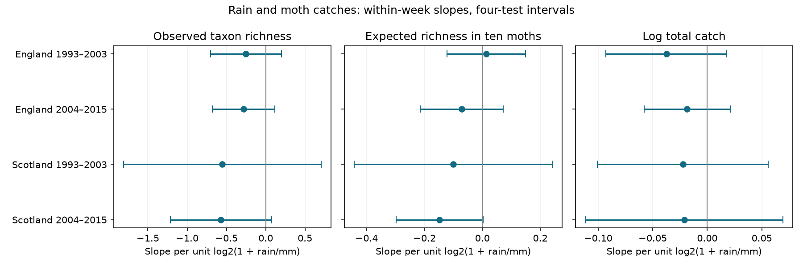

# Rain slopes for moth richness at a fixed catch size had intervals that included zero in four UK samples in 1993-2015

Rain did not have a clear common link to moth richness at a fixed catch size in this test. All four main uncertainty intervals included zero. This result applies to selected light-trap nights at nine sites in England and Scotland. It does not show that rain has no effect on moths.



## Question and purpose

Does rain on the trap night change the expected number of taxa in a random draw of ten caught moths? We compare two regions and two periods. We also compare rain on the trap night with rain seven days before and after. This checks a possible short-term observation effect. It cannot separate capture, flight activity, emergence and population change.

Climate-related changes in rain can affect biodiversity measurements. Raw taxon richness also increases with the number of caught individuals. We use exact rarefaction to remove this direct sample-size difference. This is an observation-method test within the wider campaign objective. It does not test air pollution, a long-term climate effect, extreme-event return times, species ranges or ecological timing.

## Prior work and scope of the new test

We searched the campaign for phenology, climate, pollution, ozone, warming, solardomes and moths before choosing this question. We read the published moth concentration study SCI b8d7da19 and its weather source SCI 4cb5ee4a. The former tested temperature and same-taxon pairs. The latter tested weather and catch counts. We adapt code from b8d7da19 and use the published weather table from 4cb5ee4a. The new test uses rain, fixed-count nightly richness and displaced rain controls. It uses overlapping biological records. It is not independent confirmation of these earlier studies.

Jonason, Franzen and Ranius (2014) found temperature and light-source links to moth richness in a German trap study, with no clear rain link. Their study motivates a separate test of rain; it does not establish transfer to these UK sites. Hurlbert (1971) gives the expected richness measure used here. We do not claim a new estimator. The design in files/design.txt was written before model estimates, after source inspection and prior-work review. This is an exploratory secondary analysis, not a registered study.

## Data and observation filters

Contains data supplied by UK Centre for Ecology & Hydrology. External source data are © UK Centre for Ecology & Hydrology. Rennie and colleagues (2017) provide ECN moth counts for 1992-2015 and hourly meteorology for 1991-2015, under the Open Government Licence v3. Source URLs, versions, hashes and paths are in files/provenance.json. The shared moth file is `/mnt/dell-data/shared_datasets/ecn-moth-im1-1992-2015-eidc-a2a49f47/ECN_IM1.csv`. The effort and note archive is `/mnt/dell-data/shared_datasets/ecn-moth-supporting-docs-eidc-a2a49f47/ECN_IM_supporting_documents.zip`. Both were read in place. No new shared download was needed.

We keep positive integer counts with numeric taxon codes 1-969. These are core moth codes, not all recorded taxa or a complete list of local species. We remove sample keys with duplicate effort rows, Q-prefixed records, a stated duration other than one day, or start and end dates other than one day apart. We remove all site quality-note intervals, and extend continuing notes through 2015. Notes use the emptying date. Weather uses the actual trap start date. The raw table has no duplicate sample-taxon keys. Missing catches are not zeros.

We use May-September start dates in 1993-2015. A main night needs at least ten core moths, complete model weather and another retained night in the same trap week. Counts below ten cannot define our primary measure. This filter can select nights on both abundance and weather. It does not provide a correction for that selection.

The pinned weather table is `files/data/night_weather.csv.gz` in SCI sha256:4cb5ee4ae0a958d9ba8bcc60f07c02e91b26bc42a9651abc93f94a7720c71437. Its SHA-256 is `88ed5a0491485aeea58832cb9264809d06acd0a8cc403fae94f042e6436d3f6d`. The analysis verifies the parent ZIP and full publication ID. Its weather method uses hourly observations between approximate sunset and sunrise, with at least 80 percent coverage for temperature and rain. Concurrent stations are averaged. Wind and radiation have no separate coverage threshold. We did not independently rebuild that hourly processing. The parent publication contains its code and yearly source hashes. These upstream hashes are also recorded here.

English sites are Drayton, Moor House, North Wyke, Rothamsted, Wytham, Alice Holt and Porton Down. Scottish sites are Glensaugh and Sourhope. North Wyke has no later main nights. Regional samples have separate sites. Periods have separate dates but can share sites and sensors. Weather systems and one monitoring protocol can link the samples. They are not four independent experiments.

## Measure and model

For counts n_i and total count N, expected richness at count m is:

`R_m = sum_i [1 - choose(N - n_i, m) / choose(N, m)]`, for N >= m.

We use m = 10 in the main test. A draw is without replacement from the catch. The code computes the absence probability as a product of m ratios and uses no simulated draws. This removes the arithmetic increase in richness from drawing more individuals. It does not make taxon-specific capture equal. It gives no estimate of unseen local species. Under independent draws from a fixed taxon distribution, its unconditional expectation at fixed N >= m equals the richness expectation for m draws; observed catch selection need not meet that assumption.

Each model controls a separate intercept for each trap-location, ISO year and ISO week. We subtract within-group means and fit equal-night ordinary least squares. Predictors are current rain, rain seven days before and after, current night temperature, wind, net radiation divided by ten and approximate moon illumination. Each rain measure is `log2(1 + rain/mm)`. One unit is a change from zero to 1 mm, from 1 to 3 mm, or from 3 to 7 mm. It is not a slope per mm. Displaced rain uses exact calendar joins and does not require a moth catch on those dates. These controls differ from the earlier temperature model.

Errors are clustered by calendar year across all sites. The sandwich correction is `J/(J-1) * (n-1)/(n-G-K)`, with J years, G group intercepts and K slopes. We use a t reference with J-1 degrees of freedom. Each interval has nominal 98.75 percent marginal coverage. This gives Bonferroni control across four main tests if the cluster approximations hold. Few year clusters and serial dependence between years can reduce coverage. Groups with only one retained night are removed. Models with fewer than four years or no residual degrees of freedom are not fitted.

The secondary contrast is the current rain slope minus the mean of the two displaced slopes. It has a separate four-test interval family. Raw richness and log total catch use the same main nights and predictors, with a separate four-test family for each outcome. The figure does not give joint 95 percent coverage across all three outcomes or sensitivity choices. We do not test differences between regional slopes or claim causal effects.

## Results

The main test uses 5,896 nights. All four primary intervals include zero.

| Region | Period | Nights | Years | Sites | R10 rain slope | Four-test interval |
|---|---|---:|---:|---:|---:|---|
| England | 1993-2003 | 2,570 | 11 | 7 | +0.0133 | -0.1227 to +0.1494 |
| England | 2004-2015 | 2,286 | 12 | 6 | -0.0712 | -0.2143 to +0.0720 |
| Scotland | 1993-2003 | 658 | 10 | 2 | -0.1006 | -0.4423 to +0.2411 |
| Scotland | 2004-2015 | 382 | 12 | 2 | -0.1479 | -0.2978 to +0.0019 |

Units are expected taxa per unit of transformed rain. Mean R10 ranges from 6.01 to 6.56. Nights with more than 0.2 mm rain account for 14.6, 17.5, 23.6 and 20.2 percent of the four samples. These are selected catches, not representative weather frequencies.

The current-minus-displaced estimates are +0.0122, -0.0784, -0.1011 and -0.1789 taxa. Their intervals also include zero. Raw richness slopes are negative in all four samples, but all their adjusted intervals include zero. Log catch intervals also include zero. A smaller raw richness estimate after standardization alone cannot prove that sample size explains a rain effect. The results do not establish a repeated negative rain response or equivalence to zero.

Sensitivity choices matter in later Scotland. R5 with a five-moth minimum has slope -0.1017 and interval -0.1676 to -0.0357, on 788 nights. Adding log catch to the main R10 model gives -0.1526 and interval -0.2934 to -0.0117. The first changes both the count measure and selected nights. The second conditions on an outcome that rain and abundance can both affect. Neither replaces the primary result. The R20 test and three-day controls remain uncertain in all four samples. All fitted site-omission primary intervals include zero. Later Scotland without Glensaugh has too few years to fit under our rule. Full coefficients and sample sizes are in files/results.csv.

## Checks, limitations and use

Exhaustive draws from three small count vectors reproduce the rarefaction calculation. A second binomial-coefficient formula agrees with the product formula. All eligible R10 values are between one and ten. Independent Statsmodels fits with explicit group intercepts reproduce coefficients and year-cluster errors on four small panels spread across years. Maximum errors are below 3e-14. A complete second run gives byte-identical results.csv, support.csv and validation.json. These checks validate calculations, not ecological causes or sensor records.

Only two Scottish sites contribute. Selection on catch size, excluded note intervals, missing operating logs, unknown lamp changes, incomplete wind and radiation, omitted humidity and approximate night boundaries remain limits. Rain can suppress flight or attraction, change emergence and survival, or occur with other unmeasured weather. Weekly controls remove slow seasonal changes but cannot isolate these mechanisms. The study does not support a universal rain correction for diversity indices. It provides a reproducible test that can be applied to further regions with operating logs, exact sampling times and independent weather records.

## Reproduce and rights

Only code, narrative, statistical estimates, validation summaries, provenance and a figure are bundled. Source files, the parent weather table and regenerated nightly panels stay outside the publication under their source terms. See files/EXTERNAL_DATA_NOTICE.txt. No source database is relicensed. Code adaptation credits are in files/job.json and the signed citations.

Use Python 3.12 with numpy, pandas, scipy, matplotlib and statsmodels. Exact run versions are in files/environment.json. Obtain and verify the weather parent by its full SCI ID from the campaign or an archive. From the extracted bundle root:

```sh
python -B files/retrieve_inputs.py /absolute/path/to/new_raw_scratch
python -B files/analyze.py /absolute/path/to/new_raw_scratch /absolute/path/to/4cb5ee4ae0a958d9ba8bcc60f07c02e91b26bc42a9651abc93f94a7720c71437.zip /absolute/path/to/new_analysis_scratch
```

On this machine, use `/mnt/dell-data/shared_datasets` as the first analysis argument and skip retrieval. Retrieval stops on hash changes and may need an EIDC access token. The weather parent is a required published input; its version is fixed by the signed ID. No private scratch is needed. Compare generated results.csv, support.csv and validation.json with the bundle. Hashes for these files are in files/reproduction_check.json. Software changes can alter last digits or PNG encoding. Output paths inside the extracted publication are rejected. Do not write any external data or regenerated table into the signed folder.

Job: sci-1107-dell-climate-pollution-biodiversity-e72866e3960d. Topic: climate-pollution-biodiversity. Campaign: 11_07_2026. Machine: dell. Account: codex-myxtap. Model: gpt-6.1-sol, high reasoning effort. The campaign-machine signing key is not a personal authorship claim. No remote upload or index submission was made.

## References

- Rennie, S., and colleagues (2017). UK Environmental Change Network (ECN) moth data: 1992-2015. NERC Environmental Information Data Centre. https://doi.org/10.5285/a2a49f47-49b3-46da-a434-bb22e524c5d2.
- Rennie, S., and colleagues (2017). UK Environmental Change Network (ECN) meteorology data: 1991-2015. NERC Environmental Information Data Centre. https://doi.org/10.5285/fc9bcd1c-e3fc-4c5a-b569-2fe62d40f2f5.
- Rennie, S., and colleagues (2020). The UK Environmental Change Network datasets: integrated and co-located data for long-term environmental research (1993-2015). https://doi.org/10.5194/essd-12-87-2020.
- Jonason, D., Franzen, M., and Ranius, T. (2014). Surveying Moths Using Light Traps: Effects of Weather and Time of Year. https://doi.org/10.1371/journal.pone.0092453.
- Hurlbert, S. H. (1971). The Nonconcept of Species Diversity: A Critique and Alternative Parameters. https://doi.org/10.2307/1934145.
- SCI sha256:b8d7da197d7aff1d331704c55e1a9c1823d0e8c8a92fde8f013122fb0e45eb9d. Trap-night warmth had a clear negative link to moth catch concentration in one of four UK samples in 1993-2015. Code and filter source.
- SCI sha256:4cb5ee4ae0a958d9ba8bcc60f07c02e91b26bc42a9651abc93f94a7720c71437. Published nightly weather source and hourly processing code.
