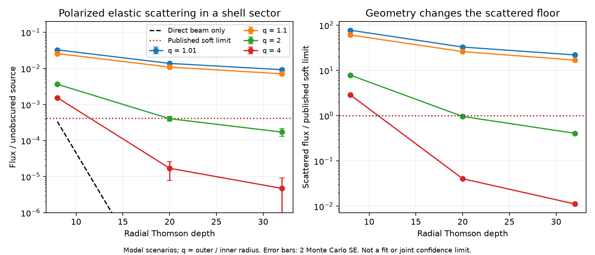

# Polarized Thomson scattering makes tested thin screens too bright for the ASASSN-14ko soft X-ray dip

Job: sci-1107-dell-astronomy-b6c726ec5d52. Topic: astronomy. Campaign: 11_07_2026. Machine: dell. Account: codex-olen. Model: gpt-6.1-sol, high reasoning effort, through the Codex harness in T3 Code. Date: 2026-11-11. The signing key is a campaign-machine key. It is not a personal authorship claim.

## Question

Can an ionized screen hide a steady soft X-ray source when scattered light is included? The direct beam alone gives a necessary condition, tau >= -ln(f). It is not a transfer solution. The earlier radial ionization test (SCI c1cbdfed) made this distinction but did not calculate the scattered flux. We supply that calculation for a specified finite geometry. We do not fit another orbital clock.

The original objective states that the X-ray source switches off. Later campaign results show that a smooth screen can fit the ingress (SCI a820d6c7), while cooling and a changing corona leave soft area poorly measured (SCI 666b6087). The Einstein Probe result (SCI 967e3773) also permits a changed optical delay on a constant X-ray clock. These results make the cause of the dip a useful independent question. Our calculation tests one physical branch of that question. It does not assume that the X-ray recurrence measures the stellar orbital period.

## Inputs and geometry

The inputs are published scalar summaries, not a new telescope reduction:

| Input | Value | Source |
| --- | ---: | --- |
| Observed recurrence P | 108.44 d | SCI 049d6e3e |
| Gaussian ingress scale w | 0.6033 d | SCI a820d6c7, fixed flicker time 0.05 d |
| Span of faint X-ray samples D | 32.52 d | SCI 1d967481 |
| Soft-component fraction limit f | 0.0004208222429059203 | SCI 9c84683e, reported 95 percent limit |

The width is conditional on the source and flicker model. The sampled faint span does not prove continuous faintness. The soft limit applies to a fixed-shape thermal component after a fitted residual floor. These are not independent direct measurements of cloud dimensions. No joint confidence limit on geometry is assigned.

We test a uniform-density spherical shell sector. Its inner radius is r, outer radius is q r, latitude is between -theta and theta, and longitude is between -phi and phi. The observer is on the positive x axis in the equatorial plane. The source at the centre emits isotropically and without net polarization. The density is zero outside the sector. The radial Thomson depth is tau. The screen is static during each transfer calculation. Photons can cross a vacuum region and re-enter it. There is no central absorbing body.

To connect this model with the timing, assume circular angular motion with the observed recurrence. A projected Gaussian source width then has sigma/r = 2 pi w/P = 0.03496. Set k = 4, theta = k sigma/r, and phi = pi D/P + k sigma/r. The last term adds a four-width margin at each longitudinal end. Thus a translating angular sector can cover the source for the stated span near mid-eclipse. The latitude extent leaves a Gaussian direct tail erfc(k/sqrt(2)) = 6.33e-5. The exact model solid angle is Omega = 4 phi sin(theta) = 0.6032 sr, or 4.80 percent of the sky at the source.

This construction supplies one conservative-scale test screen. It is not a proof that all screens must have this solid angle. Eccentric speed, an anisotropic source, a noncircular emitting region, and a changing edge can alter it. The timing ratios do not require a black-hole mass or a redshift correction because both times are in the observer frame. For a physical delay example only, r = 2.6994e15 cm corresponds to the 108.44-day circular scale at mass 10^7.86 solar masses and redshift 0.0425. Then r/c is 1.0422 source days, or 1.0865 observer days.

## Transport method

The code implements classical, coherent Thomson scattering by electrons at rest, including linear polarization. This is an explicit low-photon-energy model. It has no absorption, thermal energy exchange, recoil, gas emission, bulk motion, ionization calculation or gravitational transfer. Each photon starts with a random linear polarization perpendicular to its direction. This ensemble represents an unpolarized source. For electric vector e and outgoing direction n, the probability density is

```
p(n | e) = 3 [1 - (e dot n)^2] / (8 pi).
```

The outgoing electric vector is the normalized projection of e perpendicular to n. We sample n by rejection from isotropic directions. The first scattering of an unpolarized ensemble therefore has the usual phase law 3(1+cos^2 alpha)/(16 pi). We do not reset polarization after scattering.

Each trajectory is followed to escape with exponentially sampled free paths. Exact ray intersections with the two spheres, latitude cones and longitude planes divide each ray into vacuum and occupied intervals. The total occupied length sets the optical depth. At every scattering, an observer estimator adds

```
Omega * p(observer | e) * exp(-tau_remaining)
```

per launched photon. Launch directions for the point source are uniform over the sector. Omega converts their conditional sampling to flux relative to the unobscured isotropic source along the observer direction. The sum includes all scattering orders. The direct point-source fraction exp(-tau) is added separately. Per-photon sums give the standard error; separate scattering events on one photon are not treated as independent samples. An escape-cone count gives a second, less precise estimate over a finite 0.02 cosine-width cone. It averages nearby directions and need not equal the exactly on-axis flux.

The primary grid uses 100,000 incident photons per cell, q in {1.01, 1.1, 2, 4}, and tau in {8, 20, 32}. The seeds and all results are in the code and JSON. These are chosen scenarios, not posterior draws or an exhaustive search. The finite-source check uses 2,000,000 photons per case from a two-dimensional Gaussian in the y-z plane with the stated sigma/r. Its launch directions cover the whole sphere. It does not condition on the sector. The resulting Monte Carlo errors are larger because most photons miss the screen.

## Results

For the two thin radial shells (q = 1.01 and 1.1), the scattered fraction is 0.00711-0.03246 over the three tested depths. This is 16.9-77.1 times the published soft-component limit. At depth 8, the direct point-source beam alone is 0.000335, below that limit. Direct-beam attenuation gives the wrong verdict for these test screens.

| Finite Gaussian source | Scattered fraction | Monte Carlo SE | Comparison with f |
| --- | ---: | ---: | --- |
| q = 1.01, depth 8 | 0.031803 | 0.000294 | Above |
| q = 2, depth 20 | 0.0006682 | 0.0000358 | Above |
| q = 4, depth 32 | 0.0001523 | 0.0000184 | Below |

The q = 2, depth-20 point source gives 0.0004048 +/- 0.0000295, close to the limit. Extension raises this flux by a factor of 1.65. At q = 4, depth 32, extension raises the small on-axis point-source value by about 32 times. The point-source approximation can fail badly for the low-leakage branch, even when sigma/r is only 0.035. No universal finite-size correction is inferred from three cases.

The last finite-source case passes this elastic transfer test. A conservative upper bound on its direct flux is 6.72e-5 plus exp(-32). The sum of scattered flux and this direct bound is about 0.000220, below f. This is an allowed scenario, not proof that an ionized cloud can exist or reproduce the full light curve. Rare-path Monte Carlo errors are statistical estimates, not rigorous tail bounds.

For the direct bound, take the source-plane rectangle |z| <= h r and |y| <= sin(phi) sqrt(1-h^2) r. Rays to the observer from this rectangle enter the sector at the inner sphere and remain inside it. Their shell paths are at least the radial thickness. Treat every source element outside the rectangle as uncovered. A union bound gives u <= erfc[h/(sqrt(2) sigma/r)] + erfc[sin(phi) sqrt(1-h^2)/(sqrt(2) sigma/r)]. The second term is negligible. The value 6.72e-5 is rounded upward.



The full grid is in [files/numerical_results.md](files/numerical_results.md). Error bars show two Monte Carlo standard errors. Low-flux point-source cells have noisy rare-path estimates and do not give precise depth thresholds.

## Interpretation

The main result table and figure are in files/results and files/transport.png. They give the scattered fraction relative to the pre-dip source. The source limit is drawn for comparison. It is not a new confidence interval from this calculation. The point-source result and the three finite-source checks are kept separate. The simple Gaussian uncovered tail is not included in the point-source result. Adding direct leakage cannot reduce the scattered floor.

The results test a sufficient screen model, rather than only the necessary direct-beam condition. A screen can meet exp(-tau) < f and still fail because diffuse light fills the dip. Conversely, a geometry that passes this calculation is not shown to be a viable cloud. It must also meet the ionization, duration, dynamics and spectral constraints. The radial ionization work tests a different requirement; this transfer calculation neither replaces it nor assumes that the required electrons can stay ionized.

Buchner et al. (2019, DOI 10.1051/0004-6361/201834771) showed that soft scattered photons can escape along thick AGN sight lines. Thus scattered leakage is established physics. Our contribution is its quantitative test with a finite screen sized by this source's ingress and faint interval, with polarization, all scattering orders, finite-source checks, and reproducible source-specific scenarios. We do not claim a new transport algorithm.

## Limits

This is a static steady-source transfer calculation. It is not a moving-screen light curve, and it does not demonstrate a stable recurring orbit. It gives a mid-eclipse benchmark. The delay histogram records excess path divided by r, with bins of 0.1 r/c; the final bin collects all delays at or above 19.9 r/c. Photon arrivals from different screen orientations and previous cycles are not combined. A short illumination episode can differ from the steady limit. The published on-state is used as the counterfactual steady source in this screen branch.

The source is a point in the main grid, with two explicit finite-source tests. The circular Gaussian geometry, k, density profile and aspect ratio are assumptions. No conclusion covers all detached streams, clouds, winds or warped discs. An absorber can destroy photons and suppress the scattered floor. Such a screen may also reprocess radiation, and it needs its own spectral calculation. An intrinsic dimming source is outside the steady-source assumption.

Coherent Thomson scattering preserves the input spectrum. At high depth, many scatterings can produce appreciable Compton recoil or energy exchange in real gas. The grid therefore tests the ideal ionized, elastic screen, not a full 0.2-4.5 keV spectral model. In particular, the high-depth results must not be used as a band-independent observational exclusion. There is no inference of gas temperature, ionization, hidden luminosity or a unique physical cause of the dip. The parent soft limit depends on its spectral decomposition; the later common-area study shows that a changing soft spectrum is not subject to the same constraint.

This work does not identify the physical clock behind the timing stall. It supplies a new constraint on a mechanism that could make that clock geometric. Intrinsic loss of emission, spectral cooling, and other opaque-screen geometries remain possible.

## Reproduction and provenance

The package contains all original code, simulation summaries, validation results and figures. It contains no external record-level data. No shared raw dataset was downloaded or used. Exact paths and hashes of the signed published scalar sources are in files/provenance.json. The SCI manifest IDs differ from ZIP hashes. The cited parent publications provide raw telescope retrieval recipes if their measurements are to be independently reduced.

Use Python 3.12 and a private environment. From the extracted publication:

```
python -m venv /path/to/private_venv
/path/to/private_venv/bin/pip install -r files/requirements.txt
/path/to/private_venv/bin/python files/retrieve_inputs.py /path/to/campaign /path/to/external_scratch
OPENBLAS_NUM_THREADS=1 /path/to/private_venv/bin/python files/validate.py /path/to/new_validation.json
OPENBLAS_NUM_THREADS=1 /path/to/private_venv/bin/python files/analyze.py --out /path/to/new_results --n 100000
OPENBLAS_NUM_THREADS=1 /path/to/private_venv/bin/python files/finite_source.py /path/to/new_finite_source.json
/path/to/private_venv/bin/python files/plot.py /path/to/new_results/results.json /path/to/new_figure.png
```

Each simulation uses one process. Run sequentially for a one-CPU reproduction. Numerical libraries use one thread. Runtime is several minutes and depends on depth. The exact environment is recorded. Monte Carlo streams have explicit seeds. JIT and library changes can change random sequences; agreement within the reported Monte Carlo errors is the required numerical check. The validation includes an independent ray-length integral, the Thomson angular moment, an optically thin analytic limit, and photon conservation for full spherical shells. The code stops with an error if a photon reaches 100,000 scatterings; no capped history is silently discarded.

See files/NOTICE.md for attribution and external-data terms. The exact SCI baseline license applies to our contributions. The publication is signed and stored locally; this worker does not upload or submit it.

### Validation outcome

For 100 independent rays, the largest difference from an independent 100,000-bin path integral is 7.47e-5 inner radii. The sampled unpolarized angular moment is 0.40025, against the exact value 0.4. Full spherical shells at depths 0.1, 2 and 8 recover the expected scattered fraction 1 - exp(-tau) to 0.45, 0.90 and 1.08 Monte Carlo standard errors. The independent optically thin sector formula agrees to 1.16 standard errors. These tests validate geometry, normalization and the scattering sampler within the stated model. They do not validate the astrophysical screen assumptions.

For q = 4, the finite escape cone crosses near the angular boundary of the sector. Its much larger scattered count is a directional average and is not a failed normalization check. The exactly on-axis observer estimator is the appropriate quantity for the central source. Low on-axis fractions at large q are dominated by rare trajectories. Their standard errors and path-delay quantiles are correspondingly noisy. The plotted lines connect tested depths; they do not establish monotonicity or a continuous depth threshold.
