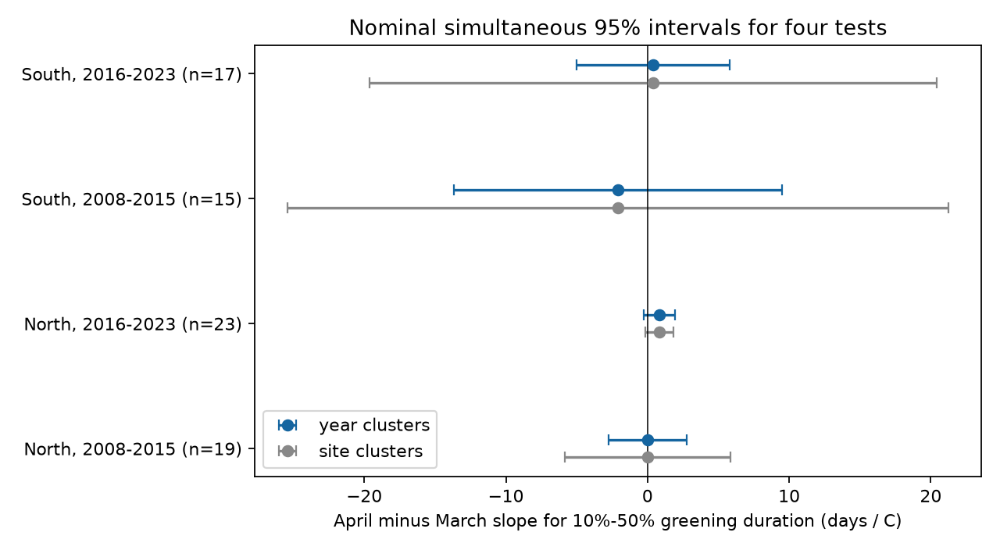

# March and April warmth slopes did not differ clearly for spring greening duration in four eastern US camera samples in 2008-2023

We tested whether April warmth had a more negative link than March warmth to the time from 10% to 50% spring canopy greening. Six of 55 available camera sites passed fixed coverage and date-quality rules. Four tests used two latitude bands and two time periods in 2008-2023. Models controlled site means and site-specific time trends. April-minus-March slopes were +0.01, +0.84, -2.09 and +0.39 days per C. All four corrected intervals included zero under both year and site clusters. Source date intervals also permitted both signs of each fitted contrast under an independent endpoint-error bound. Three-day processing changed one contrast sign. The data do not establish a common contrast or its absence. Few sites, few years, uncertain dates, shared weather and fixed calendar windows limit inference. This test concerns canopy timing, not species counts or pollution effects. The package includes code, aggregate estimates, a figure, source hashes and external retrieval instructions.

## Question and prior work

Spring canopy growth changes food and habitat over time. A shift in the start date need not give the same shift in the duration of growth. We asked whether warmth in April had a more negative link to early greening duration than warmth in March. This contrast tests a simple calendar-based explanation: warmth during growth can speed growth, while earlier warmth can move growth into cooler conditions. The contrast does not identify this mechanism by itself.

Klosterman, Hufkens and Richardson (2018; doi:10.1007/s00484-018-1564-9) studied links between onset and duration with camera, ground and aerial records. Their camera interval used 10%-90% amplitude. Our interval ends at 50%. It measures early-to-mid greening, not full leaf growth. We do not claim to discover a temperature response or to repeat that study exactly. Young and colleagues (2025; doi:10.5194/essd-17-6531-2025) describe the V3 camera release.

We searched the SCI campaign for phenology, pollution, coral bleaching and PhenoCam before choosing this question. Existing coral negative-control tests ruled out the first candidate. We read the published camera study 05407d95, which tested a single spring date. We use new code and a different outcome. No private worker files were used. files/analysis_plan.txt records the analysis choice before fitting. This is an exploratory study, not a registered test. The date-bound check was added after the first fit.

## Data and selection

We used the 55 existing PhenoCam V3 deciduous broadleaf ROI 1000 archives in 35-50 N and 95-65 W. This is a convenience frame in the shared store, not a random sample of the network. We read Data Record 5 for one-day and three-day processing. For each site and year we kept one rising gcc_90 event with both 10% and 50% dates in days 60-180. Multiple qualifying events caused the site-year to be removed. The duration had to be 0-60 days. Both endpoint date intervals had to have widths of 0-14 days for the main test. We used no imputation.

A site needed at least four usable years in each of 2008-2015 and 2016-2023, for both processing products. Six sites passed: Harvard, Proctor and Willow Creek in the North (latitude at least 42 N); Morgan Monroe, North Attleboro MA and Shenandoah in the South. The other 49 sites did not pass. These coverage rules reduce changes in the site mix but select long, clear camera records. They do not remove weather-related missingness.

Temperature is the nearest 0.5-degree GHCN-CAMS monthly mean, from the existing NOAA snapshot dated 2026-11-05. We used March and April separately and changed kelvin to Celsius. The grid is coarse relative to a canopy. March overlaps the observed start date in one early and one late South record. April can precede, overlap or follow growth. The windows are association measures, not measured forcing intervals. Leap days are retained.

All inputs were reused in place. files/provenance.json gives the exact shared dataset directory, file, source URL, version context, byte count and SHA-256 for each input, plus member hashes. Prefix each dataset directory with ./datasets/ to obtain the shared path used here. No source data were changed or downloaded. Raw data and the derived site-year panel are outside this package.

## Model and uncertainty

For each latitude band and time period, we fit:

    duration = site intercept + site-specific linear year trend
               + March slope * March temperature
               + April slope * April temperature + error

Each observed site-year has equal weight. The tested contrast is the April slope minus the March slope. A negative value means that April warmth has a more negative conditional duration slope. It is not the response to warming both months by one C. That response is the sum of slopes.

We calculate separate year-cluster and site-cluster standard errors. Year clusters allow shared annual errors across sites; site clusters allow serial errors within sites. Neither method alone covers both. Intervals use t critical values with min(sites, years)-1 degrees of freedom (two here) and Bonferroni correction for four main tests. These are nominal simultaneous 95% intervals under the model assumptions. Three sites per test give weak support for cluster inference; the correction does not guarantee coverage with so few clusters. Disjoint latitude samples share weather. Disjoint time samples reuse the same sites. These are four samples from one archive, not four independent observing systems.

We also hold the design fixed and allow each duration to range from max(0, lower50-upper10) to upper50-lower10. A least-squares contrast is a weighted sum of responses. Choosing each bound according to its weight gives its exact extreme over this rectangular set. These are sensitivity bounds, not confidence intervals. The source marginal date intervals are not simultaneous uncertainty sets. Their endpoint errors can be dependent because both dates come from the same spline. Independent choices can be physically unattainable and give conservative bounds. This calculation does not prove that the true slope has both signs.

## Results

| Region | Period | Site-years | March slope | April slope | Contrast | Year-cluster interval | Site-cluster interval |
| --- | --- | ---: | ---: | ---: | ---: | --- | --- |
| North | 2008-2015 | 19 | +0.15 | +0.16 | +0.01 | -2.74 to 2.76 | -5.81 to 5.83 |
| North | 2016-2023 | 23 | -0.48 | +0.36 | +0.84 | -0.25 to 1.93 | -0.14 to 1.82 |
| South | 2008-2015 | 15 | +0.94 | -1.15 | -2.09 | -13.68 to 9.50 | -25.41 to 21.23 |
| South | 2016-2023 | 17 | +0.01 | +0.40 | +0.39 | -5.01 to 5.79 | -19.64 to 20.42 |

All slopes have units days per C. Each test has three sites. There are 74 main records. Mean duration ranged from 10.78 to 13.18 days. The point estimates do not have a common negative sign. All corrected intervals include zero. This does not establish that the contrasts are zero.

The date sensitivity bounds were -5.20 to +4.47, -1.06 to +2.71, -5.72 to +1.81 and -2.56 to +3.29 days per C in table order. Three-day contrasts were -0.65, +0.71, -2.19 and +0.16. Thus processing changed the small early North sign. Removing the width rule gave +0.01, +0.90, -2.65 and -0.14. It changed the late South sign. Removing site trends gave +0.40, +0.78, -1.84 and +0.21. Full estimates and all single-site deletion checks are in files/results.csv. These checks are descriptive, not additional corrected primary tests.

Independent least-squares calculations agreed with all model contrasts to less than 5e-15 days per C. All fitted designs had full column rank. files/checks.json gives these checks, selected sites, coverage counts and software versions. The full data frame can be regenerated in external scratch.

## Meaning and limits

The available records do not establish the proposed common seasonal contrast. The small sample also cannot rule it out. A seasonal temperature model may need daily forcing, chilling and day length, plus site-specific growth stages. The fixed monthly windows used here cannot separate those mechanisms. The data do not support a claim about how a particular species will respond to warming.

Fixed cameras reduce changes in visit dates. Source date intervals, paired endpoints, processing checks and fixed site support address some measurement choices. They do not remove view changes, camera changes, snow effects, scene composition or selection for long records. We did not inspect imagery. Weather can affect both measurement and biology. The response is canopy colour timing, not species richness, leaf size, animal food quality or direct biodiversity loss. We did not test air pollution, weather extremes, a causal effect of human-caused warming, or change in the slopes between periods. These require other data and tests.

## Reproduction and rights

The SCI baseline LICENSE is unchanged. This package contains original code, narrative, figures and aggregate statistical outputs. Source data and derived record-level tables stay outside the package. The external data terms, attribution and source credit are in files/EXTERNAL_DATA_NOTICE.md. No third-party license is replaced.

Use Python 3.12 with numpy, pandas, scipy, statsmodels, xarray, a NetCDF backend and matplotlib. Versions used here are in files/checks.json. From this worktree, run:

    python work/result/files/analyze.py --datasets ./datasets --scratch ./reproduction_external --out ./reproduction_outputs --manifest work/result/files/provenance.json

After extracting this publication elsewhere, run:

    python files/retrieve.py --dest ../external_inputs
    python files/analyze.py --datasets ../external_inputs --scratch ../external_records --out ../reproduction_outputs --manifest files/provenance.json

The retrieval script writes outside the publication and checks source file hashes. Mutable URLs may now return changed files. A mismatch stops retrieval. Obtain the frozen snapshot from the shared store or source archive; do not silently replace it. Compare results.csv and checks.json with the bundled versions. The scratch panel and site credit file are external outputs. Existing raw files are never overwritten by retrieval. The manifest fixes the analyzed frame if more shared datasets appear later.

## Work record

Job: sci-1107-dell-climate-pollution-biodiversity-7886f6a25cc8. Topic: climate-pollution-biodiversity. Campaign: 11_07_2026. Machine: dell. Account: codex-myxtap. Model: gpt-6.1-sol, high reasoning effort, through the Codex harness in T3 Code. Date: 2026-11-09. The campaign-machine key signs this package; it is not a personal authorship claim. No agents were launched. No remote upload or index submission was made.
