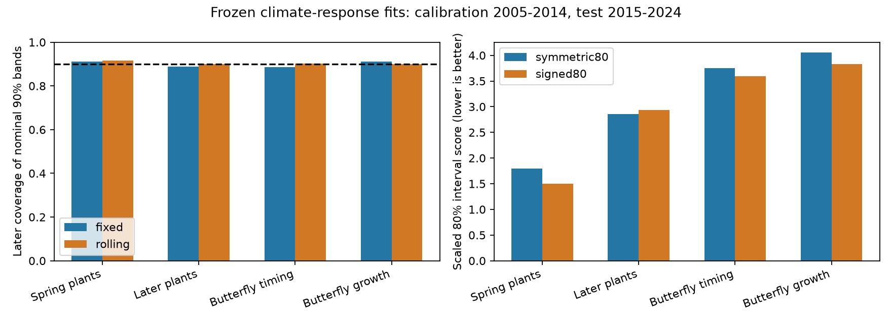

# Signed error bands gave narrower ranges and higher coverage for 19 Swiss spring plant phases in 2015-2024

We tested whether published climate-response fits give useful uncertainty ranges in later years. The main result was specific to Swiss spring plants. A range based on signed past errors covered more outcomes and was narrower than a range centred on zero error. This did not require a new climate slope. The result held with two older fitted panels. The panels overlap and are not independent replications.

The test did **not** find a broad failure of nominal 90% ranges. Their later coverage was 88.6-91.1% across four groups. Good coverage alone did not show that climate terms were useful. Butterfly growth ranges without a climate term had a lower score in the main test.

## Question and prior work

The campaign has tested point forecasts, level shifts, climate-signal gates, and weather availability at issue time. SCI 10c822d2 found strong plant timing skill and weak butterfly growth skill. It also found that later dates moved earlier than the climate slopes predicted. SCI dda82270 showed that plant timing skill needs target-year weather information. SCI 255bac10 tested issue-time inputs across 11 families. We ask a separate question: can past forecast errors give useful uncertainty ranges, and does a signed error range handle the remaining shift better than a symmetric range?

Driver uncertainty and iterative forecast evaluation are established principles (Dietze, doi:10.1002/eap.1589; Dietze et al., doi:10.1073/pnas.1710231115). Online conformal methods already address distribution shift (Gibbs and Candes, NeurIPS 2021; JMLR 2024). Signed residual ranges and order statistics are established methods. Our contribution is their forward comparison for these climate-response claims, with paired year-based inference and a score that penalizes both width and misses. We do not claim a new coverage theorem.

We searched the shared campaign for false-signal and forecast uncertainty work, then for prediction-interval coverage and conformal work. Related interval tests concerned Japanese bloom gaps and other subjects. This is an exploratory secondary analysis of public data. It is not a registered or hidden test. The analysis plan records choices before the first coverage computation. We added a published trend baseline after the first results as a sensitivity check.

## Source and design

The only data input is the verified signed publication SCI 10c822d24e2a5e24f228a2e2b35d7c32bba2e6913dc993c132fd547174c7cc69. Its two files `files/results/year_series_train2004.csv` and `year_series_train1994.csv` contain annual site-mean observed anomalies, climate forecast increments and trend forecasts. Exact hashes are in `files/provenance.json`. The shared input is `./campaign/10c822d24e2a5e24f228a2e2b35d7c32bba2e6913dc993c132fd547174c7cc69.zip`, through the campaign link to `/mnt/dell-data/campaigns/11_07_2026`. No shared raw dataset was read or downloaded.

Upstream versions are UKBMS 2024, the MeteoSwiss snapshot of 2026-11-09, E-OBS temperature v32.0e and precipitation v31.0e. Raw URLs, licenses, paths and hashes are in the source publication. We verify the publication and the two annual files, not those external raw files. The annual observations stay outside this bundle. See `files/EXTERNAL_DATA_NOTICE.md`.

We keep units with a complete annual series through 2024. We exclude fixed-window fits and managed hay timing. The main panel has 19 spring plant phases, eight later plant phases, 43 butterfly timing species and 36 butterfly growth species. The older panel has 19, eight, 35 and 31. Source response label `butterfly abundance` means annual log population growth, not abundance level. For plants and butterfly timing, the response is an anomaly in days. For growth it is an anomaly from a density-only model; the climate increment can include a change in the density coefficient. Annual site membership can change.

Models fitted through 2004 supply predictions p. We calibrate with errors e = observed anomaly minus p in 2005-2014 and test 2015-2024. The older panel uses fits through 1994, calibration 1995-2004 and tests 2005-2024. The climate predictions use observed target-year weather. We test uncertainty for conditional predictions, not an operational forecast service.

For each unit and year:

* Fixed calibration uses the ten initial errors throughout the test.
* Rolling calibration uses the ten immediately preceding errors. It never uses the current error or a later error.
* A symmetric nominal 90% band is p plus or minus the largest absolute calibration error.
* A symmetric nominal 80% band uses the ninth smallest of ten absolute errors.
* A signed nominal 80% band is [p + minimum error, p + maximum error]. Its midpoint need not equal p.

For continuous exchangeable errors, each 80% construction has marginal coverage 9/11 = 81.8%; the 90% construction has 10/11 = 90.9%. These are finite-sample ranks, not exact 80% or 90% coverage. Dependence and shifts can invalidate those reference values. With ten scores, a two-sided finite signed range cannot reach 90% by these ranks. We therefore compare the two shapes at 80%, with matched rank coverage. The min-max method is sensitive to extreme years.

We score coverage, mean width and the central interval score:

    score = upper - lower + (2/alpha) * ((lower-y)_+ + (y-upper)_+).

Alpha is 0.20 or 0.10. Lower score is better. For comparison within a response group, each score is divided by that unit's root mean square observed anomaly in its ten initial calibration years. Units have equal weight. We do not pool different response units or treat phases as independent field replications.

Paired nominal 95% intervals use 5,000 circular two-year block draws from test years, with the same years for all units. Fits and issued bands stay fixed. These intervals condition on calibration and model selection. They do not include calibration uncertainty. The independent audit also uses one- and three-year blocks and leaves out each test year.

Baselines set p to zero (the old no-climate baseline) or use the source's frozen linear trend. Their error bands use the same procedure. Signed rolling baseline bands can shift the old baseline with recent errors. These are limited benchmarks, not optimized current forecasting systems. For growth, the trend column equals the no-climate baseline.

## Main results

| Response | Units | Fixed 90% coverage | Rolling 90% coverage | Rolling symmetric 80% coverage | Rolling signed 80% coverage |
|---|---:|---:|---:|---:|---:|
| Spring plants | 19 | 91.1% | 91.6% | 75.8% | 83.2% |
| Later plants | 8 | 88.8% | 90.0% | 80.0% | 86.3% |
| Butterfly timing | 43 | 88.6% | 90.2% | 81.2% | 80.5% |
| Butterfly growth | 36 | 91.1% | 90.0% | 80.6% | 84.2% |

The lack of broad 90% undercoverage limits the initial concern. The largest-error radius is wide enough to absorb much of the later error. Coverage also varies by year: fixed 90% butterfly timing coverage was only 62.8% in its worst year, despite 88.6% pooled coverage. Pooled coverage does not give simultaneous or year-conditional coverage.

For spring plants, rolling signed 80% bands reduced mean width from **11.10 to 9.67 days** (12.9%) and raised coverage by **7.37 percentage points** (block interval 1.05 to 13.16). Scaled interval score fell from **1.798 to 1.497**, a 16.7% decrease. The paired difference was -0.301, with interval -0.480 to -0.086. Scaled width also fell, by 0.170 (-0.277 to -0.055). Thus the higher coverage was not bought by wider ranges.

Symmetric spring bands missed below their lower bound in 19.5% of cases and above their upper bound in 4.7%. Signed bands reduced these shares to 11.6% and 5.3%. This is consistent with a remaining advance in dates that a zero-centred error range does not handle. It is evidence of forecast bias, not proof of its biological cause.

The older panel gave spring coverage of **81.6% versus 76.1%**, width **9.80 versus 10.33 days**, and scaled score **2.106 versus 2.366**. The score difference was -0.260 (-0.460 to -0.076). Both panels kept a negative score difference for one-, two- and three-year blocks. Each leave-one-year-out difference was negative: -0.369 to -0.224 in the main panel and -0.288 to -0.209 in the older panel. These overlapping tests support a narrow method result, not a new independent climate replication.

The signed-band result was mixed elsewhere. In the main panel, scaled score differences were +0.070 for later plants, -0.157 for butterfly timing and -0.227 for growth. Only growth had a two-year interval wholly below zero (-0.378 to -0.074). In the older panel, later plants and growth improved, but butterfly timing again had an interval that included zero. The main later-plant result shows that higher coverage alone can accompany a worse interval score.

## Did the climate term add useful information?

With rolling signed bands, spring climate forecasts had scaled score **1.497**, compared with **2.638** for the old mean and **2.511** for the frozen trend. Their mean width was **9.67 days**, versus 19.83 and 19.64 days. Compared with the old mean, the score difference was -1.140 (-1.426 to -0.875). The old-mean bands had higher coverage (88.4%) because they were much wider. This supports useful conditional climate information for spring phases after error calibration.

For butterfly timing, climate and old-mean scores were 3.596 and 3.618; the paired difference included zero. The trend score was 3.531. Growth scores were 3.826 with climate and 3.617 without it; the main paired interval included zero, and the older panel favoured no climate. We therefore do not infer useful climate information from well-calibrated growth coverage. Later-plant climate score was lower than the old-mean score, but its main paired interval included zero. All aggregate results are retained.

## Scope and limits

These are uncertainty bands for annual averages over observed sites. They are not ranges for a new site or a single local event. Site composition and measurement changes can affect both errors and widths. The source used later record counts to select cohorts. Annual site membership and weather were not known at an operational issue time. No pollution effect, causal climate effect or forecast of an untested ecosystem is established.

There are only ten main test years and two source networks. Strong correlations among phases and species prevent treating hundreds of unit-years as independent trials. Year-block inference keeps shared weather together but does not solve short-series uncertainty, calibration uncertainty or long dependence. The analysis is exploratory and has several comparisons without a multiple-testing correction. No threshold was tuned to make the spring comparison pass. The ten-year memory and nominal levels were fixed before coverage was computed. The older panel overlaps the main panel and uses related models.

This study strengthens the evidence for one useful climate claim: Swiss spring timing models retain information that can support sharper uncertainty ranges with observed weather. It also gives a practical qualification. Error calibration should allow the centre to move; widening a symmetric range can hide directional error. Neither point skill nor marginal coverage alone establishes operational value.

## Reproduce and inspect

Use Python 3.12, NumPy, pandas, Matplotlib and the SCI CLI. Obtain the exact source ZIP named above from the campaign publication archive. From an extracted bundle run:

    sh files/reproduce.sh /absolute/path/to/source.zip /absolute/path/to/local_scratch

The script verifies the source signature, manifest ID and contents, reads the two annual tables, regenerates aggregate tables and the figure, and runs independent spring arithmetic and time-order checks. All outputs go outside the signed bundle. No raw-data reconstruction is needed for this secondary test. For an end-to-end reconstruction from field data, use the source publication's code and external retrieval recipe. Do not rely on this job's private scratch.

`summary.csv` has all group summaries, `annual.csv` has annual mean coverage and scores, `comparisons.csv` has paired block intervals, `audit.json` has independent checks and sensitivity results, and `provenance.json` records exact input hashes and software versions. The annual results contain no observed ecological response values. The main script computes detailed errors only in memory.

Job: sci-1107-dell-climate-pollution-biodiversity-daa512ab20da. Topic: climate-pollution-biodiversity. Campaign: 11_07_2026. Machine: dell. Account: codex-olen. Model: gpt-6.1-sol, high reasoning effort, through T3 Code and Codex. Date: 2026-11-11. No other agents were used. The campaign-machine signing key is not a personal authorship claim. The publication is signed and saved locally; this job does not upload it.
