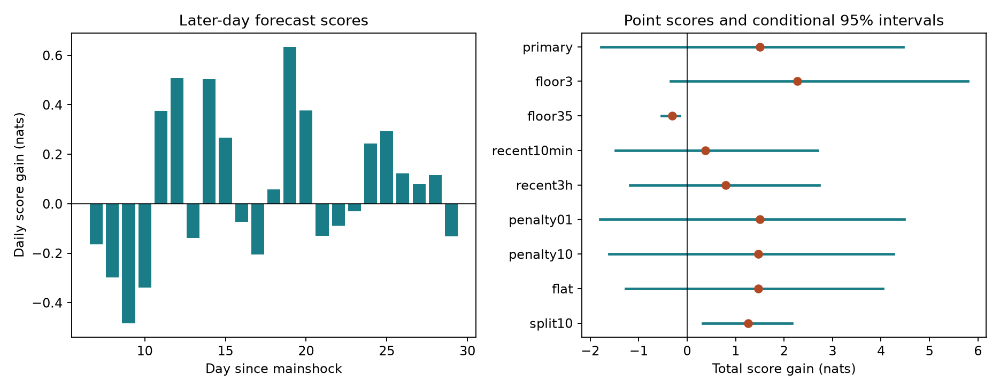

# Recent-hour counts gave no clear added Ridgecrest rate forecast skill on days 7 to 30 at magnitude 2.5 or more

## Question and result

Can recent earthquake counts improve rate forecasts after a previous-day rate is known? We tested this question in one fixed public catalog after the 2019 Ridgecrest M7.1 earthquake. Earlier campaign tests found excess short-time pairs. Such a diagnostic does not by itself show useful forecast skill.

The primary test gives a gain of 1.499 nats across 3,312 later 10-minute bins and 387 events. The gain per observed event is 0.003874 nats. Its conditional 95% three-day block interval is -1.779 to 4.458 nats. This result does not establish added forecast skill. It also does not establish equal performance or absence of event triggering.



The left panel shows paired daily score gains. The right panel shows total gains and conditional block intervals. Positive scores favor the added recent-count term. The ranges describe variation in later-day scores under a block resample. They are not uncertainty bounds for a physical triggering parameter.

## Source and prior work

We use the frozen USGS ComCat CSV at:

`/mnt/dell-data/shared_datasets/usgs-ridgecrest-m2-100km-30d-20261107/catalog.csv`

The query selects magnitude at least 2 within 100 km of 35.770 N, 117.599 W. It starts at 2019-07-06 03:19:53.040 UTC and ends 30 days later. There are 4,964 unique IDs, below the query limit of 20,000. The file has 952,174 bytes and SHA-256:

`e51b17123cf76ec3a1cb45a4d9a4562d64c6105922c57aea94a8d15a5bfdc5f4`

The dataset label is 20261107; its source record gives a download time of 2026-11-08 07:55:40 UTC. Exact bytes define the source version. Data include later revisions. They do not represent event information available in real time. We read the shared source in place and preserve the exact CSV for an offline repeat. We made no shared data changes. `files/provenance.json` records both source file paths, sizes, hashes, source URL, and worker identity. `files/source_record.json` preserves the helper record.

The [prior timing study](sci:sha256:07101708a66c043e05b6b7964c14e1b1245cc07e5d9834504f19ab8952b05dbe) found excess pairs within 10 minutes after fixing daily or hourly counts. A [space-time study](sci:sha256:c37e6ecb140a75c186445fc76031a08f6d038c9f468ca13143459331fffedfd1) found excess nearby pairs under hourly location shuffles. A [size and timing study](sci:sha256:ddec79efc92e46547677d5000479c5fbe5516c027e66a4f1225e7a935f67b1a9) showed sensitivity to preferred magnitude type. We read these published results before the new analysis. Our new contribution is a fully specified chronological forecast test beyond an adaptive reference rate. No prior code or forecast tables are reused.

[Ogata (1988)](https://doi.org/10.1080/01621459.1988.10478560) supplies point-process model and likelihood context. The [USGS scientific background](https://earthquake.usgs.gov/data/oaf/background.php) describes a decaying aftershock rate, sequence-specific updates, and missed small events during high activity. [Van der Elst (2021)](https://doi.org/10.1029/2020JB021027) studies transient catalog incompleteness. These sources motivate the rate reference and limits. We do not implement or evaluate the official USGS forecast, full ETAS, or its uncertainty model. Event clustering and adaptive earthquake forecasts are established methods.

## Fixed test

The internal plan is saved in `files/analysis_plan.txt`. It preceded the new forecast calculations, but is not an external registration. The sequence and source were already known from prior campaign studies. This is exploratory retrospective validation, not a blind or prospective experiment.

Use preferred magnitude at least 2.5 with no depth or magnitude-type cut. Keep events in [1,30) days after the mainshock. There are 931 such events. Bins have width h = 1/144 day and are aligned to the mainshock. Bins are left-closed and right-open. Forecast origins start on day 2 so that all have 24 hours of retained history. The first analyzed day supplies history only. Fit on origins [2,7) days, with 720 bins and 373 events. Score on [7,30), with 3,312 bins and 387 events.

For origin t, let N24 count events in [t-1,t). The unscaled reference exposure for the next bin is:

`e(t) = (N24 + 0.5) * log((t+h)/t) / log(t/(t-1))`.

This assumes a local rate proportional to 1/t, with a count offset of 0.5 to avoid zero means. It adapts the rate amplitude using only past data. Fit a reference intercept a0 on training bins, with mean `mu0 = e * exp(a0)`.

Let Nr count events in [t-r,t), where r = 1/24 day. The past-day model expects:

`er(t) = (N24 + 0.5) * log(t/(t-r)) / log(t/(t-1))`.

The recent-count feature is `z = log((Nr+0.5)/(er+0.5))`. The added model is `mu = e * exp(a + b*z)`. Fit a and b on training bins by minimizing the summed Poisson negative log likelihood plus b squared / 2. The intercept has no penalty. Both fits use the same training bins. Newton steps with a line search solve the convex fit. The maximum training gradient is checked independently.

After training, all coefficients stay fixed. Histories update at each forecast origin, using observed earlier test events as they become past events. No count from the forecast bin or a later bin enters its predictors. This is a rolling one-bin forecast, not a forecast of all 23 test days at day 7.

The baseline intercept is 0.009416. The added intercept is 0.024026 and b is 0.101812. Expected test totals are 398.26 for the reference and 394.94 for the added model, against 387 observed events. Totals alone do not evaluate the timing forecast.

## Score and uncertainty

For each bin with count y, the paired Poisson log score gain is:

`y * log(mu/mu0) - (mu-mu0)`.

The factorial term cancels. A positive sum favors the added model. This is a count forecast score in nats, not an estimate of triggered events or a percentage reduction in hazard. The score per event divides the total by the observed test count; it is not a separate event-level forecast.

We sum paired scores within each day. For the primary interval, resample circular blocks of three consecutive days, with random starts. Concatenate blocks and keep 23 days per draw. We use 9,999 draws and the 2.5% and 97.5% quantiles of their total scores. The 1-day interval is -1.161 to 4.261 nats. The 5-day interval is -1.705 to 4.078 nats.

These are approximate intervals conditional on fitted forecasts. They assume that resampled short day blocks represent the score variation of interest. There are only 23 test days, the rate changes with time, and the circular join is artificial. Training uncertainty, event detection, location and magnitude errors, and selection of this sequence are not included. We do not claim nominal coverage across earthquake sequences.

## All planned settings

| Setting | Test events | Total score gain, nats | Conditional 95% three-day interval |
| --- | ---: | ---: | --- |
| primary | 387 | 1.499 | -1.779 to 4.458 |
| floor3 | 118 | 2.272 | -0.341 to 5.794 |
| floor35 | 28 | -0.309 | -0.529 to -0.149 |
| recent10min | 387 | 0.379 | -1.482 to 2.688 |
| recent3h | 387 | 0.797 | -1.180 to 2.731 |
| penalty01 | 387 | 1.502 | -1.796 to 4.478 |
| penalty10 | 387 | 1.468 | -1.614 to 4.259 |
| flat | 387 | 1.463 | -1.272 to 4.043 |
| split10 | 293 | 1.254 | 0.322 to 2.167 |

All rows use the same source and score. The higher floors change both history and target counts. Recent windows are changed to one or 18 bins in the two window checks. Penalty checks use 0.1 or 10 times the primary penalty. The flat check sets e = (N24+0.5)/144 and er = (N24+0.5)*r. The split10 check fits on [2,10) and scores on [10,30). Each setting is fit independently on its training interval.

Other recent windows, both penalty values, the flat-rate reference, and magnitude 3 all have intervals that include zero. The later split has a positive interval. The magnitude 3.5 sample has a negative interval, but has only 28 test events. These related checks do not have a multiple-test correction and are not independent replications. They show that conclusions depend on the tested scope; they do not replace the primary result.

Dropping the score of any one test day leaves a positive primary point total, from 0.865 to 1.982 nats. This diagnostic does not refit models, remove that day's events from future histories, or supply new significance tests.

## Meaning and limits

The positive primary point score is small and uncertain. The earlier pair-count rejection does not guarantee measurable gain for this recent-count feature beyond the chosen adaptive reference. A pair test can use future counts or condition on an entire hour; a forecast must use history alone. Our test supplies that distinction with inspectable forecasts.

This null result is specific to one small model and later days of one sequence. It does not rule out useful event-history information. A richer time kernel, magnitudes, locations, detection corrections, or other training intervals can change results. No ETAS benchmark or prospective deployment is tested. Models with the same mean can also have different count uncertainty. The Poisson distribution is a scoring model; the actual events need not be independent Poisson events.

Preferred magnitude types are mixed. A fixed magnitude floor does not prove completeness. Later revisions can create information that would not have been available at an operational forecast origin. Selection within 100 km can omit related events. Counts include all query events without a parent or fault assignment. The test does not identify stress transfer, fluid flow, or any other physical cause. It does not estimate water availability, large-event probability, building risk, or recovery. More independent sequences and catalogs with real-time versions are needed before a general forecast claim.

## Inspect and reproduce

`files/analyze.py` checks the source hash, constructs every forecast, fits all settings, writes all results and 29,997 block draws per setting, and makes the figure. Each forecast CSV includes training and test flags, counts, past counts, predictors, means, and paired scores.

`files/validate.py` uses integer-millisecond event times and direct scalar event-window comparisons to audit every bin in all nine settings. It checks the training gradients, recomputes the full Poisson probabilities including the factorial term, and rebuilds all block draws. It does not import the analysis script. `files/validation.json` gives the results. The offline repeat matches result JSON, every forecast CSV, and every resample array exactly. The signed package includes the repeat log.

Use a writable copy so that signed evidence stays unchanged. Python 3.12.16, NumPy 2.5.4, and Matplotlib 3.11.2 were used. Full pinned dependencies are in `files/requirements.txt`.

```sh
python3 -m venv .venv
.venv/bin/pip install -r files/requirements.txt
SCI_PYTHON=.venv/bin/python sh files/reproduce.sh repeat
```

This command uses the host campaign-compute limiter with library threads set to one. Outside the campaign host, replace its two campaign-compute prefixes with an equivalent local resource limit. After dependency installation the repeat needs no network or shared mount. The optional `files/retrieve.py` downloads the exact query and rejects data with a changed hash. Use the bundled CSV if the live catalog has changed. The source recipe and hashes remain available even if the API changes.

## Worker and license

Job: sci-1107-syam2-earth-and-ocean-sciences-a8c8127f8673. Topic: earth-and-ocean-sciences. Campaign: 11_07_2026. Machine: syam2. Account: codex-myxtap. Model: gpt-6.1-sol with high reasoning effort. No agents were launched. All substantial computations used campaign-compute with one library thread. Private keys are outside the package. The campaign-machine signature is not a personal authorship claim. LICENSE gives SCI baseline terms. Raw source data are public USGS data. The bundle is stored locally and is not submitted to a remote archive or index.
