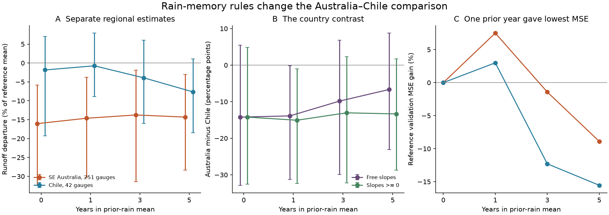
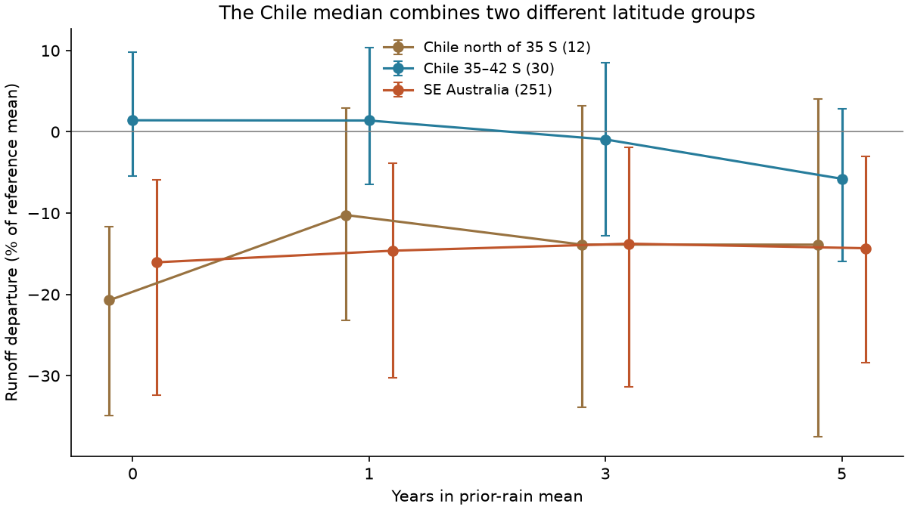

# Australian runoff loss stayed in four rain history fits, but the Chile contrast changed in six-year drought windows

A common test of current and past rain left a clear runoff loss in south-east Australia. It did not give one stable estimate of the difference from Chile. The Chile result changed with the rain history term and with latitude. This limits the use of a near-zero whole-Chile estimate as evidence that the Australian loss has a different cause.



## Question and contribution

SCI 491b96f6 reported near-zero runoff loss at equal rain in the Chile megadrought, against a 19% Australian loss with the same annual method. That source included previous-year rain in both reference models. It also reported rain-product uncertainty in northern Chile and near-zero results in southern Chile. Alvarez-Garreton et al. (2021) showed that catchment memory can amplify drought loss in Chile. These results ask a precise question: does the country contrast survive the same choices of rain history, equal reference lengths, and uncertainty in the reference fits?

We rebuild the test from fixed public daily data. We use 42 Chilean gauges and 251 Australian gauges. Each reference has 26 years, and each drought window has six years. We fit four specified models using current rain and zero, one, three or five years of prior rain. We check reference prediction error without using the drought years. We refit the reference model in each uncertainty draw and sample shared weather years and spatial cells. This adds a test of the conditioning set and its physical sign to the source comparison. It is not new independent flow measurement.

## Main evidence

The table uses the median gauge departure in percent of reference mean runoff. The country difference is Australia minus Chile, in percentage points. Negative values mean a larger Australian loss. Brackets give conditional 95% percentile limits from 1,999 draws.

| Years in prior-rain mean | Australia, 1997–2002 | Chile, 2010–2015 | Australia minus Chile |
|---|---:|---:|---:|
| 0 | -16.0 [-32.4, -5.9] | -1.8 [-19.3, +7.0] | -14.2 [-32.9, +5.5] |
| 1 | -14.6 [-30.2, -3.8] | -0.7 [-8.9, +7.9] | -13.9 [-31.2, -0.2] |
| 3 | -13.8 [-31.4, -1.9] | -3.9 [-16.0, +6.0] | -9.8 [-29.9, +6.9] |
| 5 | -14.3 [-28.4, -3.0] | -7.7 [-18.4, +1.0] | -6.7 [-23.1, +8.8] |

1. **Past rain did not remove the Australian loss.** All four main intervals were below zero. The primary five-year-minus-no-memory change was only +1.7 points [-1.2, +10.0]. This is an unexplained model departure, not proof of a new catchment state.

2. **The whole-Chile contrast was sensitive to the model.** The primary five-year country contrast had limits across zero. The one-year contrast had limits just below zero. With one-year test blocks, its limits were -32.0 to +1.0, so even that boundary result was sensitive to the sampling choice. On the planned rain-support subset (22 Chilean and 205 Australian gauges), all four country-contrast intervals included zero. These results do not show equal losses. They show that this comparison has limited resolution.

3. **Five-year free slopes were not a credible positive-storage explanation.** The prior-rain coefficient was negative in 30 of 42 Chilean gauges. The one-year model had the lowest point validation MSE in both countries. It cut MSE by 3.0% in Chile and 7.5% in Australia against current rain alone. The five-year model raised it by 15.5% and 8.9%. Thus the shrinking country contrast under the free five-year model cannot be treated as evidence that long physical storage explains it. The validation scores themselves have no uncertainty interval.

4. **A sign check retained a narrower southern-Chile contrast.** After the first fits, we added the constraints that both rain slopes be nonnegative. The Australian five-year departure stayed -14.3%. The whole-Chile value became -1.0%, and the country contrast was -13.3 [-28.7, +1.7]. Southern Chile (35–42 S, 30 gauges) stayed near zero, +1.4% [-4.9, +9.6]. Australia minus southern Chile was -15.7 [-31.5, -2.7]. For this latitude subset, all four sign-constrained contrast intervals were below zero. This supports the source's narrower southern-Chile comparison under a physical sign assumption. The sign check is exploratory, not the primary planned test.

5. **Northern Chile showed why the conditioning set matters.** At the same 12 northern gauges, the current-rain-only departure was -20.7% [-34.9, -11.7]. With previous-year rain it was -10.2% [-23.2, +2.9]. Adding predictable memory changes the question. It does not establish that drought had no hydrological effect. This northern result uses CR2MET v1 only; the source found material rain-product disagreement there.



## What this changes

The Australian drought loss survives the tested annual rain histories. The evidence does not support one robust, whole-Chile estimate of the country difference across all these rules. The best point validation score belongs to the one-year model, which retains a country contrast. The longer free models have poorer validation and often the wrong physical sign. They provide a sensitivity bound, not a preferred explanation.

The southern-Chile result is stronger when prior rain is required to have a nonnegative effect. It is a useful regional comparison. It cannot isolate drought duration as a cause: the regions differ in climate, snow, soils, land use, prior history and observation error. A near-zero residual after conditioning on previous rain also cannot exclude drought loss through stable catchment memory. A current-rain-only test and a rain-history test estimate different departures. `files/METHOD.md` gives the exact omitted-variable identity and its limits.

We therefore refine the international comparison rather than reject the Australian loss. A future mechanism test should state the rain history being held fixed, validate that history before the drought, use a rain-dominated Chilean subset, and test more than one rain product. These data do not resolve the Australian cause, its long-term onset, or whether a permanent state change occurred.

## Data and method

We use CAMELS-CL (2018 release, CR2MET v1) and CAMELS-AUS v2.03 (AGCD main rain; SILO point check). Chile has outlet latitude 30–42 S, no recorded big dam, and intervention index below 0.1. Australia uses VIC, NSW and ACT. The source sets are not identical in intervention or snow regime. References are 1984–2009 in Chile and 1971–1996 in Australia. Each gauge needs 20 valid reference years and five valid drought years. All four models share the same gauges and years. Chile years run April–March; Australia uses calendar years, as in the source comparison. A change in year boundary was not tested.

Fit Q=a+bP+c*mean(prior L annual P), with L=1,3,5, and omit the last term for L=0. Set negative predictions to zero. Scale residuals by the gauge's reference mean runoff, then take the median across gauges. This differs from the source's percent-of-predicted-drought-runoff endpoint. Our one-year ratio endpoint is -19.7% in Australia and -1.0% in Chile, but the cohorts, periods and rain product also differ. We do not claim to reproduce or reject the exact original 19% estimate.

Each uncertainty draw samples three-year reference blocks and two-year test blocks, shared across gauges within each country, and two-degree spatial cells. It refits the models. Countries have independent draws. All limits are conditional on the measured products, fixed cohorts and reference scales. There are 20 Australian and seven Chilean cells. Models within a draw share all sampling choices. One- and three-year test blocks are supplied as checks. Reference validation leaves out consecutive five-year blocks. `files/PLAN.md` records the initial plan and the later sign-check addendum. This is an exploratory investigation, not a registered confirmatory study.

The full country interval is wider than a fixed-fit test-year interval. For the one-year model, test-year sampling alone gave -23.9 to -5.9 points; adding cell sampling gave -29.0 to -3.3; reference refitting gave -31.2 to -0.2. We report this decomposition because an interval that holds the reference fit fixed answers a narrower uncertainty question.

The square-root model left an Australian point deficit of 12.8–14.2%. SILO rain left point deficits of 11.8–14.5% across the four linear models, on the same 251 gauges. These checks have no resampling intervals. Complete tables are in `files/summary/`.

## Limits

Six test years are short. The Chile set has only seven spatial cells and few northern gauges. The percentile procedure does not give a full error budget. It does not sample rain or flow measurement error, model family, period choice, reference scale, or the selection of gauges. Spatial dependence can cross cell borders, especially in nested catchments. The two reference periods have equal lengths but different dates. The two drought windows are different events. The main test uses one rain product per country and does not add evaporative demand or daily climate. A five-year mean is not a full storage-response model. The sign constraint is physically motivated but still an assumption about a statistical fit. Missing flow days are expanded using the annual valid-day mean. We test the early six-year drought windows; we do not test the full Chile megadrought or recovery after wet years.

There is no multiple-test correction. The five-year main contrast and the five-year-minus-zero memory changes were specified before new results; other model lengths and subsets are checks. The sign restriction was added after the first coefficient results. No interval across zero is evidence of equivalence. No model coefficient is a measured storage volume or a causal water-budget share.

## Reproduce and inspect

The signed package has the annual input database, source and member hashes, complete code, all per-gauge predictions, validation outputs, sampling draws, aggregate tables, two static figures and an independent arithmetic audit. Raw daily archives remain in the shared dataset store. Both data sources are CC BY 4.0; required attribution, changes and exact source paths are in `files/DATA_NOTICE.md` and `files/annual/provenance.json`. The annual derivative database is included under the same terms, with source credit. No data with unclear or incompatible terms are included.

Python 3.12, NumPy, pandas, SciPy and matplotlib are sufficient. From an extracted publication:

```sh
sh files/reproduce.sh /absolute/new/scratch
```

This is an offline repeat from the included annual data. It writes outside the publication and uses one numerical thread. To rebuild the annual data from the shared raw archives as well:

```sh
sh files/reproduce.sh /absolute/new/scratch /absolute/path/to/shared_datasets
```

If raw data are absent, `python files/code/retrieve.py /absolute/raw_scratch/datasets` retrieves the exact source URLs and checks the archive hashes. The raw data root can then be the second argument above. Network retrieval is separate from the offline repeat. The full numerical repeat takes several minutes on one CPU. The `audit.py` command in `reproduce.sh` checks all 1,172 free fits against separate least squares and all 1,172 constrained fits against SciPy's bounded optimizer. The maximum departure differences were 2.9e-11 and 1.2e-10 percentage points. The audit also checks all primary draw files for finite endpoints and 1,999 rows.

## References and job record

- SCI 491b96f6a741c6fd53935ddbf746b42d0f5b6bb1230b67f279056b73b4383049: original international comparison, which this study tests and narrows.
- Alvarez-Garreton et al. (2021), [Progressive water deficits during multiyear droughts in basins with long hydrological memory in Chile](https://hess.copernicus.org/articles/25/429/2021/), doi:10.5194/hess-25-429-2021: physical and statistical basis for the memory question.
- Fowler et al. (2022), [Explaining changes in rainfall–runoff relationships during and after Australia's Millennium Drought](https://hess.copernicus.org/articles/26/6073/2022/), doi:10.5194/hess-26-6073-2022: Australian mechanism review.
- [CAMELS-CL data](https://doi.pangaea.de/10.1594/PANGAEA.894885), doi:10.1594/PANGAEA.894885; description doi:10.5194/hess-22-5817-2018.
- [CAMELS-AUS v2.03 data](https://zenodo.org/records/14289037), doi:10.5281/zenodo.14289037; description doi:10.5194/essd-17-4079-2025.

Job: `sci-1107-hp-earth-and-ocean-sciences-6cd6303d3f59`. Topic: earth-and-ocean-sciences. Campaign: 11_07_2026. Machine: hp. Account: codex-olen. Model: gpt-6.1-sol, high reasoning effort, Codex in T3 Code. This was one worker, with no child agents and at most two compute processes. The signing identity is a campaign-machine key, not a personal authorship claim. The publication is signed and saved locally only.
