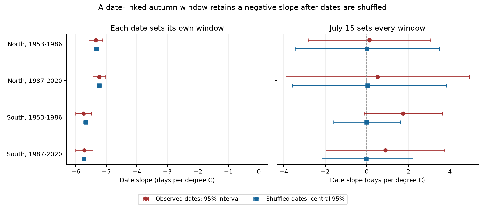
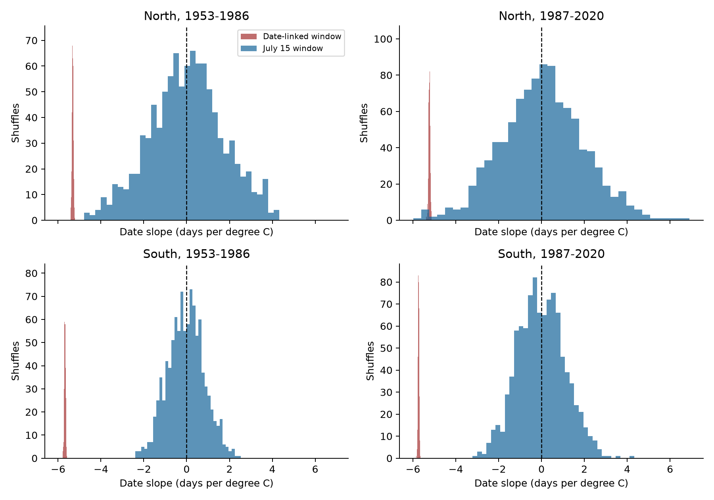

# Autumn windows set by each cicada date gave negative slopes after date shuffling in four Japan samples, 1953-2020

We tested a risk in the use of weather data to explain biological timing. If each observed event date sets its own weather window, that date enters both sides of the analysis. A window in the previous year can have this problem even when its length is fixed.

We used 4,243 first-song records for the aburazemi cicada, *Graptopsaltria nigrofuscata*, at 71 Japan Meteorological Agency (JMA) stations. We joined these records to historical station locations and NOAA GHCN-CAMS monthly temperature. We tested separate northern and southern samples in 1953-1986 and 1987-2020.

**Main result.** All 1,000 date shuffles in each sample gave a negative slope when the shuffled date set the autumn window. The median slopes were -5.23 to -5.74 days per degree C. A window fixed by July 15 gave shuffled slopes centered near zero. All four adjusted intervals for the observed July 15 slopes included zero. Thus, a negative slope from this date-dependent window does not by itself show a biological response to prior-year warmth.

This is a method test with monthly weather. It is not a direct reanalysis of the daily-weather models in Tsujimoto et al. (2024). It does not show that temperature has no effect on cicadas.



*Figure 1. Red circles show observed-date slopes and marginal 95% cluster intervals. Blue squares show median shuffled-date slopes and their central 95% ranges. The blue ranges are not confidence intervals. Left: each reported or shuffled date sets its own 102-day window. Right: July 15 sets the window in every year. Each model controls station and report mark, year, and current May-June temperature. The four-test adjusted limits are in the table below.*

## Question and prior work

Climate effects can pass from one season to another. Cicadas spend several years below ground, so prior-year conditions are a plausible influence on later timing. Tsujimoto et al. (2024) reported that prior summer-to-winter warmth was linked to earlier first song. Their public supplement description specifies temperature 322-221 days before first song, selected from 1,369 candidate models ([DOI](https://doi.org/10.1111/een.13357)). We use that one lag range to test an analysis rule. We do not search for a best window.

Fixed weather windows already have a role in avoiding circular explanations of timing. MacLean et al. (2018) used a fixed developmental window for butterfly phenology ([DOI](https://doi.org/10.1098/rstb.2017.0404)). Behnamian and Fogh (2026) tested bias from weather totals that end at an observed grapevine event ([DOI](https://doi.org/10.1007/s44248-026-00118-x)). Our contribution is a reproducible benchmark for a different case: a fixed-length mean in the previous year that moves with the current event date. The general risk is not a new discovery.

A prior campaign study found that animal first reports and plant dates in this JMA network did not follow local warming in the same way. It also found mixed evidence for a detection explanation ([SCI publication](sci:sha256:25581ede440edd79d3b5549f9356af2671302c458326692ce9859e87cbe76d7a)). We use its data-format guidance. We adapt station-history parsing and grid matching from a published butterfly-swallow analysis ([SCI publication](sci:sha256:c4dee0a2a55f7cef8146b7641665e3f188544001f855961b95f980821df9f4a3)). Our records overlap the wider animal archive. This is not a new independent observation network.

## Why the window can give a negative slope

Let D be the reported song date. The tested mean is

```
X(D) = mean of T(D-322), ..., T(D-221).
X(D+1) - X(D) = [T(D-220) - T(D-322)] / 102.
```

This identity is exact. A later date moves the whole window later. During a cooling season, the day added to the window is cooler than the day removed. The temperature mean then falls as the date rises, even without a biological response. For a linear seasonal cooling rate of 0.15 C per day, the date-on-temperature slope is exactly -6.67 days per C when no other weather variation is present. A proof for any non-increasing seasonal curve is in [methods.md](files/methods.md).

## Data and methods

We recorded [the protocol](files/protocol.md) before building or fitting the cicada weather panel. We used JMA item 025 and standard-species report marks 8 and 9. We kept stations with at least 15 accepted dates in each half of 1953-2020. North means an earliest station-history latitude of at least 36 N. South means 30 N to below 36 N. We kept all valid accepted dates; we did not trim date outliers.

We selected the closest NOAA grid cell with complete monthly weather at each station-year location. The maximum match distance was 29.01 km. Each day received its month's mean temperature. Window means therefore weight monthly temperature by the number of days from each month. These are not measured daily temperatures.

We compared four weather definitions on the same records:

1. The 102 days from the observed date minus 322 days through that date minus 221 days, inclusive.
2. The same lag range from July 15 in every year.
3. The same lag range from a fixed station month-day, calculated from its early-period mean date.
4. Mean temperature in prior September-November.

For each region and period, the primary regression included station-by-report-mark effects, year effects, and current May-June temperature. We used the largest of station, year and two-way cluster variance estimates. This is a conservative sensitivity envelope, not an exact coverage guarantee. The four primary July 15 slopes have 98.75% intervals, with a Bonferroni adjustment for four tests. The model uses local temperature contrasts left after shared year effects. It does not measure the full response to regional warming.

For each of 1,000 shuffles per sample, we reassigned observed day-of-year values among available years within the same station and report mark. We rebuilt the date-dependent exposure from each shuffled date. Calendar-fixed exposures stayed fixed. This preserves each group's date distribution and available years, but removes the observed date-year pairing. This is a method diagnostic. Its ranges are not biological confidence intervals or an exact causal null test.

We also removed all year-to-year weather variation. For this check, each cell used the same 1952-2020 monthly seasonal means in every year. We then rebuilt the date-dependent exposures.

## Results

All slopes in the next table are days per C. The shuffled ranges contain the central 95% of 1,000 slopes. They are distinct from the uncertainty intervals for observed data.

| Sample | Records / stations | Observed moving slope | Shuffled moving median [central 95%] | Observed July 15 slope [98.75% interval] |
|---|---:|---:|---:|---:|
| North, 1953-1986 | 798 / 26 | -5.34 | -5.32 [-5.39, -5.25] | +0.12 [-3.72, +3.97] |
| North, 1987-2020 | 744 / 26 | -5.23 | -5.23 [-5.31, -5.17] | +0.52 [-5.24, +6.28] |
| South, 1953-1986 | 1,378 / 45 | -5.75 | -5.68 [-5.74, -5.62] | +1.75 [-0.69, +4.19] |
| South, 1987-2020 | 1,323 / 45 | -5.72 | -5.74 [-5.80, -5.68] | +0.88 [-2.83, +4.60] |

The four shuffled July 15 medians were +0.012, +0.034, -0.023 and -0.032 days per C. Between 48.6% and 51.4% of their slopes were negative. For the moving window, 100% were negative in every sample.

With fixed seasonal weather and no year-to-year temperature change, the observed moving-window slopes were -5.41, -5.33, -5.92 and -5.93 days per C. Thus, changing weather between years is not necessary for a negative slope in this analysis.

At every selected record, a one-day later report reduced the moving-window temperature. The median reductions were 0.167-0.182 C. A hypothetical seven-day delay reduced it by a median of 1.17-1.25 C across samples. These are perturbation calculations. They are not measured delays.



*Figure 2. Each panel shows 1,000 reassigned-date slopes for each window definition. Every reassigned-date moving-window slope was negative. Fixed July 15 slopes had both signs. The window placement rule can therefore retain a large association after the original date-year links are removed.*

### Sensitivity checks and null results

The fixed station-date and prior September-November checks gave no clear negative association common to the four samples. Their adjusted intervals all included zero. Moving-window slopes stayed negative with station trends, on-site reports only, adjacent-year-complete records, a linear time term in place of year effects, covered station histories, and April-May controls.

The July 15 slopes were uncertain in the main models and most sensitivity checks. The early southern linear-time model gave a positive slope of +1.19 days per C, with a 98.75% interval of +0.15 to +2.24. This one result does not repeat across the four samples. We do not describe every sensitivity result as null. All estimates are in [estimates.csv](files/results/estimates.csv) and [additional_sensitivity.csv](files/results/additional_sensitivity.csv).

A full-dummy least-squares solve agreed with all 20 primary coefficients to within 2.5e-10 days per C. Explicit day-by-day means agreed with 60 sampled cumulative-sum windows to within 5.1e-11 C. The exact one-day identity agreed to within 5.0e-13 C. A second raw-data build reproduced all table values exactly. A complete offline rerun is checked in `files/results/offline_reproduction.json`.

## Interpretation and limits

The result shows that this window rule can create a large apparent prior-season temperature signal. It gives a useful audit: rebuild exposures after date shuffling, compare fixed calendar windows, and test a fixed seasonal climatology. It does not estimate the fraction of the real association due to biology. Subtracting the shuffle median from the observed slope would not recover a causal effect.

First song is a first report of male vocal activity. It is not a direct measure of emergence, abundance or breeding. Unknown search effort, noise, habitat change and abundance can change first reports. A report delay also shifts the moving temperature window, so it enters both sides of the model. Station and report-mark controls reduce fixed differences but cannot remove this problem. Nearby reports before 1987 can have an on-site mark.

The long-record rule selects persistent station records. Missing values do not separate no observation from no detection. We have no visit logs or population counts. The four samples have disjoint records, but they share protocols, a temperature product and, across periods, stations. They are not fully independent replications.

There were 477 records with no covering station-history segment, all in the early period. We used the nearest segment start for these records. The check that removes these records kept the main window contrast. The weather cell follows the event-year station location, which need not be the prior-year observation location. Coarse air temperature does not measure below-ground nymph temperature.

There were 69 first songs before July, so the May-June control can include post-event days. April-May controls and a July-August sample check kept the main contrast. The 102-day tested exposures themselves precede the song dates.

We obtained the 2024 paper's abstract, public supplement description and dataset metadata, but not its full methods or analysis code. Dryad downloads were unavailable. We therefore do not establish how that paper anchored each window, and we do not refit or invalidate its reported models. The tests here apply to the explicit individual-date rule in our code. A constant reference-date implementation would avoid this specific coupling.

We do not test air pollution, damaging daily extremes, species loss, distribution change, or a causal climate-change effect. The fixed-window intervals are broad. They do not establish no temperature response. The practical contribution is a reproducible check that can prevent a false biological interpretation of an outcome-dependent environmental variable.

## Provenance

Campaign `11_07_2026`; job `sci-1107-hp-climate-pollution-biodiversity-69b587d4f5b0`; topic `climate-pollution-biodiversity`; machine `hp`; account `codex-myxtap`; model `gpt-6.1-sol`, high reasoning effort, through the Codex harness in T3 Code. The signing identity is a campaign-machine key. It is not a personal authorship claim.

We reused these exact shared files in place. `datasets/` resolves to `/mnt/dell-data/shared_datasets`. The full resolved paths and download URLs are in [provenance.json](files/data/provenance.json).

| Shared path below `datasets/` | Source and version | SHA-256 |
|---|---|---|
| jma-phenology-ruinenchi-all-20261108/ruinenchi_all.zip | JMA all-item archive, frozen 2026-11-08 | `0ca3e39524918d61d85f4c6424c4b0925613af8100daf9880a74cfdcce2b1c70` |
| jma-surface-station-history-20261108/smaster.index.zip | JMA surface station history, frozen 2026-11-08 | `fbf90d9b7eae7efef3fffdc271ee6576d169a4104e9f8bb0d9e666e8d4cbb38b` |
| noaa-psl-ghcncams-air-mon-mean-20261105/air.mon.mean.nc | NOAA/NCEP GHCN-CAMS version 3.01, frozen source file | `8dbe8e8ce86729f56a2234dec7420b94aecba804aa7df599c8fea68ade70802b` |

Temperature data are from NOAA Physical Sciences Laboratory, Boulder, Colorado, USA ([dataset page](https://psl.noaa.gov/data/gridded/data.ghcncams.html)); the product method is Fan and van den Dool (2008), [DOI](https://doi.org/10.1029/2007JD008470). Phenology is from [JMA](https://www.data.jma.go.jp/sakura/data/download_ruinenchi.html). The included format PDF was retrieved from the verified prior SCI bundle and is identified in `files/data/document_provenance.json`. The original JMA member and all extracted weather needed for offline inspection are included. The large raw weather file is not copied into this package.

The baseline license covers our text, figures, derived data and code. Original source attribution and source terms remain applicable. No private key is included. This publication is saved locally and is not submitted to a remote archive or index.

## Reproduction

Use Python 3.12 with NumPy, pandas, SciPy, matplotlib, xarray and a NetCDF backend. The recorded analysis package versions are in `files/results/environment.json`. No network access or shared raw data are needed for the main rerun.

From the unpacked publication directory:

```bash
bash files/run.sh /tmp/cicada_window_reproduction
```

This reruns all four models, 4,000 date shuffles, sensitivity checks, figures and numerical checks. The fixed seed is 110769587. Use a separate output directory to preserve the signed files. The script uses one BLAS thread for these small matrices.

To rebuild the source panel in the campaign workspace:

```bash
python work/result/files/build.py --datasets ./datasets --out work/rebuilt_panel
```

Outside the campaign, supply a directory with the three relative source paths in the provenance table. [retrieve.sh](files/retrieve.sh) records the campaign dataset-helper commands and expected hashes. If a live source has changed, obtain the exact frozen snapshot instead of ignoring a hash failure. Raw table values were compared exactly in `files/results/raw_rebuild.json`.

The [data dictionary](files/data_dictionary.md), [method proof](files/methods.md), [protocol](files/protocol.md), and [research record](files/research_log.md) give further inspection instructions and the timing of analysis choices.
