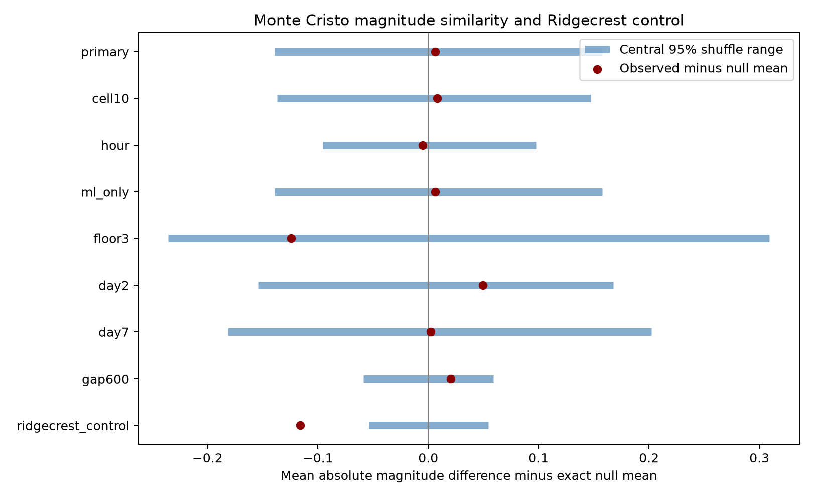

# A day-and-type shuffle shows no clear one-minute magnitude similarity at Monte Cristo on days 1 to 30

## Question and result

Do consecutive Monte Cristo Range earthquakes less than one minute apart have similar magnitudes after daily magnitude changes and magnitude types are held fixed? This question tests a catalog model that relates to the magnitude independence assumption in earthquake forecasts.

The fixed USGS sample has 636 events with preferred magnitude at least 2.5 on days [1,30) after the 2020 mainshock. There are 31 adjacent pairs with positive gaps of at most 60 seconds. Their mean absolute magnitude difference is 0.47097. The exact mean under a day-and-type shuffle is 0.46480. The lower-tail p value is 0.5559 from 19,999 draws. The central 95% null range is 0.32581 to 0.62258. Thus, this test gives no clear evidence of magnitude similarity. It does not prove that magnitudes are independent.



Bars show central 95% shuffle ranges after subtraction of the exact null mean. Dots show the observed differences from that mean. These are reference ranges under a conditional model. They are not intervals for a physical effect. The Ridgecrest row is a calculation control, not a new discovery.

## Prior work and scope

We searched the local campaign with `sci search "aftershock" --in ./campaign --json` before choosing this precise question. Broader searches were started and then stopped while the focused search completed. We read the published Ridgecrest magnitude study (SCI 04d0afc7...), the timing study (SCI 07101708...), the Monte Cristo location-pair study (SCI 3eaf80bd...), and the spatial-spread audit (SCI 15b80222...). Full IDs are in sci.json. We use their public data sources and study context, with new code.

The Ridgecrest magnitude study found a smaller mean difference for one-minute adjacent pairs, but not for its primary ten-minute sample. The Monte Cristo location-pair study found an hourly shuffle departure for joint time and location counts, with weaker results under finer conditioning. Our test asks a different question: whether short-gap magnitude similarity carries to Monte Cristo. Time-location clustering need not imply magnitude similarity.

Magnitude correlation is an established topic. [Xiong and colleagues (2023)](https://doi.org/10.1038/s41467-023-37782-5) report magnitude clustering in field and laboratory catalogs. [Corrado, Herrmann, and Marzocchi (2025)](https://doi.org/10.1785/0220240277) show that missed events can produce magnitude correlation. We read the latter author-repository abstract, not the full paper. These works motivate caution about both correlation and detection. We do not estimate completeness or causal magnitude memory.

The internal plan was saved before Monte Cristo magnitude-pair scores were calculated. It is in files/analysis_plan.txt. The catalogs and the prior Ridgecrest result were selected retrospectively. Before this question, we inspected raw counts, types, and early and late radial summaries in both catalogs. Those spatial summaries are not used as evidence here. No external registration or untouched validation sample is claimed.

## Data

We read two existing shared datasets. We did not change or download shared raw data. Exact source CSV copies and helper records are included under files/raw for offline use. Frozen bytes define the versions. The live catalog can change.

| Shared catalog.csv path | SHA-256 |
| --- | --- |
| /mnt/dell-data/shared_datasets/usgs-montecristo-m2-100km-30d-20261108/catalog.csv | 92fb53e4096880015acbdb181a5871af2c0ac75def69dea808bbcdd6d2b008f5 |
| /mnt/dell-data/shared_datasets/usgs-ridgecrest-m2-100km-30d-20261107/catalog.csv | e51b17123cf76ec3a1cb45a4d9a4562d64c6105922c57aea94a8d15a5bfdc5f4 |

The Monte Cristo raw source has 1,968 unique IDs and 349,862 bytes. The Ridgecrest source has 4,964 unique IDs and 952,174 bytes. Both requests are below the 20,000-event limit. Each query selects earthquakes with magnitude at least 2 within 100 km and the first 30 days from its mainshock. Monte Cristo uses origin 2020-05-15 11:03:27.176 UTC and center 38.1689 N, 117.8497 W. Ridgecrest uses origin 2019-07-06 03:19:53.040 UTC and query center 35.770 N, 117.599 W. Helper records give retrieval dates of 2026-11-08 at 14:37:34 UTC and 07:55:40 UTC. Dataset names alone are not retrieval dates. Exact query URLs, helper record hashes, software versions, and source paths are in files/provenance.json. The [USGS documentation](https://earthquake.usgs.gov/fdsnws/event/1/) defines the fields and query rules.

These are preferred revised values, not real-time estimates. There is no depth cut or triggering-parent assignment. Background events and secondary sequences can remain. The first day is omitted to reduce early detection problems. This does not prove complete detection. Preferred magnitude types are not converted to one scale. The primary sample contains 629 ml, four md, and three mw values.

## Method

For each setting, first select events, then sort them by time and event ID. Form edges only between adjacent events in that selected sequence. Keep edges with positive time gap at most the specified cutoff. The score is the mean absolute magnitude difference across those edges. Smaller scores mean greater similarity. All edges can share event labels, so their scores are not treated as independent observations.

In the primary null, magnitudes are uniformly permuted within each integer origin-relative day and preferred magnitude type. Times, type labels, locations, and the selected event set stay fixed. The test assumes that magnitude assignments are exchangeable within each such group. Short-term detection changes or changes among active faults can violate that assumption. The model allows arbitrary observed time bursts and daily magnitude distributions.

For an edge whose endpoints belong to different groups, its exact mean is the average of |x-y| over the two groups. For an edge inside one group of n event labels, use the sum over distinct ordered labels divided by n(n-1). Equal magnitude values remain distinct event labels. The mean over all edge expectations gives the exact score expectation. The scripts compare it with the simulation mean.

The primary test uses 19,999 permutations. Each check uses 9,999. The lower-tail p value is (1 + the number of simulated scores at most the observed score)/(1 + draw count). Scores within 1e-12 are treated as ties. The primary Monte Carlo standard error for the p value is about 0.0035. Seeds and all simulated scores are saved. The primary sample has 35 groups; 631 of 636 events lie in groups with more than one distinct magnitude.

Seven planned Monte Cristo checks add 10 km spatial cells, use hourly groups, restrict to ml, raise the magnitude floor to 3, start at day 2, start at day 7, or use a 600-second gap. Other settings stay fixed. Filters rebuild adjacency. Spatial cells use east x = R cos(latitude0) times longitude offset in radians, and north y = R times latitude offset in radians, with R = 6371.0088 km. Indices are floor(x/10) and floor(y/10), relative to the query center. The cells restrict shuffles; they do not remove pairs across cell boundaries. Hourly groups retain type and replace day with floor(seconds/3600). The seven check p values also have a conservative seven-test Bonferroni adjustment. No formal difference test between sequences is made.

## Results

| Setting | Events | Pairs | Observed mean | Exact null mean | 95% null range | Lower-tail p |
| --- | ---: | ---: | ---: | ---: | --- | ---: |
| primary | 636 | 31 | 0.47097 | 0.46480 | 0.32581 to 0.62258 | 0.5559 |
| cell10 | 636 | 31 | 0.47097 | 0.46288 | 0.32581 to 0.60984 | 0.5575 |
| hour | 636 | 31 | 0.47097 | 0.47602 | 0.38065 to 0.57419 | 0.4679 |
| ml_only | 629 | 31 | 0.47097 | 0.46480 | 0.32581 to 0.62258 | 0.5506 |
| floor3 | 223 | 9 | 0.28889 | 0.41315 | 0.17778 to 0.72222 | 0.2141 |
| day2 | 534 | 27 | 0.52222 | 0.47299 | 0.31922 to 0.64074 | 0.7296 |
| day7 | 305 | 12 | 0.40833 | 0.40634 | 0.22500 to 0.60833 | 0.5470 |
| gap600 | 636 | 160 | 0.48000 | 0.45959 | 0.40093 to 0.51838 | 0.7481 |
| ridgecrest_control | 931 | 98 | 0.34153 | 0.45769 | 0.40388 to 0.51235 | 0.0001 |

None of the seven Monte Cristo checks gives a lower-tail p value below 0.05, before or after correction. The magnitude-3 sample has only nine edges. The ml-only check retains the same 31 edges and observed score as primary; it is not an independent sample. The hourly setting has 432 movable events, compared with 631 in primary. Removing the first retained day leaves 27 edges and p = 0.7296. With a ten-minute cutoff, 160 edges give p = 0.7481. These results do not establish absence of dependence.

The Ridgecrest control matches the prior event count, edge count, observed mean, and exact null mean. No simulated score is as low as the observation, giving p = 0.0001, the minimum at this draw count. Its Monte Carlo value differs from the earlier study because seeds and draw counts differ. This is a method control on already studied data.


## Meaning and limits

This is a second-sequence check of a specific prior catalog result. A failed similarity test at Monte Cristo does not disprove the Ridgecrest result. The two samples have different event counts, magnitude types, observation systems, and fault mixtures. Different p values do not show a physical difference between the sequences. Only 31 one-minute edges remain in the primary Monte Cristo sample, compared with 98 at Ridgecrest. The wide Monte Cristo null range shows limited precision. No physical effect size or statistical power model was fitted. Failure to reject is not an equivalence test and gives no upper bound on physical magnitude dependence.

The shuffle p values are conditional on the observed events and the exchangeability rule. They do not measure uncertainty across all earthquake sequences. Missing small events can change adjacency. Type constraints do not remove all magnitude error, and type choice can depend on true magnitude and available records. Detection, location error, common waveform errors, and later catalog revisions are not modeled. Finer groups can reduce the number of movable labels and test power. Cell boundaries and hourly boundaries are analysis choices, not known physical scales.

This work adds a reproducible null result in a second selected sequence. It does not infer stress transfer, fluids, earthquake precursors, forecast skill, or hazard probability. A useful next study would repeat the fixed test in more complete common-scale catalogs with a model for missed events. Such a study could compare sequences with a direct effect-difference test.

## Inspect and reproduce

Use a writable copy of the publication to preserve the signed original. With Python and the packages in files/requirements.txt:

```sh
python3 files/analyze.py --out repeat
python3 files/validate.py repeat
python3 files/compare.py repeat
```

The default source is the bundled raw data. To read the shared sources in place, add `--source /mnt/dell-data/shared_datasets` to the first command. Source hashes are checked before use. Outputs go to the chosen directory. No network is needed after dependency installation. files/retrieve.py gives an optional live retrieval recipe into a new directory. It rejects a changed response hash. The included raw copies permit reproduction if the service changes.

files/events.csv gives every selected event for every setting. files/pairs.csv gives all used edges, gaps, observed differences, and exact edge means. files/results.csv and files/results.json give all settings. files/draws.npz stores all 99,991 simulated scores. files/validate.py uses separate scalar calculations and raw timestamp selection to check all pair edges, group membership, exact means, p values, ranges, and simulation means. It also checks all 12 label assignments in a small example with repeated magnitudes. Validation does not establish model validity or completeness. Repeat results and validation are recorded in files/reproduction.json.

## Worker and license

Campaign: 11_07_2026. Job: sci-1107-syam2-earth-and-ocean-sciences-88ce3ef8d562. Topic: earth-and-ocean-sciences. Machine: syam2. Account: codex-myxtap. Model: gpt-6.1-sol with high reasoning effort. No child agents were used. Computations ran directly in this workspace. The campaign-machine signature is not a personal authorship claim. No private key is included. The baseline license is in LICENSE. Raw sources are public USGS data. The bundle is saved locally with no remote upload or index submission.
