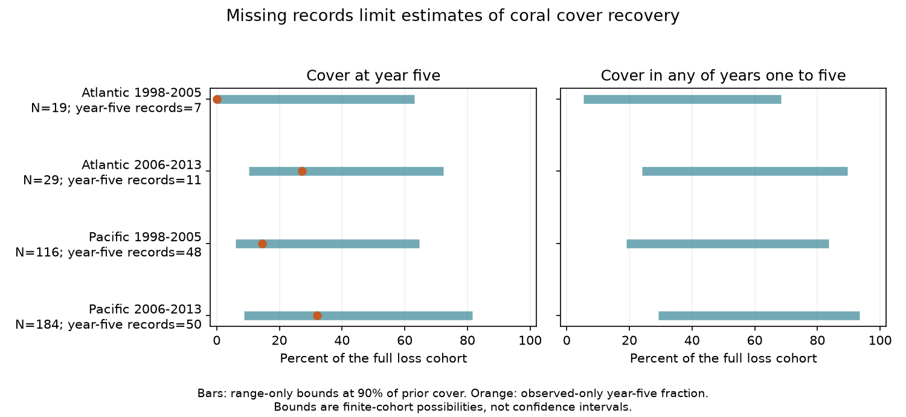

# Missing year-five records permit minority and majority coral recovery in four Atlantic and Pacific loss cohorts from 1998 to 2013

We tested whether recorded coral cover can determine the fraction of sites that reach 90% of prior cover five years after a large annual loss. HeatCRD version 1 gave 348 distinct sites in four ocean and period groups. Only 116 sites had a cover record in year five. If each missing cover can be from 0 to 100%, each group permits both a minority and a majority to meet the recovery target. The data also permit either sign of the later-minus-early period difference. These are exact bounds for selected archive cohorts. They are not confidence intervals or causal effects of heat.

## Question and prior work

Recovery time matters when marine heat and other disturbances recur. Coral cover is a measure of reef habitat. It is not a measure of species richness or recovery of the original species composition. We ask whether missing follow-up records alone can prevent a clear conclusion about five-year cover recovery. The competing explanation is that the low recovery fraction in observed records applies to the full loss cohort. We test what the records imply without that assumption.

Van Woesik and Kratochwill describe the HeatCRD archive (2024, doi:10.1038/s41597-024-03221-3). Walker, Kratochwill and van Woesik examine recovery rates after disturbances (2024, doi:10.1111/gcb.17112). Recovery trajectories need not follow one constant rate; work on two-phase recovery gives a reason to avoid linear interpolation (doi:10.1111/1365-2664.14039). These studies motivate the question. We do not repeat their disturbance classification or estimate their recovery-rate models.

We searched campaign publications for climate phenology, coral, and coral recovery before the precise design. SCI b2b835db examined missing next-year cover after high survey-date heat. It did not test a five-year recovery threshold after an observed large loss. We read that result and use the same public archive. Our result is a follow-up with a different cohort and outcome, not independent validation of that publication. We tested separate ocean groups and nonoverlapping event periods. All sites are distinct across the four groups, but sources, countries and broad environmental conditions can be shared. This is an exploratory archive analysis, not a preregistered study.

## Data and cohort rules

The only raw input is BCO-DMO 933334, version 1, dated 2024-08-15, by Robert van Woesik and Chelsey Kratochwill. The external data license is CC BY 4.0. We reused this file in place and changed no shared data:

    /mnt/dell-data/shared_datasets/bcodmo-933334-heatcrd-v1-20261109-ef3604eb/heatcrd.csv

File size: 17,242,977 bytes. SHA-256:

    c3ca8c2541b0883d50215c4f13cda23d79ebcfaff5dc05d738105f01ae0d4bdb

Exact retrieval URL and source metadata are in files/provenance.json. The source has 29,208 rows and 29,205 sample IDs. We combine repeated sample IDs before analysis. Site, source citation, year, ocean, country and heat must agree within each repeated ID, with missing values counted as a distinct value. We average cover within each ID. All nonmissing raw cover values are in the 0-100% range.

We retain valid-cover samples from the Atlantic and Pacific. We average sample covers within site, source citation and calendar year. Samples have equal weight; area and survey effort weights are unavailable. This gives 21,657 annual cells. Each cell can combine depths, months and methods. The quantity is an annual archive summary, not a fixed-date census. Dates with no recorded month can contribute cover but have no embedded thermal estimate.

A candidate loss has annual cover at least 10 percentage points below the exact preceding year's cover at the same site and source. Its loss year is 1998-2013. We keep the first candidate per site over the whole window. If two sources qualify in the same first year, lexical citation order breaks the tie. Thus no site contributes twice, including across periods. Later losses at that site are not separate events. The preceding year is a reference level, not proof of an undisturbed reef. We do not identify the cause of a loss. No event in this cohort already meets the 90% recovery threshold at its loss year.

Early loss years are 1998-2005. Later loss years are 2006-2013. Follow-up uses the same site and source at exactly one through five calendar years after loss. The last primary target year is 2018, within the archive span through 2020. No nearby year replaces a missing year. The cohort is fixed before follow-up availability is checked.

The primary target is the fraction of the finite loss cohort whose year-five annual cover summary is at least 0.9 times its reference cover. For a missing summary, we assume that a comparable measurement could be defined. The secondary target is meeting that threshold in at least one of the five annual summaries. This is a discrete annual target. It is not continuous-time first recovery, and it does not establish lasting recovery.

## Bounds and assumptions

Let N be the full cohort size, O the number with year-five cover, S the number of observed successes, and M=N-O. With no assumption about missing cover except its 0-100% range, the year-five success fraction has bounds:

    lower = S / N
    upper = (S + M) / N
    width = M / N

The reference covers are positive and at most 92.5%. Thus zero cover fails the target and 100% cover meets it. Assigning these values to all missing cells attains the two endpoints. Intermediate binary success counts attain the grid between them. We show the enclosing interval. Distinct sites ensure that a missing cell is not shared by two events. These bounds are sharp under this range-only model, conditional on the observed covers and cohort selection.

For the secondary target, let A count sites with at least one observed success in years one through five. Let F count sites with all five annual records and no success. Its bounds are A/N and 1-F/N. A site with a missing year and no observed success can meet the target in that missing year. A site with a success remains a success even if its later cover falls. We impose no monotonic recovery or linear growth assumption. With unconstrained annual missing covers these bounds are also attainable. They do not bound the time of recovery between surveys.

For a later-minus-early contrast, subtract the early upper bound from the later lower bound, and the early lower bound from the later upper bound. Distinct sites allow these endpoints simultaneously. Observed-only fractions S/O describe a different, selected target. We give no sampling confidence intervals: the calculation describes the finite archive cohort, and does not assume a random sample of world reefs. Measurement error, survey timing and the initial selection are outside these bounds.

## Results

All fractions below are percent of sites. A recovery success means at least 90% of the reference cover, not 90% absolute cover. Bounds are rounded here; full precision is in files/aggregate_results.csv.

| Ocean | Loss years | Sites | Year-five records | Successes | Observed-only success | Full-cohort bounds |
| --- | --- | ---: | ---: | ---: | ---: | --- |
| Atlantic | 1998-2005 | 19 | 7 | 0 | 0.0% | 0.0-63.2% |
| Atlantic | 2006-2013 | 29 | 11 | 3 | 27.3% | 10.3-72.4% |
| Pacific | 1998-2005 | 116 | 48 | 7 | 14.6% | 6.0-64.7% |
| Pacific | 2006-2013 | 184 | 50 | 16 | 32.0% | 8.7-81.5% |

All four groups permit both less than and more than half of the full cohort to meet the target. Later observed-only fractions are higher in each ocean. However, the full-cohort later-minus-early difference can be -52.8 to +72.4 points in the Atlantic and -56.0 to +75.5 points in the Pacific. Thus the missing records prevent a sign conclusion under range-only assumptions. This does not show that recovery is equally likely at all values inside the bounds.

The any-year target has bounds of 5.3-68.4%, 24.1-89.7%, 19.0-83.6% and 29.3-93.5%, in table order. Only 6, 3, 25 and 29 sites have all five annual records. An earlier observed success increases a lower bound; later failure cannot exclude an unobserved earlier success. Treating the last failed visit as proof of no prior recovery would require another ecological assumption.

We tested two possible archive explanations for missing year-five records. Of 12, 18, 68 and 134 missing records, only 1, 4, 4 and 9 have a source citation whose last valid Atlantic or Pacific annual cell precedes the target year. In contrast, 2, 3, 27 and 24 missing records have a later same-site, same-source cover record. These categories are disjoint. Source endpoints alone therefore cannot explain all gaps. A gap can still reflect a missed visit, an unpublished visit, a missing value, or a changed label. Later records do not establish which cause applies.

## Sensitivity and heat scope

Changing the target to 80% or 100% of reference cover leaves all four all-source year-five bounds spanning 50%. The 80% target can describe retained cover rather than a return from below that threshold. It is a sensitivity calculation with the same cohort, not a new disturbance definition.

Source stratification gives a useful limit to the main result. In the early cohorts outside Reef Check, the upper recovery bounds are 14.3% in the Atlantic (7 sites) and 41.1% in the Pacific (56 sites). These selected subgroups imply a minority under the range-only model. Other source and period groups still span 50%. The broad uncertainty does not apply uniformly to every monitoring programme. Stratification changes the target and does not show a programme effect. Reef Check supplies 233 of the 348 events.

Embedded CoRTAD TSA_DHW is known at at least one loss-year sample for 13, 24, 104 and 167 events. We use the maximum recorded survey-date value within a year for a descriptive high-heat flag of at least four. This is not the annual heat maximum: heat between surveys is unobserved. Only 2, 0, 10 and 19 events meet this flag. Among high-heat events the year-five bounds are 0-50% in the early Atlantic, 10-70% in the early Pacific and 10.5-89.5% in the later Pacific. There is no later Atlantic high-heat cohort. A stricter flag requires heat at every valid-cover sample. Aggregate files include that check and missing-heat groups. Missing heat is never set to zero. These small, selected groups cannot establish a common heat response or recovery after verified heat damage.

## Limits and use

The result concerns the information in selected records. It does not estimate global recovery. Annual averages can change when survey depth or season changes. A 10-point annual decline can reflect observation error, changing coverage or a real loss. Selecting a large decline can cause regression to the mean. Stable source labels do not guarantee stable methods or sampled reef area. Missing records can arise at several stages of field work and archiving. The bounds do not correct these problems, missing baseline records, inaccurate site labels or rounded cover values.

The geographic and period checks use distinct sites but share monitoring sources. They are not independent experiments. The early and later groups have different source mixtures and follow-up windows. Repeated disturbances during follow-up are allowed; no attribution to marine heat or climate change follows. We did not test air pollution. Cover return does not prove return of ecological function or species composition. The useful output is a reproducible audit: these full-cohort year-five conclusions require recovery assumptions or additional records, even when observed-only summaries appear clear.

## Reproduction and rights

The package includes original code, aggregate results, a static figure, source provenance, runtime versions and an independent validation report. No raw data or derivative record database is bundled. External data terms and credit are in files/EXTERNAL_DATA_NOTICE.txt. The bundled statistical summaries are our aggregate analytical results. The SCI baseline license applies to our bundled materials and does not replace external source terms.

From an extracted publication root, use Python 3 with NumPy, pandas and Matplotlib. The exact run versions are in files/runtime.json. Run:

    sh files/reproduce.sh /mnt/dell-data/shared_datasets/bcodmo-933334-heatcrd-v1-20261109-ef3604eb/heatcrd.csv /absolute/path/to/new-scratch

On another machine, first retrieve the external file:

    python3 files/retrieve.py /absolute/path/to/raw-scratch
    sh files/reproduce.sh /absolute/path/to/raw-scratch/heatcrd.csv /absolute/path/to/new-scratch

The scripts verify the exact raw SHA-256 and refuse output inside the publication. The retrieval script refuses to overwrite an existing file. Regeneration writes record-level evidence only to external scratch. It also writes the aggregate CSVs and figure. Source removal or changed bytes will stop retrieval or hash validation; do not silently substitute another version.

The independent validator uses the standard-library CSV reader and dictionaries to rebuild sample means, annual cells, first site losses, five annual matches, counts and year-five endpoints. It does not use the pandas panel. All four cohorts passed count and endpoint comparisons to 1e-12. The main code checks the missingness-width identity and endpoint order. These checks test implementation, not ecological assumptions.

Campaign: 11_07_2026. Job: sci-1107-dell-climate-pollution-biodiversity-43f7006fe3d5. Topic: climate-pollution-biodiversity. Machine: dell. Account: codex-myxtap. Model: gpt-6.1-sol with high reasoning effort. No agents were launched. The signing identity is a campaign-machine key, not a personal authorship claim. Only local signing and storage were requested.
