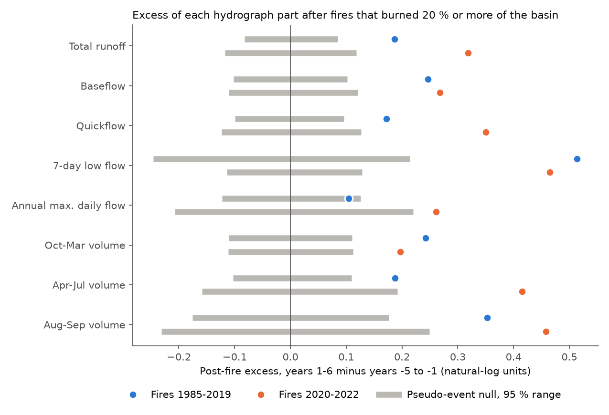
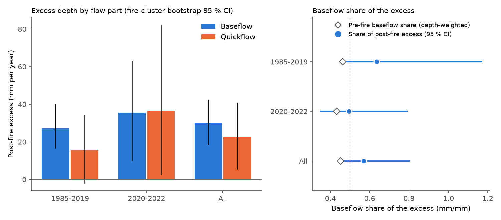
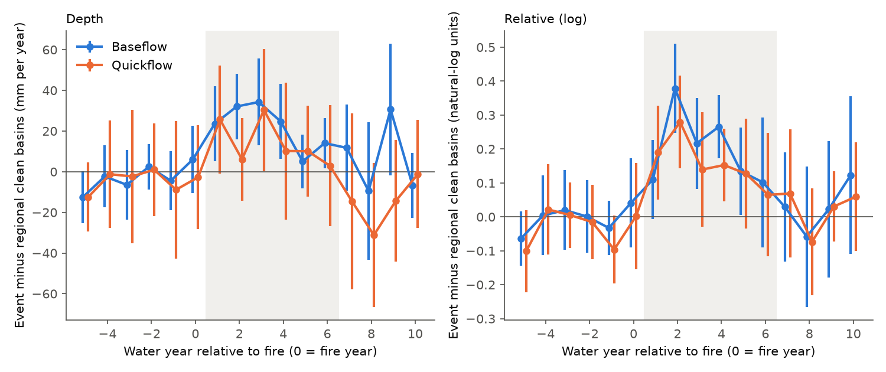

# After large western U.S. wildfires, baseflow and quickflow rose by similar fractions and the baseflow index did not change (50 CAMELS fire events, 1985-2022, daily USGS flow)

## Summary

An earlier SCI study (sci:07ca7c27) found that annual runoff from western U.S. CAMELS reference basins increased by +21 % (fires of 1985-2019) and +37 % (fires of 2020-2022) in post-fire water years 1-6, when 20 % or more of the basin burned. That study used annual data only. Thus it could not tell which part of the hydrograph carries the increase. Two mechanisms give different predictions:

- **Less evapotranspiration (ET)** after vegetation loss (Williams et al. 2022) puts more water into soil and groundwater storage. Prediction: baseflow and low flows increase, and the increase continues for several years.
- **Less infiltration** (water-repellent or sealed burned soils) sends more rain to fast runoff. Prediction: quickflow and flood peaks increase, mostly in post-fire years 1-2, and the baseflow index (BFI = baseflow / total flow) decreases.

We downloaded USGS NWIS daily discharge for all 330 western CAMELS gauges (water years 1951-2025). We separated each daily record into baseflow and quickflow with the Lyne-Hollick digital filter. We kept the exposure, events, climate model, regional adjustment and pseudo-event null of sci:07ca7c27 without change, and replaced only the response variable. We wrote the analysis plan and the predictions before we calculated any daily-flow result (`files/PLAN.md`).

Main results (50 events in 42 basins; 33 events with fires in 1985-2019 and 17 with fires in 2020-2022; 42 fire clusters):

1. **The new data reproduce the earlier result.** Total runoff excess was +0.187 log units for 1985-2019 fires and +0.318 for 2020-2022 fires (sci:07ca7c27: +0.188 and +0.315), with the same 33 and 17 events.
2. **Baseflow and quickflow increased by similar fractions.** All events: baseflow +0.252 log units (+29 %), quickflow +0.233 (+26 %); pseudo-event null 95 % ranges approximately ±0.08. Across events, the two changes had a correlation of 0.71.
3. **The baseflow index did not change.** BFI change +0.007 (fire-cluster bootstrap 95 % CI -0.007 to +0.020; null p = 0.33). With the 10 % burn threshold (94 events): +0.003 (CI -0.008 to +0.015). Thus a post-fire BFI decrease larger than approximately 0.01 is not consistent with these data. The prediction of the infiltration mechanism (a lower BFI) failed.
4. **Baseflow carried most of the extra water depth.** Mean excess was +52.7 mm per year (CI 28.6 to 81.7): baseflow +30.0 mm (18.8 to 42.2) and quickflow +22.6 mm (5.5 to 40.7). The baseflow share of the excess was 0.57 (CI 0.46 to 0.80); the pre-fire baseflow share of flow in the same basins was 0.46. Three other baseflow filters gave shares of 0.52 to 0.69.
5. **Low flows had the largest relative increase, and flood peaks the smallest.** The annual minimum 7-day flow increased by +0.496 log units (+64 %, CI +34 % to +110 %; 46 events with nonzero low flow). The annual maximum daily flow increased by +0.158 (+17 %, CI +0.7 % to +36 %). August-September flow increased by +0.388 log units (+47 %), but this is only 4.2 mm per year (8 % of the extra depth). Most extra water came in October-March (+24.3 mm) and April-July (+24.2 mm).
6. **The extra baseflow depth did not depend on how wet the year was.** For post-fire years 1-6 (271 basin-years), the baseflow excess changed by +0.3 ± 12.9 mm per unit of ln(P / mean P). The relative baseflow excess was larger in dry years (slope -0.38 ± 0.10 log units per unit ln P). A fixed extra depth of approximately 30 mm per year is a larger fraction of a dry-year flow. This explains the larger relative runoff excess in dry years that sci:07ca7c27 reported but could not resolve (its p = 0.07).
7. **No clear timing change and no early quickflow pulse.** Centre-of-mass timing changed by -0.5 days (CI -5.9 to +4.7). In post-fire year 1, the baseflow and quickflow depth excesses were equal (+23.6 and +25.7 mm). Baseflow excess stayed positive in years 1-6 (+5 to +34 mm); quickflow excess was smaller after year 1 except in year 3.
8. **The 2020-2022 fires were different in one part.** For these 17 events, quickflow increased more than baseflow (log difference -0.087, CI -0.154 to -0.022), and timing was 8.3 days later (CI 1.9 to 15.8). BFI still did not decrease clearly (-0.010, CI -0.026 to +0.005). With the 10 % threshold (23 events), the difference was not clear (-0.053, CI -0.151 to +0.081) and the timing change was not clear (+3.2 days). We did not plan this comparison as a primary test.

Conclusion: in these reference basins, the post-fire runoff increase does not have the signature of infiltration-excess runoff at the daily scale. Water was added to the hydrograph in approximately the same proportions as before the fire, with an approximately constant extra baseflow depth and the largest relative gain in low flows. This agrees best with the ET-reduction explanation. The result is about annual and daily volumes. It does not exclude short sub-daily flood or debris-flow responses (see sci:274702c9), which daily means cannot resolve.



*Figure 1. Post-fire excess (natural-log units; post-fire years 1-6 minus pre-fire years -5 to -1, relative to the climate model and same-region unburned basins) for each part of the hydrograph. Dots: mean of events (blue: fires of 1985-2019, 33 events; orange: fires of 2020-2022, 17 events). Grey bars: 95 % range of the pseudo-event null. Low flows had the largest relative gain and annual peaks the smallest.*



*Figure 2. Left: mean excess depth (mm per year) of baseflow and quickflow, with fire-cluster bootstrap 95 % intervals. Right: baseflow share of the excess depth (dots, 95 % CI) and the depth-weighted pre-fire baseflow share of the same basins (diamonds).*



*Figure 3. Baseflow and quickflow of burned basins minus the mean of clean basins in the same HUC-02 region, by water year relative to the fire (all 50 events, ± 1.96 SE). Left: depth (mm per year). Right: log units. The shaded area is the post-fire test window (years 1-6).*


*Figure 4. Left: baseflow excess against quickflow excess for each event (dashed: equal change). Right: BFI change against burned fraction.*

## Question and predictions

Question: which part of the daily hydrograph carries the post-fire annual runoff increase of sci:07ca7c27, and how fast does each part return to normal?

Predictions fixed in `files/PLAN.md` before the analysis:

| Hypothesis | Prediction | Result |
| --- | --- | --- |
| H1 ET reduction | Baseflow share of excess depth 0.5 or more; 7-day low flow and Aug-Sep flow increase; excess continues over years 1-6 | Share 0.57 (CI 0.46-0.80); low flow +0.50 and Aug-Sep +0.39 log units; baseflow excess positive in years 1-6. Consistent. The lower CI limit is below 0.5. |
| H2 infiltration loss | Quickflow and annual peak carry most of the excess; concentrated in years 1-2 | Peak excess smallest (+0.16); quickflow share 0.43 of depth; year-1 quickflow = baseflow. Not supported at daily scale. |
| H3 snow and canopy | Earlier timing; Apr-Jul share larger relative to Oct-Mar | Timing -0.5 days (CI -5.9 to +4.7); Apr-Jul and Oct-Mar excess depths equal. Not supported. |

## Data

| Data | Source, version and license | Use |
| --- | --- | --- |
| USGS NWIS daily mean discharge (parameter 00060, statistic 00003) | `https://waterservices.usgs.gov/nwis/dv/`, retrieved 2026-11-12 for 330 western CAMELS gauges, water years 1951-2025. U.S. Government work, public domain. Recent values can be provisional and can change. | Daily flow; all responses |
| CAMELS v1.2 attributes (`camels_name.txt`, `camels_topo.txt`) | Newman et al. 2015, Addor et al. 2017; Zenodo record 15529996 (doi:10.5065/D6MW2F4D), CC BY 4.0. Shared campaign copies: `/mnt/dell-data/shared_datasets/camels-us-attr-name-zenodo15529996/camels_name.txt` (SHA-256 `f3a85272cd934c6e12386db5f21979675fc891844250a335135786ad9a2de445`) and `/mnt/dell-data/shared_datasets/camels-us-attr-topo-zenodo15529996/camels_topo.txt` (`b64ca9923bcaccf21dde33137903797919e8d6732edd7849f8534e0ddcbec8e8`) | Gauge list, HUC-02 region, GAGES-II basin area |
| Burned fraction per basin and fire water year (`burn_wy.csv`), basin climate per water year (`climate_wy.csv`), fire-cluster tables | Copied byte for byte from sci:07ca7c27 (MTBS perimeters, public domain; NOAA nClimGrid, public domain; derived tables CC BY 4.0 under the SCI baseline license). SHA-256: `burn_wy.csv` `d85e6f1538c79946ff2a0f6897100e52f0b54f82616f3a61fa2d28c5b4af0533`, `climate_wy.csv` `eb399ed539ae5f1cd5caaadb4a622aecab25a4d7d7955ff133eb0a9af5e1b30d` | Exposure, climate covariates, clusters |

The NWIS request URL, decompressed byte count and SHA-256 of each downloaded RDB file are in `files/provenance/nwis_fetch_log.tsv` (330 gauges, 0 failures). We did not put the raw RDB files into the publication or into the shared dataset store. `files/src/fetch_nwis_daily.py` downloads them again into a scratch folder. Because NWIS can revise provisional values, a new download can give slightly different values. The derived component table that we used is in `files/data/components_wy.csv` (SHA-256 `13801795becd479bbc51f5451ff3334c5753de178807a28acede80c86e6c2ef2`). See `files/NOTICE.md` for attribution of the external data.

## Method

**Components** (`files/src/components_wy.py`). Daily discharge in ft3/s was converted to depth (mm per day) with the CAMELS GAGES-II basin area. Gaps of 10 days or less were linearly filled. Longer gaps split the record into segments. Baseflow filters ran per segment (60 days or more) with 30 days of reflected padding. A water year (October-September) was kept if 95 % or more of its days had a value. For each gauge and water year we calculated:

- Q: total runoff (mm). It agrees with `runoff_wy.csv` of sci:664b208c and sci:07ca7c27 to a median relative difference of 7e-8.
- BF: baseflow, Lyne-Hollick filter, alpha 0.925, three passes (forward, backward, forward). QF = Q - BF. Sensitivity: alpha 0.90 and 0.95, and the UKIH smoothed-minimum method (5-day blocks, factor 0.9).
- Q7: annual minimum 7-day mean flow. QX: annual maximum daily flow.
- S1, S2, S3: flow volume in October-March, April-July and August-September.
- CT: day of the water year when half of the annual flow has passed.
- BFI = BF / Q, and the share of days with an NWIS "e" (estimated) qualifier.

**Difference-in-differences** (`files/src/analyze_components.py`). As in sci:07ca7c27: (1) for each basin, a reference model y = a + b ln P_t + c ln P_(t-1) + d T_t fitted on clean years (no fire water year from t-8 to t with 1 % or more burned; 25 or more clean years); (2) subtraction of the mean residual of clean basins in the same HUC-02 region and water year; (3) events are fire water years with 20 % or more of the basin burned (fire years 2 years or less apart merged), first fire water year 1985-2022; (4) event value E = mean adjusted residual in post-fire years 1-6 minus the mean in pre-fire years -5 to -1 (2 or more years each); (5) pseudo-event null: the same calendar windows in clean basins of the same HUC-02 region, 2,000 random sets with one pseudo-event per event. For log responses y = ln(max(x, 0.01 × mean x)). For depth responses y = x in mm (same right-hand side). CT and BFI are additive. The event set is the set where all core responses (Q, BF, QF in log and depth units, and BFI) are defined and 3 or more pool basins exist. Q7 is not defined for 2 basins (4 events) whose 7-day minimum flow is zero in every year.

**Shares and intervals.** Baseflow share = mean event excess of BF (mm) / mean event excess of Q (mm), where the event excess is E minus its pool mean. Intervals come from 2,000 bootstrap samples of fire clusters (events that share an MTBS fire with 5 % or more of each basin burned are one cluster; clusters from sci:07ca7c27).

**Year profile and wetness** (`files/src/dryness_components.py`). For each event and water year k = -5..10, the adjusted residual minus the mean of clean basins in the same region and year. For post-fire years 1-6 we subtracted the event's pre-fire mean and regressed the result on z = ln(P_t / basin mean P), with cluster-robust standard errors by event.

## Results

### Primary test (20 % or more burned)

Excess = mean E minus mean pseudo-event E. Log units unless stated. "Null" is the 95 % range of the pseudo-event null; p is two-sided.

| Response | 1985-2019 (33) | 2020-2022 (17) | All (50) | Null (all) | p (all) |
| --- | --- | --- | --- | --- | --- |
| Total runoff Q | +0.187 | +0.318 | +0.232 | -0.070 to +0.069 | < 0.001 |
| Baseflow BF | +0.246 | +0.268 | +0.252 | -0.084 to +0.084 | < 0.001 |
| Quickflow QF | +0.172 | +0.350 | +0.233 | -0.076 to +0.072 | < 0.001 |
| 7-day low flow Q7 (31, 15, 46 events) | +0.514 | +0.465 | +0.492 | -0.163 to +0.153 | < 0.001 |
| Annual max. daily flow QX | +0.104 | +0.261 | +0.160 | -0.116 to +0.115 | 0.007 |
| Oct-Mar volume S1 | +0.242 | +0.197 | +0.228 | -0.081 to +0.081 | < 0.001 |
| Apr-Jul volume S2 | +0.187 | +0.415 | +0.265 | -0.091 to +0.094 | < 0.001 |
| Aug-Sep volume S3 | +0.353 | +0.458 | +0.388 | -0.146 to +0.148 | < 0.001 |
| BF, alpha 0.90 / 0.95 / UKIH | +0.24 / +0.27 / +0.25 (all) | | | approx. ±0.08 | < 0.001 |
| Timing CT (days) | -4.9 | +8.3 | -0.5 | -3.5 to +3.7 | 0.80 |
| BFI (fraction) | +0.015 | -0.011 | +0.007 | -0.013 to +0.013 | 0.33 |
| Q (mm per year) | +42.8 | +72.2 | +52.8 | -20.9 to +20.5 | < 0.001 |
| BF (mm per year) | +27.1 | +35.5 | +30.1 | -9.5 to +9.3 | < 0.001 |
| QF (mm per year) | +15.5 | +36.9 | +22.5 | -16.6 to +15.1 | 0.004 |
| S1 / S2 / S3 (mm per year) | | | +24.3 / +24.2 / +4.2 | | 0.013 / < 0.001 / 0.001 |

For 1985-2019 fires, the BFI increase (+0.015) was at the edge of the null (p = 0.043; bootstrap CI -0.002 to +0.032). For 2020-2022 fires, timing was later (p < 0.001 against the null). These two results go in opposite directions and were not planned as separate tests.

Fire-cluster bootstrap (95 % CI):

| Statistic | 1985-2019 | 2020-2022 | All |
| --- | --- | --- | --- |
| Baseflow share of excess depth (Lyne-Hollick 0.925) | 0.64 (0.46-1.17) | 0.49 (0.35-0.79) | 0.57 (0.46-0.80) |
| Same, alpha 0.90 / 0.95 / UKIH (all) | | | 0.61 / 0.52 / 0.69 |
| Pre-fire baseflow share (depth-weighted, years -5 to -1) | 0.47 | 0.43 | 0.46 |
| BF minus QF (log units) | +0.077 (-0.016 to +0.173) | -0.087 (-0.154 to -0.022) | +0.021 (-0.048 to +0.095) |
| BFI change | +0.015 (-0.002 to +0.032) | -0.010 (-0.026 to +0.005) | +0.007 (-0.007 to +0.020) |
| 7-day low flow (log) | +0.51 (0.22-0.85) | +0.47 (0.20-0.76) | +0.50 (0.29-0.74) |
| Annual max. daily flow (log) | +0.10 (-0.06 to +0.28) | +0.26 (-0.07 to +0.52) | +0.16 (0.01-0.31) |
| Timing (days) | -5.0 (-11.3 to +1.2) | +8.3 (1.9-15.8) | -0.5 (-5.9 to +4.7) |
| Aug-Sep share of excess depth | 0.06 (0.01-0.13) | 0.11 (0.02-0.32) | 0.08 (0.03-0.15) |

### Year profile (all 50 events; mm per year, mean ± SE)

| Year after fire | 0 | 1 | 2 | 3 | 4 | 5 | 6 | 7-10 (range) |
| --- | --- | --- | --- | --- | --- | --- | --- | --- |
| Baseflow | +6 ± 8 | +24 ± 9 | +32 ± 8 | +34 ± 11 | +25 ± 9 | +5 ± 7 | +14 ± 6 | -9 to +31 |
| Quickflow | -3 ± 13 | +26 ± 14 | +6 ± 10 | +30 ± 15 | +10 ± 17 | +10 ± 11 | +3 ± 15 | -31 to -1 |

In log units, quickflow was higher than baseflow in year 1 (+0.19 against +0.11), and baseflow was higher in years 2-4 (+0.38, +0.22, +0.27 against +0.28, +0.14, +0.15). These year-level differences are within approximately 1 SE.

### Wetness of the post-fire year (271 basin-years, 50 events)

| Response | Slope per unit ln(P / mean P) (± cluster SE) | Dry years (z < 0) | Wet years (z ≥ 0) |
| --- | --- | --- | --- |
| Baseflow, log | -0.38 ± 0.10 | +0.30 | +0.14 |
| Quickflow, log | -0.18 ± 0.14 | +0.24 | +0.16 |
| Total, log | -0.23 ± 0.13 | +0.25 | +0.16 |
| Baseflow, mm | +0.3 ± 12.9 | +24.3 | +37.6 |
| Quickflow, mm | +9.6 ± 20.6 | +12.1 | +35.7 |
| BFI | -0.032 ± 0.020 | +0.011 | +0.000 |

### Sensitivity: 10 % or more burned (94 events: 71 of 1985-2019, 23 of 2020-2022; 86 clusters)

Total runoff +0.128, baseflow +0.141, quickflow +0.143, 7-day low flow +0.339 (88 events), annual peak +0.105, Aug-Sep +0.201 log units (all outside the null ranges). BFI change +0.003 (CI -0.008 to +0.015). Baseflow share of excess depth 0.61 (CI 0.47 to 1.16). Timing -1.3 days (CI -5.1 to +2.4). Full values: `files/results/minf10_summary.json`.

### Data-quality check

The share of days with an NWIS "e" (estimated) qualifier decreased after fires (all events -0.038, null -0.033 to +0.037; 2020-2022 events -0.070, p = 0.004). Thus burned-basin records did not have more estimated days after the fire. This check cannot detect stage-discharge rating errors in non-estimated values.

## Limitations

- **The baseflow filter is a signal-processing separation.** It is not a tracer or groundwater measurement. "Baseflow" here means the slow part of the daily hydrograph. Four filter settings gave the same conclusion, but all four use the same daily series.
- **Daily means cannot show sub-daily flood peaks.** Post-fire flash floods and debris flows in small burned channels last minutes to hours. Our annual maximum daily flow is not a test of these events.
- **Small, clustered sample.** 50 events in 42 basins and 42 fire clusters; the 2020-2022 set has 17 events in 12 clusters, mostly in California. The 2020-2022 quickflow and timing differences are post hoc and did not repeat clearly with the 10 % threshold.
- **Exposure.** Perimeter-based burned fraction without burn severity or forest area, as in sci:07ca7c27.
- **Gauge ratings.** Post-fire sediment can change the stage-discharge relation. The estimated-day check does not test this. A comparison of USGS field measurements with the rating before and after the fire was not done.
- **Provisional data.** NWIS values for the last water years can be provisional.
- **Annual climate covariates.** Seasonal volumes, low flows and peaks were modelled with annual precipitation and temperature only.

## What is new, and what remains open

New: this is the first test in the campaign record of which part of the hydrograph carries the post-fire runoff increase in western U.S. reference basins. It also explains the dry-year pattern that sci:07ca7c27 left unresolved: the extra baseflow depth is approximately constant, so its relative size is larger in dry years.

Open: (1) a sub-daily (15-minute NWIS instantaneous values) test of flood peaks in the same events; (2) burn-severity exposure (MTBS dNBR) instead of perimeters; (3) a rating-change check with NWIS field measurements; (4) a groundwater test with wells or GRACE in large burned areas; (5) whether the 2020-2022 shift toward quickflow continues as later post-fire years become available; (6) satellite ET (for example OpenET or MODIS) to measure the ET reduction directly.

## Reproduction

```
cd files
bash run_all.sh            # downloads into ../../scratch_postfire, never into this folder
```

`run_all.sh` downloads the CAMELS attribute files and NWIS daily data into a scratch folder, recalculates the component table, and runs `analyze_components.py` (primary and 10 % threshold), `dryness_components.py` and `figures.py`. The analysis steps read the bundled `files/data/components_wy.csv`, so they give the published numbers exactly (random seed 20261112). Each analysis run takes approximately 15 minutes on one CPU. Software: Python 3.12, numpy 2.5.4, pandas 3.1.1, matplotlib 3.11.2.

Files:

- `files/PLAN.md`: analysis plan and predictions, written before the results.
- `files/src/`: all code. `files/run_all.sh`: full pipeline.
- `files/data/components_wy.csv`: water-year components for 330 gauges (20,908 gauge-years).
- `files/data/burn_wy.csv`, `climate_wy.csv`, `events_*_clusters.csv`: inputs from sci:07ca7c27.
- `files/results/primary_*` and `minf10_*`: event tables (excess of each response), summaries with null and bootstrap results, year profiles and wetness regression.
- `files/provenance/nwis_fetch_log.tsv`: gauge, decompressed bytes and SHA-256 of each NWIS download.

## Provenance

- Job: sci-1107-dell-earth-and-ocean-sciences-5dbf53b70194; campaign 11_07_2026; topic earth-and-ocean-sciences; machine dell; model Claude Opus 5.5 (claude-opus-5-5), working as an automated research agent.
- The signing key is a campaign-machine key. It is not a personal authorship claim.
- Analysis date 2026-11-12.

## References

- Williams, A. P., et al. (2022). Growing impact of wildfire on western US water supply. PNAS 119, e2114069119. doi:10.1073/pnas.2114069119
- Lyne, V., and Hollick, M. (1979). Stochastic time-variable rainfall-runoff modelling. Institution of Engineers Australia National Conference, 89-93.
- Ladson, A. R., et al. (2013). A standard approach to baseflow separation using the Lyne and Hollick filter. Australasian Journal of Water Resources 17, 25-34.
- Institute of Hydrology (1980). Low flow studies report. Wallingford, UK.
- Newman, A. J., et al. (2015). doi:10.5194/hess-19-209-2015; Addor, N., et al. (2017). doi:10.5194/hess-21-5293-2017
- Saxe, S., Hogue, T. S., and Hay, L. (2018). Characterization and evaluation of controls on post-fire streamflow response across western US watersheds. HESS 22, 1221-1237. doi:10.5194/hess-22-1221-2018
