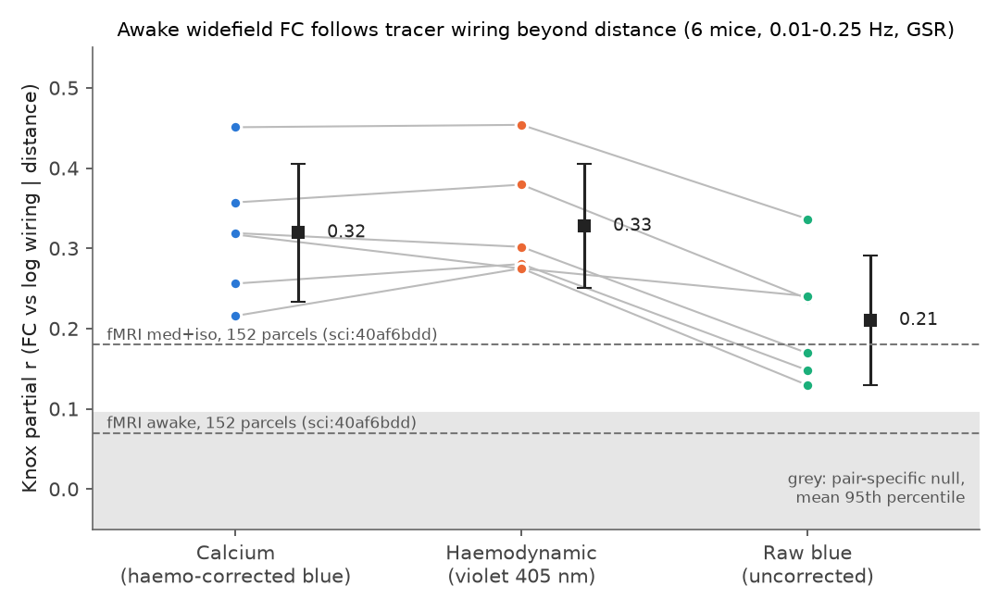
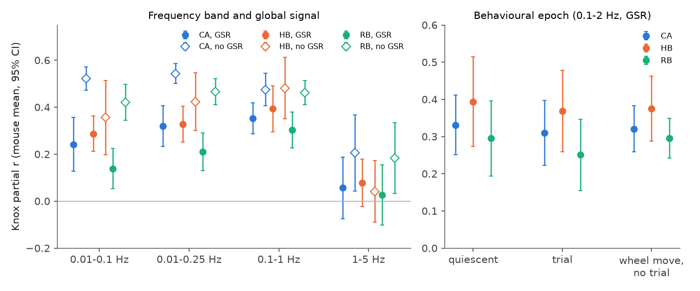
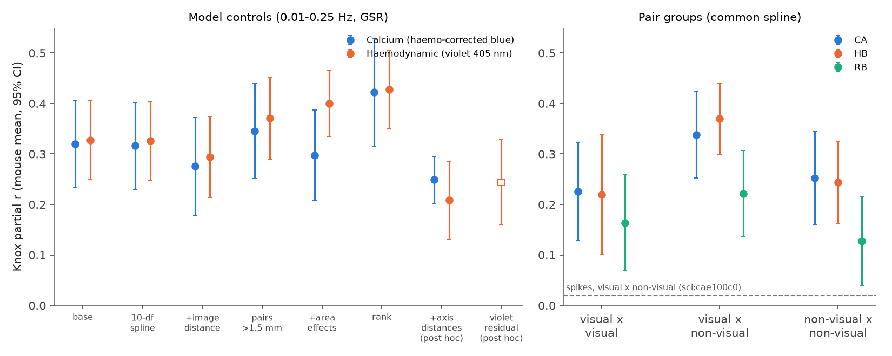

# In 6 awake task mice, widefield calcium FC follows Allen tracer wiring beyond distance, and the haemodynamic signal of the same frames follows it equally

## Summary

**Question.** In mouse fMRI, the Allen tracer connectome (Knox et al. 2019) predicts cortical functional
connectivity (FC) beyond distance under medetomidine with isoflurane (Knox partial r 0.18), but much less in awake
mice (0.07; sci:40af6bdd). Is this awake loss a property of awake neural activity? Or does it come from the
measurement (BOLD signal, awake scanning)? We tested the same metric with widefield imaging of awake mice. These
data have a neural (GCaMP calcium) signal and a haemodynamic (violet 405 nm) signal from the same frames.

**Data.** International Brain Laboratory (IBL) widefield sessions, Zador lab, decision task, 15 Hz per channel.
We used the 12 sessions (2 for each of 6 mice) that sci:1f4c1425 selected by a fixed rule. There were 20 to 24
dorsal-cortex areas per hemisphere and 429 to 552 ipsilateral area pairs per session.

**Method.** We wrote the analysis plan (files/code/PLAN.md) before we calculated FC-versus-wiring values. For
each session and signal, FC is the Fisher z of the Pearson correlation of the band-passed area signals. The
Knox partial r is the correlation of FC with log10 Knox wiring after we remove a 5-df spline of 3-D CCF centroid
distance and a hemisphere term from both. This is the metric of sci:40af6bdd. Primary condition: 0.01-0.25 Hz, all
frames, global signal regression (GSR). Statistics: mouse means (6 mice), t 95% CI.

**Main results.**

1. **H1 passed.** Calcium FC followed the wiring beyond distance: Knox partial r 0.32 (95% CI 0.23 to 0.41),
   6/6 mice positive, p = 0.0002. All 12 sessions were above the 95th percentile of a pair-specific null (wiring
   values permuted inside distance bins; null 95th percentile about 0.09; all p <= 0.002). The result stayed
   with additive area effects (0.30, CI 0.21 to 0.39), with image-plane distance (0.28), with a 10-df spline
   (0.32), for pairs farther than 1.5 mm (0.35), with ranks (0.42), and without GSR (0.54).
2. **H2 failed.** The violet haemodynamic signal followed the wiring as much as calcium did: 0.33 (CI 0.25 to 0.40);
   calcium minus violet -0.008 (CI -0.046 to 0.029, p = 0.60, 2/6 mice positive). The violet signal is a delayed,
   inverted copy of the calcium signal (peak cross-correlation -0.39 to -0.57 at +1.0 to +1.5 s in all 12
   sessions), as expected for blood volume. Thus it is a CBV-like haemodynamic signal, not a calcium-free negative
   control. The order of the two signals changed with the model: calcium was higher without GSR (+0.12, p = 0.03)
   and violet was higher with area effects (-0.10, p = 0.006). We see no consistent difference.
3. **H3 failed.** At 0.1-2 Hz with GSR, quiescent and trial epochs gave the same calcium partial r (quiescent minus
   trial +0.021, CI -0.038 to 0.080, p = 0.40). Without GSR (not pre-set as primary), quiescent epochs were higher
   (+0.094, CI 0.036 to 0.153, 6/6 mice).
4. **Band.** The alignment was in slow activity. With GSR it was 0.24 at 0.01-0.1 Hz, 0.32 at 0.01-0.25 Hz, 0.35
   at 0.1-1 Hz and 0.06 (CI -0.08 to 0.19) at 1-5 Hz.
5. **Uncorrected blue was weaker.** The raw blue signal (calcium plus haemodynamics, before correction) gave 0.21
   (CI 0.13 to 0.29), lower than calcium in 6/6 mice (-0.11, p = 0.0001). Calcium and haemodynamic components have
   opposite sign, so their mix partly cancels.
6. **Visual x non-visual pairs (secondary).** The calcium alignment was present in all three pair groups: visual x
   visual 0.23, visual x non-visual 0.34, non-visual x non-visual 0.25 (all 6/6 mice). In spike correlations,
   sci:cae100c0 found no effect for visual x non-visual pairs (0.02). Widefield FC does not repeat that exception.

**Conclusion.** In awake, task-performing mice, cortex-wide calcium FC follows the tracer connectome beyond distance,
in every mouse and session. A CBV-like haemodynamic signal from the same frames follows it equally. Thus, in these
data, neither awake neural activity nor awake haemodynamics in general removes the connectome alignment. The
weak awake alignment in fMRI (sci:40af6bdd) is therefore more likely to come from other factors (BOLD contrast,
scanner conditions, motion, parcel scale, or the 6 fMRI mice) than from the awake state itself. We did not test
these factors directly, and our parcel scale differs from the fMRI study (see Limitations).

## Prior work in the campaign and what is new

- sci:40af6bdd: fMRI Knox partial r 0.18 (med+iso), 0.04 (isoflurane), 0.07 (awake). New: the same metric with
  a direct neural signal in awake mice, and a haemodynamic signal of the same frames.
- sci:cae100c0: tracer strength predicts spontaneous spike correlations beyond distance, not for visual x
  non-visual pairs. New: widefield FC in different mice shows the alignment in all pair groups.
- sci:68f4f3d6 and sci:fe1e4c15: mouse wiring is mostly node-level, and geometry-only FC can look like wiring.
  New: the alignment stays after additive area effects, image-plane distance, and (post hoc) separate axis
  distances. We did not use the node-similarity (matrix completion) model of sci:68f4f3d6.
- sci:1f4c1425: in the same 12 sessions, activity lags did not follow hierarchy or projection asymmetry. New: the
  zero-lag FC of the same data follows the symmetric wiring strength. We reuse its atlas code and session list.
- sci:820618fe and sci:193d9a56: related tracer-FC and task-state tests in fMRI and IBL spikes.

## Data

- IBL widefield (CC BY 4.0), 12 sessions, list in files/code/sessions_confirm.csv. Shared store paths:
  datasets/ibl-widefield-<subject>-<date>-u-images, -svt-haemo, and (added by this job) -svt-uncorrected.
  SHA-256, sizes and source URLs: files/provenance/shared_datasets_sha256.txt. Small session files (landmarks,
  imaging times, light source, trials, wheel moves): files/provenance/ibl_session_small_files_sha256.txt.
- Knox et al. 2019 normalized connection density, Allen CCF v3 100 um annotation and structure graph (campaign
  store; hashes in files/provenance/).
- wfield dorsal-cortex reference (commit 6bb958bf), hashes in files/provenance/reference_files_sha256.txt.
- External terms: files/NOTICE-external-data.md.

## Methods

- **Areas.** Allen dorsal-cortex map warped to each session with the IBL landmark similarity transform, masks eroded
  by 3 pixels; MOB, FRP, ACAd, PL, RSPv, AUDv, VISli, VISpl and areas under 200 pixels excluded (same as
  sci:1f4c1425). Area signal = mean of U over area pixels times the SVT.
- **Signals.** CA: haemodynamic-corrected blue (GCaMP). HB: violet frames of the uncorrected SVT. RB: blue frames
  of the uncorrected SVT. All have about 63,000 to 99,000 frames per channel (70 to 110 min).
- **Filtering and FC.** 2nd-order Butterworth zero-phase band-pass. GSR: regression of the mean area signal.
  FC = arctanh of the Pearson r over the selected frames.
- **Epochs (0.1-2 Hz).** trial: stimulus onset - 0.2 s to feedback + 1 s. Wheel move: wheel-move intervals
  -0.5 s to +1 s. quiescent: neither (5,259 to 27,496 frames per session). moveonly: wheel move and not trial.
- **Structure.** log10 of the mean of the two directions of the Knox ipsilateral density. Distance: Euclidean
  distance between 3-D centroids of each area in one CCF hemisphere. Pairs: ipsilateral pairs in each hemisphere;
  both hemispheres use the same wiring and distance values.
- **Metric.** Residuals of FC and of log wiring after OLS on [intercept, natural cubic regression spline of
  distance (5 df, patsy cr), hemisphere]; Knox partial r = Pearson r of the two residuals.
- **Null.** 1,000 permutations of the wiring value of each unique area pair inside 5 distance-quantile bins (the
  same permuted value in both hemispheres).
- **Variants.** 10-df spline; added spline of image-plane centroid distance; pairs > 1.5 mm (refit); added
  additive area effects (one dummy per area and hemisphere); ranks; no GSR; split-half reliability.
- **Post hoc (after the pre-set tests).** (a) Splines of |dAP|, |dDV| and |dML| added. (b) Violet signal minus its
  least-squares FIR prediction from the calcium signal of the same area (lags -1 to +4 s). (c) Similarity of the
  distance-residual FC patterns of calcium and violet.
- **Note on blinding.** The plan was written first. While we tested the code, we saw the values of one session
  (CSK-im-001 2021-01-21). We did not change the plan after that.

## Results

Figure 1. Knox partial r per mouse (dots; lines join the same mouse) for the three signals, primary condition.
Black squares: mouse mean and 95% CI. Grey band: mean 95th percentile of the pair-specific null. Dashed lines: the
published fMRI values of sci:40af6bdd, for orientation only (different parcels and coverage).

Figure 2. Distance-residual FC against distance-residual log wiring, all 12 sessions pooled (dots: pairs; black:
deciles, mean and SEM). Left: calcium. Right: violet.

Figure 3. Left: Knox partial r by band, with (filled) and without (open) GSR. Right: behavioural epochs at 0.1-2 Hz
with GSR. Mouse means and 95% CIs.

Figure 4. Left: model variants for calcium and violet (primary condition); the last two are post hoc. Right: pair
groups with the common spline; the dashed line is the spike result for visual x non-visual pairs (sci:cae100c0).

Figure 5. Mean cross-correlation of calcium and violet signals of the same area, one line per session.

### Pre-set tests (files/results/preset_tests.csv)

| Test | Value (6 mice) | 95% CI | p | mice | Pass |
| --- | --- | --- | --- | --- | --- |
| H1 calcium partial r > 0 | 0.319 | 0.233 to 0.405 | 0.0002 | 6/6; 12/12 sessions > null | yes |
| H2 calcium minus violet > 0 | -0.008 | -0.046 to 0.029 | 0.60 | 2/6 | no |
| H3 quiescent minus trial (calcium, 0.1-2 Hz, GSR) | +0.021 | -0.038 to 0.080 | 0.40 | 4/6 | no (two-sided) |

### Main conditions, calcium (files/results/main_table.csv, summary_all.csv)

| Condition | Partial r | + area effects | distance fit R | split-half reliability |
| --- | --- | --- | --- | --- |
| 0.01-0.25 Hz, GSR (primary) | 0.32 (0.23, 0.41) | 0.30 (0.21, 0.39) | 0.69 | 0.96 |
| 0.01-0.25 Hz, no GSR | 0.54 (0.50, 0.59) | 0.27 (0.20, 0.33) | 0.66 | 0.94 |
| 0.01-0.1 Hz, GSR | 0.24 (0.13, 0.36) | 0.21 (0.08, 0.34) | 0.69 | - |
| 0.1-1 Hz, GSR | 0.35 (0.29, 0.42) | 0.34 (0.27, 0.40) | 0.70 | - |
| 1-5 Hz, GSR | 0.06 (-0.08, 0.19) | 0.09 (-0.11, 0.28) | 0.72 | - |

Violet (primary): 0.33 (0.25, 0.40); with area effects 0.40 (0.34, 0.47). Raw blue (primary): 0.21 (0.13, 0.29).

### Post hoc results (files/results/extra_sessions.csv)

- With separate axis distances: calcium 0.25 (6/6, p < 0.001), violet 0.21 (6/6, p = 0.001); calcium minus violet
  +0.04 (p = 0.03). This model takes more from the violet value than from the calcium value.
- The calcium FIR model explained 23-36% of the violet variance (mouse means). The violet residual still gave
  partial r 0.24 (6/6, p = 0.0007). Thus much of the wiring-aligned haemodynamic FC is not a simple linear copy of
  the local GCaMP signal. Possible causes: activity that the GCaMP line does not report (for example deep layers or
  interneurons), non-linear neurovascular coupling, or vascular anatomy that is correlated with wiring.
- Distance-residual FC patterns of calcium and violet were similar (r 0.55 to 0.89, mean 0.76).

## Interpretation

- In awake, task-performing mice, the direct tracer wiring between dorsal cortical areas predicts their slow
  calcium co-fluctuations beyond distance. The effect is in every mouse and session, and it is above a
  pair-specific null by a factor of about 3.
- The haemodynamic signal shows the same alignment. If awake haemodynamic FC in general lost the wiring alignment,
  we would expect a lower violet value. We did not see this.
- The alignment is in slow activity (< 1 Hz). This is the band of fMRI. Faster calcium FC (1-5 Hz) with GSR did not
  show a clear alignment.

## Limitations

- **Different scale from the fMRI study.** We used 20-24 coarse dorsal areas per hemisphere; sci:40af6bdd used 152
  parcels per hemisphere over all isocortex. Partial r values depend on scale and coverage. Thus our values cannot
  be compared directly with the fMRI numbers. A direct test needs fMRI parcels that match these areas, or awake
  and anaesthetised widefield data from the same mice. We did not have either.
- **No anaesthetised widefield data.** We cannot say whether anaesthesia would increase the widefield alignment.
- **Violet is not a pure haemodynamic signal.** 405 nm reflectance mostly follows blood volume, but it can include
  autofluorescence, a small calcium-dependent GCaMP part, and movement artefacts. It is also not BOLD.
- **Geometry.** The wiring model (Knox) is spatially smooth, and widefield signals blur across the surface. We
  controlled 3-D distance, image-plane distance, area effects and (post hoc) axis distances, but other geometric
  structure can remain.
- **Six mice, one lab, one task, one GCaMP line.** The mouse-level tests have 5 degrees of freedom.
- **The wiring is from other mice** (Allen tracer injections, model).
- **Task context.** All data are from the decision task. Quiescent epochs are short (5,259 to 27,496 frames).
- **Uncorrected blue.** The haemodynamic correction is from IBL; we did not test other correction methods.

## Open questions for later work

- Compare awake and anaesthetised widefield FC in the same mice with this metric.
- Recompute the fMRI value of sci:40af6bdd on the same dorsal areas (needs the Grandjean 2020 parcel data again).
- Find why the haemodynamic residual (not explained by local calcium) follows the wiring: test vascular maps, and
  test mouse lines with deep-layer or interneuron GCaMP.
- Test the node-similarity model of sci:68f4f3d6 on these widefield FC matrices (files/results/fc/).

## Reproduction

From a checkout with the campaign `datasets/` link, run from the repository root:

1. `bash files/code/fetch_refs.sh` (wfield reference; writes to work/raw). Copy the code to work/code first, or
   adjust the paths: all scripts use paths relative to the repository root (work/code, work/raw, work/out).
2. For each session in sessions_confirm.csv: `BIGPAT="NOBIGFILES|" bash work/code/fetch_session.sh
   zadorlab/Subjects/<subject>/<date>/001 work/raw/wf/<subject>_<date>` (small files, about 10 MB per session).
3. U, haemo-corrected SVT and uncorrected SVT: use the shared store, or `bash work/code/fetch_uncorrected.sh`
   (adds the uncorrected SVTs through campaign-dataset). The U and haemo SVT are fetched by the script of
   sci:1f4c1425 (fetch_all.sh in that bundle) or directly from the S3 keys in files/provenance/.
4. `bash work/code/run_all.sh` (structure, extraction, FC metrics, lag check; about 1 min per session on 2 CPUs),
   then `bash work/code/run_extra.sh` (post hoc analyses and statistics), then `python work/code/figures.py`.
   Outputs go to work/out (scratch), never into the publication folder.

The files/results/fc/*.npz files hold the per-session FC matrices for all signals, bands, GSR settings and epochs
(keys `<signal>_<band>_<gsr|raw>_<epoch>`, area order in `names`).

## Provenance

- Job: sci-1107-hp-neural-structure-and-computation-8bb1596bf35c; campaign 11_07_2026; topic
  neural-structure-and-computation; machine hp; model claude-opus-5-5 (Claude Code). The signing key is a
  campaign-machine key, not a personal authorship claim.
- Software: files/provenance/environment.txt. Run date 2026-11-12.
