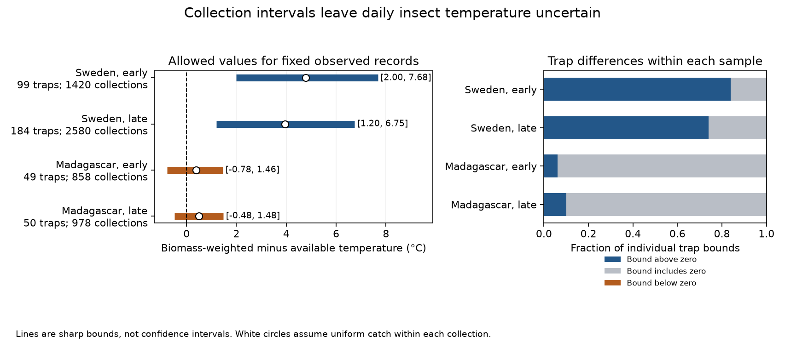
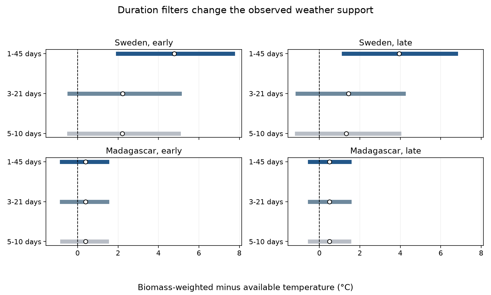

# Insect catch was linked to warmer days in two Swedish samples under fixed daily weather and 1-45 day windows in 2019

## Question and result

Can collection totals show that insect mass was caught on warmer days than the days available to the trap, even when the day of capture is unknown? We apply bounds to measured insect catches and daily site weather in Sweden and Madagascar. We hold the supplied daily temperatures fixed. We permit any nonnegative daily mass allocation that preserves each collection total.

For two Swedish periods in 2019, the mean temperature contrast is positive for every permitted allocation. The bounds are +2.00 to +7.68 C in the early period and +1.20 to +6.75 C in the late period. The two Madagascar bounds in 2019-2020 include zero. These are bounds for selected records, not confidence intervals. The Swedish result depends on weather coverage: a 3-21 day collection filter gives bounds across zero in both periods.



| Country | Period | Traps | Collections | Lower bound, C | Uniform allocation, C | Upper bound, C | Individual trap bounds above zero |
|---|---|---:|---:|---:|---:|---:|---:|
| Sweden | Early | 99 | 1,420 | 2.00 | 4.78 | 7.68 | 83 of 99 |
| Sweden | Late | 184 | 2,580 | 1.20 | 3.94 | 6.75 | 136 of 184 |
| Madagascar | Early | 49 | 858 | -0.78 | 0.39 | 1.46 | 3 of 49 |
| Madagascar | Late | 50 | 978 | -0.48 | 0.50 | 1.48 | 5 of 50 |

The contrast is the mean daily temperature linked to captured mass minus the mean temperature available over the same observed trap days. Each trap has equal weight. A positive contrast describes a warm association in the catch. It does not establish that warming increases insect abundance. The Madagascar result leaves the sign unresolved; it does not establish absence of an association.

## Prior work and contribution

[Van Dijk and colleagues](https://doi.org/10.1098/rspb.2024.0090) studied the spatial and seasonal distribution of biomass in these networks. [Welti and colleagues](https://doi.org/10.1111/icad.12555) studied weather and insect biomass in Germany and used uniform daily allocation to divide collections across months. That assumption is useful but is not a daily observation. Our question is what collection totals establish without it.

We searched the campaign before precise question selection. The initial search was `climate pollution biodiversity phenology`. A focused search was `insect biomass Sweden Madagascar`. Further searches used `insect capture temperature bounds`, `insect thermal`, and `insect temperature bounds`. These searches are not an exhaustive novelty review.

We read the published [collection-duration test](sci:sha256:33081dacfdd7e6835872f82ebee425fee5f193895dbd6f75b0b86881c48b98d2). Its data rules informed our source checks. We also read the [visit-bracket study](sci:sha256:006c74222e580233abebb7511aaa354e95e18449377a656b7c828aeccabe16d0), which bounds a flowering regression with uncertain dates. Here, daily insect mass is unknown, collection totals are fixed, and the target is a mean temperature contrast. We reuse no code or derived panel from these publications. The insect source records overlap prior campaign studies. This is a new analysis of existing field data, not a new field replication or a new general theorem.

Files/plan.md was saved before the bound calculations. The study is exploratory and was not registered. The primary groups and duration checks were set in that plan. The matched-trap explanation of the duration result was added after inspection of the primary results and is marked below.

## Data and selection

We read five existing shared files in place: two sample CSV files, two daily temperature CSV files and the source metadata workbook. They come from [Zenodo record 11205860](https://zenodo.org/records/11205860), v1, 16 May 2024, a mirror of [Dryad DOI 10.5061/dryad.ghx3ffbtk](https://doi.org/10.5061/dryad.ghx3ffbtk). Files/provenance.json gives exact shared paths, resolved paths, source URLs, byte counts and SHA-256 hashes. Every source hash matches its dataset helper record. No new shared data were downloaded or changed.

The source has 4,737 Swedish rows and 1,861 Madagascar rows. Swedish rows without sample IDs are inserted snow-season zeros, not measured catches. We exclude all 276 such rows. We also exclude 15 negative Swedish masses, two Swedish durations outside 1-45 days, and one Swedish trap collection without complete weather. The remaining candidate counts are 4,443 and 1,861. There are no measured zero masses in these retained data.

We remove all 18 Madagascar collections that overlap another candidate collection at the same trap. Sweden has no such overlaps. Placement day in Sweden is twice the reported midpoint minus collection day. These values are integers. The same calculation agrees with the explicit Madagascar placement and calendar dates.

Primary daily support runs from the day after placement through collection day. The weather target uses these calendar days. It does not resolve actual hours. The duration filter uses the recorded elapsed minutes divided by 1,440. The median absolute difference between calendar day count and recorded duration is 0.067 days; the maximum is 0.992 days. Alternative endpoint rules test this convention.

Each country is divided at midpoint day 183 of its own survey. Day 1 is 1 January 2019 in Sweden and 1 August 2019 in Madagascar. Early means midpoint at or before day 183; late means a later midpoint. A window can cross this boundary, but the two groups share no collection records. Retained midpoints span 18.5-345 in Sweden and 10.5-368 in Madagascar. The latter survey extends slightly beyond one year.

A trap-period must have at least six valid collections, at least 60 supported days, and positive total mass. This leaves 5,836 collections in 382 trap-periods. The periods share 99 Swedish traps and 49 Madagascar traps. The countries have separate networks. These are separate time samples with recurring traps, not independent years. No missing interval is filled. Available temperature refers only to observed and retained windows, not a complete year.

## Target, assumptions and proof

For each trap-period, let M be total mass. For collection i, let m_i be its mass and let T_i contain its supported daily temperatures. Let A be the mean temperature over all supported days. The bounds for the temperature contrast are:

```text
lower = sum(m_i * min(T_i)) / M - A
upper = sum(m_i * max(T_i)) / M - A
```

The lower endpoint is attained by putting all collection mass on a coldest day in each window. A warmest-day allocation attains the upper endpoint. Mixtures attain all values between them. The mean endpoints across equally weighted traps are therefore also sharp. Files/proof.md gives the argument and its assumptions. The daily allocations are mathematical possibilities under these constraints; they are not inferred capture histories.

Uniform daily mass within each window gives the white circles in the figure. It is a descriptive value inside each bound. It is not identified by the collection totals. The mean bound widths are 5.68 and 5.54 C in Sweden and 2.24 and 1.96 C in Madagascar.

The source daily mean temperature is an exposure label, not an insect body temperature or capture-hour temperature. We assume that mass measurements and window dates are valid and that each mass can be treated as a sum of capture contributions within its window. Weather errors, preservation effects and unrecorded trap failures are outside the bounds. We impose no daily capture-capacity limit.

## Duration and observation support



With 3-21 day collections, Swedish bounds are -0.41 to +5.04 C early and -1.09 to +4.17 C late. With 5-10 day collections, they are -0.42 to +4.99 C and -1.12 to +3.95 C. All four include zero. The corresponding Madagascar bounds also include zero. A duration filter changes the weather and mass being studied; it is not a correction of a fixed target.

We made a post-result support check on traps eligible with both 1-45 and 3-21 day windows. Long windows, over 21 days, account for a mean 32.7% of observed days but 5.7% of mass early in Sweden. The late values are 30.6% and 8.0%. These are means of trap-specific shares. Removing long windows raises the available-temperature mean from 8.38 to 11.55 C early and from 10.72 to 14.10 C late. The uniform-allocation capture means rise only from 13.16 to 13.78 C and from 14.68 to 15.54 C. The late comparison uses 183 common traps. Files/support_diagnostics.csv gives the calculation.

This supports a coverage explanation for much of the duration sensitivity. Long intervals contain relatively little mass and include colder weather. It does not establish why catches were low or why collection schedules changed. Madagascar has no windows over 21 days in this analysis.

## Other checks and uncertainty

Using common traps in both periods gives Swedish lower bounds of +2.00 and +1.65 C. Forest-only samples give +2.13 and +1.21 C. Including placement day gives +1.35 and +0.70 C. Shifting support one day earlier gives +1.78 and +1.03 C. Each of these Swedish sample bounds remains positive. The Madagascar bounds include zero in every planned variant. Inclusion of overlapping windows as separate day occurrences has little effect there, but changes the available-day target.

The whole-survey bound is +1.05 to +6.80 C for 185 Swedish traps and -0.51 to +1.60 C for 50 Madagascar traps. The whole-survey coverage rule permits some traps that fail a separate period rule. It is not an average of the two period bounds.

Files/aggregate_results.csv gives all 34 group summaries and 2,000 trap-bootstrap endpoint and point ranges with seed 20261109. The bootstrap holds daily weather fixed and resamples traps. It is only a check of sensitivity to the observed trap mix. Spatial dependence, selected locations and shared weather prevent a claim of regional coverage. No p values or multiple-test claims are made. The bounds themselves do not require independent traps or a fitted weather response model.

Four independent linear programs on real eligible trap-periods give the same extreme objectives as the formulas. The largest objective error is zero at the saved precision. A separate check of 121 synthetic linear programs includes zero mass and one-day windows. Eleven mixtures verify intermediate allocations. An independent aggregation from the scratch record panel matches primary endpoints and uniform values to 1.2e-15 C. Files/checks.json and files/independent_checks.json save the checks. They do not validate the field measurements.

## Limits and use

Captured mass combines local abundance, body mass, flight activity, capture and preservation. These records do not separate those processes. Seasonal emergence, habitat, rainfall and other factors can create the warm association. We estimate no causal temperature effect, climate trend, pollution effect, species richness change or species distribution shift.

The sample has one survey year per country. Sweden covers several habitats; Madagascar sites are forests. Missing winter collections, selected processing, excluded negative masses, weather grid error and the duration screen limit generalization. Shared traps and common protocols limit temporal independence. The countries cover different months and climates. No common mechanism across countries is established.

The useful result is a reproducible diagnostic: report an attainable interval for a daily exposure linked to collected mass, then show how collection filters change available weather. Uniform allocation alone can give a positive value even when the records allow either sign. Finer collection intervals can reduce allocation uncertainty, but removing long intervals can also remove a distinct season.

## Reproduction and external rights

Use Python 3.12, numpy, pandas, scipy and matplotlib. Files/environment.json records versions. With the original shared store:

```sh
python /path/to/result/files/analyze.py --datasets /absolute/path/to/datasets --out /absolute/path/to/new-scratch
python /path/to/result/files/validate.py --external-panel /absolute/path/to/new-scratch/record_panel_external.csv
```

Without that store, retrieve exact inputs into separate local scratch first:

```sh
python /path/to/result/files/retrieve.py --scratch /absolute/path/to/new-inputs
python /path/to/result/files/analyze.py --datasets /absolute/path/to/new-inputs --out /absolute/path/to/new-scratch
```

The scripts check exact input hashes and refuse analysis or retrieval output inside the publication. Retrieval never overwrites an existing source file. The tested existing-file retrieval path and complete analysis were checked in local scratch. Future source availability is not guaranteed. Files/validate.py can check saved aggregates and synthetic examples without external data.

Raw sources and record-level derivatives stay outside this bundle. Included material consists of our code, text, proof, figures, provenance and aggregate outputs. The source record reports CC0. Credit and external weather terms are given in files/EXTERNAL_DATA.md. The exact SCI baseline LICENSE applies to bundled work; it does not replace external licenses.

Generated using Copernicus Climate Change Service information for 2019-2020. Contains modified Copernicus Climate Change Service information, 2026. Neither the European Commission nor ECMWF is responsible for any use that may be made of the Copernicus information or data it contains.

## Job provenance

Job: sci-1107-hp-climate-pollution-biodiversity-d0e97288b19e. Topic: climate-pollution-biodiversity. Campaign: 11_07_2026. Machine: hp. Account: codex-andrii. Model: gpt-6.1-sol with high reasoning effort through the Codex harness in T3 Code. Analysis date: 9 November 2026. Work was done in the assigned isolated worktree. No child agents were used. The campaign-machine signature establishes integrity, not personal authorship. No private key is included.
