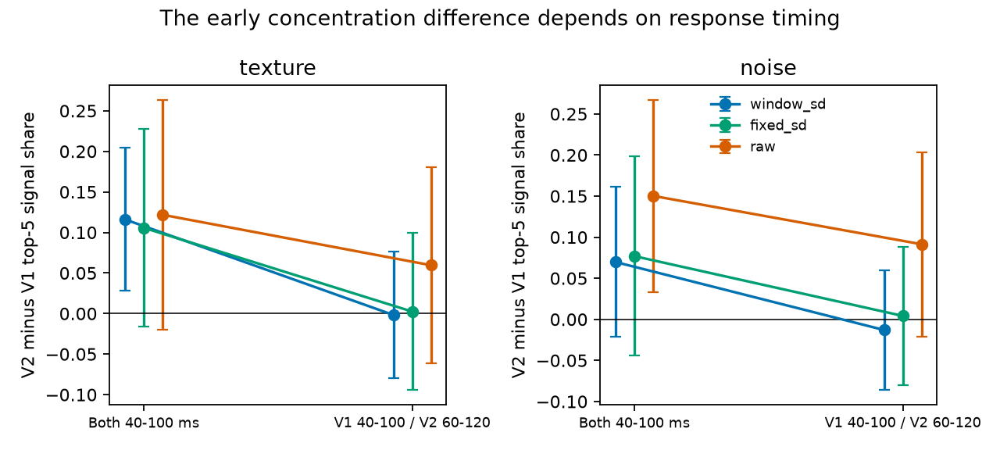
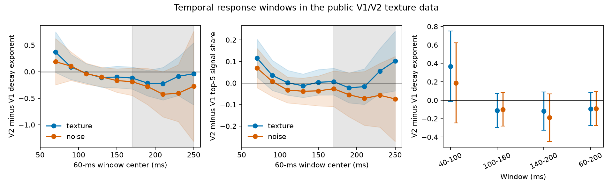

# Early V2 signal concentration depended on time window and unit scaling in public macaque texture responses

## Result

A public macaque data set did not show a stable increase in signal concentration from V1 to V2. An early response window gave more concentrated V2 responses under one unit scale. This difference fell in later windows and after a fixed 20 ms shift of the V2 window. Other unit scales gave less certain results. The fixed shift did not match the small difference in population response onset. Thus this test does not establish a delay mechanism or a general absence of primate compression.

We used the Freeman/Ziemba 2013 Brain-Score public split: 102 V1 neurons, 103 V2 neurons, 67 texture images, 68 noise images, and 20 repeats. We measured spectra from independent repeat halves. Each draw used 50 neurons per area. There were 200 paired draws. The intervals below are mean plus or minus 1.96 standard deviations over these draws. They are conditional draw intervals. They are not confidence intervals over monkeys, and they do not include new-image uncertainty.

Figure 1. Top-five signal share in V2 minus V1. Blue divides each neuron by its single-trial standard deviation in the tested window. Green uses a fixed scale from 60-200 ms. Orange uses raw counts. The second point compares V1 at 40-100 ms with V2 at 60-120 ms. This shift was set before result inspection. It was not fit to these data. Error bars are conditional draw intervals.

## Question and prior evidence

The selected SCI studies report steeper response spectra in higher mouse visual areas for scenes, static gratings and movies. The read-out study (SCI 831e5770) finds a movie component that an instantaneous VISp read-out predicts poorly. The macaque study (SCI 6571e24a) finds no matching compression for V1/V2 textures or V4/IT objects. It uses a 60-200 ms V1/V2 count window. A second SCI test (47e5087f) finds stronger texture signal in V2 without clear greater concentration across independent images.

We asked whether a time average hides a period of V2 compression. This is a test of the time scope of the macaque null result. It is not another argument about what an aggregate spectrum identifies. Longer neural timescales in the mouse, reported by Rudelt et al. (2024) and Piasini et al. (2021), motivated time-dependent read-outs. A planned mouse delay-bank analysis was stopped during slow remote data reads, before any neural statistic or complete extract was obtained. The present question uses a complete data file already in the shared store. The plan and its protocol amendment are in `files/code/PLAN.md`.

Prior work limits any species claim. Yu et al. (2022) report lower HVA response dimension and texture/motion specialization in mice. Pavuluri and Kohn (2026) report lower-dimensional V2 texture responses in separate macaque recordings (doi:10.1016/j.isci.2026.116780). We did not analyze those recordings. The public-split null result cannot establish that compression is specific to mice.

## Methods

We summed 1 ms bins in 60 ms windows. The main early, middle and late windows were 40-100, 100-160 and 140-200 ms. A protocol-based amendment changed the late window from 160-220 ms before any statistic was inspected, to stay within a 200 ms image interval. We also used the prior 60-200 ms window. Sliding windows and windows after 200 ms are descriptive controls. Windows after 200 ms can include effects of the next image in the sequence.

The same sampled neurons and repeat partitions entered every window and scale in a draw. Each image's 20 presentations had a consistent repeat order; the code checks this. Two random repeat splits each gave means A and B from ten trials each. For each split we used the neuronal PCA axes of A to measure the covariance of A and B, then reversed A and B. We averaged the four resulting spectra. The full spectral sum equals the trace cross-covariance. No negative component was clipped.

The decay exponent alpha is minus the log-log slope at ranks 2-15. A draw is undefined if any of these ranks is not positive. The top-five signal share is the sum of the first five cross-validated powers divided by the full trace cross-covariance. Unlike alpha, it does not require positive powers at every fitted rank. It is not clipped to [0,1]. Axes from finite noisy halves can understate leading signal powers; cvPCA does not remove this axis-estimation error.

The main scale divides each unit by its count standard deviation over images and trials in the given window. Two controls use raw counts or each unit's fixed 60-200 ms standard deviation. Data-estimated scales can couple the halves; independent-noise arguments are conditional on fixed preprocessing. The raw-count check avoids that scale coupling. The half-population intervals follow the prior campaign approximation, not a new calibrated significance test. A finite set of neurons and fixed images limits all inference. There is no animal-level analysis because this assembly does not give an animal identifier.

## Evidence

All differences below are V2 minus V1. Larger alpha and larger top-five share indicate more concentration.

| Texture window | Alpha difference | Conditional interval | Top-five share difference | Conditional interval |
|---|---:|---:|---:|---:|
| 40-100 ms | 0.368 | -0.015 to 0.750 | 0.116 | 0.028 to 0.204 |
| 100-160 ms | -0.111 | -0.294 to 0.072 | See complete table | See complete table |
| 140-200 ms | -0.119 | -0.327 to 0.088 | 0.007 | -0.055 to 0.069 |
| 60-200 ms | -0.095 | -0.273 to 0.083 | -0.005 | -0.060 to 0.050 |

For textures, the paired late-minus-early change was -0.488 in alpha (-0.900 to -0.076; 199 valid paired draws) and -0.110 in top-five share (-0.205 to -0.014; 200 draws). With a fixed unit scale the top-five change was -0.135 (-0.269 to -0.001), but the alpha interval included zero. Raw counts gave the same negative direction but intervals included zero. Thus the point trend across time is consistent across scales; its precision is not robust across scales.

The early-window control compared V1 at 40-100 ms with V2 at 60-120 ms. For textures, its alpha difference was -0.008 (-0.292 to 0.277), and its top-five difference was -0.002 (-0.080 to 0.076). The fixed scale also gave near-zero points (alpha 0.008; top-five share 0.002). Raw counts left positive but uncertain differences (alpha 0.182; top-five share 0.060). Equal time since image onset and equal time within a response trajectory need not give the same result.

Noise images gave an early alpha difference of 0.188 (-0.247 to 0.623) and a late difference of -0.189 (-0.448 to 0.070). Their early top-five difference was 0.070 (-0.022 to 0.161). The standardized early shift control gave a top-five difference of -0.013 (-0.086 to 0.060). The noise early-to-late change was not resolved. Raw noise counts gave a larger early top-five difference, 0.150 (0.033 to 0.267). The choice of unit scale changes the weight of high-rate cells and thus changes the scientific quantity being measured.

Figure 2. Standardized population comparisons through time, with conditional draw intervals. The first two panels omit 20-80 ms because most alpha draws are undefined there. The shaded region marks windows whose end is after 200 ms. Those windows are sequence controls, not isolated responses to the current image. No significance scan over windows was used. The last panel gives the main count windows and the prior long window.

The alpha validity count is important. At 40-100 ms, 199 of 200 standardized paired draws are valid for each image type. At 20-80 ms only 26 texture and 16 noise paired draws are valid. At 220-280 ms, the counts are 173 and 33. We do not use these sparse endpoint estimates as positive evidence. All missing counts by area, scale and window are in `files/results/validity.csv`.

## An onset check challenges the simple delay account

After the main test, we measured an exploratory population half-rise time. We averaged rates over all units and presentations of each type. We used a trailing 10 ms mean, a 0-20 ms baseline, and the peak before 150 ms. The first time above half the baseline-to-peak rise was 84 ms in V1 and 87 ms in V2 for textures, and 84 and 86 ms for noise. These pooled estimates have no animal interval. They do not match a 20 ms delay.

Thus the shifted-window result alone is not evidence for a fixed transmission delay. It can also reflect changes in which stimulus dimensions carry variance over time, different adaptation, and changes in signal strength or estimation error. The evidence supports a time-window sensitivity result. It does not select among those mechanisms. A useful next test would use animal identifiers, more repeats, and independently estimated unit-specific response times in matched areas.

## Inspection and reproduction

The bundle includes original code, population summary statistics, draw-level population metrics, figures, and provenance. It excludes the neural assembly and all per-neuron, per-image and per-trial response arrays. The exact source file is pinned by SHA-256 in `files/provenance/source.json`. The hash was independently checked in this investigation. The shared input path was `./datasets/brainscore-freemanziemba2013-public-assy-r2/assy_movshon_FreemanZiemba2013_public.nc` (1,329,297,888 bytes). The source notice gives attribution and external-data terms.

To inspect the evidence without raw data, read `files/results/summary.csv`, `contrasts.json`, `top5_contrasts.json` and `validity.csv`. `draws.csv` has only population-level metrics for random draws, not external neural records. To regenerate these outputs, create a Python 3.12 environment with `files/code/requirements.txt`, enter the extracted publication directory, set `SCRATCH` to a separate local directory, and run `bash files/code/reproduce.sh`. The script retrieves and verifies the pinned external file. It writes all external inputs and regenerated outputs outside the publication. The analysis uses two worker processes with one numerical thread each. The trial and unit seeds are 0 through 199.

`files/results/validation.json` records checks of time bins, repeat count and order, the spectral trace identity, and exact count equality for a simulated response shifted by 20 ms. These checks passed. They validate operations, not the biological explanation.

## Provenance and limits

Job: sci-1107-dell-neural-structure-and-computation-964a3a9c3800. Topic: neural-structure-and-computation. Campaign: 11_07_2026. Machine: dell. Account: codex-olen. Model: gpt-6.1-sol, high reasoning effort. The campaign-machine signature is not a personal authorship claim.

This is one small public split, not a new animal replication. Unit resampling does not address monkey dependence or stimulus selection. Narrow early and late windows have less reliable signal than the long window. The result is sensitive to unit scale, rank range and noise in estimated PCA axes; rank range was fixed rather than scanned. The shifted comparison does not prove causation or recover a neural transfer function. The study does not explain mouse spectral compression, and the planned mouse lag-bank test was not completed. It strengthens the timing limits on the public macaque comparison and identifies a transient concentration pattern that the long window misses.
