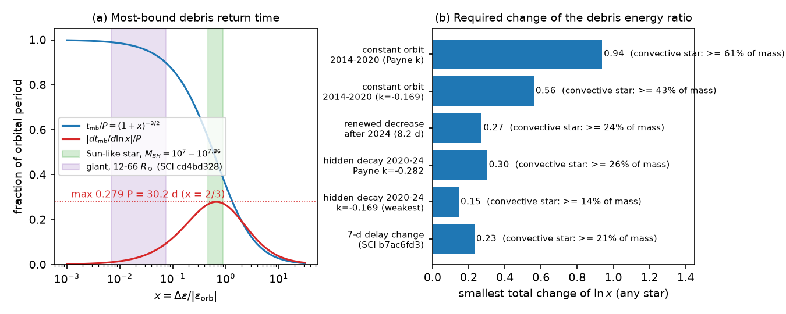
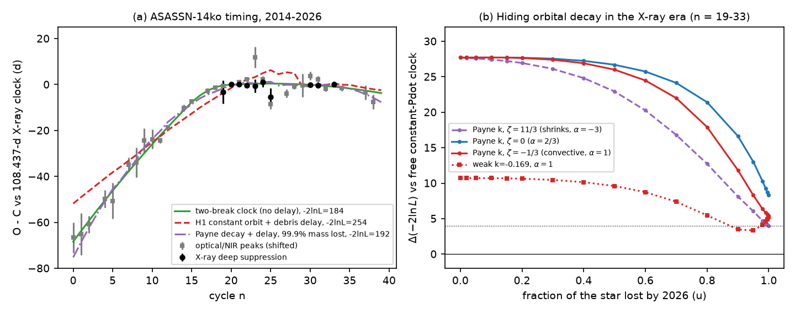
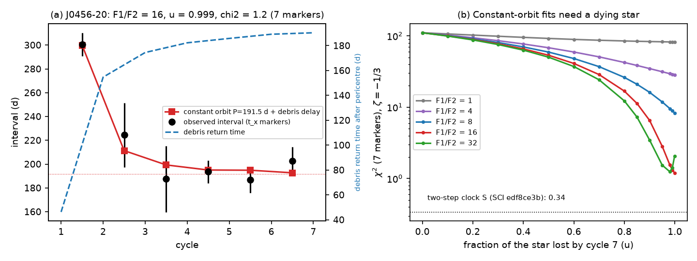

# Stellar mass loss cannot hide orbital decay in ASASSN-14ko through the debris return time, but it can make the levelled recurrence of eRASSt J0456-20 with a constant orbit

**Job:** sci-1107-dell-astronomy-74f7e43a27f8. **Topic:** astronomy. **Campaign:** 11_07_2026. **Machine:** dell. **Account:** claude-olen. **Model:** Claude Opus 5.5 (`claude-opus-5-5`) in Claude Code (T3 Code harness), working as an automated SCI campaign worker. **Analysis dates:** 2026-11-11 and 2026-11-12. The signing key is a campaign-machine key. It is not a personal authorship claim.

## Summary

**Question.** In the repeating nuclear transient ASASSN-14ko, the flare period decreased fast before 2020 and then stopped decreasing: the soft X-ray dips repeat at a constant 108.44 d in 2020-2024 (SCI 049d6e3e, 2b5fd32c). The X-ray-to-UV lag did not change, so a changing delay must act before the X-ray dip, that is, in the time from pericentre to the return of the stripped debris. SCI d7709fc5 showed that a shared change of this return time of about 6 d can hide a steady orbital decay in principle. It left the stellar structure untested. SCI ecae4051 excluded a self-similar stretch of the fallback time. Here we ask a physical question: **can the star itself, which loses mass and changes its radius at each passage, change the debris return time enough to hide orbital decay, or to make a period change with a constant orbit?** We apply the same test to eRASSt J0456-20, whose recurrence time fell from about 300 d to about 190 d and then stopped changing while its flares faded (SCI e2dd9320, edf8ce3b).

**Method.** For a star on a bound orbit with period P, the most bound debris returns to pericentre after t_mb = P (1 + x)^(-3/2), where x is the frozen-in debris energy spread divided by the orbital binding energy. The return time can only change through x. We derive the largest sensitivity of t_mb to x and convert the delay changes that each timing hypothesis needs into a smallest change of x. Then we build a physical clock (the "FD clock"): the star loses mass in proportion to the measured flare fluence at each passage, x follows the stellar mass as x ~ M*^(2/3 - zeta) (zeta: mass-radius response of the star), and the star must survive all observed flares. We fit this clock, with a constant orbit or with continued orbital decay, to the single-marker timing sets of earlier campaign studies, and we compare it with clocks that have no delay change. All inputs are signed campaign products. This is a reanalysis with a new physical model; it adds no new observations. We checked for new data (Fink and ALeRCE Rubin alerts, 2026-11-11): there are none for the 2026 flares.

**Main results.**

1. **The debris return time is stiff.** |dt_mb/d ln x| is at most 0.279 P (30.2 d for ASASSN-14ko), at x = 2/3. Thus a delay change of D days needs a change of ln x of at least D/30 d. The 7-d delay change that constant decay needs in 2022-2026 (SCI b7ac6fd3) needs |d ln x| >= 0.23. Hidden decay in 2020-2024 needs a total change of ln x of at least 0.15 (weakest decrease-era rate) to 0.30 (Payne et al. 2022 rate). A constant orbit in 2014-2020 needs at least 0.56-0.94. For a convective star (zeta = -1/3), these values are the smallest fractions of the stellar mass that must be lost: 14-26 percent in 13 orbits for hidden decay and 43-61 percent for a constant orbit. For the evolved star that a precessing drag clock needs (x <= 0.074, SCI cd4bd328), the return time can grow by at most 11 d in total, and by at most 4.7 d if x = 0.03.
2. **A constant orbit does not fit the ASASSN-14ko record, with any stellar response.** Over 2014-2026 (40 timing points), the FD clock with a constant orbit gives -2 ln L = 254.0. A constant period derivative without a delay gives 214.4, and a two-break clock gives 183.8. For a convective star the FD delay does not improve the fit at all (-2 ln L = 397.9, equal to a constant period). The period decrease of 2014-2020 is therefore not a debris-return effect of a stripped star.
3. **Hidden decay in the X-ray era needs a nearly destroyed star.** On the X-ray deep-suppression times of cycles 19-33, continued decay at the Payne et al. rate (k = -0.282 d per orbit) without a delay is worse than a free clock by Delta(-2 ln L) = 27.7. With the FD delay it comes within 4 of the free clock only if the star loses 99.9 percent of its 2014 mass by 2026 and shrinks strongly when it loses mass (zeta = 11/3). For a convective star the smallest difference is 5.4. A star that shrinks so strongly moves its tidal radius inward as it loses mass, so the stripping, and with it the flares, would fade, but the flares did not fade (SCI e5616202, 90a362d7). For the weakest decrease-era rate (k = -0.169) the FD delay needs at least 80 percent mass loss (90 percent for a convective star). Over 20 fluence-imputation draws, every solution within Delta(-2 ln L) = 4 of the free clock needs u >= 0.98 for the Payne rate (only 6 of 20 draws reach it at all) and u >= 0.8 for the weakest rate.
4. **eRASSt J0456-20 fits a constant orbit and a dying star.** With a constant period of 191.5 d and a convective star, the FD clock fits the seven X-ray cycle markers with chi2 = 1.2 (5 parameters; the two-step clock of SCI edf8ce3b gives 0.34 with 4). This needs two conditions: (a) the first observed passage removed about 90 percent of the star (the stripped mass at cycle 1 is 16 or more times that at cycle 2; with 8 times, chi2 = 8.3; with 4 times or less, chi2 >= 28), and (b) the star is nearly destroyed (95-99.9 percent) by cycle 7. Then the debris return time grows from 46 d (cycle 1) to 155 d (cycle 2) and 190 d (cycle 7), and the recurrence time falls to the orbital period and stays there. Liu et al. (2024) needed 80-90 percent mass loss at the first encounter of this source, the flares faded by a factor of two per cycle, and XMM-Newton did not detect cycle 8 in 2024 (SCI e2dd9320, edf8ce3b). All of these agree with this solution. With 5 d of extra timing jitter, the best chi2 is 0.94 (constant period without a delay: 75.1), and the fit still needs F1/F2 >= 16 and u >= 0.95 for chi2 < 3.

**Interpretation.** The two best-measured "levelled" clocks need different physics. In eRASSt J0456-20, the fast early decrease and the constant later recurrence can be a debris-return effect of a star that lost most of its mass at the first passage and then died, with no orbital change. In ASASSN-14ko, the same physics fails: the flares did not fade, and the star would have to lose at least 90 percent of its mass by 2026. Thus in ASASSN-14ko the stall is a stall of the orbital period (or of a delay that is not set by the star, which no tested model gives). Together with earlier campaign results (no change of the AGN disc state, SCI cd4bd328; no self-similar fallback stretch, SCI ecae4051; a light-travel-time clock only for black-hole masses above about 10^8 Msun, SCI 8e6f3b54), this leaves an orbital clock that switched off, such as drag with a changing crossing geometry.

**Forecast tests.** (1) If hidden decay in ASASSN-14ko is a debris-return effect of a dying star, the star keeps at most 2 percent (Payne rate, u >= 0.98) to 10-20 percent (weakest rate, u >= 0.8-0.9) of its 2014 mass after flare 38 (2026 January). A flare of normal fluence uses about 2.4 percent. Thus at most about 1 more normal flare (Payne rate) or 4-8 more flares (weakest rate) can occur. SPHEREx detected flare 40 in 2026 August (SCI 8ce2fda4); if flare 39 (2026 April, no data) also occurred, the Payne-rate solution already fails. Normal flares at cycle 47 (about 2028 September) or later exclude the weakest-rate solution too. (2) If the J0456-20 solution is correct, no further flares of J0456-20 will occur.

**Limitations.** The frozen-in spread, the power-law mass-radius response and stripped mass proportional to the optical (or X-ray) fluence are simple assumptions; the radiative efficiency per stripped mass is assumed constant in each source. Tidal heating can change the stellar radius without mass loss; we do not model it. A change of the pericentre also changes x; a change large enough would change the stripped mass strongly, which we do not model. For J0456-20 the cycle-1 fluence is unknown and is a parameter; the cycle-1 time comes from a published onset. The ASASSN-14ko fluences of 22 cycles are imputed (era medians; 20 random draws as a check). The model comparisons use Delta(-2 ln L) and AIC, not calibrated tests.



**Figure 1.** (a) Return time of the most bound debris (blue) and its sensitivity to ln x (red) as fractions of the orbital period. Green: a Sun-like star at black-hole masses 10^7-10^7.86 Msun; purple: the 12-66 Rsun giant of the precessing drag clock (SCI cd4bd328). (b) Smallest total change of ln x that each ASASSN-14ko hypothesis needs, for any star. The percentages are the smallest mass fractions for a convective star.

## 1. Background and question

ASASSN-14ko (nucleus of ESO 253-G003, z = 0.0425) has UV/optical flares every 104-115 d. Payne et al. (2021, 2022) found a period derivative of -0.0026. Campaign studies showed that the decrease stopped near 2020-2021 and possibly restarted after 2024. The constant 108.44-d X-ray dip clock (SCI 049d6e3e, 2b5fd32c), the constant X-ray-to-UV lag, and the analysis of SCI 77860d3a and 90a362d7 make the stall the best-measured feature of the record. Many explanations were tested: random period kicks (SCI 9817499f, c9cc95cf), energy-proportional clocks (SCI e5616202, edf8ce3b, c2b0b0ea), AGN disc drag (SCI cd4bd328), a light-travel-time clock (SCI 8e6f3b54), a self-similar fallback stretch (SCI ecae4051), and a shared delay (SCI d7709fc5, bda90c19, 17ee95f2).

SCI d7709fc5 proved that a common delay range of 5.96 d over 13 cycles can keep a constant event period while the orbit decays. It did not ask what physical process could make this delay. In a repeating partial disruption, the only physical clock between pericentre and the first debris return is the return time of the most bound debris. It depends on the star (mass, radius) and on the encounter. The star loses mass at each passage, so its structure changes, and the flare fluence measures how much mass it loses. This gives a test with no free delay function: the delay must follow the measured fluence history through stellar physics.

## 2. Data

All inputs come from signed campaign publications (`files/NOTICE_external_data.md`). We include unchanged copies in `files/data/inputs/`.

| Data | Source | Use |
| --- | --- | --- |
| X-ray deep-suppression times (first crossing of 30% of the pre-dip rate, Swift XRT + NICER), cycles 19-33, 10 times | SCI 2b5fd32c `marker_table.csv` (marker `f30`) | Timing (type 0) |
| Optical/NIR peak times, cycles 0-38: Payne et al. published (n <= 24), ASAS-SN g template (25-34), TESS (38); SPHEREx peak of cycle 37 | SCI 9398601f `all_peak_times_used.csv`; SCI 8ce2fda4 | Timing (type 1) |
| g-band profile-fit fluences of 16 good flares (2017-2024) and V-band fluences of 3 good flares (2015-2016) | SCI e5616202 `flare_measurements.csv` | Stripped mass per passage |
| eRASSt J0456-20 t_x markers and X-ray fluences (cycles 2-7); cycle 1 time from the Liu et al. (2024) onset plus the mean offset | SCI edf8ce3b `j0456_cycles_base.csv` (from SCI e2dd9320) | Timing and stripped mass |

For the 22 ASASSN-14ko cycles without a good fluence we use the median of the measured fluences of the same era (n <= 24: 13.5 mJy d; n >= 25: 16.8 mJy d). In 20 random draws we replace each missing value by a random measured value of the same era.

## 3. Methods

**3.1 Return time and its sensitivity** (`fallback_lib.py`). The star has orbital period P and specific orbital energy -GM/(2a). The stripped debris has energies within +/- De of the orbital energy. With x = De/|e_orb|, the most bound debris returns after t_mb = P (1 + x)^(-3/2) (0 < t_mb < P). Then dt_mb/d ln x = -1.5 P x (1 + x)^(-5/2), with the largest absolute value 1.5 (2/3)(5/3)^(-5/2) P = 0.2789 P at x = 2/3. For the usual frozen-in spread De = G M R*/r_t^2 with r_t = R*(M/M*)^(1/3), x = 2 a M*^(2/3) / (R* M^(2/3)) = 0.89 (M/10^7 Msun)^(-1/3) (M*/Msun)^(2/3) (R*/Rsun)^(-1) for P = 108.44 d. If the stellar radius follows R* ~ M*^zeta when the star loses mass, then d ln x = (2/3 - zeta) d ln M*. We write alpha = 2/3 - zeta. A convective star (zeta = -1/3) has alpha = 1. When x must decrease (longer delay), alpha > 0 is needed, and |alpha| <= 1 for zeta >= -1/3.

**3.2 Required change of x** (`04_bounds.py`). The absolute delay is unknown. For a required delay path D_n (any zero point), we scan the first return time over all values that keep every t_mb in (0, P), and we take the smallest total variation of ln x. For quadratic paths (a curvature that the delay must supply) we also scan the free linear term, which the orbital period absorbs. Cases: (a) 7 d (SCI b7ac6fd3); (b) hidden decay in cycles 20-33: curvature k_obs - k_true, with k_true = -0.282 (Payne et al.), -0.239, -0.169 or -0.376 d per orbit (SCI cd4bd328) and k_obs = 0 or the lower 95% value -0.065 (SCI 2b5fd32c); (c) a constant orbit over cycles 0-20 with the observed curvature; (d) the 8.2-d early shift after 2024 (SCI 049d6e3e).

**3.3 FD clock** (`fdlib.py`). Pericentre times T_n = T0 + P0 n + k n(n-1)/2. Stellar mass before passage n: m_n = 1 - mu sum_{i<n} F_i (units of the cycle-0 mass), where F_i is the fluence of flare i. x_n = x0 m_n^alpha. Marker time = T_n + t_mb(x_n, P_n) + an offset per marker type. The parameter u = mu sum_{i<39} F_i is the fraction of the cycle-0 mass that the star lost after the last observed flare (cycle 38); u < 1 means that the star survives all observed flares. For fixed (x0, u, alpha, jitter), T0, P0, the offset and k (if free) are solved by weighted least squares. We scan x0 over 0.005-4 (40 values, from giants to compact main-sequence stars), u over 18 values from 0 to 0.999, alpha over -3, -2, -1, -0.5, 1/3, 2/3, 1 (zeta from 11/3 to -1/3), and the optical jitter over 0.5-6.5 d. The X-ray jitter is fixed at 0.3 d.

**3.4 Hypotheses** (`02_fits_14ko.py`). REF: no delay change (constant P; constant Pdot; a two-break clock with profiled breaks). H1: constant orbit (k = 0) + FD, all 40 points. H2: k = -0.282 + FD, X-ray markers of cycles 19-33. H2w: the same with k = -0.169. H2full: k = -0.282 + FD, all points. HF: free k + FD, all points. We use -2 ln L with free jitter and AIC.

**3.5 eRASSt J0456-20** (`03_fits_j0456.py`). A constant orbital period P (grid 170-260 d) + FD delay with the X-ray fluences F = exp(ln F) of cycles 2-7 and a cycle-1 fluence F1 = r F2 (r = 1-100, because cycle 1 has no X-ray fit in the campaign). u is the fraction lost after cycle 7. We use chi2 with the marker errors, as in SCI edf8ce3b, and a variant with 5 d of extra jitter.

## 4. Results

### 4.1 Required changes of x

Table 1. Smallest total change of ln x (`files/results/bounds.json`).

| Hypothesis | Delay that x must supply | min total |d ln x| | Smallest mass loss, convective star |
| --- | --- | --- | --- |
| Constant decay in 2022-2026 (SCI b7ac6fd3) | 7 d | 0.23 | 21% |
| Hidden decay 2020-2024, k = -0.169, k_obs = -0.065 | curvature 0.104 d/orbit^2 over 13 orbits | 0.15 | 14% |
| Hidden decay 2020-2024, k = -0.282 (Payne), k_obs = -0.065 | curvature 0.217 | 0.30 | 26% |
| Hidden decay 2020-2024, k = -0.282, k_obs = 0 | curvature 0.282 | 0.39 | 32% |
| Renewed decrease after 2024 | -8.2 d | 0.27 | (x must increase) |
| Constant orbit 2014-2020, k_obs = -0.169 | curvature over 20 orbits | 0.56 | 43% |
| Constant orbit 2014-2020, k_obs = -0.282 | curvature over 20 orbits | 0.94 | 61% |

These are lower limits for any star and any history of x. For x <= 0.074 (giant stars), the largest possible increase of t_mb is 11.0 d (x = 0.074), 7.7 d (0.05), 4.7 d (0.03) and 1.1 d (0.007), so a giant cannot supply the 6-d range of SCI d7709fc5 unless x >= 0.04.

The ASAS-SN g fluences of cycles 0-38 sum to about 625 mJy d (measured plus imputed), that is nu E_nu = 1.5 x 10^51 erg at the g band and 3.5-15 x 10^51 erg bolometric for blackbody temperatures of 15,000-30,000 K. If the star loses at least 90 percent of a 1-Msun mass, the radiated energy per stripped rest-mass energy is at most 0.002-0.009.

### 4.2 ASASSN-14ko: FD fits



**Figure 2.** (a) O-C of the X-ray deep-suppression times (black) and the optical/NIR peaks (grey; shifted by the two-break offset) against the 108.437-d X-ray clock, with the two-break clock (green), the best constant-orbit FD clock (red dashed) and the best Payne-decay FD clock (purple; it needs 99.9 percent mass loss). (b) Delta(-2 ln L) of continued decay plus FD delay against the free constant-Pdot clock on the X-ray markers (cycles 19-33), as a function of the mass fraction that the star loses by 2026. Dotted line: Delta = 4.

Table 2. Fits (`files/results/fits_14ko.json`, `summary.json`).

| Model | Data | Points | Parameters | -2 ln L | Best FD parameters |
| --- | --- | --- | --- | --- | --- |
| constant P | all | 40 | 4 | 397.9 | - |
| constant Pdot | all | 40 | 5 | 214.4 | - |
| two breaks (cycles 14, 19) | all | 40 | 9 | 183.8 | - |
| H1 constant orbit + FD | all | 40 | 7 | 254.0 | u = 0.8, alpha = -2 |
| H1, convective star (alpha = 1) | all | 40 | 7 | 397.9 | no improvement |
| H2full Payne decay + FD | all | 40 | 7 | 191.7 | u = 0.999, alpha = -3 (201.8 for u <= 0.9) |
| HF free k + FD | all | 40 | 8 | 191.4 | u = 0.999, alpha = -3 |
| free k (no delay) | X-ray 19-33 | 10 | 3 | 27.8 | - |
| Payne k (no delay) | X-ray 19-33 | 10 | 2 | 55.5 | - |
| k = -0.169 (no delay) | X-ray 19-33 | 10 | 2 | 38.5 | - |
| H2 Payne k + FD | X-ray 19-33 | 10 | 5 | 31.8 | u = 0.999, alpha = -3 |
| H2w k = -0.169 + FD | X-ray 19-33 | 10 | 5 | 28.7 | u = 0.999, alpha = -3 |

The constant-orbit FD clock (H1) is worse than a constant Pdot by 39.6 and worse than the two-break clock by 70.2 in -2 ln L. It cannot make the fast early decrease, the stall and the renewed decrease with one smooth mass-loss history. For a fluence that is about constant, mass loss changes x monotonically. The delay then accelerates as the star approaches destruction, which is the wrong shape for the 2014-2020 decrease. With alpha = 1 the delay grows too little to matter.

For hidden decay (H2), Figure 2b shows that the FD delay helps only when most of the star is lost. With the Payne rate, Delta(-2 ln L) against the free clock (best over x0 and jitter, for each alpha) is 27.7 at u = 0, 20.3-27.8 at u = 0.6, 12.7-28.0 at u = 0.8, 8.1-28.4 at u = 0.9 and 4.0-29.2 at u = 0.999. For a convective star (alpha = 1) the values are 24.5, 17.9, 11.8 and 5.4. Only alpha = -3 (zeta = 11/3) reaches Delta = 4. With k = -0.169, Delta <= 4 needs u >= 0.8 (any alpha) or u >= 0.9 (alpha = 1).

Robustness (`fits_14ko_draws.csv`, `summary.json`). In 20 fluence-imputation draws, H1 gives -2 ln L = 244.4-266.7 (median 259.5), always worse than a constant Pdot (214.4) and the two-break clock (183.8). H2 (Payne rate) gives 30.8-39.7 (median 34.2, that is Delta = 3.0-11.8 against the free clock); only 6 of 20 draws reach Delta <= 4, and all of them need u >= 0.98. Every draw puts the best H2 solution at u = 0.999. H2w (k = -0.169) reaches Delta <= 4 in all draws, with the smallest u from 0.8 to 0.99 (median 0.9).

### 4.3 eRASSt J0456-20: a constant orbit with a dying star



**Figure 3.** (a) Recurrence intervals of eRASSt J0456-20 (t_x markers) and the constant-orbit FD clock with P = 191.5 d, F1/F2 = 16 and a convective star. Dashed blue: return time of the most bound debris after pericentre. (b) chi2 of the constant-orbit FD clock (convective star) against the mass fraction lost by cycle 7, for different cycle-1 fluences. Dotted line: the two-step clock of SCI edf8ce3b.

Table 3. Constant-orbit FD fits (`fits_j0456*.json`). Constant period without a delay: chi2 = 110.6.

| F1/F2 | best chi2 | u | alpha | x0 | P (d) | mass left after cycle 1 |
| --- | --- | --- | --- | --- | --- | --- |
| 1 | 36.1 | 0.98 | -2 | 0.007 | 251.0 | 0.64 |
| 4 | 28.4 | 0.999 | 1 | 0.80 | 191.5 | 0.30 |
| 8 | 8.3 | 0.999 | 1 | 1.13 | 191.0 | 0.18 |
| 12 | 2.5 | 0.999 | 1 | 1.33 | 191.5 | 0.13 |
| 16 | 1.2 | 0.999 | 1 | 1.58 | 191.5 | 0.10 |
| 24 | 1.2 | 0.98 | 1 | 3.11 | 190.5 | 0.09 |
| 32 | 1.2 | 0.98 | 1 | 4.36 | 190.0 | 0.07 |

For F1/F2 = 16 and a convective star, chi2 is 6.5 at u = 0.9, 2.8 at u = 0.95 and 1.2-1.6 at u = 0.98-0.999. Thus the fit needs a star that lost about 90 percent of its mass at the first observed passage and nearly all of it by cycle 7. The best solutions have a convective response (alpha = 1); stars that shrink when they lose mass do not fit. x0 = 1.3-4.4 corresponds, for P = 191 d, to a Sun-like star around a black hole of about 10^5.4-10^7 Msun.

With 5 d of extra jitter (`fits_j0456_jit5.json`), the constant period without a delay gives chi2 = 75.1; the FD clock gives 18.2 (F1/F2 = 4) and 0.94 (F1/F2 = 16 and 32). For F1/F2 = 16, chi2 is 4.7 at u = 0.9 and 2.1 at u = 0.95.

## 5. Discussion

**Why the two sources differ.** In the FD clock, the delay change per passage is S(x) d ln x, with S at most 0.279 P. A large delay change needs a large fractional mass loss. In J0456-20 the stripped mass per passage fell steeply (the X-ray fluence fell by about a factor of two per cycle), so the delay grew fast at first and then stopped. This makes a recurrence time that falls to the orbital period and stays there, without any change of the orbit. In ASASSN-14ko the fluence did not fall; it even rose in the stall orbits (SCI e5616202, 90a362d7). Steady stripping makes a delay that accelerates near destruction, which cannot mimic either the early decrease or the stall unless the star is almost gone.

**What remains for ASASSN-14ko.** With the star excluded as the source of the delay, and the AGN state, a self-similar stretch and (for the host black-hole mass) a light-travel-time clock excluded by earlier work, the stall is most likely a stall of the orbital period itself. The precessing drag clock of SCI cd4bd328 is one candidate. It needs an evolved star with small x, and for such a star the return time is even stiffer (Section 4.1), so the timing then directly traces the orbit.

**Relation to other campaign results.** We agree with SCI ecae4051 that a fallback-time change does not explain the stall, and we extend this from a self-similar stretch to any change of the debris energy ratio x caused by stellar mass loss. We agree with SCI d7709fc5 that a shared delay is possible mathematically; we show that the star cannot provide it unless it is almost destroyed. The fluence rise in the stall orbits (SCI 90a362d7) has the wrong effect for a convective star: more mass loss gives a longer delay, that is, later flares and a longer apparent period, with the largest effect near destruction.

## 6. Limitations

- The model uses the frozen-in energy spread at the tidal radius. If the spread is set at pericentre for partial disruptions, x also depends on the pericentre, and a change of the pericentre changes x. Such a change would also change the stripped mass strongly; we do not model this coupling.
- Tidal heating can inflate the star without mass loss, and a star can contract between passages. We do not model the thermal state of the star; the bounds of Section 4.1 still apply to any such change.
- The stripped mass is assumed proportional to the flare fluence with one constant factor per source. The cycle-1 fluence of J0456-20 is unknown, and the J0456-20 result depends on it (F1/F2 >= 12-16).
- The mass-radius response is one power law for the whole evolution. Real stars change zeta as they lose mass.
- 22 of 39 ASASSN-14ko fluences are imputed. The optical peaks have shape-dependent offsets (SCI e5616202, ecae4051); H2 uses only X-ray markers for this reason.
- The model comparison uses Delta(-2 ln L) and AIC with grid fits; no bootstrap calibration.
- No public data cover the 2026 flares. The forecasts in the summary are the direct tests.

## 7. Reproduction

Requirements: Python 3.12 with numpy, pandas and matplotlib (`files/code/requirements.txt`); the `sci` CLI only to read the inputs again.

```
sh files/code/get_inputs.sh <campaign_dir> <scratch>/inputs   # optional: re-read and hash-check the five inputs
sh files/code/run_all.sh <scratch> 20                         # all fits, bounds, figures and tables into <scratch>
```

`run_all.sh` uses the input copies in `files/data/inputs/`. The fits are deterministic grid searches; the imputation draws use the fixed seed 20261111. Run time on one CPU: about 1 min for the base ASASSN-14ko fits, about 1 min per imputation draw, 3-8 min per J0456-20 run and 3 min for the bounds.

Files:

- `files/code/`: all code (MIT). `fallback_lib.py` (return time, bounds), `fdlib.py` (FD clock), `01_prepare.py` to `06_tables.py`, `get_inputs.sh`, `run_all.sh`.
- `files/data/inputs/`: input tables from the signed SCI publications, with SHA-256.
- `files/data/derived/`: the prepared timing and fluence tables.
- `files/results/`: `fits_14ko.json` (all fits with profiles over u and alpha), `fits_14ko_draws.csv`, `bounds.json`, `fits_j0456*.json`, `summary.json`, logs.
- `files/figures/`: Figures 1-3.

## References

- Payne, A. V. et al. 2021, arXiv:2009.03321; 2022, arXiv:2206.11278 (ASASSN-14ko period and period derivative).
- Liu, Z. et al. 2023, arXiv:2208.12452; 2024, A&A, doi:10.1051/0004-6361/202348682 (eRASSt J0456-20).
- Guillochon, J. & Ramirez-Ruiz, E. 2013, ApJ 767, 25; Stone, N., Sari, R. & Loeb, A. 2013, MNRAS 435, 1809 (frozen-in debris energy spread).
- Hjellming, M. S. & Webbink, R. F. 1987, ApJ 318, 794 (adiabatic mass-radius response of stars).
- Campaign publications (full identifiers in `sci.json`): SCI 049d6e3e, 2b5fd32c, 9398601f, 8ce2fda4, e5616202, edf8ce3b, e2dd9320, cd4bd328, d7709fc5, ecae4051, 90a362d7, 8e6f3b54, b7ac6fd3, 77860d3a, bda90c19.
