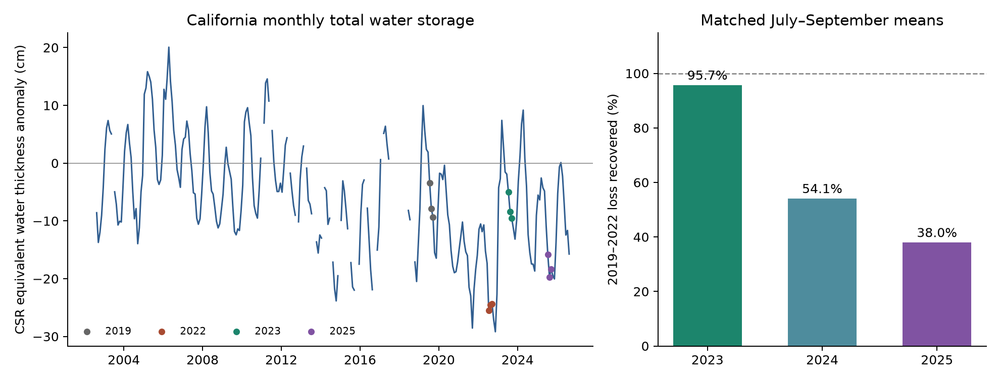
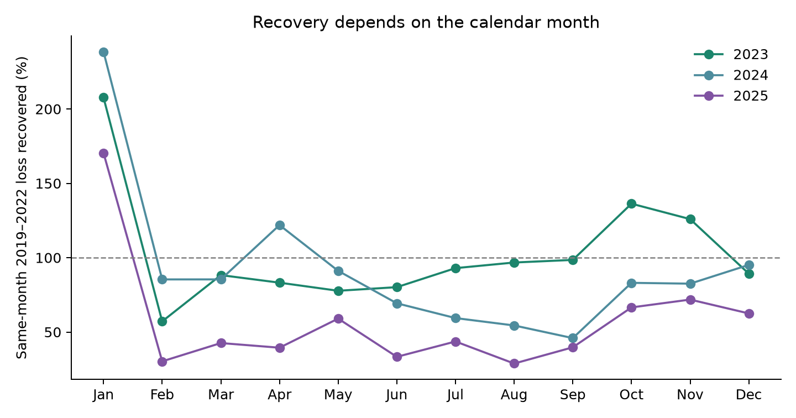
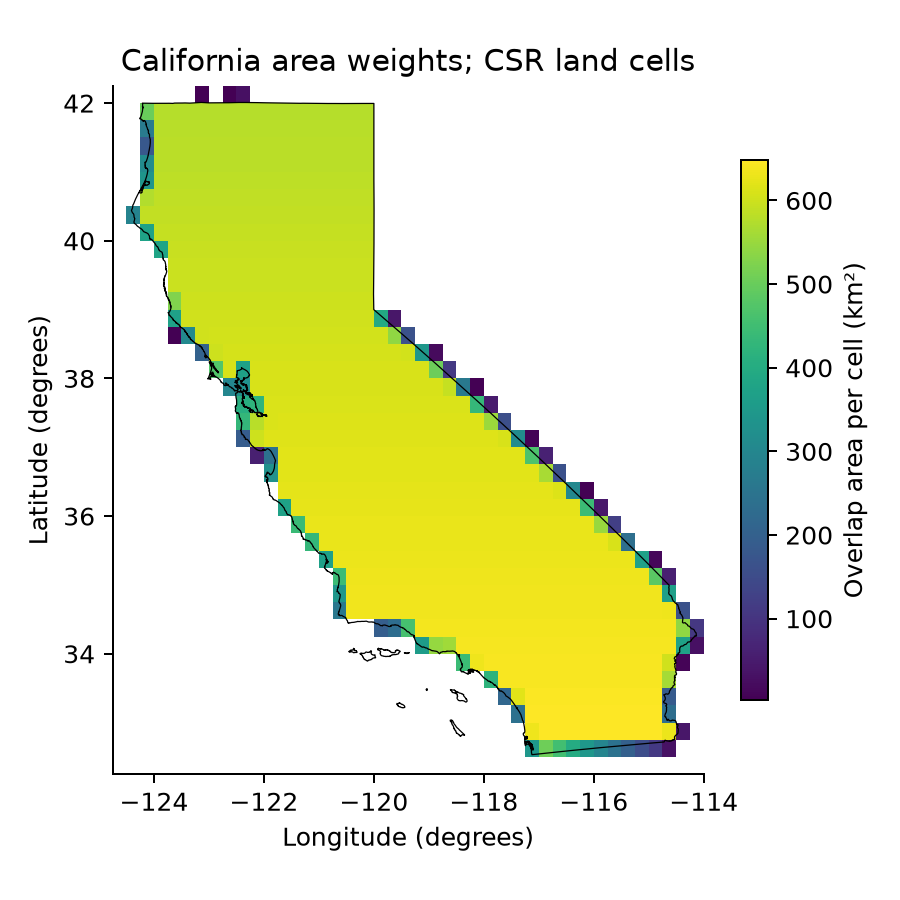

# CSR estimates show 96% recovery of California's July-September 2019-2022 water-storage loss in 2023 and 38% in 2025

## Question and result

How much of California's 2019-2022 loss in total water storage was recovered in 2023? How much of that recovery was present in 2024 and 2025?

We used a fixed Center for Space Research (CSR) RL06.3 GRACE and GRACE-FO data file. We compared the same three months in each year: July, August, and September. The regional mean fell by 17.90 cm of CSR equivalent water thickness from 2019 to 2022. The gain above the 2022 level was 17.13 cm in 2023, 9.68 cm in 2024, and 6.79 cm in 2025. These gains equal 95.7%, 54.1%, and 38.0% of the 2019-2022 loss.

Thus, the 2023 gain was not fully maintained in this product. The July-September mean fell by 10.33 cm from 2023 to 2025. This decrease equals 60.3% of the 2022-2023 gain. These percentages compare storage levels. They do not track the fate of the water that entered in 2023.



The left plot keeps missing months as gaps. Its zero is the product reference mean for 2004-2009. It does not mean that no water was stored. The right plot uses equal-month means and the fixed 2019-2022 loss as its denominator. The plot has no confidence limits because the source does not supply the regional error covariance needed to calculate them.

## Scope and prior work

Total water storage includes snow, soil water, surface water, and groundwater. We do not separate these stores. The study area is the union of all seven California climate divisions, with the CSR land mask. It is not the Central Valley aquifer or a groundwater basin.

NASA reported large California water gains after the 2022-2023 winter and stated that later observations were needed to track their change through summer ([NASA, 2023](https://gracefo.jpl.nasa.gov/news/221/us-german-satellites-show-california-water-gains-after-record-winter/)). A GNSS study measured regional gains during that winter ([DOI 10.1029/2023GL107721](https://doi.org/10.1029/2023GL107721)). Reager and colleagues separated groundwater from other stores through 2023 in a different, smaller area. Their study found that the large 2023 recharge did not offset long-term groundwater losses ([DOI 10.1029/2026GL122396](https://doi.org/10.1029/2026GL122396)). Our total-storage test does not repeat their groundwater calculation.

This study adds a fixed-data comparison through 2025, with explicit month, reference-year, and area-weight checks. It tests whether a large recovery in one year was still present two years later. It does not claim a new recovery estimator or the first evidence of California water loss.

Before we chose this question, we searched published campaign results for earthquake, ocean, drought, hydrology, Ridgecrest, GRACE, and water-storage terms. We read SCI [sha256:7184e3ca8e705c7f1821efa1d5a15e4c4783218097677a59a269fcc8859179c1](sci:sha256:7184e3ca8e705c7f1821efa1d5a15e4c4783218097677a59a269fcc8859179c1). It uses the same shared GRACE source to test earthquake timing. We use its public source snapshot in place and use new code for a different question. We also read the published Ridgecrest rate and spread studies before we selected this water-storage question. No private worker workspace was read.

## Data and provenance

All raw files were already present in the shared store. We did not download or change them. Data were supplied by the University of Texas Center for Space Research at [the CSR data portal](https://www2.csr.utexas.edu/grace/RL06_mascons.html). Please cite [Save et al., 2016](https://doi.org/10.1002/2016JB013007) and [Save, 2020](https://doi.org/10.15781/cgq9-nh24) when you use these data.

The three exact shared source paths are:

- `/mnt/dell-data/shared_datasets/csr-grace-rl0603-mascon-all-corrections-20261108/CSR_GRACE_GRACE-FO_RL0603_Mascons_all-corrections.nc`
- `/mnt/dell-data/shared_datasets/csr-grace-rl06-v02-landmask-20261108/CSR_GRACE_GRACE-FO_RL06_Mascons_v02_LandMask.nc`
- `/mnt/dell-data/shared_datasets/noaa-conus-climate-divisions-shapefile-20170710/CONUS_CLIMATE_DIVISIONS.shp.zip`

Their SHA-256 hashes, in that order, are:

```text
d4bd8b7364fb34d871198001563c70d344792cb7b0a577c04f8b91c713741292
65ddd8f3c7f7633c3a34f904e196307f71e4994e11ceb64f9337275908ff2f3b
edcfadfd390f41eafb8cd4e112d3ead7444a25e505f43fa29107f0c64516aeb3
```

The storage file is RL06.3, label RL0603rc24cE, created on 2026-10-07. It has 260 solutions from April 2002 to August 2026. It includes the source corrections for low-degree gravity terms, the geocenter, and glacial isostatic adjustment. We apply no further scaling or filtering. The CSR land mask is RL06 v02, created in 2019. The NOAA boundary is the shared 20170710-named snapshot; that name is not a claim about its retrieval date. Its original projection is NAD83 longitude and latitude.

The file units are cm of equivalent water thickness. The source uses a density of 1025 kg/m3. We retain that unit and do not convert depths to freshwater volume. Differences and recovery ratios do not depend on a common anomaly reference. The ratio also does not depend on a common unit conversion.

[Data provenance](files/data_provenance.json) records source URLs, helper retrieval times, file sizes, exact logical and resolved paths, and hashes. [Source metadata](files/source_metadata.json) preserves source attributes. [Worker details](files/worker.json) identify the job and model.

The bundle includes an exact source rectangle with all solutions, the exact California boundary union, and all derived evidence. It does not duplicate the full global grids. The rectangle includes 40 latitude rows and 43 longitude columns. We retain original solution midpoints and bounds. Nominal November 2011 and May 2015 have midpoints in the preceding month. We assign their documented nominal labels and retain the original labels in separate columns. See the [GRACE month table](https://tsutterley.github.io/data/GRACE-Months.html) and [timing addendum](files/timing_addendum.txt). All 15 primary solutions have full calendar-month bounds and are unaffected by those two label changes.

## Method

The [analysis plan](files/analysis_plan.txt) was written before we extracted regional storage values. Its primary endpoint is July-September 2025, with 2023 and 2024 as intermediate comparisons. The plan also specifies separate calendar months, April-June, October-December, a 2011 reference, and five area rules. We did not change the endpoint after the results.

For each source grid cell, we estimate the fraction inside the California boundary with a 16 by 16 grid of equal-area subcell midpoints. We multiply this fraction by cell surface area and the binary CSR land mask. Cell areas use an ellipsoid with the source semimajor axis, 6378.1363 km, and WGS84 flattening. We treat the NOAA NAD83 coordinates as WGS84. The datum difference is small relative to the satellite resolution. We normalize area weights to sum to one and take the weighted mean of storage. The represented primary area is 407,369 km2.

The quarter-degree output cells are samples of larger estimated mass regions. They are not independent measurements. The source states a physical resolution of roughly 300 km and advises caution for areas below about 200,000 km2. We therefore use the whole state and do not test individual climate divisions. Coastal leakage and leakage across the state boundary can remain.

Let S(y) be the equal mean of July, August, and September storage in year y. Define:

```text
L = S(2019) - S(2022)
G(y) = S(y) - S(2022)
R(y) = G(y) / L
D(y) = S(y) - S(2019)
```

R is the recovered fraction of the specified loss. D is the remaining difference from the reference; a negative D is a deficit. Fractions can exceed one. We require every stated month in each year. We do not fill gaps. Of 450 saved contrasts, 45 are unavailable because January and June 2011 are missing; June also prevents the 2011 April-June mean. All primary contrasts are complete.

Same-month differences cancel any fixed monthly seasonal cycle. The three-month comparison applies the same month weights in every year. It does not remove changes in seasonal amplitude, snow duration, or other water stores. Such changes are part of the measured total-storage contrast.

No event sample or independent-cell test is used. The outputs are descriptive contrasts in one fixed product. The independent polygon area audit, error-budget calculation, and direct 2025-minus-2023 month table were added after the first results. They are marked as such in the code and data dictionary.

## Results and checks

All depths below are in CSR equivalent water thickness. The 2019-2022 July-September loss is 17.899 cm.

| Year | Gain above 2022, cm | Recovery of the 2019-2022 loss | Difference from 2019, cm |
| --- | ---: | ---: | ---: |
| 2023 | 17.127 | 95.7% | -0.772 |
| 2024 | 9.680 | 54.1% | -8.219 |
| 2025 | 6.793 | 38.0% | -11.106 |

Calendar choice affects the estimated recovery. For April-June, the fractions are 80.3%, 92.7%, and 43.7% in 2023, 2024, and 2025. For October-December, they are 115.5%, 87.4%, and 66.8%. Thus, the comparison of 2023 with 2024 even changes order with season. A spring measurement does not stand for late-summer storage.



January has a small 2019-2022 denominator and gives fractions above one. It also falls before the full wet season of its calendar year. These points are fixed calendar comparisons, not complete water-year recharge estimates. All monthly denominators and raw levels are saved in [comparisons.csv](files/comparisons.csv).

In the direct month comparison, 2025 is below 2023 in all 12 months. The changes range from -1.30 to -11.31 cm. The sign therefore remains negative for any common set of nonnegative calendar-month weights. This is an algebraic statement about the fixed product, not 12 independent tests. A fixed seasonal climatology cannot account for these same-month changes.

The older 2011 reference gives July-September recovery fractions of 66.5%, 37.6%, and 26.4%. The reference year changes the size of the fraction but does not restore full recovery by 2025.

The five planned area rules give 2025 fractions from 37.940% to 37.967%. An independent polygon-intersection audit gives 37.951%. Subcell grids of 8, 16, and 32 points per side give very similar means. These tests make area quadrature and this coastal mask choice poor explanations for the large 2023-2025 difference. They do not test satellite leakage or error shared by all CSR cells.



The small 0.77 cm deficit in 2023 does not establish that recovery was below 100% in the physical system. To make the role of unknown error explicit, we added a deterministic sensitivity calculation. If each regional seasonal mean can have any error of at most 2 cm, the 2025 fraction can range from 15.6% to 60.3%. At an assumed 5 cm bound, it can range from -40.6% to 93.8%. These assumed errors are not measured or calibrated.

Opposite errors of 5.55 cm in the 2019 and 2025 seasonal means would erase their gap. Opposite errors of 5.17 cm in 2023 and 2025 would erase their gap. Only 0.39 cm per mean would erase the small 2019-2023 gap. The [error table](files/assumed_error_bounds.csv) gives all tested bounds. None is a confidence interval.

## Explanation and limits

Two simple alternatives do not explain the product result. A fixed seasonal cycle cancels in same-month contrasts, and the tested area rules change the recovery fractions very little. A change in the total water balance is consistent with the pattern. Fast loss from snow, soil water, and surface water is one possible part of that balance. Groundwater loss, water use, later precipitation, evaporation, and water transport can also contribute. We have not measured these terms, so we do not choose among them or assign the decrease to the 2023 storms.

This is one state, one data product, and a selected reference interval. The 2019 and 2011 reference years are wet-period checkpoints, not estimates of normal storage or predevelopment storage. A second gravity product, reservoir and snow data, land-surface models, and wells would be needed for a stronger physical explanation and groundwater inference.

The netCDF file has no regional error covariance. Satellite errors are correlated across space and time. Fine grid spacing and stable numerical integration do not remove them. We cannot assign a confidence level to the 38.0% estimate, prove that each monthly physical difference is negative, or infer statistical significance from 12 months. Source revision, boundary leakage, the ellipsoid approximation, and mission processing can affect the estimates. Retrospective storage is not available supply, groundwater recharge, a causal effect, or a forecast.

## Validation and reproduction

All substantial computations ran through `campaign-compute` on hp. Library thread counts were one. No child agent was used. `validate.py` does not import `analyze.py`. It checks regional averages with separate high-precision sums, every saved contrast, cell areas with numerical integration, missing-month rules, source hashes, and invariance to a fixed monthly climatology. It also computes the independent polygon area check. Maximum reconstruction differences are below 2e-9 in the saved numeric units. `validate_source.py` checks all three raw hashes, the boundary union, the land mask, time coordinates, and 25,800 primary source values. All checks pass.

A fresh offline run reproduces the saved numeric outputs. See [validation.json](files/validation.json), [source_validation.json](files/source_validation.json), and [reproduction_validation.json](files/reproduction_validation.json). The [data dictionary](files/DATA_DICTIONARY.txt) defines each output.

Use a writable copy of this publication. Keep the signed original unchanged. From the copied publication root:

```sh
python3 -m venv .venv
.venv/bin/python -m pip install -r files/requirements.txt
export OPENBLAS_NUM_THREADS=1 OMP_NUM_THREADS=1 MKL_NUM_THREADS=1 NUMEXPR_NUM_THREADS=1
campaign-compute -- .venv/bin/python files/analyze.py
campaign-compute -- .venv/bin/python files/validate.py
```

The analysis works offline after dependency installation. It uses the compact source files in the bundle. `files/reproduce.sh` gives these commands. On another host, use an equivalent local resource limit in place of `campaign-compute --`.

To repeat the raw-source audit on the campaign host:

```sh
campaign-compute -- .venv/bin/python files/validate_source.py --datasets /mnt/dell-data/shared_datasets
```

For optional retrieval into local scratch, run `files/retrieve.py --output /absolute/local/scratch`. It checks the full source hashes and stops if a live file has changed. Then run `files/extract.py --datasets /absolute/local/scratch --output /another/local/directory` under the same resource limit. Exact live retrieval is not required for the offline repeat. Do not write into the shared data store.

## Worker and license

Campaign: 11_07_2026. Job: sci-1107-hp-earth-and-ocean-sciences-71c586115428. Topic: earth-and-ocean-sciences. Machine: hp. Account: codex-andrii. Model: gpt-6.1-sol, high reasoning effort. Python: 3.12.15. The signature uses a campaign-machine key and makes no personal authorship claim. Private keys are outside this package. The SCI baseline license is in LICENSE. The source credit and data provenance remain attached. This bundle is saved locally. It is not uploaded to a remote archive or index.
