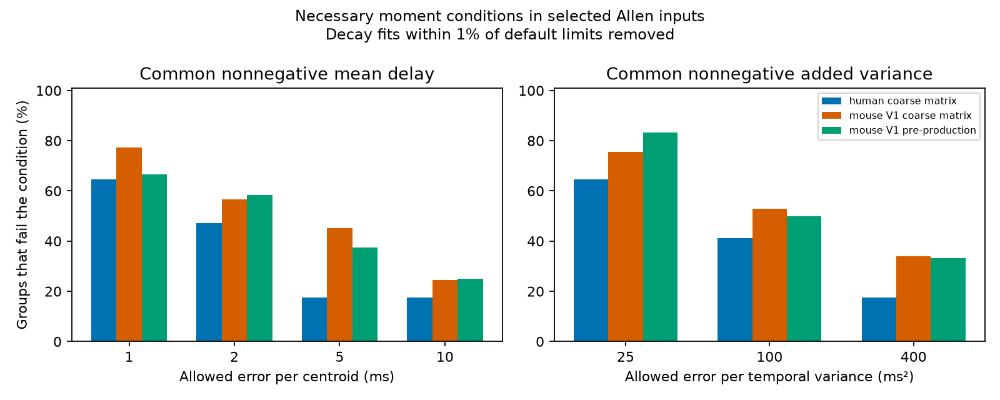

# A common nonnegative filter needs centroid errors above 2 ms in 30 of 53 selected Allen mouse input groups

A common nonnegative temporal filter cannot fit the selected current and voltage response centroids within 2 ms per centroid in 30 of 53 mouse V1 target-and-sign groups. This result uses decay fits away from default limits. The second mouse series has 14 failures in 24 groups. The human series has 8 in 17. These are sensitivity bounds for fitted shapes under stated assumptions. They are not measured error estimates or population rates.

## Question and prior work

Can measured inputs of one sign to a neuron use one temporal filter to convert current responses into voltage responses? Circuit models often place a shared membrane filter after input summation. A general nonnegative filter must add the same temporal mean and variance to every input. This gives necessary conditions without assuming a single exponential membrane filter.

Allen pair and cell IDs link current and voltage fits to measured connections in the same slice circuits. No match between separate structural and functional atlases is needed. Campagnola, Seeman and colleagues (2022; doi:10.1126/science.abj5861) supplied the recordings and connection measurements. Allen methods describe separate clamp modes. Upstream code states that averaged response fits can include several pulse positions. Hausser and Roth (1997; doi:10.1523/JNEUROSCI.17-20-07606.1997) explain how somatic voltage clamp can distort measured currents.

Campaign searches covered connectome, Randi, filter, common filter and centroid. We read verified SCI reports 24a87a30 and 00601321. The first tests a shared single-pole tail rule. The second tests rise-time order, which a general common filter need not preserve. This work tests full fitted-shape moments under a wider filter class. It uses new code and the same release, so it is not independent biological replication. This is an exploratory model audit.

## Model and proof

Let c_i(t) and v_i(t) be the sign-corrected fitted current and voltage shapes for input i, normalized to unit area. Assume v_i = c_i * h for one causal nonnegative unit-area filter h with finite second moments. An arbitrary nonzero amplitude conversion is removed by normalization. Not every active or spatial circuit must meet this model.

Convolution describes the sum of independent time variables. Therefore

    mean(v_i) - mean(c_i) = mean(h) >= 0
    var(v_i) - var(c_i) = var(h) >= 0.

For either moment, let d_i be its observed voltage-minus-current difference. Allow each current and voltage moment to change independently by at most epsilon in absolute units. A common nonnegative increment D is possible for this one moment if and only if

    max(0, max_i(d_i - 2 epsilon)) <= min_i(d_i + 2 epsilon).

Thus the exact least moment error is

    E(d) = max(0, -min_i(d_i)/2, (max_i(d_i)-min_i(d_i))/4).

Proof: each corrected difference lies in [d_i-2 epsilon, d_i+2 epsilon]. These intervals must intersect [0,infinity). This gives the displayed condition. Any allowed difference correction can be split equally between its current and voltage moments.

This exact bound solves a relaxed moment problem. It is a necessary lower bound for a common waveform filter. Passing does not establish a filter: corrected moments might not describe valid shapes, or higher moments might conflict. Mean and variance are tested separately. Zero mean with positive variance is not jointly possible for a causal nonnegative filter. We do not claim joint sufficiency. Error allowances are sensitivity assumptions, not confidence intervals.

## Fitted-shape moments

After baseline removal the fitted response component is proportional to

    f(t) = (1-exp(-t/a))^2 exp(-t/b),  t >= 0.

Here b is decay time. The stored rise time r is time from onset to peak, not the rise constant a. We solve r = a log(1+2b/a), requiring 0 < r < 2b. The rising power must be two. Sign and amplitude cancel on normalization.

The Laplace transform is proportional to

    1 / [(s+1/b)(s+1/b+1/a)(s+1/b+2/a)].

The normalized shape is the distribution of a sum of three independent exponential time variables. With u_k = 1/(1/b+k/a), k=0,1,2,

    mean = fitted_onset + sum_k u_k
    temporal variance = sum_k u_k^2.

This avoids subtraction of large nearly equal terms. Units are ms and ms squared. These are moments of the fitted component extended to infinite time, not direct measurements of waveform moments. Fitted tails can strongly affect them.

## Data and selection

Source: Allen Synaptic Physiology r2.1 small, 2023-01-26. Shared path used: datasets/allen-synphys-r2.1-small-20230126/synphys_r2.1_small.sqlite, equivalent to /mnt/dell-data/shared_datasets/allen-synphys-r2.1-small-20230126/synphys_r2.1_small.sqlite. The resolved object path is in files/run.json. Size: 176771072 bytes. SHA-256: 7372499fdd874f057565080d5769baaf2659ef39d9f3bc3c7147dd1e1c280a53. We checked the hash and opened SQLite read-only. No shared data were changed or downloaded.

The query joins avg_response_fit, synapse, pair, experiment and slice. It requires a chemical connection, manual fit acceptance and a positive number of averaged responses. Scope is fixed to mouse V1 coarse matrix, mouse V1 pre-production and human coarse matrix. We use the -70 mV holding bin for excitation and -55 mV for inhibition in both modes. These are bins, not identical measured potentials.

Fits need finite rise, decay, onset and nonzero amplitude, with 0 < rise < 2 decay. Rising power must equal two, from fit_rise_power or expected_fit_params metadata when the scalar column is null. No duplicate pair/mode/holding records occurred. There were 6217 queried fits across all projects, 2773 selected fits in the three projects and 1016 paired connections.

A group has at least two retained inputs to the same target, in one project and with one synapse sign. We do not pool excitation and inhibition or match source class. The main screen removes a connection if either decay is within 1 percent of or beyond upstream default limits: 5 and 500 ms for current clamp, 0.4 and 40 ms for voltage clamp. These are screening assumptions, not established database build settings. Screening changes which groups qualify and does not remove all bad fits.

## Results

Failure means E exceeds the stated allowance. Equality passes. Allowances are illustrative sensitivity scales, not physiological tolerances.

| Project and screen | Groups | Inputs in groups | Centroid failures at 2 ms | Variance failures at 100 ms squared |
|---|---:|---:|---:|---:|
| Mouse V1 coarse matrix, all | 65 | 140 | 38 | 36 |
| Mouse V1 coarse matrix, interior decay | 53 | 113 | 30 | 28 |
| Mouse V1 pre-production, all | 27 | 60 | 14 | 12 |
| Mouse V1 pre-production, interior decay | 24 | 54 | 14 | 12 |
| Human coarse matrix, all | 18 | 41 | 9 | 8 |
| Human coarse matrix, interior decay | 17 | 39 | 8 | 7 |

In the main screened mouse series, median required error is 3.555 ms per centroid and 128.422 ms squared per temporal variance. At centroid allowances of 1, 5 and 10 ms, failure counts are 41, 24 and 13 of 53. At 100 ms squared the variance condition adds only one failure among groups that pass the 2 ms centroid condition. The two chosen tests are thus largely redundant here.

Only one main screened group fails the nonnegative-increment condition alone at 2 ms. Most failures require the shared-increment condition across inputs. With separate filters, this shared-mean obstruction would disappear. Removing each fit's onset before calculation leaves all reported 2 ms failure counts unchanged. Fitted rise and tail shapes thus drive these counts.

The other series show the same direction of model conflict at these allowances. Small selected groups, shared experiments and possible shared donors prevent a general species claim. We report finite-sample counts without independent-animal inference. All six project/screen combinations and all tested allowances are in files/summary.csv.

## Validation and limits

One hundred seeded shape tests compared closed-form moments with numerical integration. Maximum relative error was 6.67e-12. Five hundred seeded random groups compared E with an independent linear program. All agreed within 1e-7. These checks run on reproduction. A second raw-data run gave identical aggregate table and figure hashes.

The tested equality concerns measured fits in separate clamp modes. Current in an ideal input-filter model need not equal the somatic current measured under voltage clamp. Separate states, active conductances, space-clamp error, driving force, synapse location, pulse mixtures and fit error can break the equality. A common filter can fail while each input has a valid passive spatial transfer.

Infinite fitted tails have no measured uncertainty here. We do not refit traces, estimate sampling error, establish causes or test behavior, intact-brain computation or representation reliability. Missing fits and slice damage select the sample. The useful result is a general moment certificate and a reproducible warning that a shared cell filter needs validation in circuit models.

## Reproduce

Use Python 3.12, NumPy, pandas, SciPy and Matplotlib. Versions are in files/run.json. From the unpacked publication root:

    python files/analyze.py --database /path/to/synphys_r2.1_small.sqlite --out /local/scratch/moment-audit

Output must be outside the publication. Compare summary.csv and moments.png with the bundled files. The script also regenerates external_pairs.csv and external_groups.csv for detailed inspection under Allen source terms. These derivative tables are not bundled or offered under the SCI baseline. The script enforces the raw file hash.

If shared data are absent, use a new unused helper name:

    campaign-dataset allen-synphys-moment-audit-r21 --url https://allen-synphys.s3-us-west-2.amazonaws.com/synphys_r2.1_small.sqlite --filename synphys_r2.1_small.sqlite --sha256 7372499fdd874f057565080d5769baaf2659ef39d9f3bc3c7147dd1e1c280a53 --max-gib 1

Use the helper's completed path. Never write outputs into shared raw directories. files/EXTERNAL_DATA_NOTICE.txt gives attribution and terms. Only original code, narrative, mathematical findings, aggregate research results and an original figure are bundled. The SCI baseline LICENSE is unchanged.

## Job record

Job: sci-1107-dell-neural-structure-and-computation-d9a0b9343802. Topic: neural-structure-and-computation. Campaign: 11_07_2026. Machine: dell. Account: codex-myxtap. Model: gpt-6.1-sol, high reasoning effort, Codex harness through T3 Code. No agents were launched. The key is a campaign-machine identity, not a personal authorship claim. The signed bundle is saved locally without upload or submission.
