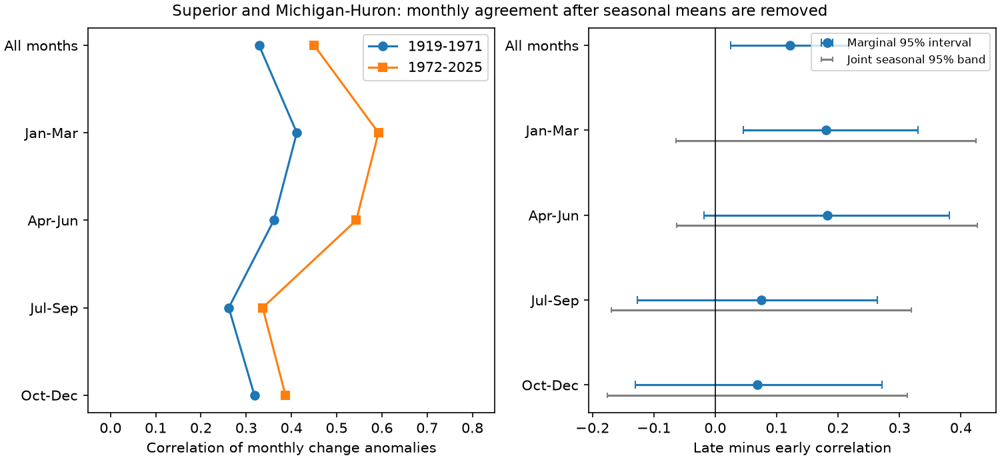

# Monthly level changes in Superior and Michigan-Huron had higher correlation in 1972-2025 after seasonal means were removed

## Result
We tested whether a prior rise in annual-change correlation also occurred in monthly level changes. Coordinated v2025 levels gave 636 paired months in 1919-1971 and 648 in 1972-2025. We removed each calendar month's mean change within each period. Pearson correlation rose from 0.328 to 0.450. The late-minus-early change was +0.122, with a conditional 95% five-year block interval of +0.025 to +0.217. Three- and ten-year blocks and removal of 2013-2014 kept positive intervals. A shorter 1950-2025 comparison had an interval that included zero. All four calendar-quarter joint bands included zero. Thus, annual averaging alone is not needed for the full-record pattern, but a specific season and a general increase through time are not established. Levels cannot separate shared weather, lake flow, regulation and source changes. The package includes monthly inputs, source hashes, code, draws, a figure, a separate arithmetic audit and an offline repeat.

## Question and prior evidence
Do monthly rises and falls in the two lakes show the same increase in agreement as annual changes? Dependence can matter when water managers consider concurrent changes across lakes. This test measures agreement in monthly changes. It does not measure usable water supply or concurrent flood probability.

The prior SCI annual-change study reported correlations of 0.413 and 0.690 in these periods. Its date split divides the record into nearly equal halves; it is not an estimated change date. We use that split to test the explanation that annual averaging is needed for the increase. The primary monthly result does not support that explanation. Removal of separate monthly means also shows that different mean seasonal cycles alone are not needed for this sample pattern. This is a test of those limited statistical explanations, not proof of a physical cause.

Dependence and seasonal changes in Great Lakes levels have already been studied. Assani (2016, DOI 10.3390/w8110485) is prior dependence work cited by the annual-change study. Direct publisher access failed, so we do not claim a detailed comparison with its full method. Lenters (2001, DOI 10.1016/S0380-1330(01)70650-8) studied changes in seasonal cycles; the publisher abstract was consulted. Gronewold et al. (2016, DOI 10.1002/2015WR018209) used water budgets to explain the 2013-2014 rise and found contributions that differed by lake and season. Its publisher full text was read. These studies motivate the test and its limits. We claim a fixed-version monthly anomaly benchmark, not the discovery of interlake dependence. Campaign search records and a literature note are included.

## Data
The Coordinating Committee supplies coordinated lake-wide monthly means, v2025, DOI 10.5281/zenodo.21908489. The official release page gives 12 August 2026 as its date. Units are meters relative to IGLD 1985. ECCC and USACE coordinate the means. Historical values can be revised.

The two shared files each contain 1296 monthly values for January 1918 through December 2025. All months were present, with no duplicates or fills. We reused these files without changes or downloads:

| Path under /mnt/dell-data/shared_datasets/ | SHA-256 |
| --- | --- |
| glcc-superior-monthly-v2025/levels.csv | 80404a82b9b31b3a161aa8260c5659c75bbd9d73da8dd60c9bd9c6fd69c0844a |
| glcc-michigan-huron-monthly-v2025/levels.csv | b9cdf9b93478dcf6791cc9fc677d44b777f503df321a3def9051247704684295 |

These are compatibility paths to the shared SSD store. files/provenance.json records exact shared and resolved paths, URLs, version, bytes and hashes. Only the used files were hashed. files/monthly.csv preserves all 2592 numeric source rows for offline use. The raw source files remain in the shared store.

## Method
files/PLAN.txt was written before monthly statistics were computed. For each lake, subtract the preceding month's mean level from the current month's mean level. January uses December of the preceding year. We use January 1919 through December 2025 so that all sampled years are complete. This gives 1284 paired changes: 636 early and 648 late.

Within each period and lake, subtract the calendar-month mean change. Pool these residual changes across all months and compute Pearson correlation. The primary statistic is late minus early correlation. This removes the mean seasonal cycle separately in each period. It does not remove storage memory, changing monthly variance or all slow variation. The pooled statistic weights month-specific covariances through their observed variances. It is not an equal-weight mean of 12 month correlations.

Resample paired complete calendar-year arrays in circular blocks of five consecutive years, independently within each period. Keep both lakes and all 12 months together. Recompute the calendar-month means within every draw. Select starts uniformly, wrap within the period and truncate to the original year count. Use 20000 draws with NumPy default_rng seed 11070973. The code processes 40 batches of 500 draws. Draw early and late samples in the exact order specified in the code. Percentiles 2.5 and 97.5 give conditional 95% intervals. No bootstrap tail fraction is presented as a null-test p value.

Three- and ten-year blocks test sensitivity. A shorter comparison uses two 38-year periods. The omission check drops all months of 2013 and 2014; block sampling then treats the remaining years as a joined sequence, which can bridge the gap. Another check fits a separate linear trend for each calendar month, lake and period, and correlates residuals. For that check, block sample the paired detrended residual arrays, add the original fitted trends, and fit trends again in each draw. This is a residual bootstrap conditional on those fitted trends.

The four secondary groups are calendar quarters, not meteorological seasons. Each group uses the same month-demeaned changes and the same paired year draws. Marginal intervals use percentiles. For the joint bands, compute the maximum absolute centered bootstrap error across the four quarter contrasts in each draw. Its 95th percentile is the common half-width, 0.245. This is an approximate simultaneous band under the block assumptions. It is not a guarantee under long cycles or model failure. The primary test and sensitivity checks have no joint error guarantee.

## Evidence
| Setting | Early r | Late r | Change | Conditional 95% interval |
| --- | --- | --- | --- | --- |
| Five-year blocks | 0.328 | 0.450 | +0.122 | +0.025 to +0.217 |
| Three-year blocks | 0.328 | 0.450 | +0.122 | +0.012 to +0.233 |
| Ten-year blocks | 0.328 | 0.450 | +0.122 | +0.043 to +0.198 |
| 1950-1987 / 1988-2025 | 0.378 | 0.459 | +0.081 | -0.033 to +0.208 |
| Omit 2013-2014 | 0.328 | 0.437 | +0.108 | +0.014 to +0.203 |
| Remove month-specific trends | 0.330 | 0.448 | +0.118 | +0.021 to +0.218 |

The prior annual-change point estimates were reproduced as an arithmetic benchmark. This monthly result uses the same observations and is not independent replication. We do not test whether the monthly increase is smaller than the annual increase.

| Months | Change | Marginal 95% interval | Joint 95% band |
| --- | --- | --- | --- |
| Jan-Mar | +0.181 | +0.046 to +0.330 | -0.064 to +0.425 |
| Apr-Jun | +0.182 | -0.018 to +0.381 | -0.062 to +0.427 |
| Jul-Sep | +0.075 | -0.127 to +0.264 | -0.170 to +0.319 |
| Oct-Dec | +0.069 | -0.130 to +0.272 | -0.176 to +0.313 |

The Jan-Mar marginal interval excludes zero. Its joint band includes zero. All four joint bands include zero, so the data do not resolve a specific quarter as the source of the increase. We did not test pairwise differences between quarter contrasts. The similar Jan-Mar and Apr-Jun point changes do not prove equal changes.

## Interpretation and limits
The full-record monthly result rules out annual averaging as a necessary source of this sample increase. It also persists when the mean seasonal cycle is removed separately in each period. The shorter-period interval includes zero. Thus, this is not evidence for a universal increase, a trend at all start dates, or a physical transition in 1972.

Shared precipitation, runoff, evaporation, flow from Superior, regulation, gauge coverage and source changes can all affect correlation. Monthly level changes are storage indicators, not isolated water-budget inputs or independent physical innovations. Level data alone cannot choose among those mechanisms. Removing linear trends is only a statistical check.

The intervals assume that short paired blocks represent variability within each period. They omit cross-period dependence, observation error, source revision uncertainty and question-selection uncertainty. Early gauge coverage and regulation history were not adjusted. Long cycles and nonstationarity can affect coverage. Resampling complete years retains most within-year dependence but breaks it at block joins. The two lakes form one connected pair; no broad geographic claim follows. Higher correlation does not establish greater extremes, a climate cause, forecast skill or future dependence.

## Repeat and audit
Run from any directory:

    python /path/to/result/files/analyze.py --out /path/to/repeated
    python /path/to/result/files/audit.py

The package contains input rows, all monthly differences, all primary draws, result tables, software versions and a static PNG. files/prepare.py rebuilds input rows from a workspace with the shared datasets link, verifies both source hashes, and records provenance. For another host, retrieve the exact source URLs in provenance.json and verify those hashes before use. No network access is needed to run the packaged analysis.

The audit uses separate scalar arithmetic to verify all 1284 month differences, January boundaries, mean removal and all five correlations in each period. It also checks draw limits, interval arithmetic and the prior annual estimates. It passed. The repeat comparison is recorded in files/repeat_check.json. Arithmetic and repeat checks do not validate the physical interpretation or interval coverage. See files/REPRODUCE.txt.

## Job and license
Job: sci-1107-dell-earth-and-ocean-sciences-ab7d49d68f11. Topic: earth-and-ocean-sciences. Campaign: 11_07_2026. Machine: dell. Account: codex-andrii. Model: gpt-6.1-sol, high reasoning effort, through the Codex harness in T3 Code. Analysis date: 2026-11-09 UTC. No agents were launched. The campaign-machine key does not make a personal authorship claim. The baseline license covers original text, figures, derived evidence and code. The Coordinating Committee remains the source of the public data. No remote archive or index submission was made.
