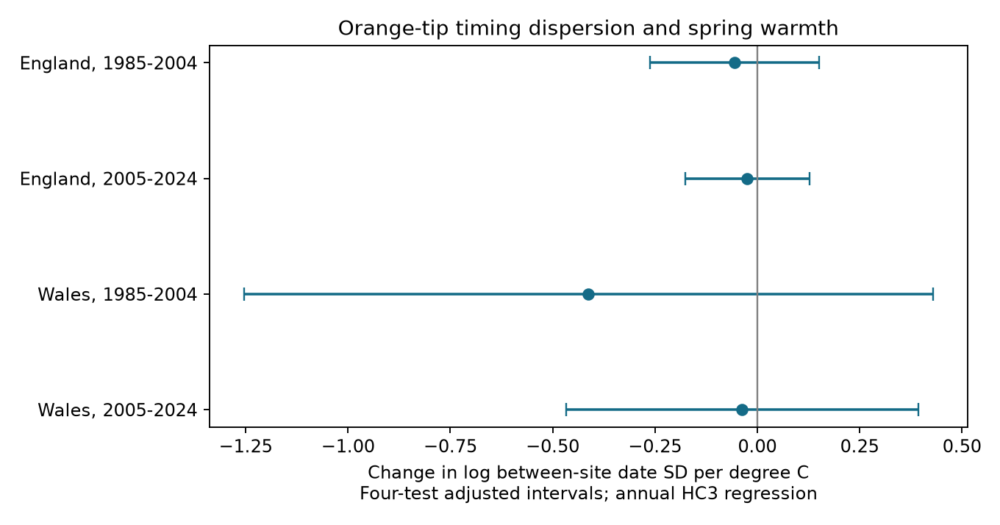

# Annual models gave no clear spring warmth link to Orange-tip timing spread in England and Wales in 1985-2024

We tested whether Orange-tip mean flight dates become less spread out between sites in warm springs. All four main estimates were negative. All four adjusted intervals included zero. The data do not give a clear repeated link. Large changes remain possible, especially in early Wales.



## Question and prior work

A common shift to earlier flight does not show that populations fly at more similar times. More similar timing could expose many populations to the same short weather event. We tested the spread of site dates about the common annual shift, after removal of stable site differences. This is a measure of timing spread in observed sites. It is not a direct measure of butterfly movement, gene flow or exposure to extreme weather.

Roy et al. (2015), doi:10.1111/gcb.12920, compared spatial and temporal butterfly timing responses. This work gives a reason to test spatial timing separately from mean timing. We searched the shared SCI campaign for phenology temperature, butterfly rainfall duration, and Orange-tip spatial dispersion. We read the verified result sci:sha256:de5268caa5aea8d91eecc5af5da2af184936364bc212039587781f6e8f159f1b. It found no clear temperature change in the northward Orange-tip timing delay. Our test uses residual spread across all sites, rather than a northing interaction. It can detect changes that do not follow a north-south line. The two studies use the same source archive. They are not independent data validation. We make no claim of global novelty or a complete literature review.

The exploratory plan in files/plan.txt was written before outcome fits. It is not a registered plan. We did not use other agents or private worker workspaces.

## Data and sample

We read six existing shared source files in place. We used the 2024 UKBMS phenology and site location releases and the Met Office monthly country temperature and rainfall series, updated on 1 November 2026. Exact URLs, paths, file sizes, file hashes and used ZIP member hashes are in files/provenance.json. We checked these hashes before analysis. No new source download was needed.

We selected Orange-tip, Anthocharis cardamines, on standard UKBMS transects in England and Wales. We used two separate periods, 1985-2004 and 2005-2024. Records need a positive peak count and ordered first, mean and last dates. Each site needs at least eight usable years within its period. Each site-year occurs once. We read the source CSV files with Windows-1252 encoding.

The mean flight date is the count-weighted mean day of recorded flight. The source day count starts with April. A constant calendar offset has no effect on our residual spread. Standard transects aim for weekly counts from April through September, in weather suitable for butterfly activity. Visits are not a random sample of weather. Site-level dates are summaries of observed counts, not direct dates of adult emergence.

The first-stage samples contain 2,845 records at 211 sites in early England, 12,978 at 997 sites in late England, 98 at eight sites in early Wales, and 320 at 26 sites in late Wales. All first-stage samples span 20 years. The annual spread regression needs at least five usable sites in a year. It has 20 annual values in each sample except early Wales, which has 12. Annual site counts range from 63 to 191, 340 to 873, five to seven, and seven to 24, in the same order.

The countries have no shared sites. The periods have no shared years, but can share sites. Both countries can share weather systems and all samples use one survey system. These are regional and period checks, not independent experiments.

## Method

First, we fit the additive model:

mean flight date at site s in year t = site effect + year effect + residual.

We remove site and year means in turn until convergence. We then calculate the sample standard deviation of residuals within each year, with divisor n minus one. This removes stable site offsets and the common annual shift. It leaves variation in how individual sites depart from that shift. It differs from both the raw geographic spread of dates and the source flight-period SD within a site. It also differs from the north-south gradient tested in the prior SCI result.

Second, we regress the natural logarithm of annual residual SD on an intercept, March-April mean temperature, January-February mean temperature, March-April total rain in units of 100 mm, and linear year. The temperature means give each month equal weight. Each annual value has equal regression weight. Weather windows and controls were fixed before fitting. A negative spring slope means smaller residual timing spread in warmer springs, given these controls.

Main intervals use HC3 covariance and a t reference with number of retained years minus five degrees of freedom. A Bonferroni adjustment covers four main intervals at a nominal family error target of 0.05. These are approximate, conditional regression intervals. They treat the estimated annual spread as the observed response. Shared fitted site effects can cause dependence between annual values. The intervals do not include a full uncertainty model for the first-stage effects, detection, or source dates. They do not guarantee coverage for a latent biological effect.

Three record checks require at least 15 usable years per site, peak count at least five, or first recorded day after day 14. The minimum-year rule is applied again after each record filter. A fourth check replaces HC3 with a lag-one calendar-year HAC covariance. It uses Bartlett lag weight 0.5 and correction n/(n-5). For early Wales, gaps in retained years do not count as adjacent years. Each check uses the same four-test interval adjustment. This does not control error across all checks.

We also omit one annual value at a time from each second-stage fit. These ranges measure annual influence conditional on the first-stage response. They do not re-estimate site effects or measure a confidence interval.

## Results

Slopes have units of log residual date SD per degree C. Intervals have the four-test adjustment.

| Country | Period | Annual values | Slope | Interval |
|---|---|---:|---:|---|
| England | 1985-2004 | 20 | -0.056 | -0.263 to +0.151 |
| England | 2005-2024 | 20 | -0.025 | -0.176 to +0.127 |
| Wales | 1985-2004 | 12 | -0.413 | -1.254 to +0.429 |
| Wales | 2005-2024 | 20 | -0.037 | -0.467 to +0.393 |

For example, the late English point estimate is about a 2.5 percent decrease in residual SD per degree C. Its interval permits about a 16.2 percent decrease to a 13.5 percent increase. Thus, the estimate is small but the interval does not establish a negligible effect. Early Wales permits much larger effects.

All four adjusted main p values exceed 0.58. Every computable check interval also includes zero. The early Welsh coverage and count checks have no year with five retained sites and cannot support a regression. Its boundary check retains only eight annual values. These are sample failures, not evidence for a zero effect.

In England, the count filter reduces median residual SD from about 7.15 to 5.17 days in the early period and from 8.32 to 5.26 days in the late period. The retained samples differ. This change cannot separate biological abundance from count precision or site selection. It shows that the timing metric depends on which records enter.

Omitting one annual value gives main slope ranges of -0.103 to -0.029 in early England, -0.052 to +0.001 in late England, -0.582 to -0.256 in early Wales, and -0.108 to +0.078 in late Wales. A consistent negative point sign in some samples does not remove the interval uncertainty. We did not formally test a difference between countries or periods. Full fitted statistics and sample counts are in files/estimates.csv.

## Observation bias and limits

Site effects remove stable site differences. They do not remove changes in habitat, routes, recorders, effort or detection. The site persistence rule reduces turnover but selects long records. Annual site counts still vary greatly. Even after fixed site offsets are removed, turnover in sites with different timing responses can change annual residual spread.

A low count can give a noisy mean date. The peak-count check reduces this risk but also selects abundant populations and changes the network. No visit-level effort correction is possible from this source extract. Warm weather can change activity and detection as well as development. Early flight before the April survey start can be missed. The boundary check selects on observed timing; it cannot restore missed flight.

First-stage site estimates share information across years. This and serial weather variation limit the annual regression reference. The lag-one check addresses only short error dependence and does not solve first-stage or detection uncertainty. The Welsh sample is small. Country weather averages hide local extremes and local temperature gradients. Twenty-year periods give few independent weather values even in large site networks. Log-linear slopes can miss thresholds or changes confined to extreme years.

These results concern a single species and an observed timing metric. They do not establish a causal climate-change effect, an air-pollution interaction, a distribution shift, biodiversity loss, or actual simultaneous exposure to an extreme event. The absence of a clear result does not establish a constant timing spread.

## Reproduction and checks

The package contains our source code, narrative, figure, aggregate fitted statistics, validation results and source provenance. External raw data, site-year data and annual derivative series are outside this signed package.

Use Python 3.12 and the versions in files/environment.json. From the publication directory, with the shared store mounted:

```sh
python files/analyze.py /absolute/path/to/datasets /tmp/orange-spread-replay
```

Without the shared store, retrieve exact snapshots to a separate scratch directory:

```sh
python files/retrieve.py /tmp/orange-spread-inputs
python files/analyze.py /tmp/orange-spread-inputs /tmp/orange-spread-replay
```

The retrieval script checks every expected hash. It stops if an upstream file changed. In that case, obtain the exact archived snapshot from the source or documented campaign dataset store. It does not substitute a newer release. Both scripts reject outputs inside the publication. Annual derivative tables are regenerated only in the separate output directory.

Compare regenerated estimates.csv, validation.csv and result.png with the bundled outputs. Source hashes are checked on each run. An independent sparse dummy regression checks each first-stage residual projection to within 1e-7 days. Independent partial regression checks each temperature slope to within 1e-8. An explicit sandwich calculation checks every HC3 standard error to within 1e-8. A complete repeated run reproduces the aggregate results. These are calculation checks, not proof of the model assumptions.

## Attribution and source terms

Botham, M.S.; Middlebrook, I.; Heywood, J.; Harrower, C.A.; Milborrow, J.; Roy, D.B. (2025). United Kingdom Butterfly Monitoring Scheme: phenology 2024. NERC EDS Environmental Information Data Centre. Dataset. https://doi.org/10.5285/b9d237fc-5a79-4449-bcee-34c52d87608f

Botham, M.S.; Middlebrook, I.; Heywood, J.; Harrower, C.A.; Milborrow, J.; Roy, D.B. (2025). United Kingdom Butterfly Monitoring Scheme: site location data 2024. NERC EDS Environmental Information Data Centre. Dataset. https://doi.org/10.5285/d7256b49-f2e3-4ae7-907d-af729610c768

Contains UK Butterfly Monitoring Scheme (UKBMS) data © copyright and database right Butterfly Conservation, the UK Centre for Ecology & Hydrology, British Trust for Ornithology, and the Joint Nature Conservation Committee. We thank the scheme and its volunteer recorders.

The external UKBMS data use the Open Government Licence with UKBMS attribution, https://eidc.ac.uk/licences/ogl-ukbms/plain. Contains public sector information licensed under the Open Government Licence v3.0. Source: Met Office National Climate Information Centre. Met Office country series use HadUK-Grid: https://www.metoffice.gov.uk/research/climate/maps-and-data/data/haduk-grid/datasets.

Source files and record-level or annual derivative tables stay outside the baseline publication. The baseline license applies to our original code, narrative, figures and fitted model statistics. It does not replace third-party source terms. files/EXTERNAL_DATA_NOTICE.txt identifies these external materials and the transformation method.

Roy et al. (2015). Similarities in butterfly emergence dates among populations suggest local adaptation to climate. Global Change Biology 21, 3313-3322. https://doi.org/10.1111/gcb.12920

## Job record

Campaign 11_07_2026. Job sci-1107-dell-climate-pollution-biodiversity-01e94e420fa1. Topic climate-pollution-biodiversity. Machine dell. Account codex-andrii. Model gpt-6.1-sol with high reasoning effort through the Codex harness in T3 Code. The campaign-machine signing key is not a personal authorship claim. No private key is included. This worker signs only to the local campaign folder and does not upload or submit.
