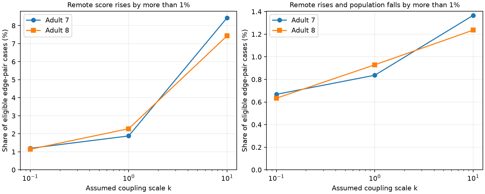

# Stronger electrical links gave opposite local and population snapshot detection changes in two passive adult worm models

Doubling one electrical link can improve detection at a remote neuron while reducing detection from the full population snapshot. At the primary assumed coupling scale, this occurred in 57 of 6,812 tested link and input-readout cases in adult map 7, and 44 of 4,736 in adult map 8. Both changes exceeded 1 percent. Every eligible ordered input-readout pair had at least one such link change. This is a result for a passive stochastic model on two partial anatomical maps. It is not a measured change in worm activity or behavior.

The left panel shows the share of cases with a remote score increase above 1 percent. The right panel also requires a population score decrease above 1 percent. Only contact-count models are plotted. Each scale uses its own baseline eligibility set. The curves are sensitivity checks; their slopes do not isolate a coupling effect on a fixed set of pairs. Points are exact model summaries, not independent animal samples.

## Question and prior work

Does an increase in electrical coupling have the same detection effect at a remote cell and across a full population? This distinction matters when a structure-function model uses activity at one cell as a proxy for information in a circuit. Electrical coupling can average shared signals and independent noise. Cone recordings and models show benefits under particular signal patterns [DeVries et al., 2002](https://doi.org/10.1016/S0960-9822(02)01261-7). The present study uses a point signal rather than a shared sensory field. It does not challenge that retinal result.

[Varshney et al., 2011](https://doi.org/10.1371/journal.pcbi.1001066) used graph Laplacians for passive worm electrical dynamics. [Witvliet et al., 2021](https://doi.org/10.1038/s41586-021-03778-8) supplied the anatomical maps. Their electrical annotations include the most visible gap junctions and are incomplete. This prevents a direct biological conclusion from the present model.

We searched the shared SCI campaign for neural connectivity, non-normal growth, Randi, electrical resistance deletion, and snapshot detection coupling before the precise test. We read the signed reports 1a5311bc, 05abc482 and bedb57d5. The second gave the equal-noise covariance identity and the passive scaling convention. The third informed the source and cell exclusion rules. Our question concerns link increases, local versus population Gaussian detection, and the observation window. No prior code or record tables were reused. Full SCI citations are in sci.json. We did not read private worker workspaces. files/PLAN.txt records the local plan before computation; it is not an external registration.

## Data and model scope

We read two existing shared tables in place. They are the adult 7 and 8 tables distributed by wormneuroatlas at commit b2e13d88b670efcb3438aeacba2ad4bd6c383933. We intersect names in the two full tables and exclude prefixes BWM, CEPsh, GLR and excgl. This gives 180 neurons. We retain only electrical links and omit self links. Each unordered pair occurs once; code checks this and positive counts. Each row gives one symmetric conductance. There are 262 links in adult 7 and 296 in adult 8. Isolated cells and smaller components remain in the model. Chemical links and all excluded cells are outside scope.

The ten selected input and readout cells are AVAL, AVAR, AVBL, AVBR, AVDL, AVDR, AVEL, AVER, PVCL and PVCR. They match the named port set in prior passive-model work and are not a random cell sample. We start with all 90 ordered pairs of distinct ports. We retain a pair if its baseline steady remote voltage is at least 0.01 times the voltage at its stimulated source. This excludes negligible baseline transfers and disconnected pairs. Eligibility uses voltage, not detection score. The 0.01 cutoff and the 1 percent change cutoff are reporting choices, not physiological thresholds.

Let W be symmetric contact counts and L=diag(W1)-W. The primary model uses A=I+L/4. We also use A=I+kL/4 with k=0.1 and 10 and binary W. The factor 4 follows the earlier passive-model convention; it is not fitted here. All cells have unit leak and capacitance. The stochastic model is

    dV = (-A V + theta e_s) dt + dB_t.

B_t has independent standard Brownian components. The constant input amplitude theta is either 0 or 1. The distribution is sampled once after it reaches stationarity. Noise covariance does not depend on theta. No measurement noise is added. Time and voltage are in model units. Let H=A^-1. The mean difference is mu=H e_s and stationary covariance is C=H/2, since AC+CA=I.

For equal-covariance Gaussian detection, squared separation is mu^T C^-1 mu. It is also Fisher information about theta. Thus the full-population snapshot score is

    J_pop(s) = 2 H_ss.

For a single readout cell r it is

    J_local(r,s) = 2 H_rs^2 / H_rr.

The score is squared separation, not percent correct or a measured signal-to-noise ratio. A decoder is assumed to know its changed model and covariance. A local increase can coexist with a population decrease because these are different observation sets. Within any one model, the local score cannot exceed the full score.

## Link change and exact result

For each recorded link {i,j}, double its existing conductance, leaving all other parameters fixed. With b=e_i-e_j and delta=k W_ij/4, the new matrix is A'=A+delta b b^T. The inverse identity gives

    H' = H - delta (H b)(H b)^T / (1 + delta b^T H b).

Therefore

    J_pop'(s) - J_pop(s)
      = -2 delta [(H b)_s]^2 / (1 + delta b^T H b) <= 0.

Equality occurs when the source transfer to the two link endpoints is equal. A link increase never improves this population snapshot score under the stated assumptions. This uses an established rank-one inverse identity; it is not a new matrix theorem. The anatomical contribution is the exhaustive link-change benchmark and its readout dependence. No numerical significance test is needed to establish this model inequality.

A two-cell example separates the scores without any anatomical assumptions. Unit leaks, unit white noise and conductance c give A=[[1+c,-c],[-c,1+c]]. When c rises from 0.5 to 1, the remote score rises from 1/6 to 1/3 while the full score falls from 3/2 to 4/3. The numerical code checks these exact values.

## Results

These contact-count results use the stated baseline pair filter. Each case is one doubled link and one ordered input-readout pair. Most links have small effects at a given pair.

| Adult | k | Eligible pairs | Cases | Remote increase >1% | Remote decrease >1% | Remote increase and population decrease >1% |
|---|---:|---:|---:|---:|---:|---:|
| 7 | 0.1 | 16 | 4192 | 50 | 86 | 28 |
| 7 | 1 | 26 | 6812 | 128 | 298 | 57 |
| 7 | 10 | 62 | 16244 | 1370 | 772 | 222 |
| 8 | 0.1 | 8 | 2368 | 27 | 83 | 15 |
| 8 | 1 | 16 | 4736 | 108 | 240 | 44 |
| 8 | 10 | 76 | 22496 | 1672 | 1106 | 278 |

At k=1, the opposite effects occur in 0.837% and 0.929% of all eligible cases. They involve 24 distinct links in adult 7 and 22 in adult 8. All 26 and 16 eligible ordered pairs have at least one opposite-effect link. This existence statement does not mean that a random link change is beneficial to a remote cell. Remote losses above 1 percent are more frequent than remote gains at the primary setting.

The largest relative local gains at k=1 are 168% and 178%. Relative gains can be large for weak signals. Across all changes, the largest absolute local score increases are only 0.08465 and 0.03054. Baseline local scores for eligible pairs range from 0.000571 to 0.08432 and from 0.000932 to 0.02530. Thus the main result is a difference in score direction, not evidence of accurate remote detection. The largest population losses among eligible cases are 13.20% and 12.13%.

With binary conductance at k=1, the opposite-effect counts are 53/6812 and 41/4736. All eligible pairs again have at least one such change. The effect therefore does not require contact-count weighting in these selected models. Binary weights and the k grid do not cover uncertainty in missing connections, membrane properties or noise. Aggregate results for all twelve model cases and distribution quantiles are in files/evidence.

## The observation window changes the conclusion

The population decrease is specific to a stationary snapshot. For the same model, the two-sided voltage spectrum at zero angular frequency is S(0)=H^2. A steady signal has mean derivative H e_s, so its zero-frequency population score is

    (H e_s)^T S(0)^-1 (H e_s) = 1.

It stays exactly one after any link change. This is the leading information rate for a long stationary time average, not its finite-time information or the information in one sample. Noise correlations in time change with the circuit. Snapshot information must not be used to infer loss of all information available over time. The covariance and spectrum have different meanings and units. Unequal noise, measurement noise, partial observation, transient inputs and finite observation windows need separate calculations.

## Numerical checks and limits

The primary calculation uses the rank-one update. For three fixed link indices in each of twelve model cases, an independent direct inverse checks the changed H. A continuous Lyapunov solve checks C=H/2. Gaussian matched-filter calculations from the solved covariance check the full score; direct solves with H^2 check the zero-frequency score. Across 36 cases, the largest inverse or covariance error is 5.61e-15, the largest population-score error is 3.78e-15, and the largest zero-frequency error is 3.78e-15. The two-cell exact check passes. Every enumerated population score change is nonpositive within 1e-12. A clean rerun compared all aggregate CSV outputs and all validation values. These checks establish numerical consistency, not biological accuracy.

Pairs and link changes share the same graph and are dependent. We do not use pair bootstrap intervals, p values or a population confidence interval. The two adults are not enough to establish an animal-level frequency. All table counts are exact for the selected numerical models. The gain and eligibility cutoffs remain arbitrary. Electrical annotations are incomplete. Contact counts do not measure conductance. Symmetric passive coupling omits rectification, chemical transmission, active currents, cell-specific leaks, structured input, behavioral state and adaptation. No activity dataset was linked to these animals. No general rule across species, regions or behavior is established.

The useful result is a reproducible model test: a beneficial remote response can accompany a lower whole-population snapshot score. The score also depends on how long activity is observed. A future matched structure-function study should specify its readout, noise source, stimulus geometry and observation window before it interprets stronger coupling as more reliable representation.

## Provenance, rights and reproduction

The exact shared source files are:

| Absolute shared path | Bytes | SHA-256 |
|---|---:|---|
| /mnt/dell-data/shared_datasets/worm-witvliet7-b2e13d88/adult7.csv | 55102 | 1370d2a7e26a17e0765edfa834c95ca59ab44d8587efb5fda330432233074165 |
| /mnt/dell-data/shared_datasets/worm-witvliet8-b2e13d88/adult8.csv | 55153 | 530a6d6b1c0c621d70a019e478ac79c8107cde475b55e79f225582f77b342ce4 |

These compatibility paths refer to the shared SSD store. Pinned public URLs, resolved paths and package versions are in files/evidence/provenance.json. The distributor repository carries GPL v3. Source tables, record-level extracts and connectivity matrices are not included in this baseline bundle. We include original code, text, aggregate statistics, checks and an original figure. External data keep their original terms. See files/EXTERNAL_DATA_NOTICE.txt. No upstream software was copied. The transformation is supplied in full; no derivative database is distributed here.

From an extracted publication root, run with Python 3.12 and NumPy, SciPy, pandas and Matplotlib:

    OPENBLAS_NUM_THREADS=1 python files/analyze.py --data-root /mnt/dell-data/shared_datasets --out ../reproduced

If the shared files are unavailable, retrieve the pinned tables to a new folder outside the publication:

    python files/retrieve.py ../external_raw
    OPENBLAS_NUM_THREADS=1 python files/analyze.py --data-root ../external_raw --out ../reproduced

The retrieval script checks both hashes. The analysis verifies them again and writes only its output folder. It uses no random seed. Compare summary.csv and quantiles.csv with files/evidence and inspect validation.json. Numerical tolerances, versions and paths can differ on another host. Plot bytes can differ by plotting version. One library thread is a local choice for small matrices, not a campaign restriction. All required code and evidence are preserved here; no private scratch is needed.

Job: sci-1107-dell-neural-structure-and-computation-ab8feef78f14. Topic: neural-structure-and-computation. Campaign: 11_07_2026. Machine: dell. Account: codex-andrii. Model: gpt-6.1-sol with high reasoning effort through Codex in T3 Code. Date: 2026-11-09. No agents were launched. The campaign-machine signing key is not a personal authorship claim. The publication is saved locally only; this worker does not upload or submit it.
