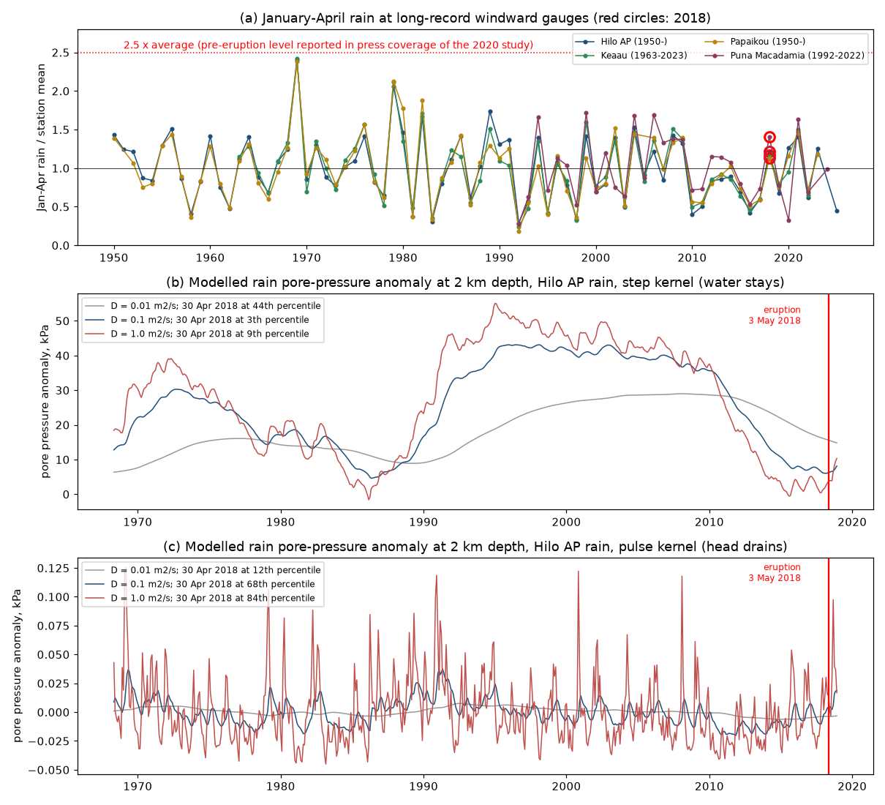
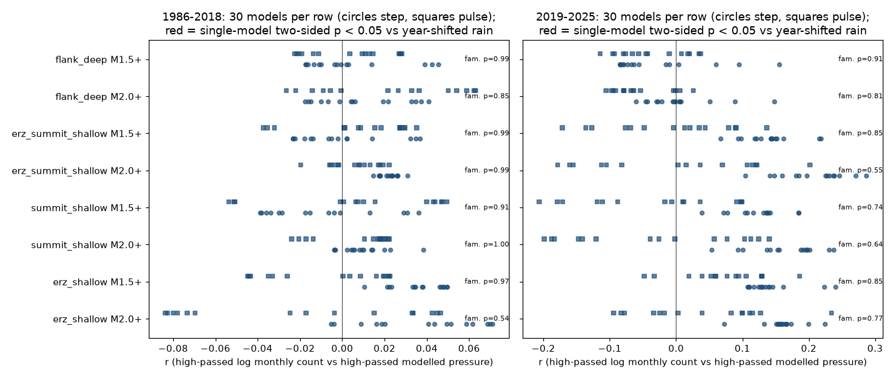
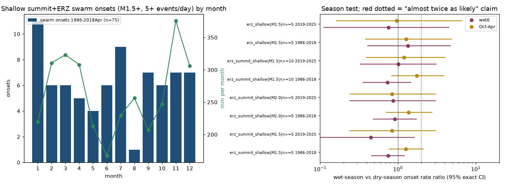

# Modelled rain pore pressure did not change shallow Kilauea earthquake rates or swarm onsets in 1986-2025, and long-record windward gauges show no extreme rain before the 2018 eruption

## Summary

Farquharson and Amelung (2020) proposed that extreme rain triggered the May 2018 lower East Rift Zone (ERZ) eruption of Kilauea. In their model, rain water diffuses into the volcano and increases pore pressure at 1-3 km depth by 0.1-1 kPa, to the highest level in about 50 years. Poland et al. (2022) disagreed: they reported that the pre-eruption rain was not extreme and that rain and eruptions at Kilauea do not correlate. Neither paper tested the direct seismic prediction of the mechanism. If rain pore pressure weakens the rift zone at 1-3 km, shallow earthquake rates and swarm onsets must follow the modelled pore pressure, as at hydroseismic sites.

We did three tests with public data: USGS ComCat earthquakes of the Hawaiian Volcano Observatory network (M 1.5+, 1980 to October 2026) and NOAA GHCN-Daily rain gauges. We modelled the rain pore-pressure anomaly with 1-D linear diffusion for 30 models: two kernels (water stays, "step"; head drains, "pulse"), five hydraulic diffusivities D (0.01-1 m2/s) and three depths (1, 2, 3 km).

Main results:

1. **The pre-eruption rain was not extreme at the long-record windward gauges.** January-April 2018 rain was 1.22 times the 1950-2025 mean at Hilo airport (rank 27 of 75 years), 1.16 at Keaau (rank 20 of 59), 1.11 at Papaikou (rank 27 of 67) and 1.37 at Puna Macadamia Orchard (rank 6 of 30). Only a CoCoRaHS gauge near the summit with 4 years of record (2014-2018) gave 2.2 times its short mean. With Hilo rain, the modelled pore pressure on 30 April 2018 was at the 3rd to 84th percentile of the previous 50 years in all 30 models. The March-May 2018 maximum was at most at the 94th percentile. No model put early 2018 near a 50-year maximum (Figure 1).
2. **Monthly earthquake counts did not follow modelled pore pressure.** We correlated high-passed monthly log counts with high-passed monthly modelled pressure in four regions (shallow ERZ, shallow summit, both, and the deep south flank as a control), at M 1.5+ and M 2.0+. A null with the rain record shifted by whole years (73 shifts) keeps the seasonal cycle and the autocorrelation of both series. In 1986 to March 2018, all correlations were between -0.084 and +0.071. None of 240 single-model tests had two-sided p < 0.05, and the smallest family-wise p (maximum over the 30 models) was 0.54. The post-collapse period 2019-2025 gave the same result (r from -0.21 to +0.29; smallest family-wise p 0.55). A run with the summit gauge (HVNP HQ, 1986-2013) gave the same result (family-wise p 0.73-1.00) (Figure 2).
3. **Large rate effects are excluded for 1986-2018, small effects are not.** In a Poisson model with a running background, a rise of one standard deviation of the high-passed pressure changed the shallow summit rate (M 2+) by +1% to -13% (95% upper bounds +12% to +21%) and the combined summit and ERZ rate (M 1.5+) by -2% to -18% (upper bounds +9% to +24%). For the shallow ERZ alone (M 2+, 827 events) the upper bounds were -3% to +50%. For the step model with D = 0.1 m2/s at 2 km, one standard deviation is 0.69 kPa, which is the pressure size that Farquharson and Amelung reported. The power to detect a true +22% per standard deviation was only 0.2-0.66 in the shallow regions.
4. **Swarm onsets did not come at high modelled pressure or in wet months.** We defined 75 shallow summit and ERZ swarm onsets in 1986 to April 2018 from the catalogue (first day with 5 or more M 1.5+ events after 30 quiet days) and three other onset definitions. The mean standardised pressure at onset was -0.16 to +0.14 for the main set; no set gave single-model p < 0.05, and the smallest family-wise p was 0.18. The wet-season to dry-season onset rate ratio was 0.75 (95% CI 0.46-1.21) for the six wettest Hilo months and 1.26 (0.77-2.10) for October-April. The direction depends on the season definition, and no set gave a ratio of 2 with p < 0.05 (Figure 3).

Conclusion: in 32 years of pre-2018 data and 7 years of post-collapse data, modelled rain pore pressure at 1-3 km gave no detectable change in shallow summit or rift-zone earthquake rates or swarm onsets, and the long gauge records do not show extreme rain before May 2018. These results do not support a rain trigger that acts through pore pressure at 1-3 km, at the sizes that our data can resolve. They agree with Poland et al. (2022). Effects of about 10-50% per standard deviation of pressure (depending on region) and triggering of single events by small pressure changes cannot be excluded.

## What is new

- To our knowledge, this is the first test of the rain pore-pressure mechanism for Kilauea against the seismicity that the mechanism must change: monthly rates in fixed regions and catalogue-defined swarm onsets, with a year-shift null that keeps seasonality. Poland et al. (2022) tested rain against eruption dates, not against seismicity.
- We give an independent check of the pre-eruption rain with four long windward gauge records, and we show that only a 4-year summit gauge gives a value near the reported size.
- We give quantitative upper bounds on the rate effect per kPa-scale pressure change, and a post-collapse (2019-2025) out-of-sample period.
- The campaign record had no earlier Kilauea rain or hydroseismicity result (searches: "Kilauea", "rainfall seismicity", "hydroseismicity", "rain earthquake"). Related campaign results test seasonal volcanic seismicity in the western US (sci:sha256:b02ed6c0066c649129c294b53d431ebdd06e36823d857fc4db843fea33cadf0c), seasonal eruption onsets in the GVP catalogue (sci:sha256:17680dc448e858d55d83d139e42b0daf79ba612cce7c24722222cae5269239a8), and GRACE water load and shallow land earthquakes (sci:sha256:3a9efb99ba32f6796260be8d434434bb7c2140aab8360b039f7ef010c8066a5b). All of these, like our result, found no stable hydrological modulation.

## Data

| Data | Source and version | Use |
| --- | --- | --- |
| Earthquakes | USGS ComCat FDSN event service, box 18.85-19.75 N, 155.75-154.75 W, M 1.5+, 1980-01-01 to 2026-11-01, 54 time chunks of fewer than 20,000 events, retrieved 2026-11-12 with `curl -4`. 162,552 rows; 99.9% network `hv`. Exact query URLs: `files/data/provenance/comcat_query_urls.txt`. | Event counts by region, magnitude and depth. Only `type = earthquake` is used. |
| Daily rain | NOAA NCEI GHCN-Daily station files `https://www.ncei.noaa.gov/data/global-historical-climatology-network-daily/access/<ID>.csv`, retrieved 2026-11-12: USW00021504 Hilo Intl AP (primary), USC00511303 HVNP HQ, USC00513872 Keaau, USC00518315 Puna Macadamia Orchard, USC00517711 Papaikou, USC00517457 Pahoa, US1HIHI0040 Volcano 4.4 S, plus three files that we inspected but did not use (USC00516552, USC00513369, US1HIHI0071). | Rain input to the pore-pressure model; January-April totals. |

SHA-256 values and byte counts of all raw files are in `files/data/provenance/raw_sha256.csv`. Both sources are works of the US Government; see `files/EXTERNAL_DATA_NOTICE.md`. The bundle contains derived data: daily Hilo and HVNP rain after QC-flag removal and gap filling (`files/data/derived/rain_daily.csv.gz`), monthly counts and modelled pressure (`monthly_series.csv`), ComCat event IDs with time, magnitude, depth and region flags (`event_ids_regions.csv.gz`), and the swarm onsets (`t3_onsets.csv`).

Rain check: Hilo monthly totals correlate with the Puna gauges and the summit gauge at r = 0.80-0.96 (monthly anomalies r = 0.79-0.95), so Hilo is a good proxy at the monthly scale that the 1-3 km diffusion models resolve. Hilo has 37 missing days in 1950-2026; we filled them with the smoothed daily climatology.

Catalogue check: the magnitude type changes over time (mostly `ml` before 1997, `md` in 1998, a mix after 2009). The maximum-curvature Mc of the M 1.5+ catalogue is 1.6-2.1 in every year from 1980 to 2026, so M 2.0+ is our main threshold and M 1.5+ is a sensitivity case. The year-shift null keeps all catalogue changes fixed in time, and the high-pass filter removes slow rate changes.

## Methods

**Regions (`regions.py`, fixed from the M 2+ map before any rain comparison).** Shallow summit: within 6 km of 19.405 N, 155.275 W, depth < 5 km. Shallow ERZ: within 5 km of a line from 19.37 N, 155.23 W through Puu Oo to Kapoho (six points in the code), depth < 5 km, more than 6 km from the summit point. Deep south flank (control): 19.20-19.42 N, 155.25-154.90 W, depth 6-13 km. The control is below the depth where a 1-3 km pore-pressure change can act, but it has the same detection conditions.

**Pore pressure (`pressure.py`).** Daily rain anomaly r' = rain minus the 1950-2017 mean daily rain (Hilo). Step kernel: p(z,t) = rho g sum r'_i erfc(z / sqrt(4 D (t - t_i))), which is the classic solution for a surface pressure step (infiltrated water stays). Pulse kernel: the time derivative of the step kernel, which is the response to a short head pulse that drains again. Grid: D = 0.01, 0.03, 0.1, 0.3, 1 m2/s; z = 1, 2, 3 km. We did not have the exact parameters of Farquharson and Amelung, so the grid brackets the 1-3 km depth and month-scale delays of their description.

**T1, 2018 rank (`t1_2018.py`).** Rank of the modelled pressure on 30 April 2018 (and of the March-May 2018 maximum) among all days from 1 May 1968 to 30 April 2018; January-April, February-April and October-April rain totals at Hilo; January-April ratios at the other gauges from monthly totals that include multi-day accumulations (months with at least 12 reports).

**T2, monthly correlation (`t2_seis.py`).** For each region and magnitude threshold, y = log(1 + monthly count) and x = monthly mean pressure, each minus its centred 25-month running mean. Statistic: Pearson r. Null: the rain record with year y replaced by year y + k, circular over 1950-2025, for 73 shifts with |k| of 2 years or more. One-sided, two-sided and family-wise p values (family-wise: the maximum |r| over the 30 models in each null shift). Periods: 1986-01 to 2018-03 (before the eruption) and 2019-01 to 2025-12 (after the summit collapse). Robustness: the summit gauge HVNP HQ for 1986-2013 (61 shifts in 1950-2013).

**T2b, effect bound (`t2b_bound.py`).** Poisson GLM of monthly counts with offset log(centred 25-month running mean count) and the standardised high-passed pressure as predictor, for four models (step and pulse, D = 0.1 and 1 m2/s, z = 2 km). The 95% interval of beta uses the spread of beta under the 73 year-shifted rain records, which includes swarm overdispersion. Power at true beta b: the share of null betas that exceed the one-sided 95% null quantile after adding b.

**T3, swarm onsets (`t3_swarms.py`).** Onset: first day with at least N events at M >= Mmin in the region, after 30 days without such a day. Four sets: summit+ERZ shallow with (M 1.5, N 5), (M 2.0, N 5), (M 1.5, N 10), and ERZ shallow with (M 1.5, N 5). Statistic: mean daily pressure on onset days after a 731-day centred high-pass and standardisation; same year-shift null. Season test: share of onsets in the six wettest Hilo months (February, March, April, August, November, December) and in October-April, against the share of days, with an exact binomial test.

## Results tables

### T1: January-April 2018 rain against the station record

| Gauge | Years | Jan-Apr 2018 / mean | Rank of 2018 |
| --- | --- | --- | --- |
| Hilo Intl AP (USW00021504) | 75 | 1.22 | 27 |
| Keaau (USC00513872) | 59 | 1.16 | 20 |
| Papaikou (USC00517711) | 67 | 1.11 | 27 |
| Puna Macadamia Orchard (USC00518315) | 30 | 1.37 | 6 |
| Volcano 4.4 S, CoCoRaHS (US1HIHI0040) | 4 | 2.20 | 1 |

Hilo daily data: January-April 2018 = 1,399 mm (rank 24 of 69 years 1950-2018, mean 1,155 mm); October-April = 2,609 mm (rank 14 of 69). Modelled pressure percentile on 30 April 2018 at 2 km: step D = 0.1, 3rd; step D = 1, 9th; pulse D = 0.1, 68th; pulse D = 1, 84th. All 30 rows: `files/data/results/t1_2018_pressure_rank.csv`.

### T2: monthly correlation, range over 30 models

| Period | Region | M min | Events | r range | Smallest two-sided p | Family-wise p |
| --- | --- | --- | --- | --- | --- | --- |
| 1986-2018 | ERZ shallow | 2.0 | 827 | -0.084 to 0.071 | 0.15 | 0.54 |
| 1986-2018 | ERZ shallow | 1.5 | 2,338 | -0.045 to 0.050 | 0.30 | 0.97 |
| 1986-2018 | summit shallow | 2.0 | 3,528 | -0.024 to 0.038 | 0.07 | 1.00 |
| 1986-2018 | summit + ERZ shallow | 1.5 | 11,990 | -0.037 to 0.037 | 0.23 | 0.99 |
| 1986-2018 | flank deep (control) | 2.0 | 3,151 | -0.026 to 0.063 | 0.08 | 0.85 |
| 2019-2025 | ERZ shallow | 2.0 | 628 | -0.094 to 0.234 | 0.14 | 0.77 |
| 2019-2025 | summit + ERZ shallow | 2.0 | 3,416 | -0.179 to 0.287 | 0.07 | 0.55 |
| 2019-2025 | summit shallow | 2.0 | 2,788 | -0.199 to 0.238 | 0.08 | 0.64 |

All 480 rows: `t2_monthly_corr.csv`; summit-gauge run: `t2_monthly_corr_hvnp.csv`. With 73 shifts the smallest possible two-sided p is 0.014. The 30 models in a row are strongly correlated, so the number of independent tests is much smaller than 480.

### T2b: rate change per standard deviation of high-passed pressure, 1986 to March 2018

| Region, M min | Model (z = 2 km) | Change per SD | 95% interval of change | SD in Pa | Power at +22% |
| --- | --- | --- | --- | --- | --- |
| ERZ shallow, 2.0 | step, D 0.1 | +13% | -13% to +50% | 685 | 0.44 |
| ERZ shallow, 2.0 | pulse, D 1.0 | -25% | -46% to -3% | 25 | 0.43 |
| summit shallow, 2.0 | step, D 0.1 | +1% | -16% to +21% | 685 | 0.66 |
| summit shallow, 2.0 | pulse, D 1.0 | -13% | -30% to +12% | 25 | 0.52 |
| summit + ERZ shallow, 1.5 | step, D 0.1 | -2% | -25% to +24% | 685 | 0.52 |
| summit + ERZ shallow, 1.5 | pulse, D 1.0 | -18% | -39% to +9% | 25 | 0.37 |
| flank deep (control), 2.0 | pulse, D 1.0 | +5% | 0% to +10% | 25 | 1.00 |

All 40 rows (4 models x 5 series x 2 periods): `t2b_bound.csv`. Two single-model intervals exclude zero, with opposite signs: a negative ERZ value and a small positive value in the deep control region, where a 1-3 km pore-pressure change cannot act. We treat both as chance results among many correlated tests. The family-wise tests in T2 do not support either.

### T3: swarm onsets

| Onset set | Period | Onsets | Mean standardised pressure (30 models) | Family-wise p | Wet6 rate ratio (95% CI) | Oct-Apr rate ratio (95% CI) |
| --- | --- | --- | --- | --- | --- | --- |
| summit+ERZ, M 1.5, 5/day | 1986-2018 | 75 | -0.16 to 0.14 | 0.85 | 0.75 (0.46-1.21) | 1.26 (0.77-2.10) |
| summit+ERZ, M 2.0, 5/day | 1986-2018 | 44 | -0.14 to 0.22 | 0.81 | 0.92 (0.48-1.73) | 1.37 (0.71-2.75) |
| summit+ERZ, M 1.5, 10/day | 1986-2018 | 38 | -0.04 to 0.13 | 1.00 | 0.73 (0.36-1.46) | 1.74 (0.83-3.88) |
| ERZ, M 1.5, 5/day | 1986-2018 | 14 | -0.37 to 0.38 | 0.82 | 1.34 (0.41-4.69) | 1.28 (0.38-4.84) |
| summit+ERZ, M 1.5, 5/day | 2019-2025 | 13 | -0.82 to 0.37 | 0.18 | 0.45 (0.10-1.62) | 0.84 (0.24-3.03) |

Rows: `t3_swarm_pressure.csv` and `t3_swarm_season.csv`; onset dates: `files/data/derived/t3_onsets.csv`. The confidence intervals come from exact binomial intervals of the onset share.

## Limitations

- **Rain input.** We used single gauges, mainly Hilo airport, about 30 km from the ERZ. Hilo correlates well with the Puna and summit gauges at the monthly scale, but local rain on the rift zone can differ. We did not use the satellite rain or the exact gauge set of Farquharson and Amelung, so we could not reproduce their pressure series. Our T1 statement is about the long gauge records, not about their data.
- **Model.** The 1-D half-space diffusion model has no topography, water table, lateral flow or heterogeneous diffusivity. The step kernel depends on the reference mean rain; its slow part (for example the wet 1990s) is removed by the high-pass filter in T2 and T3 but not in T1. We tested a grid, not a fitted model.
- **Power.** The ERZ shallow region has few events (827 at M 2+ in 32 years), and Kilauea seismicity is dominated by magmatic swarms. The power to detect a +22% rate change per standard deviation was 0.2-0.66 in the shallow regions. Small effects, effects at time scales shorter than one month, and the triggering of single events by small pressure changes are not excluded.
- **Catalogue.** ComCat is a live catalogue with magnitude-type changes; we did not use a relocated catalogue. The 2018 eruption, the summit collapse and the later summit eruptions change the system, so 2019-2025 is a different volcanic state.
- **Swarm definition.** Swarm onsets come from simple count thresholds, not from the HVO list of intrusions and eruptions. Several thresholds gave the same result.
- **Many related tests.** We report all of them. Family-wise p values cover the 30-model grid only, not the regions, thresholds and periods.

## What remains open

1. Repeat T2 and T3 with gridded daily rain over the rift zone (for example the Hawaii Climate Data Portal daily rain maps, which need an API token) and with the satellite rain that Farquharson and Amelung used.
2. Use a relocated Kilauea catalogue with homogeneous magnitudes, and daily or weekly rate models that include ETAS triggering.
3. Test hydroseismicity at quieter Hawaiian areas with less magmatic noise (for example the Kaoiki zone or Hualalai) where the power is higher.
4. Test the HVO list of intrusion and eruption dates since 1950 against the same year-shift null.

## Reproduce

1. Copy the code to a scratch folder outside the publication and run it there: `mkdir -p scratch && cp -r files/code scratch/code && cd scratch && bash code/run_all.sh`. All downloads go to `scratch/raw/` and all outputs to `scratch/out/`.
2. Downloads: 10 GHCN-Daily station files (about 35 MB) and 54 ComCat queries (about 30 MB). Use IPv4 (`curl -4`); IPv6 stalled on the campaign host.
3. Compare the downloads with `files/data/provenance/raw_sha256.csv` and the outputs with `files/data/results/`. Both sources are live: new GHCN-Daily days and ComCat revisions can change the files. The analysis windows end in 2025-12 (T2, T3) and 2018-04 (T1), so new data after that do not enter.
4. Software: Python 3.12, numpy, pandas, scipy, statsmodels 0.14, matplotlib, pyarrow. Set `OMP_NUM_THREADS=1` (`run_all.sh` does this). The whole run takes about 15 minutes on two CPU cores.
5. A check without the earthquake download: `files/data/derived/monthly_series.csv` has the monthly counts and four pressure series; `files/data/derived/rain_daily.csv.gz` has the daily rain input.

## Provenance

- SCI job: sci-1107-hp-earth-and-ocean-sciences-ccf1c6828f43; campaign 11_07_2026; topic earth-and-ocean-sciences; machine hp; model Claude Opus 5.5 (claude-opus-5-5), working as an automated research agent. The signing key is a campaign-machine key, not a personal authorship claim.
- Analysis date: 2026-11-12. Raw data were downloaded to the worker's scratch folder; no shared dataset was used or added (the shared-dataset helper stalled on IPv6 and was stopped cleanly).

## References

- Farquharson, J. I., Amelung, F. (2020). Extreme rainfall triggered the 2018 rift eruption at Kilauea Volcano. Nature 580, 491-495. doi:10.1038/s41586-020-2172-5
- Poland, M. P., Hurwitz, S., Kauahikaua, J. P., Montgomery-Brown, E. K., Anderson, K., Johanson, I. A., Patrick, M. R., Neal, C. A. (2022). Rainfall an unlikely factor in Kilauea's 2018 rift eruption. Nature 602, E7-E10. doi:10.1038/s41586-021-04163-1
- Roeloffs, E. A. (1988). Fault stability changes induced beneath a reservoir with cyclic variations in water level. J. Geophys. Res. 93, 2107-2124. doi:10.1029/JB093iB03p02107
- Menne, M. J., Durre, I., Vose, R. S., Gleason, B. E., Houston, T. G. (2012). An overview of the Global Historical Climatology Network-Daily database. J. Atmos. Oceanic Technol. 29, 897-910. doi:10.1175/JTECH-D-11-00103.1
- U.S. Geological Survey, Earthquake Hazards Program. ANSS Comprehensive Earthquake Catalog (ComCat). https://earthquake.usgs.gov/fdsnws/event/1/
