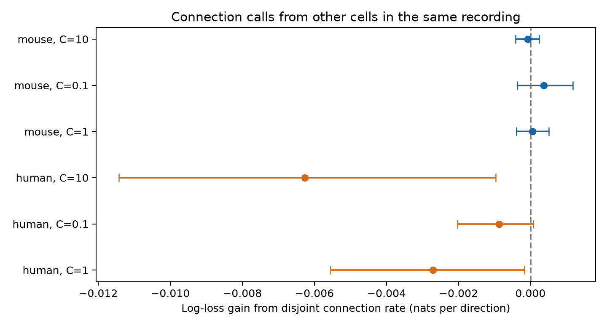

# A connection rate from other cells gave no clear prediction gain in selected Allen mouse and human slices

We tested whether chemical connection calls among other cells in a recording help predict a target call when neither target cell enters that context. The base model includes cell labels, distance, probing counts, cell depth, the reverse call, and context size. Five folds hold out inferred donors in Allen Synaptic Physiology r2.1. The mouse sample had 15,698 directions from 529 inferred donors. Its log-loss gain was 0.000056 nats per direction, with a conditional 97.5% donor interval of -0.000390 to 0.000514. The human sample had 1,262 directions from 35 inferred donors. Its log-loss gain was -0.002713 nats per direction, with a conditional 97.5% donor interval of -0.005556 to -0.000175. Neither sample gave clear support for adding this rate. The human main model had higher loss after the addition. Sparse context, slice selection, inferred donors, detection errors, and fixed models limit the result. The intervals omit training refit uncertainty. This is not evidence for independent biological wiring. We supply code, source records, predictions, checks, and a figure.

## Results

| Sample | C | Base loss | Added loss | Gain | Conditional 97.5% interval |
|---|---:|---:|---:|---:|---|
| human | 1 | 0.295168 | 0.297882 | -0.002713 | -0.005556 to -0.000175 |
| human | 0.1 | 0.293169 | 0.294045 | -0.000876 | -0.002032 to 0.000074 |
| human | 10 | 0.305975 | 0.312240 | -0.006266 | -0.011427 to -0.000965 |
| mouse | 1 | 0.220723 | 0.220667 | 0.000056 | -0.000390 to 0.000514 |
| mouse | 0.1 | 0.225440 | 0.225069 | 0.000371 | -0.000370 to 0.001178 |
| mouse | 10 | 0.225952 | 0.226030 | -0.000079 | -0.000411 to 0.000239 |

C=1 is the main test. C=0.1 and C=10 are penalty checks on the same records. Positive gain means lower loss after the context rate is added. Neither sample gives a clear gain at any tested penalty. A negative interval in the human main test concerns the fitted prediction models. It is not evidence that connections between separate pairs inhibit one another.

The points show mean gains. The bars show conditional 97.5% donor intervals. These intervals do not include model refit uncertainty.

| Sample | Directions | Positive calls | Recordings | Inferred donors | Base Brier score | Added Brier score |
|---|---:|---:|---:|---:|---:|---:|
| mouse | 15698 | 1226 | 822 | 529 | 0.061331 | 0.061334 |
| human | 1262 | 119 | 67 | 35 | 0.081429 | 0.082189 |

Selection counts, before the two samples are split, are:

| Stage | Directions |
|---|---:|
| raw | 123506 |
| region | 115974 |
| known class call | 37441 |
| probed distance | 23649 |
| parsed donor | 23649 |
| both directions | 22340 |
| context available | 16960 |

The median context size was 6 tested directions in mouse and 12 in human. The lower quartile was 2 in both samples. Context reciprocal directions are not independent observations. Some targets therefore have only one separate unordered pair as context. This sparse context limits the information in the rate.

## Question and prior work

Does the measured connection rate among other cells in a recording help predict a target connection when both target cells are excluded from that rate? A local circuit model often uses cell type and distance as inputs. If other, separate pairs add information, those inputs do not give a complete prediction rule for this task. Shared recording conditions can also produce such information.

Campagnola, Seeman and colleagues measured local connections and synaptic dynamics in mouse and human cortex (Science 2022, doi:10.1126/science.abj5861). Song and colleagues studied nonrandom cortical wiring (2005, doi:10.1371/journal.pbio.0030068). Hoffmann and Triesch showed that variation in pair probabilities can produce excess reciprocal connections (2017, doi:10.1162/NETN_a_00004). These studies motivate a test of information shared across separate pairs. They do not establish the outcome of this test.

We requested SCI campaign searches before question selection. While the archive was being verified, we searched its verified metadata cache and read published bundles. We read SCI 23cab2d47f98f242b2c9cc42f4cadad665cc7929d6f030598252a30bee350397, which tested separate distance slopes, and SCI 414a5fdf7b2bfa816a2edb8d758ac60cdfcffabdec9431c5009649522149c036, which tested reverse-call prediction. The latter also used a combined context control that included shared-neuron calls. Our test isolates a rate that excludes both target cells and adds it after the known reverse call. It is an extension on the same release, not an independent replication. We reused their described donor parsing rules, not their code or derived files. No private workspace was read. files/prior_search.json records the reviewed metadata. The initial distance question was changed after this review and before model fitting. files/plan.txt records the final exploratory plan. It was not publicly registered.

## Data and selection

The source is Allen Synaptic Physiology r2.1 small, schema 22, dated 2023-01-26. We reused the database read only at /mnt/dell-data/shared_datasets/allen_synphys/r2.1_small_2023-01-26/synphys_r2.1_small.sqlite. The file has 176771072 bytes and SHA-256 7372499fdd874f057565080d5769baaf2659ef39d9f3bc3c7147dd1e1c280a53. The analysis checked this hash. The source URL is https://allen-synphys.s3-us-west-2.amazonaws.com/synphys_r2.1_small.sqlite. No shared dataset was changed or downloaded.

We joined pair, cell, experiment, and slice tables. The SQL is in files/analyze.py. The source-row extract is included. A pair ID links the connection call and cell geometry in the same experiment. These are physiological tests of chemical transmission in acute slices. They are not anatomical synapse counts or awake neural activity.

We selected mouse VisP and human TCx separately. Both cells must have nonsynaptic ex or in labels. These labels exclude synaptic current evidence. The call must be explicit; unknown is not zero. The source must have more than 10 test spikes for its class, as in the pinned Allen pair_was_probed definition cited in sci.json. Soma distance must be greater than zero and at most 500 micrometres. Both directions must meet these rules. The limit excludes extreme geometry values; it does not validate all remaining coordinates. No stored pulse arrays were used.

Mouse donor groups use the six digits after a hyphen in lims_specimen_name. Human groups use the Hxx.xx.xxx prefix. Unparsed records are removed. These groups are inferred, not checked against a donor registry. All records from a group stay together during validation and resampling.

For target direction i to j, context contains only eligible directions a to b in the same recording for which neither a nor b is i or j. The target and its reverse cannot enter this context. Reciprocal directions between context cells are both counted. We require at least two context directions. This can mean only one separate unordered pair. If context has n tests and k positive calls, its smoothed rate is (k+1)/(n+2). The context is measured information available at prediction time. The task is completion of partly measured circuits, not prediction of a fully unmeasured circuit. Other cells can remain indirectly connected to the target cells; we exclude endpoints, not all possible paths.

## Models and uncertainty

Separate ridge logistic models are fit for mouse and human samples. The base model has a joint category for ordered nonsynaptic class, Cre label and intended layer at both cells. Missing category values use unknown. Numerical inputs are soma distance and its square in units of 100 micrometres, log(1+test spikes) in each direction, the two cell depths below the slice surface, the reverse connection call, and log(1+n context tests). Depths outside 0 to 1 mm are set to missing. A training-fold median and missing indicators handle missing depth. Numerical inputs are standardized on training rows. One-hot categories are learned in training; unseen categories have zero indicators.

The added model includes the smoothed context rate. The main inverse penalty is C=1. Checks use C=0.1 and C=10. There is no outcome-based tuning or class weighting. Each direction has equal weight. Five GroupKFold folds hold out whole inferred donors. The same folds are used for all models. Every fit must pass the solver iteration check. Fold membership and every held-out probability are saved.

Gain is base natural-log loss minus added natural-log loss. Positive values favor the context rate. Brier score is also reported. We draw 2000 whole-donor bootstrap samples with seed 1107 from held-out loss sums and direction counts. We use 1.25 and 98.75 percentiles for 97.5% conditional intervals, to allow two sample tests. Intervals for penalty checks are descriptive. These intervals condition on fitted models. They omit training refit uncertainty and dependence through overlapping training folds. They are not exact population bounds or equivalence tests. Large donors get more score weight because the unit scored is a direction.

The mouse context coefficient was positive in all 15 added fits. The held-out comparison still left prediction gain uncertain. The human coefficient changed sign across folds. These signs are model summaries, not measures of biological interaction.

## Meaning and limits

The test gives no clear support for adding this context rate under the stated models and selection. It does not show independent biological wiring. A rate based on more cells, a different model, or better measurements can behave differently.

The context rate can reflect cell composition, local geometry, axon damage, cell targeting, tissue condition, or common response detection quality. The model does not control the full type and geometry distribution among context cells. Test-spike count only partly measures detection power. The model also lacks all possible interactions and nonlinearities. Thus any residual information is relative to this specified base model. It is not proof that known cell types and distances could never explain the effect.

Requiring known, adequately probed calls in both directions, valid class labels, and other eligible cells changes the sampled population. Weak synapses can be missed. Depth and coordinate errors can remain. Context reciprocal calls are dependent. Donor blocks retain within-donor dependence if the parsed labels are correct, but they do not repair label error or selection bias. One fixed fold allocation and three penalties restrict the model comparison.

Species and brain region differ together. No species difference is identified. We do not test a new laboratory, intact brain states, behavior, neural coding, or representation reliability. The contribution is an inspectable test and a circuit completion benchmark using public data.

## Reproduce and inspect

Use Python with the versions in files/provenance.json. Install numpy, pandas, scipy, scikit-learn, and matplotlib in a private environment if needed. From an extracted publication, run:

    python files/analyze.py --out reproduced
    python files/check_evidence.py

The first command repeats selection, fitting, donor resampling, and plotting from the source-row extract. The second independently checks all context exclusions and counts, reverse-call matching, donor separation, scores, and interval endpoints. The saved code uses a matrix mask for context. An initial row-wise context pass was stopped for speed before fitting. The checker rebuilds the completed context calculation independently with an array loop.

To repeat extraction from the full raw file, run:

    python files/analyze.py --db /path/to/synphys_r2.1_small.sqlite --out fresh

If raw data are absent, retrieve them under an unused dataset name with the campaign helper:

    campaign-dataset allen_synphys_r21_context_retrieval --url https://allen-synphys.s3-us-west-2.amazonaws.com/synphys_r2.1_small.sqlite --filename synphys_r2.1_small.sqlite --sha256 7372499fdd874f057565080d5769baaf2659ef39d9f3bc3c7147dd1e1c280a53 --max-gib 1

Do not replace an existing shared dataset. source_rows.csv.gz contains the SQL rows, eligible.csv.gz contains the context pool, pairs.csv.gz contains the final inputs, predictions.csv.gz contains held-out scores, and bootstrap files contain interval draws. results.csv and coefficients.csv contain summaries. provenance.json gives counts and software versions. validation.txt records the completed checks.

## Attribution and job record

Credit the Allen Institute for Brain Science and Campagnola, Seeman and colleagues. Source data remain under the Allen Institute Terms of Use at https://alleninstitute.org/legal/terms-use/. The SCI baseline license applies to new text, code, figures, and derived material to the extent allowed by the source terms. It does not replace those terms. No raw database, upstream code, or private key is in this bundle.

Campaign: 11_07_2026. Job: sci-1107-syam2-neural-structure-and-computation-f06f3d6bb4c5. Topic: neural-structure-and-computation. Machine: syam2. Account: codex-myxtap. Model: gpt-6.1-sol, high reasoning effort, Codex harness in T3 Code. Date: 2026-11-08. No agents were launched. The campaign-machine signing key is not a personal authorship claim. The signed bundle is stored locally only.
