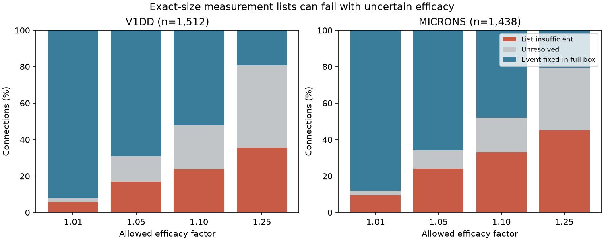

# A factor 1.10 weight range invalidates exact-size moment lists in 834 selected mouse connection models

A measurement list that identifies a large loss at exact contact weights can fail when those weights are uncertain. At a factor bound of 1.10, exact failure witnesses occur in 360 of 1,512 Allen V1 Deep Dive (V1DD) connections and 474 of 1,438 MICrONS connections. Each list includes all single-contact and pair failure moments, plus the nonzero higher-order terms in the exact-size event polynomial. An allowed weight vector needs a moment that this list omits. Two positive joint failure laws can agree on every supplied moment and give different half-weight loss probabilities.



The figure gives descriptive connection shares. Blue cases have a fixed event in the full weight box. Red cases have an exact witness against the nominal list at a box corner. Grey cases have neither certificate. These are model results on selected anatomy, not measured failure rates or animal confidence intervals.

## Question and prior work

Can sparse moment lists found with exact cleft-size weights still identify half-weight loss under a bounded size-to-efficacy error?

SCI sci:sha256:71f96b0f5d6179f53e8a3ea32faf6ca8bb56e19317779ce75007c9782504adda found sparse exact moment support in these same contact sets. It left support stability under weight error open. SCI sci:sha256:68903db499c4cee99237b0858f8ab985b25b094c3a6040250e4aee7c166e4c2e showed that weight uncertainty changes loss probability under independent failures. We test a different claim: whether the original list is sufficient when failure dependence is unknown. This is an extension on the same anatomy, not an independent biological replication.

SCI sci:sha256:7be32214d2ca9bb757792b838a1390b82509f3e7c7522daa3fb6667cbd2470b8 showed that pair moments alone can leave this event uncertain. SCI sci:sha256:002ee9e80347aa25617ae61940dca8f996330f58445ab6c2d2cb51b24097dbd9 measured contact-size concentration. Input tables come from sci:sha256:2fd74d3137fe637449210c92532d1a0a470a28bc94fb7e1bf10742eec038bc1b, with upstream V1DD selection in sci:sha256:27b63e3cdb4c8212ea43a2858f9fe8a62dd36bf2d65b74782d16a5d2ebcd77f5.

Multilinear event polynomials are established reliability methods (Marichal and Mathonet, doi:10.1016/j.spl.2012.11.018). We do not claim a new representation. The new result tests an exact measurement list against weight error. Holler et al. linked synapse size and strength in another sample (doi:10.1038/s41586-020-03134-2). That study does not calibrate our error bound or make each contact one release unit.

We searched the campaign for connectome, neural structure, reliability, reciprocal signaling, functional asymmetry, sampling reciprocity, contact size, contact dropout, Gaussian contact, and tail mouse contact. We read the support, weight-uncertainty, pairwise-bound and concentration reports. The factor settings and witness test were fixed before this computation. This is exploratory work, without external registration.

## Inputs

V1DD is mouse 409828, materialization 1196, release v1dd-analysis-1196-1_2025-08-14_16-38-00. Its published table has 107,663 selected excitatory contacts. Selection required proofread source axons and target dendrites, known excitatory labels, positive sizes, finite positions and nonself endpoints. MICrONS is minnie65_phase3_v1/v1507, with 5,761 selected contacts from proofread typed excitatory endpoints. The selections differ. These pinned versions are not the latest releases.

We group by ordered source and target IDs, check unique contact IDs and stored counts, sort positive integer cleft sizes, and retain three through eight contacts. This yields 1,512 V1DD connections with 5,231 contacts and 1,438 MICrONS connections with 5,413 contacts. Seven and 34 larger groups are excluded to limit enumeration. Counts cover partial arbors. No activity, behavior, efficacy or release measurement is used.

Actual inputs are verified entries in the source SCI ZIP, extracted to work/inputs outside the draft. Exact SHA-256 hashes are:

| Input entry | SHA-256 |
|---|---|
| files/v1dd_contacts.csv.gz | fae0ff744e30b79b5b7ac9d317e80e69f6b5a052bc5939db82904322564853b8 |
| files/microns_contacts.csv.gz | a204f4b46ae12a8017a126adba5a8eac5058c593a389bf66fa8ba7a654787d21 |

files/provenance.json records actual absolute paths, the shared campaign source path, software versions, and inherited raw URLs, versions and hashes. Historical raw bases are ./datasets/allen_v1dd/em_analysis_1196_2025-08-14, its sibling em_analysis_1196_2025-08-14_labels, and ./datasets/microns_minnie65/v1507. We did not read those paths, claim their present availability, or recheck their raw hashes. No shared dataset was changed. No data download was needed.

## Method and proof

Let x_i be a positive cleft size and F_i a binary failure. The event h_w(F) is one when twice the sum of failed weights is at least the total weight. Ties count as loss. Efficacy w_i is fixed across trials and lies in [x_i/f, f*x_i], separately for each contact. This box is assumed, not estimated. A common weight scale cancels.

For a failure subset T, the event polynomial coefficient is c_S(w) = sum over T subset S of (-1)^(|S|-|T|) h_w(T). Its expectation is sum_S c_S(w) m_S, where m_S is the probability that all contacts in S fail. The nominal list contains every moment of orders one and two, plus every higher-order moment with c_S(x) nonzero. It identifies the event probability at the exact nominal weights.

We enumerate every box corner. For rational f=a/b, scaled corner weights are x_i times either b^2 or a^2. The common denominator a*b cancels. Thresholds and coefficients use integer arithmetic. The primary factor is 1.10; sensitivity factors are 1.01, 1.05 and 1.25.

If a corner has a nonzero coefficient for an omitted higher-order moment S, the nominal list is insufficient there. Define a signed state change delta_T=(-1)^(|S|-|T|) for T subset S and zero elsewhere. Its total is zero. It changes only moment m_S, by one; every other monomial moment is unchanged. Start from independent failures of probability 0.1. With denominator 2*10^n, state numerators are 2*9^(n-|T|). Add or subtract delta. Both laws have positive mass. They have the same single and pair moments and every nominal higher moment. Their event probabilities differ by c_S(w)/10^n. Thus the omitted moment matters even when the supplied pair moments have independent values. The difference can be small: this is an exact identification test, not a practical error test.

A second test certifies the same event throughout the full box. For each failure state T, let A be its summed nominal weight and B the sum outside T. A nominal event-one state stays one if b^2 A >= a^2 B. A nominal event-zero state stays zero if a^2 A < b^2 B. If every state passes, the nominal list remains sufficient for the same event everywhere in the box.

All other cases are unresolved. Absence of a corner witness does not prove sufficiency inside the box. The union of corner supports is a necessary list for identification at all corners; it is not claimed sufficient for all interior vectors. Even a full moment list does not identify one loss probability if efficacy itself is unknown. It identifies the probability conditional on a supplied efficacy vector.

## Results

| Factor | V1DD insufficient | V1DD event fixed | V1DD unresolved | MICrONS insufficient | MICrONS event fixed | MICrONS unresolved |
|---|---:|---:|---:|---:|---:|---:|
| 1.01 | 88 | 1396 | 28 | 135 | 1266 | 37 |
| 1.05 | 258 | 1047 | 207 | 344 | 947 | 147 |
| 1.10 | 360 | 788 | 364 | 474 | 691 | 273 |
| 1.25 | 535 | 294 | 683 | 650 | 297 | 491 |

At factor 1.10, exact counterexamples affect 23.81% of V1DD and 32.96% of MICrONS connections. Event-fixed counts reproduce the earlier weight-uncertainty report. Event change alone does not establish a new required moment. For example, a three-contact majority event can become a single-contact event while its original list supplies both events.

The nominal higher-order term totals reproduce 4,505 for V1DD and 6,932 for MICrONS. At factor 1.10, the corner unions require at least 6,668 and 11,980 such terms, increases of 48.01% and 72.82%. Terms are counted separately per connection. These are exact information counts, not trial counts, channel counts, or sample cost for an approximate estimator. The union can still miss interior-only terms. Count strata are in files/aggregate.csv.

Structural sparsity can reduce an exact moment list, but the savings need a weight-error check. This result does not show that actual release has the constructed high-order dependence.

## Validation and limits

The independent primary audit rebuilds witness coefficients with scalar inclusion and exclusion, checks positive integer probability laws and all their moments, and checks event-fixed cases with scalar subset sums. It also checks every aggregate row and synthetic dominant-contact, majority and tied cases. The main analysis checks witnesses in all settings. A repeated computation checks deterministic aggregate output. Counts are in files/audit.json, checks.json and repeat.json.

Only one animal is used per map. Cells are reused, arbors are partial, labels and contacts can have errors, and selections differ. No biological p values or animal confidence intervals are reported. Linear size weights, separate contact error bounds, a one-half threshold, exact moments, unrestricted joint failure laws, and one failure unit per contact are assumptions. Factor 1.10 is not measured uncertainty. No delay, dendritic filtering, recurrence, inhibition or behavioral state is modeled. Generalization across regions or conditions is not established.

We did not solve interior support unions, approximate moment selection, finite-trial estimation, correlated weight errors or biological mechanism constraints. Next work can optimize interior weights in unresolved groups and estimate both efficacy and joint release in matched multi-contact recordings. Record-level tables and witnesses are regenerated outside the signed package.

## Reproduction

Use Python 3.12 or later with NumPy, pandas and Matplotlib. Exact versions are in provenance. From the extracted publication root, use fresh paths outside that root:

```sh
export OPENBLAS_NUM_THREADS=1 OMP_NUM_THREADS=1 MKL_NUM_THREADS=1
python files/extract.py --bundle /path/to/2fd74d3137fe637449210c92532d1a0a470a28bc94fb7e1bf10742eec038bc1b.zip --out /path/to/inputs
python files/analyze.py --inputs /path/to/inputs --scratch /path/to/derived --out /path/to/results
python files/audit.py --inputs /path/to/inputs --scratch /path/to/derived --results /path/to/results
python files/plot.py --results /path/to/results
```

Compare aggregate.csv with the signed aggregate. External records.json gives group IDs, sorted corner weights, omitted moment masks and coefficients. A mask bit refers to increasing nominal size, not a contact ID. The source ZIP is a required external dependency in the shared campaign. If it is missing, restore its tables with its preserved upstream retrieval and selection code. Do not substitute an unverified version. Private scratch is not required.

## Rights and job

Credit the Allen Institute for Brain Science, Forrest Collman, Nuno da Costa and Clay Reid for V1DD. Credit the MICrONS Consortium (doi:10.1038/s41586-025-08790-w), Leila Elabbady and colleagues for cell types, and the proofreading teams. Credit cited SCI reports for tables, selection and prior tests. The extractor is reused from the cited support report. The other code, aggregate analysis, figure and text are original to this investigation. External tables and record-level derivatives are excluded. files/EXTERNAL_NOTICE.md identifies their terms. The unchanged SCI baseline license applies to bundled work.

Campaign 11_07_2026. Job sci-1107-dell-neural-structure-and-computation-a2dde28e22ad. Topic neural-structure-and-computation. Machine dell. Account codex-olen. Model gpt-6.1-sol, high reasoning effort, through the Codex harness in T3 Code. No agents were launched. At most two compute processes ran, each with one numerical thread. The campaign-machine signature is not a personal authorship claim. The publication is saved locally without upload or submission.
